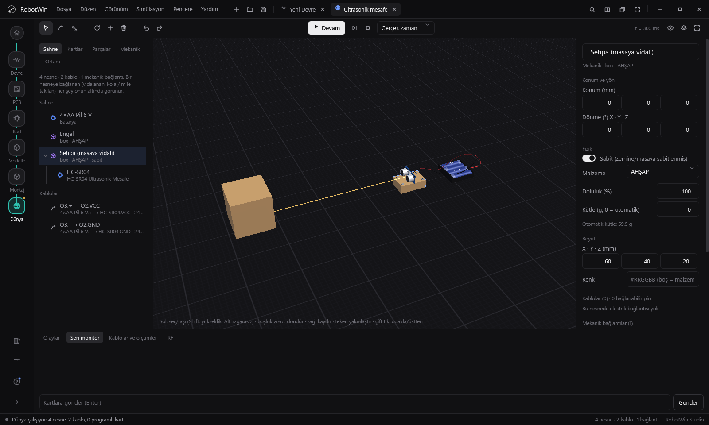

# RobotWin Studio

[](https://dotnet.microsoft.com/download/dotnet/9.0)
[](#indirme-ve-kurulum)
[](LICENSE)
[](https://github.com/Kinin-Code-Offical/robotwin-studio/releases/latest)

**Türkçe** · [English](#english) · **Belgeler / Docs: [kinin-code-offical.github.io/robotwin-studio](https://kinin-code-offical.github.io/robotwin-studio/)**


**RobotWin Studio**, robot ve elektronik projelerini baştan sona tek bir Windows uygulamasında yapmanızı sağlar: devreyi çizin, PCB'sini çıkarın, kodunu yazın, şasesini modelleyin, sonra her şeyi gerçek fizikli bir açık dünyaya koyup kablolayın ve birlikte çalıştırın. Arduino (ATmega328P) kodu gerçek derlenmiş HEX olarak emüle edilir, ESP32 kodu devreyle eş zamanlı (co-simulation) çalışır; motorlar, servolar, sensörler, kablolar ve parçalar birbirini gerçekten etkiler.

> **Belgeler:** Adım adım, ekran görüntülü kullanım kılavuzu ve geliştirici belgeleri **[belge sitesinde](https://kinin-code-offical.github.io/robotwin-studio/)** (kaynakları: [docs/kullanim](docs/kullanim/README.md)). Uygulama içinde: *Yardım → Çevrimiçi belgeler*.


## İçindekiler

- [Ne yapabilirsiniz?](#ne-yapabilirsiniz)
- [Ekran görüntüleri](#ekran-görüntüleri)
- [İndirme ve kurulum](#indirme-ve-kurulum)
- [Hızlı başlangıç: ilk dünyanız 5 adımda](#hızlı-başlangıç-ilk-dünyanız-5-adımda)
- [Aşama aşama özellikler](#aşama-aşama-özellikler)
- [Klavye kısayolları](#klavye-kısayolları)
- [Dosya türleri](#dosya-türleri)
- [Kaynaktan derleme](#kaynaktan-derleme)
- [Testler](#testler)
- [Komut satırı](#komut-satırı)
- [Proje yapısı](#proje-yapısı)
- [Yol haritası (geliştiriliyor)](#yol-haritası-geliştiriliyor)
- [Lisans](#lisans)
- [English](#english)

## Ne yapabilirsiniz?

Uygulamanın sol tarafındaki **"Tasarımdan gerçeğe hattı"** bir projenin aşamalarını sırayla gösterir:

| Aşama | Kısayol | Ne yapılır |
| --- | --- | --- |
| **Devre** | Ctrl+1 | Şema çizin, 256 gerçek parçadan seçin, analog çözücüyle canlı simüle edin; osiloskop, multimetre, Monte Carlo, arıza tespiti. |
| **PCB** | Ctrl+2 | 2/4/6 katmanlı kart, bakır alanlar, etkileşimli ve otomatik yol çizimi, DRC, Gerber/Excellon ve KiCad 8 dışa aktarımı. |
| **Kod** | Ctrl+3 | Arduino Uno/Nano (arduino-cli ile) ve ESP32 (MSVC ile) kodu yazın, derleyin, emüle karta yükleyip çalıştırın. |
| **Modelle** | Ctrl+4 | Blender benzeri 3D modelleyici: temel şekiller, düzenleme modu, CSG (birleşim/fark/kesişim), hazır robot parçaları, STL/OBJ/PLY. |
| **Montaj** | Ctrl+5 | Devreden otomatik 3D araç veya drone oluşturun, arenada sürün/uçurun, arıza deneyleri yapın. |
| **Dünya** | Ctrl+6 | Kartları, parçaları, gövdeleri ve modelleri gerçek fizikli bir dünyaya koyun; kablolayın, mekanik olarak bağlayın, çalıştırın. |

Ayrıca **Başlangıç** (Ctrl+0), **Kütüphane** (Ctrl+7) ve **Ayarlar** (Ctrl+,) sayfaları vardır. Arayüz Türkçedir.

## Ekran görüntüleri

| | |
| --- | --- |
|  |  |
| **Devre:** şema editörü ve canlı simülasyon | **PCB:** katmanlar, yollar, DRC |
|  |  |
| **Modelle:** Blender benzeri 3D modelleyici | **Dünya:** Arduino ile iki eksenli servo kol |
|  |  |
| **Dünya:** ESP32 + PS5 kumandalı araba | **Dünya:** ultrasonik sensör ışın izleme ile ölçer |

## İndirme ve kurulum

1. [Sürümler (Releases)](https://github.com/Kinin-Code-Offical/robotwin-studio/releases/latest) sayfasından `RobotWinStudio-Setup-<sürüm>.exe` (.NET dahil, en kolayı) ya da daha küçük **lite** paketi `RobotWinStudio-Setup-<sürüm>-lite.exe` dosyasını indirin.
2. Çalıştırın ve sihirbazı izleyin.
3. Kurulum varsayılan olarak yalnızca sizin kullanıcınız için `%LOCALAPPDATA%\Programs\RobotWin Studio` klasörüne yapılır; Başlat menüsü kısayolu, isteğe bağlı masaüstü kısayolu ve dosya türü ilişkilendirmeleri eklenir. Kaldırmak için Windows *Uygulamalar* listesini veya kurulum klasöründeki `Uninstall.exe` dosyasını kullanın.

Ana paket .NET'i içinde taşır, ek kurulum gerekmez. Lite paket daha küçüktür ama **.NET 9 Masaüstü Çalışma Zamanı** ister; yoksa kurulum sihirbazı kurmayı önerir. (1.0.0 sürümünde .NET dahil paketin adı `-tam.exe` idi.)

**Komut satırından kurulum seçenekleri:**

| Komut | Etki |
| --- | --- |
| `RobotWinStudio-Setup-1.0.0.exe /S` | Sessiz kurulum (bu kullanıcı için) |
| `... /S /ALLUSERS` | Tüm kullanıcılar için (`Program Files`, yönetici izni gerekir) |
| `... /S /D=C:\Araclar\RobotWin` | Kurulum klasörünü seçer |
| `... /S /PORTABLE /D=E:\RobotWin` | Taşınabilir: yalnızca dosyaları açar (USB bellek için; kısayol ve kayıt defteri yok) |
| `... /NODESKTOP`, `/NOTYPES`, `/LAUNCH` | Masaüstü kısayolu yok, dosya türü ilişkilendirmesi yok, kurulumdan sonra başlat |

**İsteğe bağlı derleyiciler** (yalnızca kendi kodunuzu derlemek için; hazır örnekler derlenmiş olarak gelir):

- **Arduino Uno/Nano:** `winget install ArduinoSA.CLI` ve ardından `arduino-cli core install arduino:avr`.
- **ESP32:** Visual Studio 2022 (veya Build Tools) ile **"C++ ile masaüstü geliştirme"** iş yükü. ESP32 çizimleri bilgisayarınızda MSVC ile yerel olarak derlenir.

Yollar otomatik bulunur; bulunamazsa **Ayarlar → Derleyiciler** bölümünden `arduino-cli` ve `vcvars64.bat` yollarını elle girebilirsiniz.

## Hızlı başlangıç: ilk dünyanız 5 adımda

En hızlı yol: **Başlangıç** sayfasındaki **Dünyalar** listesinden bir şablon açın (örneğin *Arduino ile iki eksenli servo kol*) ve **F5** ile çalıştırın.

Sıfırdan küçük bir dünya kurmak için:

1. **Yeni dünya** (Ctrl+Shift+N). 4 × 3 m'lik boş bir atölye açılır.
2. Sağdaki **Parçalar** sekmesinde *4×AA Pil 6 V* ve *TT Redüktörlü Motor 1:48* arayıp ekleyin. Motoru seçip denetçideki **Fizik → Sabit** anahtarını açın (masaya sabitlenmiş gibi durur).
3. **Mekanik** sekmesinden bir **Tekerlek** ekleyin. Tekerlek seçiliyken **Bağla** aracını (B) seçip motora tıklayın ve **"Motor miline sabitle (birlikte döner)"** seçeneğini seçin.
4. **Kablo çek** aracıyla (K) pilin `+` ucunu motorun bir ucuna, `−` ucunu diğer ucuna bağlayın. Fare pinin üzerindeyken pin adı ve gerilimi görünür.
5. **Dünyayı çalıştır** (F5). Motor döner, tekerlek döner, motorun sesi duyulur; alttaki **Kablolar ve ölçümler** sekmesinde akımı görürsünüz. **Shift+F5** durdurup başa döner.

Ayrıntılı anlatım: [docs/kullanim/07-dunya.md](docs/kullanim/07-dunya.md).

## Aşama aşama özellikler

### Devre

- Aranabilir parça kütüphanesi: dirençler, kondansatörler, diyotlar, LED'ler, BJT/MOSFET'ler, op-amp'ler (LM358, TL072…), 74HC lojik, regülatörler (7805, AMS1117…), piller, röleler, DC motorlar (TT, N20, 25GA-370…), servolar (SG90, MG996R…), sensörler (HC-SR04, TCRT5000, LM35, PIR…), I²C ekranlar (SSD1306, 1602/2004 LCD), MPU-6050, motor sürücüler (TB6612, L298N, DRV8833), Arduino Uno/Nano, ESP32 DevKitC/DevKit V1, kablosuz cihazlar.
- Kablo (W), etiket (L), genel etiket (Ctrl+L), güç sembolü (P), numaralandırma, bul/değiştir (Ctrl+F/Ctrl+H), elektriksel kural denetimi (ERC).
- **Canlı simülasyon** (F5): modifiye düğüm analizi + Newton-Raphson çözücü, ısınma ve parça hasarı (yanma, sigorta atması), simülasyon hızı 0.01×…20×. Çalışırken butonlara basın, potansiyometreleri çevirin, kablolara tıklayıp ölçün.
- Alt paneller: **Osiloskop** (4 kanal, tetikleme, ölçümler, imleçler), **Multimetre** (6000 sayım, true-RMS, sigortalı akım girişleri), **Seri monitör**, **Kart pinleri**, **Monte Carlo** (toleranslarla N koşu, histogram), **Olaylar**, **Arıza tespiti** (ters LED, dirençsiz LED, kısa devre, geri dönüş diyodu eksik… ve "Neden yandı?" açıklaması).
- Dışa aktarma: BOM (CSV), KiCad netlist, SPICE netlist, PNG/SVG, yazdır/PDF.

### PCB

- 2, 4 veya 6 bakır katman; kart ayarları (kalınlık, bakır ağırlığı, kör/gömülü via, hat sınıfları).
- Bakır alanlar (Z): ısıl bağlantı, öncelik, ada temizleme; **Doldur**.
- Etkileşimli yol çizimi (X): engellerin etrafından dolaşır, V ile via, 45°/90°; otomatik yerleştirme ve otomatik yol çizimi.
- DRC: boşluklar, yol genişliği, delik, halka, kart kenarı, avlu çakışması, bağlanmamış ağlar, akım kapasitesi.
- **Üretim:** Gerber RS-274X (X2) + Excellon + BOM + CPL tek ZIP'te. **KiCad'e aktar:** KiCad 8 projesi (`.kicad_pro/.kicad_sch/.kicad_pcb`, kütüphaneler). 3D kart görünümü, footprint editörü, kartı modül parça olarak kaydetme.

### Kod

- Kart başına kod; şablonlar (Blink, PWM, buton, analog okuma, HC-SR04, engelden kaçan robot, çizgi izleyen, I²C tarayıcı, MPU-6050).
- **Derle** (F7) ve **Yükle ve çalıştır** (F5). Hatalar Türkçeleştirilir ve satırında gösterilir.
- **ATmega328P emülatörü:** tam komut seti, kesmeler, Timer0/1/2 (PWM), USART, ADC, EEPROM, watchdog, I²C (TWI); SSD1306, PCF8574+HD44780 LCD ve MPU-6050 cihaz modelleri. Hazır HEX dosyası da yüklenebilir.
- **ESP32 eş zamanlı simülasyonu:** çizim MSVC ile yerel bir DLL'e derlenir ve Arduino API düzeyinde devreyle adım adım çalışır: GPIO, ADC, LEDC PWM, DAC, zamanlayıcılar, FreeRTOS görevleri/kuyrukları, Wire, Servo, Wi-Fi (dünya içinde sanal ağ), BLE alt kümesi, Bluepad32 kumandaları.

### Modelle

- Kutu, silindir, koni, küre, simit, boru, kama, delikli plaka, profil (ekstrüzyon), döndürme.
- Düzenleme modu (Tab): köşe/kenar/yüz seçimi, ekstrüzyon (E), içe öteleme (I), bölme, yumuşatma, birleştirme.
- CSG: birleşim, fark, kesişim; ayna, dizi, ebeveyn bağlama.
- Hazır robot parçaları: 2WD şasi plakası, SG90 servo braketi, L braket, tekerlek göbeği, muhafaza kutusu + kapak.
- Malzeme ve doluluk oranından kütle; STL/OBJ/PLY içe/dışa aktarma; **Dünyaya gönder**.

### Montaj

- Devrenin gerçek montajı: PCB'ye lehimli parçalar kartın üzerinde kalır; motor, servo, pil, sensör ve kontrol kartı modülleri ayrı gerçek 3D parçalar olarak dünyaya gelir ve devredeki ağlara göre pin-pin kablolanır. Araç şablonu yok: şaseyi, tekerleri, eklemleri ve kabukları dünya araçlarıyla kurarsınız, her şey gerçek fizikle çalışır.

### Dünya

- **Nesneler:** kendi tasarladığınız kartlar (devre + PCB + kod, aynı tasarımdan birden fazla kopya), tek başına katalog parçaları, mekanik gövdeler (kutu, plaka, kol, silindir, tekerlek, küre, masa), içe aktarılan 3D modeller (STL, OBJ, PLY).
- **Kablolar:** AWG kesiti, uzunluk ve renk; hazır jumper boyları (10/15/20/30/50 cm); gerçek bakır direnci ve voltaj düşümü, akım sınırı, aşırı yükte ısınıp yanma. Halat fiziğiyle sarkar; kısa kalırsa gerilir, fişi çekip çıkarır. **Kablolar ve ölçümler** sekmesi her kablonun boyunu uçlar arası mesafeyle karşılaştırır (bol / yeterli / gergin / yetmiyor) ve akım, güç, voltaj düşümü, yük yüzdesini gösterir.

  
- **Mekanik bağlantılar:** sabit (vida/yapıştırıcı), servo koluna/motor miline sabitleme, menteşe, kızak.
- **Fizik:** yerçekimi (Dünya, Ay, Mars, Jüpiter, sıfır), malzemeye göre sürtünme ve sekme, kutu/küre/silindir/üçgen ağ çarpışmaları, 1 ms sabit adım; servolar ve DC motorlar devreyle çift yönlü bağlıdır (yük devreye geri döner).
- **Sensörler:** HC-SR04 ultrasonik sensör dünyadaki nesnelere ışın izleme ile gerçekten ölçer; I²C ekranlar 3D model üzerinde canlı görünür.
- **Radyo ve USB:** 2.4 GHz ortamı (BLE, Wi-Fi, Bluetooth Classic kumandalar), uzaklık ve engelle zayıflama, IR (NEC) kumanda; DualSense/DualShock 4/Xbox kumandalar (gerçek kumanda veya ekrandaki sanal kumanda); bilgisayar + USB kablosu ile besleme ve seri monitör.
- **Sahne ağacı**, olay günlüğü, kablo ölçümleri, RF paneli; simülasyon sesleri (motor, servo, buzzer, röle, yanma).
- **Kayıt ve render** (Dünya araç çubuğunda ● Kayıt, Ctrl+R; ya da Simülasyon › Render, Ctrl+F5): kaydı bitirdiğinizde o süre ekrandan bağımsız olarak, seçtiğiniz doğrulukta (0,05 ms'ye kadar fizik adımı) baştan hesaplanır: her parçanın konumu, hızı, kuvvetleri, tüm akım/gerilim/güç sinyalleri; video kare hızında **her parçada FEM gerilmesi** (dörtyüzlü ya da kiriş elemanlar), **tüm montajın etrafında 3B hava akışı** (lattice-Boltzmann, montaja etkiyen kuvvet ve Cd) ve **ısınma**. Ardından aynı 3B sahnede video gibi oynatılır: zaman çizelgesinde gezinin, ağır çekim izleyin, her parçayı gerilmesine göre renklendirin (deformasyon büyütülmüş), temas ve eklem kuvvetlerini ok olarak, hava akışını kesit olarak görün; grafiğe tıklayınca o saniyeye atlanır. Sonuçlar `.rwanalysis` ya da CSV olarak saklanır.

  

### Pencere ve gezinme

- Belge sekmeleri (sürükleyerek sıralama), **bölünmüş görünüm** (Ctrl+\\), sayfayı **ayrı pencereye alma**, **odak modu**, **tam ekran** (F11), **komut paleti** (Ctrl+K) ile her şeyi arama.
- Otomatik yedekleme (`Belgeler\RobotWin\Yedekler`), son açılan dosyalar, arayüz ölçeği %75–150.

## Klavye kısayolları

| Kısayol | İşlev |
| --- | --- |
| Ctrl+N / Ctrl+Shift+N | Yeni devre / kart · Yeni dünya |
| Ctrl+O / Ctrl+S / Ctrl+Shift+S | Aç · Kaydet · Farklı kaydet |
| Ctrl+Z / Ctrl+Y | Geri al · Yinele |
| Ctrl+K | Komut paleti (her şeyi ara) |
| Ctrl+0 … Ctrl+7 | Başlangıç, Devre, PCB, Kod, Modelle, Montaj, Dünya, Kütüphane |
| Ctrl+, | Ayarlar |
| Ctrl+B | Tasarım hattını genişlet / daralt |
| Ctrl+\\ | Bölünmüş görünüm aç / kapat |
| Ctrl+Tab / Ctrl+Shift+Tab / Ctrl+W | Sonraki / önceki sekme · Sekmeyi kapat |
| F5 / Shift+F5 / Ctrl+F5 / Ctrl+R | Simülasyonu başlat-duraklat · Durdur · Render (Dünya) · Kayıt al (Dünya) |
| F7 | Derle (Kod sayfası) |
| F10 | Menü çubuğu |
| F11 / Esc | Tam ekran · Tam ekrandan çık |

Sayfalara özgü kısayolların (devre, PCB, modelleyici, dünya) tam listesi: [docs/kullanim/09-kisayollar.md](docs/kullanim/09-kisayollar.md).

## Dosya türleri

Hepsi içinde `manifest.json` bulunan sürümlü ZIP kapsayıcılarıdır.

| Uzantı | İçerik |
| --- | --- |
| `.rwproj` | Proje / kart: şema, PCB, mekanik montaj, kart kodları ve son derlemeler, projeye özel parçalar, önizleme |
| `.rwworld` | Dünya: ortam, nesneler, kablolar, mekanik bağlantılar; içindeki kartlar tam proje olarak saklanır |
| `.rwpart` | Tek kullanıcı parçası (simülasyon modeli, parametreler, isteğe bağlı footprint ve 3D model) |
| `.rwlib` | Paylaşım için parça koleksiyonu |
| `.rwsim` | Simülasyon kaydı: ölçüm kanalları (CSV), olaylar, seri çıktı, araç yörüngesi, proje |
| `.rwmodel` | Modelle sayfasının 3D model belgesi |
| `.rwfp` | Footprint (PCB ayak izi) |

Kurulum bu türleri Windows'a kaydeder; elle yapmak için **Ayarlar → Dosya türleri** (yalnızca bu kullanıcı, HKCU).

## Kaynaktan derleme

Gereksinimler: Windows 10/11 x64, [.NET 9 SDK](https://dotnet.microsoft.com/download/dotnet/9.0) (`global.json` 9.0.112 ve üstünü ister), Git.

```powershell
git clone https://github.com/Kinin-Code-Offical/robotwin-studio.git
cd robotwin-studio
dotnet build RobotWinStudio.sln -c Debug
builds\RobotWin.Studio\Debug\net9.0-windows\RobotWinStudio.exe
```

Çıktılar `builds\<proje adı>\` altına gider (`Directory.Build.props`). Kurulum dosyası üretmek için Visual Studio C++ araçları gerekir:

```powershell
powershell -ExecutionPolicy Bypass -File tools\build-installer.ps1 -Version 1.0.0
# -> builds\installer\RobotWinStudio-Setup-1.0.0.exe
```

Ayrıntılar: [docs/SETUP_WINDOWS.md](docs/SETUP_WINDOWS.md), [docs/BUILD_RELEASE.md](docs/BUILD_RELEASE.md).

## Testler

```powershell
dotnet test RobotWinStudio.sln
builds\RobotWin.Studio\Debug\net9.0-windows\RobotWinStudio.exe --selftest --selftest-out selftest.txt
```

`--selftest` her örnek projeyi derler, simüle eder, PCB'sini yerleştirip yollarını çizer ve DRC çalıştırır; sonuç `SELFTEST PASS` olmalıdır. CI (`.github/workflows/ci.yml`) her push ve PR'da derleme, birim testleri ve self-test çalıştırır. Ayrıntılar: [docs/TESTING.md](docs/TESTING.md).

### Doğruluk: neye ne kadar güvenebilirsiniz

- **Analitik çözümlerle doğrulananlar:** konsol kiriş sehimi ve gerilmesi, delikli plakada gerilme yığılması (Kt ≈ 3), burulma, serbest parçada atalet dengesi, Poiseuille akışı, silindir arkası girdap kopması (Strouhal), küre sürüklemesi (Schiller–Naumann), ısı iletimi, BMP280 datasheet örneği (adc_T = 519888 → 25,08 °C), motorun datasheet yüksüz akımı ve devri ile fizikteki mil turunun birbirini tutması.
- **Sizin parçanız için:** analitik tablolar, sizin parçanızın ağının ve mesnetlerinin gerçeğe ne kadar yakın olduğunu söylemez. Bunun için iki araç vardır. **Ağ yakınsaması denetimi** en kötü anı daha ince ağla yeniden çözer ve farkı yazar. **.inp dışa aktarma** aynı durumu (ağ, malzeme, mesnetler, o anki yükler) CalculiX / ANSYS / Abaqus'a taşır; sonucu orada çözüp karşılaştırırsınız. Nokta yüklerin hemen altındaki tepe gerilme her FEM kodunda ağ inceldikçe büyür, bu yüzden karşılaştırmada %98'lik değer kullanılır.
- **Parça yayılımı:** datasheet değeri gerçek parçanın tipik değeridir. Klon (yan sanayi) servo ve motorlar akımda %30–40 sapar. Ekranda okunan akımlar bu belirsizlikle (±%) gösterilir; render'daki belirsizlik bandı gerçek parçaların düşebileceği aralığı çizer. Güç kaynağı ve kablo kesiti seçerken tezgâh ölçümüyle doğrulayın.
- **Firmware:** ESP32'de SPI gerçekten bağlı cihazla konuşur. Yanlış CS pini, bağlanmamış MISO, uyumsuz SPI modu ve fazla yüksek saat gerçek karttaki gibi hatalı veri verir. Görev watchdog'u ESP-IDF 5 gibi çalışır: besleme kesilirse rapor basar ve kartı yeniden başlatır.

## Komut satırı

| Komut | Etki |
| --- | --- |
| `RobotWinStudio.exe <dosya>` | Bir `.rwproj`, `.rwworld`, `.rwsim`, `.rwpart` veya `.rwlib` dosyası açar |
| `--selftest [--selftest-out rapor.txt]` | Arayüzsüz uçtan uca kontrol; çıkış kodu 0 = geçti |
| `--snapshot ekran.png --page <sayfa> [--example <id>] [--simulate <sn>] [--fault <senaryo>] [--size 1600x960] [--wait <sn>] [--nav-expanded]` | Bir sayfayı PNG olarak kaydeder (belgeler ve görsel test için) |
| `--gallery <klasör> [--gallery-filter …] [--gallery-columns 4] [--gallery-tile 460x340]` | Tüm 3D parça modellerinin PNG özet sayfaları |
| `--export-logo <klasör>` | Logoyu PNG + ICO olarak dışa aktarır |
| `--register-file-types` / `--unregister-file-types` | Dosya türlerini kaydeder / kaldırır (kurulum programı kullanır) |

`--page` değerleri: `home`, `schematic`, `pcb`, `code`, `model`, `assembly`, `world`, `library`, `settings`. Dünya sayfasında `--fault` bir dünya şablonu kimliğidir (örneğin `--page world --fault ps5-car`).

## Proje yapısı

```text
RobotWinStudio.sln        Uygulama + çekirdek + testler
Studio/RobotWin.Studio/   WPF masaüstü uygulaması (sayfalar, dünya, 3D modeller, modelleyici, PCB, ölçü aletleri)
CoreSim/src/RobotTwin.CoreSim/  Simülasyon çekirdeği (analog çözücü, parçalar, firmware, PCB, fizik, dünya, dosya biçimleri)
CoreSim/native/esp32hal/  ESP32 Arduino HAL katmanı (C++; çizimlerle birlikte MSVC ile derlenir)
CoreSim/tests/            xUnit testleri
Installer/                Yerel Win32 kurulum programı (setup.cpp)
tools/build-installer.ps1 Kurulum dosyası üretir
docs/                     Belgeler, kullanım kılavuzu, ekran görüntüleri
FirmwareEngine/, NativeEngine/  Eski C++ motorları (uygulama kullanmaz)
```

Ayrıntılar: [docs/PROJECT_STRUCTURE.md](docs/PROJECT_STRUCTURE.md), mimari: [docs/ARCHITECTURE.md](docs/ARCHITECTURE.md).

## Yol haritası (geliştiriliyor)

Aşağıdakiler üzerinde çalışılıyor; **henüz ana dala alınmadı** ve yayımlanmış sürümlerde yoktur:

- **Havacılık:** sabit kanat aerodinamiği, itki eğrili (.eng) roketler, atmosfer modeli, aviyonik sensörler, paraşüt/piro.
- **Akışkanlar:** su ve su altı, kaldırma kuvveti, sıvılar ve basınç.
- **Tek saat ve birlikte hata ayıklama:** firmware kesme noktasında MCU, devre ve fizik birlikte durur; karışık sinyal bölümleme.
- **Mekanik ve endüstriyel parçalar:** vida/geçme, kırılma, dişli/kayış/yay/sönümleyici, profiller, lineer raylar, step motor ve sürücüler, pnömatik, paletli araçlar, yumuşak gövdeler.
- **Daha fazla MCU:** Mega, ATtiny, RP2040, STM32, ESP8266, ESP32-C3/S3; SPI/CAN/ESP-NOW/LoRa sürüleri; PLC (ladder/ST, Modbus).
- **Köprüler:** STEP/URDF/KiCad proje içe aktarma, SPICE modelleri, `custom_parts` klasörü.
- **Dil:** İngilizce varsayılan arayüz, Türkçe ve eklenebilir dil paketleri.

## Katkı, güvenlik, belgeler

- [Kullanım kılavuzu (Türkçe)](docs/kullanim/README.md) · [Geliştirici belgeleri](docs/README.md) · [Sürüm notları](CHANGELOG.md)
- [Katkıda bulunma](CONTRIBUTING.md) · [Güvenlik](SECURITY.md) · [Davranış kuralları](CODE_OF_CONDUCT.md) · [Erişilebilirlik](docs/ACCESSIBILITY.md) · [Üçüncü taraf bildirimleri](THIRD_PARTY_NOTICES.md)
- Sorun bildirmek için: [GitHub Issues](https://github.com/Kinin-Code-Offical/robotwin-studio/issues)

## Lisans

MIT. Ayrıntılar için [LICENSE](LICENSE) dosyasına bakın.

---

## English

**RobotWin Studio** is a Windows desktop app for building robot and electronics projects end to end: draw the circuit, lay out the PCB, write the firmware, model the chassis, then drop everything into an open world with real physics, wire it up and run it all together. Arduino (ATmega328P) firmware runs as real compiled HEX on an emulated MCU, ESP32 sketches run in co-simulation with the circuit, and motors, servos, sensors, cables and parts genuinely affect each other. The user interface is in Turkish.

Documentation site: **[kinin-code-offical.github.io/robotwin-studio](https://kinin-code-offical.github.io/robotwin-studio/)** — the step-by-step user guide (Turkish, with screenshots) and the developer docs. In the app: *Yardım → Çevrimiçi belgeler*.

### What's inside

The left-hand **"design-to-real line"** (*Tasarımdan gerçeğe hattı*) walks through the stages of a project:

| Stage (UI name) | Shortcut | What you do |
| --- | --- | --- |
| Circuit (**Devre**) | Ctrl+1 | Schematic capture with 256 real parts, live analog simulation, 4-channel oscilloscope, multimeter, bench supply, tolerances, Monte Carlo, fault diagnosis, ERC; BOM/KiCad/SPICE/PNG/SVG export. |
| **PCB** | Ctrl+2 | 2/4/6-layer boards, copper zones, interactive router that walks around obstacles, auto-placement and auto-routing, DRC, Gerber RS-274X X2 + Excellon + BOM + CPL, KiCad 8 project export, footprint editor, 3D board view. |
| Code (**Kod**) | Ctrl+3 | Write, build (F7) and run (F5) firmware: Arduino Uno/Nano via `arduino-cli` on a cycle-counted ATmega328P emulator (timers/PWM, USART, ADC, EEPROM, watchdog, TWI with SSD1306/LCD/MPU-6050 models); ESP32 sketches compiled natively with MSVC against an Arduino-level HAL (GPIO, ADC, LEDC, DAC, timers, FreeRTOS, Wire, Servo, simulated Wi-Fi, BLE subset, Bluepad32). |
| Model (**Modelle**) | Ctrl+4 | Blender-like modeller: primitives, edit mode (extrude, inset, subdivide, …), CSG union/difference/intersection, mirror/array, parametric robot parts, materials and mass, STL/OBJ/PLY import/export, *send to world*. |
| Assembly (**Montaj**) | Ctrl+5 | Auto-build a rover or X-quadcopter from the circuit, drive/fly it in arenas, run fault experiments, record `.rwsim`. |
| World (**Dünya**) | Ctrl+6 | Place your boards, catalogue parts, mechanical bodies and imported meshes in a physics world; wire them with real cables (AWG, standard jumper lengths, resistance and voltage drop, rope physics that pulls plugs out when too short, burn-out), join them (fixed, servo horn/motor shaft, hinge, slider) and run everything in lock-step: circuit, firmware, radio and rigid-body physics. Ultrasonic sensors ray-cast the scene; BLE/Wi-Fi/Bluetooth gamepads and IR remotes are simulated; a PC + USB cable powers a board and opens its serial port. **Record and render** (● Record, Ctrl+R; Simulation › Render, Ctrl+F5): the recorded stretch is recomputed off-screen at full accuracy — every pose, force and signal, FEM stress of every part at video frame rate, 3D lattice-Boltzmann flow around the whole assembly and heating — and replayed like a video in the same 3D scene with a timeline, slow motion, per-part stress colours, force arrows, a flow slice and graphs that jump to the clicked second. |

Plus **Home** (Ctrl+0), **Library** (Ctrl+7: browse parts, make custom `.rwpart` parts, import KiCad symbols/footprints) and **Settings** (Ctrl+,). Window features: document tabs, split view (Ctrl+\\), detach a page into its own window, focus mode, full screen (F11), command palette (Ctrl+K), autosave backups.

Screenshots are shown in the [Turkish section above](#ekran-görüntüleri).

### Download and install

1. Download `RobotWinStudio-Setup-<version>.exe` (carries .NET, nothing else to install) or the smaller **lite** package `RobotWinStudio-Setup-<version>-lite.exe` from [Releases](https://github.com/Kinin-Code-Offical/robotwin-studio/releases/latest).
2. Run it. The lite package needs the **.NET 9 Desktop Runtime**; its wizard offers to install it if missing. (In 1.0.0 the package with .NET was named `-tam.exe`.)
3. Default install is per user in `%LOCALAPPDATA%\Programs\RobotWin Studio`. Silent: `/S`; all users: `/S /ALLUSERS`; target folder: `/D=<dir>`; portable unpack: `/S /PORTABLE /D=<dir>`; also `/NODESKTOP`, `/NOTYPES`, `/LAUNCH`. Uninstall from Windows *Apps* or `Uninstall.exe`.

Optional compilers for your own firmware (bundled examples ship precompiled): `winget install ArduinoSA.CLI` then `arduino-cli core install arduino:avr` for AVR; Visual Studio 2022 / Build Tools with the **Desktop development with C++** workload for ESP32. Paths can be overridden in **Settings → Compilers** (*Ayarlar → Derleyiciler*).

### Quick start: your first world in 5 steps

1. **New world** (*Yeni dünya*, Ctrl+Shift+N): an empty 4 × 3 m workshop opens.
2. In the **Parts** tab (*Parçalar*) add *4×AA Pil 6 V* and *TT Redüktörlü Motor 1:48*; select the motor and switch on **Physics → Fixed** (*Fizik → Sabit*).
3. From the **Mechanical** tab (*Mekanik*) add a **Wheel** (*Tekerlek*); with the wheel selected, pick the **Join** tool (B), click the motor and choose **"Motor miline sabitle (birlikte döner)"** (fix to motor shaft).
4. With the **Cable** tool (K) connect battery `+` to one motor pin and `−` to the other.
5. **Run the world** (F5): the motor spins the wheel, you hear it, and the *Kablolar ve ölçümler* tab shows the cable current. Shift+F5 stops and resets.

Or simply open a template from the Home page (e.g. *Arduino ile iki eksenli servo kol*) and press F5.

### Keyboard shortcuts

Ctrl+N new circuit/board · Ctrl+Shift+N new world · Ctrl+O open · Ctrl+S save · Ctrl+Shift+S save as · Ctrl+Z/Ctrl+Y undo/redo · Ctrl+K command palette · Ctrl+0…7 pages · Ctrl+, settings · Ctrl+B expand rail · Ctrl+\\ split view · Ctrl+Tab/Ctrl+Shift+Tab/Ctrl+W tabs · F5/Shift+F5 run-pause/stop · F7 build · F10 menu bar · F11 full screen. Page-specific keys: [docs/kullanim/09-kisayollar.md](docs/kullanim/09-kisayollar.md).

### File types

All are versioned ZIP containers with a `manifest.json`: `.rwproj` (project/board: schematic, PCB, assembly, firmware sources and builds), `.rwworld` (world, with embedded boards), `.rwpart` (custom part), `.rwlib` (part collection), `.rwsim` (simulation recording), `.rwmodel` (modeller document), `.rwfp` (footprint).

### Build from source

Requirements: Windows 10/11 x64, .NET 9 SDK (pinned by `global.json`), Git.

```powershell
git clone https://github.com/Kinin-Code-Offical/robotwin-studio.git
cd robotwin-studio
dotnet build RobotWinStudio.sln -c Debug
builds\RobotWin.Studio\Debug\net9.0-windows\RobotWinStudio.exe
```

Installer (needs Visual Studio C++ tools): `powershell -ExecutionPolicy Bypass -File tools\build-installer.ps1 -Version 1.0.0` → `builds\installer\RobotWinStudio-Setup-1.0.0.exe`. Pushing a `v*` tag runs `.github/workflows/release.yml`, which builds both installers and attaches them to the GitHub release. See [docs/BUILD_RELEASE.md](docs/BUILD_RELEASE.md).

### Tests

`dotnet test RobotWinStudio.sln` runs the xUnit suite in `CoreSim/tests`. `RobotWinStudio.exe --selftest --selftest-out selftest.txt` builds, simulates, auto-places, auto-routes and DRC-checks every example project and must end with `SELFTEST PASS`. `--snapshot` renders any page to PNG for visual checks. See [docs/TESTING.md](docs/TESTING.md).

**How far to trust it.**
- **Checked against analytic results:** cantilever deflection and stress, the plate-with-hole stress concentration (Kt ≈ 3), torsion, inertia relief, Poiseuille flow, cylinder shedding (Strouhal), sphere drag (Schiller–Naumann), heat conduction, the BMP280 datasheet example, and the motor's datasheet no-load current and speed against the physics shaft's turns.
- **For your own part:** the mesh and the supports matter more than any table. Two tools address this. The *mesh convergence check* re-solves the worst instant on a finer mesh and reports the change. The *.inp export* writes the same case (mesh, material, supports, loads at that instant) for CalculiX, ANSYS or Abaqus, so you can compare against an independent solver.
- **Part spread:** datasheet values are typical. Clone servos and motors differ by 30–40 % in current. Readings show this uncertainty, and the render's uncertainty band draws the range real parts may fall in. Bench-check before sizing a supply.
- **ESP32 behaves like the real chip:** SPI talks to the device that is really wired, and wiring or mode mistakes give wrong data as on the bench. The ESP-IDF task watchdog fires and reboots the chip.

### Command line

`RobotWinStudio.exe <file>` opens a file; `--selftest [--selftest-out f]`; `--snapshot out.png --page home|schematic|pcb|code|model|assembly|world|library|settings [--example id] [--simulate s] [--fault name] [--size WxH] [--wait s] [--nav-expanded]`; `--gallery <dir>`; `--export-logo <dir>`; `--register-file-types` / `--unregister-file-types`.

### Project layout

`Studio/RobotWin.Studio` (WPF app) → `CoreSim/src/RobotTwin.CoreSim` (simulation core) with `CoreSim/native/esp32hal` (ESP32 HAL sources) and `CoreSim/tests` (xUnit). `Installer/` + `tools/build-installer.ps1` produce the setup. `FirmwareEngine/` and `NativeEngine/` are legacy C++ engines from the 1.x design and are not used by the app. See [docs/PROJECT_STRUCTURE.md](docs/PROJECT_STRUCTURE.md) and [docs/ARCHITECTURE.md](docs/ARCHITECTURE.md).

### Roadmap (in progress)

Being worked on, **not merged yet** and not in any release:

- Aerospace: fixed-wing aerodynamics, rockets with thrust curves, atmosphere, avionics sensors, parachute/pyro.
- Fluids: water and underwater, buoyancy, liquids and pressure.
- One clock and co-debugging: a firmware breakpoint freezes MCU, circuit and physics together; mixed-signal partitioning.
- Mechanical and industrial parts: fasteners and fits, breakage, gears/belts/springs/dampers, extrusions, linear rails, steppers and drivers, pneumatics, tracked vehicles, soft bodies.
- More MCUs (Mega, ATtiny, RP2040, STM32, ESP8266, ESP32-C3/S3), SPI/CAN/ESP-NOW/LoRa swarms, PLC (ladder/ST, Modbus).
- Bridges: STEP/URDF/KiCad project import, SPICE models, a `custom_parts` folder.
- English as the default UI language, Turkish and add-on language packs.

### License

MIT. See [LICENSE](LICENSE). Contributions: [CONTRIBUTING.md](CONTRIBUTING.md) · Security: [SECURITY.md](SECURITY.md) · Accessibility: [ACCESSIBILITY.md](docs/ACCESSIBILITY.md) · Changes: [CHANGELOG.md](CHANGELOG.md).
