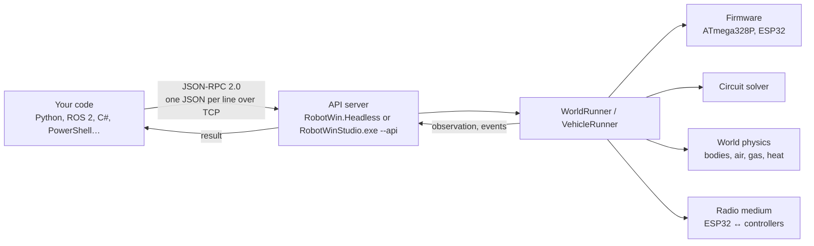

# Automation API

RobotWin Studio ships a **headless, deterministic simulation runner** and a local **JSON-RPC API server**
so it can be scripted for academic robotics, ROS 2, autonomous-vehicle / UAV work and robot learning:

- the circuit, the boards' real firmware (ATmega328P emulation, ESP32 HAL model) and the mechanics are
  advanced in lockstep with the app's exact slicing; same seed + same commands ⇒ bit-identical runs;
- runs are as fast as the CPU allows (RTF ≫ 1 for most scenes), resettable, and many instances run in
  parallel as separate processes;
- sensors are read by name (ultrasonic parts, encoders, vehicle line/obstacle mounts, plus virtual IMU,
  GPS, odometry, 2D/3D LiDAR, RGB/depth cameras, range and line sensors attachable to any object);
- actuators can be commanded at three levels: **pins** (the client replaces the firmware), **drivers**
  (PWM duty of motor-driver channels / ESCs) and **joints** (ideal DC-motor voltage, speed, torque, servo angle);
- vehicles: differential-drive helper, quadcopter arming / throttle / attitude / altitude-hold setpoints;
- circuit introspection: node voltages, per-part currents, temperatures and failures, raw solver signals;
- serial in/out per board, firmware replacement, events (part failures, crashes, impacts, warnings).

## Quick start (Python)

```python
from robotwin import launch

with launch(example="car", seed=1) as server:            # a headless server in its own process
    sim = server.client()
    sim.add_sensor("lidar", name="scan", object="O1", offset=[0, 0, 0.05])
    sim.add_sensor("odometry", name="odom", object="O1")
    sim.drive(0.2, 0.0)                                   # 0.2 m/s forward
    r = sim.step(dt=0.01, steps=100, observe=["scan", "odom"])
    print(r["time"], r["rtf"], r["observation"]["odom"]["position"])
    sim.reset(seed=1)                                     # same seed → the same run
```

Connect to a running server with `RobotWinClient("127.0.0.1", 5555)`. Reinforcement learning (`RobotWinEnv`, Gymnasium compatible), parallel environments and imitation learning are described in [`python/README.md`](https://github.com/Kinin-Code-Offical/robotwin-studio/blob/main/python/README.md).

## Without the Python client

The protocol is plain JSON lines over TCP, so any language works. PowerShell:

```powershell
$c = [System.Net.Sockets.TcpClient]::new("127.0.0.1", 5555)
$s = $c.GetStream(); $w = [System.IO.StreamWriter]::new($s); $r = [System.IO.StreamReader]::new($s)
$w.WriteLine('{"jsonrpc":"2.0","id":1,"method":"world.load","params":{"example":"car"}}'); $w.Flush(); $r.ReadLine()
$w.WriteLine('{"jsonrpc":"2.0","id":2,"method":"sim.step","params":{"dt":0.01,"steps":100,"observe":["pose:O1"]}}'); $w.Flush(); $r.ReadLine()
```

## How it fits together



## Starting a server

| Command | What it does |
|---|---|
| `RobotWin.Headless --api 5555` | Cross-platform headless server (.NET 9, Windows/Linux/macOS). |
| `RobotWin.Headless --api 0 --example car --parent-pid 1234` | Free port, preloaded example; prints `ROBOTWIN_API_READY port=<n>`; exits with its parent. |
| `RobotWin.Headless --run 5 --world robot.rwworld [--dt 0.01] [--seed 3]` | Batch run, JSON report on stdout (exit code 4 if the solver halted). |
| `RobotWinStudio.exe --api 5555 [--world f.rwworld]` | The app itself, windowless: world bodies come from the app's 3D models (identical physics to the UI), ESP32 sketches are compiled with the app's MSVC settings. |
| `RobotWinStudio.exe --bake-geometry f.rwworld [--out g.json]` | Writes the app's body geometry beside the world (`f.rwworld.geometry.json`); the headless tool picks it up automatically. |

Common options: `--seed N`, `--no-firmware`, `--firmware-dir DIR` (for `builtin:` hex files),
`--host ADDR --allow-remote` (non-loopback), `--token T`. Build the tool with
`dotnet build tools/RobotWin.Headless -c Release` (output in `builds/RobotWin.Headless/Release/net9.0/`).

## Wire protocol

JSON-RPC 2.0 over TCP, **one JSON value per line** (UTF-8, `\n`). Requests may be batched (a JSON array).
Notifications (no `id`) get no reply. Non-finite numbers are sent as `null` (e.g. a LiDAR beam with no return).
Requests from all connections are executed one at a time in arrival order.

```text
→ {"jsonrpc":"2.0","id":1,"method":"world.load","params":{"example":"car","seed":7}}
← {"jsonrpc":"2.0","id":1,"result":{"kind":"world","title":"Araba","objects":[...],...}}
→ {"jsonrpc":"2.0","id":2,"method":"sim.step","params":{"dt":0.01,"steps":50,"actions":[{"drive":{"v":0.2,"w":0}}],"observe":["O2.encoder","pose:O1"]}}
← {"jsonrpc":"2.0","id":2,"result":{"time":0.5,"steps":50,"rtf":1.8,"observation":{...},"failed":[],"halted":false}}
```

Error codes: `-32700` parse error, `-32600` invalid request, `-32601` unknown method, `-32602` bad
params, `-32603` internal, `-32001` nothing loaded, `-32002` not found, `-32003` unsupported in this mode,
`-32004` unauthorized.

Units: SI (m, s, rad, V, A, °C); `rpy_deg`/`angle` in degrees where named so. Frames: world Z-up,
x forward / y left / z up for bodies and sensors (ROS REP-103). Quaternions are `[x, y, z, w]`.

## Timing model

`sim.step {dt, steps}` advances `steps × dt` simulated seconds. Internally each `dt` is cut into the app's
lockstep slices (1 ms; 50 µs with an ATmega328P; 100 µs with an ESP32): firmware → circuit solver
(adaptive, `max_step` default 2e-4 s like the app) → mechanics (1 ms fixed steps). The reply reports the
wall time and the real-time factor of that call; `sim.status` has running averages. `pace: 1.0` locks the
call to wall-clock time (0.5 = half speed). Typical RTF on a desktop CPU: micro quadcopter ≈ 15–30×, analog
line follower ≈ 14×, two-wheel world car ≈ 1.7× (world physics, 16 solver iterations), Arduino robot with
firmware ≈ 0.8× (cycle-accurate AVR emulation). Use more processes for throughput.

## Modes

* **World** (`.rwworld`, or `example: "car"`): sandbox worlds of the World page. Objects have ids `O1`, `O2` …;
  components with a moving port (motor shaft, servo horn) are actuators; boards are programmable.
* **Vehicle** (`.rwproj` with a Montaj-page assembly, or `example: "line-follower" | "obstacle-avoider" | "quadcopter"`):
  the robot car / quadcopter of the schematic simulation with its arena. The body is object `vehicle`;
  built-in sensors `odom`, `imu`, `gps` plus one per mounted sensor (by refdes).
* **Circuit** (`.rwproj` without a robot assembly): the Circuit page's simulation with its boards' code (the project's
  compiled HEX for Unos / Nanos, its sketches for ESP32s). No objects or actuators; pins, nets, serial, sensors and
  `circuit.*` work as in the other modes.

## Method reference

### Session

| Method | Params | Result |
|---|---|---|
| `hello` | `token?` | name, `api_version` ("1.0"), backend (`headless`/`studio`), sensor types, examples |
| `ping` | – | `"pong"` |
| `methods` | – | `{method: help}` |
| `shutdown` | – | `true`; the process exits |

### World

| Method | Params | Result |
|---|---|---|
| `world.load` | one of `path` (.rwworld / .rwproj), `example`, `world_json`; `seed`=0, `firmware`=true, `max_step`=2e-4, `rel_tol`=1e-3, `damage`=true, `geometry` (baked JSON path), `environment` (world mode: `{track: "oval"\|"eight"\|"none", track_scale, friction, gravity, ambient_c, obstacles: [{x, y, size_x, size_y, height}], clear_obstacles}`), `arena` (vehicle mode: `oval`, `eight`, `obstacles`, `empty` …), `sensors` (list of `sensor.add` params) | same as `world.describe` |
| `world.reset` | `seed?`, `randomize?: {position: σ m, yaw_deg: σ}`, `observe?: [names]` | `{time: 0, seed, observation?}` — rebuilds circuit, firmware and physics; added sensors stay; actuator commands are cleared |
| `world.describe` | – | `kind`, `title`, `environment` (incl. track `start` [x, y, yaw]), `objects` (id, name, kind, part, pose, geometry: shape/min/max/mass/port/sensor), `joints`, `cables`, `boards`, `actuators`, `sensors` (vehicle mode: `vehicle` block with type, mass, dimensions) |
| `world.save` | `path` | saves the loaded world (with `environment` edits) as `.rwworld` — opens in the app's World page |
| `world.export_geometry` | `path?` | body geometry + cable lengths (the `.geometry.json` format) |

### Stepping and events

| Method | Params | Result |
|---|---|---|
| `sim.step` | `dt`=0.01 (≤10), `steps`=1 (or `duration`), `actions?` (applied first, see below), `observe?` (names), `pace?`, `stop_on_failure?`, `events?` | `time`, `steps`, `sim_time`, `wall_time`, `rtf`, `halted`, `failed` (object ids), `events_pending`, `observation?`, `events?` |
| `sim.status` | – | time, seed, rtf, rtf_average, wall_time, halted, failed, boards |
| `events.poll` | `max?` | `[{time, source, kind: info\|warning\|failure\|impact, message, value}]` (drained) |

`actions` items: `{actuator, mode, value, ...}` (as `actuator.set`), `{pin, board?, mode, duty?, frequency?, angle?}`
(as `pin.write`), `{drive: {v, w, ...}}`, `{flight: {...}}` (as `flight.set`), or `{method, params}` (any method).

`observe` names: any sensor name, `pose:<object>`, `pin:<board>.<pin>` (or `pin:<pin>`), `part:<ref>`,
`status`, `flight`.

### Objects

| Method | Params | Result |
|---|---|---|
| `object.list` | – | `[{id, name, kind, static}]` |
| `object.get_pose` | `id` (id or name) | `position`, `orientation` [x,y,z,w], `rpy` (rad), `linear_velocity`, `angular_velocity` (world frame) |
| `object.set_pose` | `id`, `position?`, `orientation?` or `rpy_deg?`, `keep_velocity?` | new pose — the whole jointed assembly is moved rigidly, velocities zeroed |

### Sensors

| Method | Params | Result |
|---|---|---|
| `sensor.list` | – | descriptions (`name`, `type`, `object`, limits, resolution) |
| `sensor.types` | – | types available to `sensor.add` |
| `sensor.read` | `name` or `names[]` (none = all except cameras) | reading(s); every reading has `time` |
| `sensor.add` | `type`, `name?`, `object?`, `offset?` [x,y,z] (object frame), `rpy_deg?`, type parameters | description |
| `sensor.remove` | `name` | bool |

Built-in sensors — world: `<object>.range` (HC-SR04 part: `range`, `in_range`, beam `from`/`to`, `echo_pulse`),
`<object>.encoder` (motor/servo port: `angle`, `velocity`, `ticks` @1440 cpr). Vehicle: `odom`, `imu`, `gps`,
and each mount by refdes (`value`, `triggered`, `range`).

Virtual sensor types (`sensor.add`), parameters with defaults:

| Type | Parameters | Reading |
|---|---|---|
| `imu` | `accel_noise`=0, `gyro_noise`=0 (σ), `filter_tau`=0.004 s | `orientation`, `rpy`, `angular_velocity` (sensor frame), `linear_acceleration` (specific force, ≈ +9.81 z at rest) |
| `gps` | `origin_lat`=41.0082, `origin_lon`=28.9784, `origin_alt`=40, `noise`=0 m, `noise_vertical` | `latitude`, `longitude`, `altitude`, `position_enu`, `velocity_enu`, `covariance_diagonal` (x = east, y = north) |
| `odometry` / `pose` | `noise`=0 | `position`, `orientation`, `rpy`, `linear_velocity` / `angular_velocity` (body frame, ROS odometry), `linear_velocity_world` |
| `lidar` | `samples`=360, `angle_min`=−π, `angle_max`=π, `range_min`=0.05, `range_max`=8, `layers`=1, `vfov_deg`, `noise`=0, `ignore_own`=true | LaserScan fields: `angle_min/max/increment`, `range_min/max`, `ranges` (null = no return; `layers × samples` values for 3D) |
| `range` | `range_max`=4, `noise` | `range` (null = nothing), `hit_object` |
| `camera` | `width`=64, `height`=48 (≤640×480), `fov_deg`=60, `range_max`=20 | `encoding` "rgb8", `width`, `height`, `step`, `fx`, `fy`, `cx`, `cy`, `data` (base64, row-major from top-left) |
| `depth` | as camera | `encoding` "32FC1" (little-endian float32 metres, +inf = nothing) |
| `line` | `threshold`=0.4, `noise` | `value` (floor reflectance: black line ≈ 0.06, white ≈ 0.85), `on_line` |

Extending (C#): other modules register part sensors with
`SensorRegistry.RegisterProvider(runner => IEnumerable<ISimSensor>)` and new virtual types with
`SensorRegistry.RegisterType("name", (runner, spec) => ISimSensor)`; they then appear in `sensor.list`,
`sensor.read`, `sim.step observe` and the ROS bridges without API changes.

### Actuators

| Method | Params | Result |
|---|---|---|
| `actuator.list` | – | world: one per moving port (`type` motor / servo / joint, `modes`, motor constants) and per PWM driver device; vehicle: wheel/prop motors (with their driver) and drivers |
| `actuator.set` | `name`, `mode`, `value`, `max_torque?`, `supply?`=6 V | see below |
| `actuator.release` | `name?` (all when omitted) | `true` — back to the circuit/firmware |
| `pin.write` | `board?` (object id/name/refdes; optional with one board), `pin` ("D5", "A0", "IO21"), `mode`: `high` `low` `input` `pullup` `pwm` (`duty` 0–1, `frequency`=490) `servo` (`angle` 0–180°, 50 Hz) `release` | pin state |
| `pin.read` | `board?`, `pin` | `voltage`, `level`, `mode`, `current`, `pwm_frequency`, `pwm_duty`, `overridden` |
| `drive.differential` | `v` m/s, `w` rad/s (+ = left), `left?`/`right?` motor ids, `base?`, `wheel_radius?`, `track?`, `mode`: `speed` (default) / `voltage`, `max_torque?`, `supply?`; vehicle: `max_speed`=0.6 | wheels used (motor, side, wheel speed / duty) |
| `drive.stop` | – | releases everything |

Actuation levels:

1. **Pins** — the firmware's view: hold a board pin at a level / PWM / servo pulse every slice. Best with
   `firmware: false` (or `firmware.enable {enabled:false}`), so the client *is* the controller and the signal
   still goes through the real circuit (drivers, H-bridges, servos).
2. **Drivers** — `mode: duty` on a PWM switch (motor-driver channel, FC MOSFET): its logic input is ignored
   while commanded. Vehicles: wheel/prop motors are addressed by refdes and resolved to their driver.
3. **Joints** (world mode) — ideal command of a moving port, bypassing the circuit: `voltage` (DC-motor
   torque–speed line from the part's motor constant, resistance and gear ratio), `duty` (= value × `supply`),
   `speed` (rad/s at the output shaft, limited by `max_torque`), `torque` (N·m), `angle` (servo horn, degrees,
   90 = centre, driven by the servo's own torque/speed model).

`drive.differential` (world) finds wheel motors (sideways axle), their side from the chassis frame (+x
forward of the base object, default: what the motors are fixed to), wheel radius and track from the
attached wheels, then commands output-shaft speeds. It is open loop: close the loop with `odom` for accuracy
(caster scrub and slip make the real turn rate lower). In vehicle mode it sets the drivers' duty
(`side speed / max_speed`; single-direction drivers cannot reverse).

### Flight (UAV, vehicle mode, quadcopter)

| Method | Params | Result |
|---|---|---|
| `flight.status` | – | `armed`, `powered`, `mode`, `throttle`, stick inputs, `target_altitude`, `altitude`, `roll`/`pitch`/`yaw` estimate, `motor_commands`, `props_broken`, `speed`, `distance`, `mass` |
| `flight.arm` | `armed`=true | status |
| `flight.set` | `throttle` 0–1, `roll` / `pitch` / `yaw` −1…1 (sticks: max 25° tilt, 3 rad/s yaw), `mode`: `angle` (manual throttle) / `altitude` (throttle = climb-rate stick, 0.5 holds), `target_altitude` m, `armed` | status |
| `flight.motors` | `duty`: [4] (null releases one) | raw motor PWM duties (overrides the flight controller) |

Arming in altitude mode centres the throttle (0.5) and holds the current height (≥ 0.6 m) unless
`target_altitude` is given. Positive pitch tilts nose-down (accelerates +x), positive roll rolls right
(accelerates −y), positive yaw turns left.

### Serial, firmware, circuit

| Method | Params | Result |
|---|---|---|
| `serial.read` | `board?`, `clear`=true | `{refdes: text}` since the last read |
| `serial.write` | `text`, `board?` | `true` (to the board's RX) |
| `firmware.set` | `board`, `hex` or `path` (Intel HEX; omit both to clear) | board — applied on the next `world.reset` |
| `firmware.enable` | `enabled` | status — resets the run |
| `circuit.voltage` | `node`: net name, or `object:pin` in a world | volts (null if unknown) |
| `circuit.part` | `ref`: component object id, `object/R2` (part on a board), or a refdes | `devices` (id, type, failed, failure, `signals`: I, V, P, T …), `temperature`, `failed` |
| `circuit.signals` | `prefix`, `max`=500 | raw solver signals |

## Python, ROS 2, rosbridge

* Python client, Gymnasium env, vector envs, imitation learning: [`python/README.md`](https://github.com/Kinin-Code-Offical/robotwin-studio/blob/main/python/README.md).
* ROS 2 node, launch file, URDF export: [`ros2/robotwin_bridge/README.md`](https://github.com/Kinin-Code-Offical/robotwin-studio/blob/main/ros2/robotwin_bridge/README.md).
* No-ROS WebSocket (rosbridge v2 subset, for roslibjs / web dashboards): `python -m robotwin.rosbridge --example car --port 9090`.

## Fidelity notes (what is not identical to the app)

* Wi-Fi, BLE and Bluetooth links between ESP32 boards and game controllers run headless too (`WorldRunner.Radio`:
  set a controller's `Input` to drive it). IR remotes, sounds and the USB-cable gating of the serial monitor are
  not part of headless runs.
* `RobotWin.Headless` approximates body geometry from datasheet sizes when no baked geometry exists (TT motor, ESP32, Nano, Uno
  and 4×AA pack match the app; other parts are boxes). `RobotWinStudio.exe --api` or `--bake-geometry` give the
  app's exact bodies.
* ESP32 boards run only when the host can build sketches (the app with MSVC); the headless tool leaves them idle.
* Joint-level actuator commands and virtual sensors are idealised additions (documented above); pin and driver
  commands go through the real circuit.
* The ray-cast camera is flat-shaded and low resolution — for learning pipelines, not photorealism.
