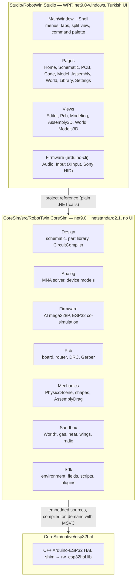
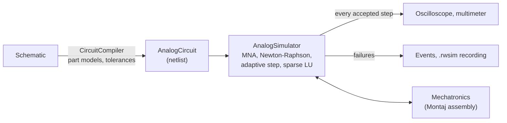
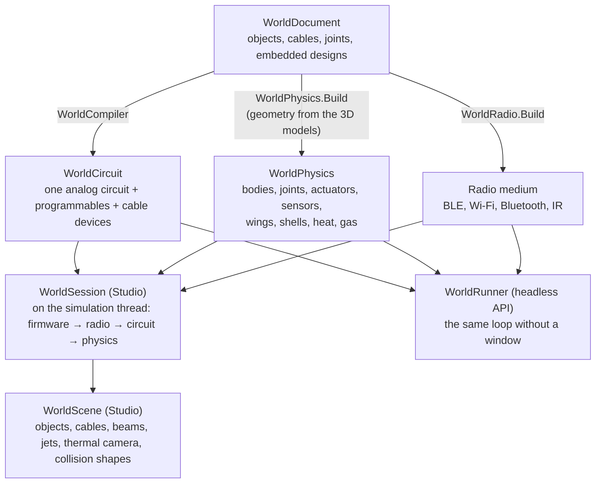
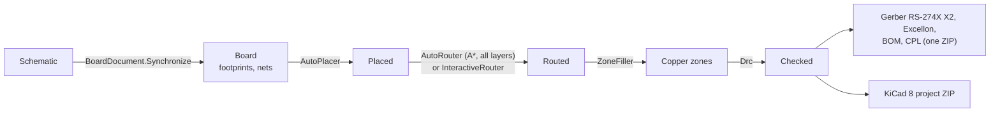

# Architecture

RobotWin Studio is a single Windows desktop process: a C# .NET 9 WPF application (`Studio/RobotWin.Studio`) on top of a C# simulation core (`CoreSim/src/RobotTwin.CoreSim`). There is no separate engine process, no IPC and no game engine. The only native code that runs inside the app is the user's own ESP32 sketch, compiled with MSVC into a DLL (see [Firmware co-simulation](#firmware-co-simulation)).

> The 1.x design (Unity front end + C++ `NativeEngine`/`FirmwareEngine` over named pipes) is described in [archive/](archive/README.md). Those engines are still in the repository but are not used by the app.

## Layers

| CoreSim folder | What it holds |
| --- | --- |
| `Design/` | Schematic model, part library (`StandardParts`, `Esp32Parts`, `WirelessParts`), `CircuitCompiler`, ERC, BOM, SPICE, tolerances, Monte Carlo, diagnostics |
| `Analog/` | MNA + Newton-Raphson solver, sparse LU, device models (incl. batteries, chargers, protection boards) |
| `Instruments/` | Oscilloscope, multimeter |
| `Firmware/` | ATmega328P emulator, Intel HEX, I²C bus + device models, `FirmwareCoSimulation`; `Esp32/` sketch compiler + co-simulation |
| `Pcb/` | Board model, layers, zones, router, auto layout, DRC, Gerber/Excellon, KiCad export |
| `Mechanics/` | Rigid-body `PhysicsScene`, collision shapes and convex hulls, meshes, materials, assembly drag, vehicles/drones, mass properties |
| `Modeling/` | PolyMesh, primitives, CSG, mesh editing, robot parts, `.rwmodel` |
| `Sandbox/` | `WorldDocument`, `WorldCompiler`, `WorldPhysics` (+ wings, shells, thermal, gas), `Radio/` |
| `Sdk/` | Environment (air, wind), force fields, behaviours, scripts, plugins |
| `Formats/` | `.rwproj` / `.rwpart` / `.rwlib` / `.rwsim` containers, KiCad library import |

Rules of thumb:

- **CoreSim has no UI dependency.** Everything that can be tested headless (solver, firmware, PCB, physics, world compiler, file formats) lives there and is covered by `CoreSim/tests`.
- **Studio owns rendering and interaction.** WPF 3D (`Viewport3D`) draws the board, assembly, world and modeller views; 3D component models are generated in code (`Models3D/`), not loaded from asset files. A part's collision body is the convex hull of that model (`World/ModelHulls.cs`).
- Older CoreSim folders (`Host/`, `IPC/`, `Runtime/`, `Specs/`, `Contracts/`, `Engine/`, `Infrastructure/`, `Serialization/`) come from the 1.x design; the Studio app does not use them.

## Documents and the workspace

`Shell/Workspace.cs` holds the open documents (tabs). A document is either a **circuit/board project** (`ProjectPackage`: schematic, PCB board, mechanical assembly, firmware sources) or a **world** (`WorldDocument`). A board inside a world is opened as an embedded document ("Dünyadaki kart", board in the world) and edited with the same Schematic/PCB/Code pages.

The left navigation (`Shell/FlowRail.cs`, "Tasarımdan gerçeğe hattı", the design-to-real line) switches pages: Devre → PCB → Kod → Modelle → Montaj → Dünya, plus Home, Library and Settings. `MainWindow` can show a second page side by side (split view), move a page into its own window (detach), hide the rail (focus mode) and go full screen.

## Circuit simulation loop

1. `Design/CircuitCompiler` turns a `Schematic` into an analog netlist (`AnalogCircuit`) using each part's simulation model from the `PartLibrary`. Tolerances (`Design/Tolerances.cs`) can perturb values with a fixed seed.
2. `Analog/AnalogSimulator` solves it: modified nodal analysis, Newton-Raphson for non-linear devices, trapezoidal / backward-Euler integration, adaptive sub-stepping, sparse LU (`SparseLu`) with dense fallback, a thermal model and part damage (burn, blown fuse, breakdown). It is deterministic. The maths: [Circuit solver](en/physics/01-circuit.md).
3. `Studio/Simulation/SimulationSession` drives the simulator from the WPF render loop at the selected speed, samples probes at every accepted solver step for the oscilloscope and multimeter, raises failure events and records `.rwsim` files.
4. When the project has a mechanical assembly, `Mechanics/Mechatronics` couples motors and propellers to a rigid-body vehicle or drone both ways: the circuit drives the motors, the load torque comes back.

## Firmware co-simulation

Firmware runs **in lockstep** with the circuit: the firmware runs for a slice, then the circuit is stepped by the same amount.

| | AVR (Arduino Uno / Nano) | ESP32 |
| --- | --- | --- |
| Model | `Firmware/Atmega328P*`: cycle-counted ATmega328P (full AVRe+ instruction set, interrupts, GPIO with INT0/1 and pin change, Timer0/1/2 with PWM, USART0, ADC, EEPROM, watchdog, TWI master, minimal SPI) | `Firmware/Esp32/`: the sketch compiled natively and run at Arduino-API level |
| Build | `Studio/Firmware/ArduinoCompiler` with `arduino-cli` → Intel HEX; examples ship as prebuilt `.hex` | `Esp32SketchCompiler`: preprocesses the `.ino`, compiles it with MSVC `cl.exe` (found through Settings, `vswhere` or the standard Visual Studio folders) into an x64 DLL linked against `rw_esp32hal.lib` (built once from the HAL sources embedded in CoreSim and cached under `%LOCALAPPDATA%\RobotWin\esp32hal-cache`) |
| Slice | 50 µs | 100 µs (world) |
| Pins | logic levels and ADC voltages in; LOW / HIGH / pull-up / timer PWM out; brown-out holds the CPU in reset | ESP32 input thresholds, 45 kΩ pull-ups, LEDC PWM, DAC |
| Extras | I²C models on the bus: SSD1306, PCF8574 + HD44780, MPU-6050 | FreeRTOS tasks, timers, Wire, Servo, simulated Wi-Fi, a BLE subset and Bluepad32; `Esp32Radio` connects the sketch to the world's radio medium |

## World pipeline

The open world (Dünya page) reuses all of the above on many boards and parts at once:

- **`Sandbox/WorldDocument`** is the saved model: title and environment (`WorldSpec`: floor size and friction, walls, gravity, temperature, obstacles), objects (`Board`, `Component`, `Body`, `Model`, each with pose, material, infill, mass and a fixed flag), cables (two pin ends, AWG, length, colour), joints (`Fixed`, `Hinge`, `Slider`, optionally to a servo horn or motor shaft, with limits and break force), embedded board designs and custom parts. It provides editing helpers and deep copies for undo.
- **`Sandbox/WorldCompiler`** flattens the world into one circuit: each board's schematic and a one-part schematic per free component are merged with names prefixed by the object id (`O3/U1`); every cable becomes a resistor sized from gauge and length with a power rating and a 160 °C burn-out limit; electrically separate groups get their own 0 V reference; a PC + USB cable can power a board or charge a USB-C battery.
- **`Sandbox/WorldPhysics`** builds a `Mechanics/PhysicsScene`: gravity, ground and obstacles, one rigid body per object (box, sphere, cylinder, or the convex hull of the part's 3D model), a rotor on a hinge for each servo horn and motor shaft, and the user's joints. Parts joined by at most two joints do not collide. Every 1 ms step it drives actuators from the circuit, adds wing, gas and drag forces, steps the physics, feeds horn angle/current and shaft load back to the circuit, and advances the heat network. The maths: [Physics and maths](en/physics/README.md).
- **`Sandbox/Radio`** simulates a 2.4 GHz medium (BLE advertising/GATT notifications, Wi-Fi with UDP and stream sockets, Bluetooth Classic HID gamepads with pairing), path loss through distance, obstacles and bodies with optional log-normal fading, a line-of-sight IR channel (NEC), and USB (`WorldUsb`).
- **`Studio/World/WorldSession`** owns a running world: compiles, creates the solver, starts AVR (50 µs slices) and ESP32 (100 µs slices) co-simulations, attaches I²C devices reached through cables, builds `WorldPhysics`, and advances everything in lockstep. Failures and impacts become log entries and sounds (`Audio/SimSounds`).
- **`Formats/Urdf`, `Formats/Xacro`, `Formats/UrdfImport`** read a ROS robot description (xacro expanded first: properties, expressions, macros, includes, conditions) and put it into a world: links with bodies as parts at the zero configuration, joints as hinges and sliders with their limits and a drive each (`WorldJoint.Drive`: a position or speed loop on the scene joint's velocity drive, as strong and fast as the URDF's effort and velocity; `WorldPhysics.SetJointTarget` moves it while running).
- **`Ros/RosBridgeClient`, `Ros/RosWorldLink`** put a running world on ROS 2 through rosbridge (the v2 JSON protocol over a WebSocket, `System.Net.WebSockets` only): `/clock` and `/joint_states` out, `/joint_command` in as motor targets; for a robot free on the ground (`RosWorldLink.Mobile.cs`) `/odom` and `/tf` out from `WorldPhysics.MotionOf`, `/cmd_vel` in as its drive wheels' speeds (track and radius from `WorldPhysics.RollingRadius`); the sensors a URDF declares for Gazebo (`Formats/UrdfSensors.cs` → `WorldObject.RobotSensors`) are run by `RosWorldLink.Sensors.cs` (rays through `PhysicsScene.Raycast`, IMU through `ImuModel`) and published as `/scan` and `/imu`. Sending and receiving run on their own tasks; the link's `Step` runs with the simulation and only queues (Studio: `WorldSession.Ros`).
- **`Industrial/ModbusTcpServer`, `ModbusHost`** serve the remote I/O modules (`CellParts.ModbusIoId`) over Modbus TCP (function codes 1–6, 15, 16, 23; `ModbusTcpServer.Answer` is the protocol without the network). The module's data table (`WorldPhysics.ModbusDevices`, `Sandbox/WorldPhysics.Modbus.cs`) follows its circuit pins every machine step: coils drive the DO pins, DI pins set the discrete inputs (Studio: `WorldSession.Modbus`, open while the world runs).
- **`Industrial/StProgram`** is our IEC 61131-3 Structured Text compiler and interpreter (tree, typed, PLC integer wrapping, standard function blocks, run-time faults); `Sandbox/WorldPhysics.Plc.cs` scans it every cycle time against the PLC part's pins. `WorldPhysics.Pneumatics.cs` solves pneumatic cylinders (two air chambers with mass and energy, ISO 6358 valve flow) and `WorldPhysics.Switches.cs` photoelectric sensors and limit switches.
- **`Studio/Simulation/SimThread`** runs the live simulations (a world, the circuit) on a thread of their own, so a heavy one takes a core instead of the UI thread's frames. One lock, the *gate*, keeps the two threads apart: the simulation thread holds it while it advances (pieces of at most 2 ms of computing); the UI thread holds it whenever it handles something (input being routed, timers, posted work, bindings), through the dispatcher's hooks, so pages and panels read and change a running simulation as they always did. Only drawing runs beside the simulation: WPF's layout and render pass, whose frame handlers and controls that show a simulation take `SimThread.Hold()` around what they read. What only the UI may do (the event log, pausing at a breakpoint or a failure, serial text for the pages) the simulation thread leaves for the UI's next frame. While a run cannot keep up, the frames that read it take at most a quarter of the time and the GPU redraws the last scene in between. Ayarlar → Simülasyon can turn it off (the old way: inside the frames); `--sim-thread off` does so for one run.

## PCB pipeline

## File formats

All formats are versioned ZIP containers with a `manifest.json` (format, version, app, title, author, dates, summary), written through a temporary file so a crash cannot leave a half-written file. Code: `Formats/RobotWinFiles.cs`, `Sandbox/WorldDocument.cs`, `Modeling/ModelDocument.cs`.

| Extension | Contents (inside the ZIP) |
| --- | --- |
| `.rwproj` (v2) | `schematic.json`, `pcb/board.json`, `mechanics/assembly.json`, `firmware/index.json`, `firmware/<RefDes>/sketch.ino` + `.hex`, `library/parts.json`, `settings.json`, `preview.png`. v1 projects (a single JSON file) still open. |
| `.rwworld` | `world.json`, `designs/index.json`, `designs/<id>.rwproj` (embedded boards), `preview.png` |
| `.rwpart` | `part.json`: base simulation model, parameters, optional footprint, module sub-circuit and 3D model |
| `.rwlib` | `parts/<id>.json` |
| `.rwsim` | `channels/*.csv`, `events.json`, `trajectory.json`, `serial.txt`, `project.rwproj` |
| `.rwmodel` | `model.json`, `preview.png` |
| `.rwfp` | `footprint.json` |

## User data locations

| What | Where |
| --- | --- |
| Settings | `%APPDATA%\RobotWinStudio\settings.json` |
| User part library, footprints | `%APPDATA%\RobotWinStudio\Library` (`Footprints\`) |
| Plugins | `%APPDATA%\RobotWinStudio\Plugins` |
| Recent files, crash log | `%APPDATA%\RobotWinStudio\recent.txt`, `crash.log` |
| Autosave backups | `Documents\RobotWin\Yedekler` |
| arduino-cli builds | `%LOCALAPPDATA%\RobotWinStudio\Build` |
| C# script builds | `%LOCALAPPDATA%\RobotWinStudio\Scripts` |
| ESP32 HAL / sketch cache | `%LOCALAPPDATA%\RobotWin\esp32hal-cache` |
| File-type icons | `%LOCALAPPDATA%\RobotWinStudio\Icons` |
