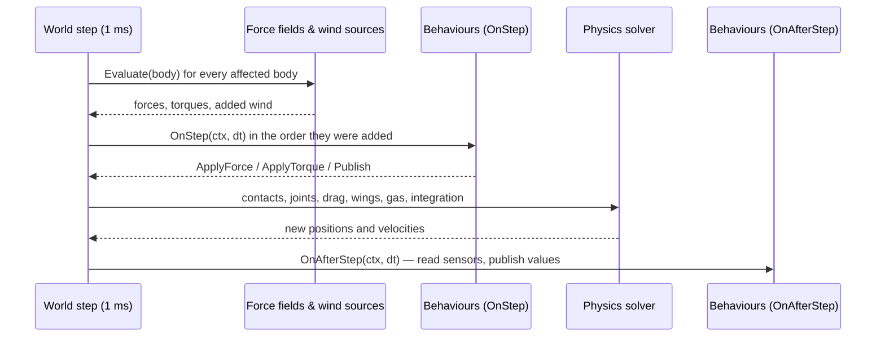

# Physics scripts (SDK): environment, force fields, scripts and plugins

Your own physics can be added to a world at three levels. All of them run inside the same fixed 1 ms physics step, in a fixed order, with seeded randomness, so a world gives the same result every time.

| Level | Where | You need | Good for |
| --- | --- | --- | --- |
| **Expression** | Object → *Ortam ve davranışlar* → *Davranış ekle → İfade*, or Environment → *İfade alanı* | Nothing | Quick force laws: `F.x = -k*(x - x0) - c*vx`, `wind.x = 3*sin(t)` |
| **C# script** | World → *Betikler* tab → *Yeni C# betiği* | .NET 9 SDK (the app downloads nothing) | Behaviours with state, sensors, controllers; saved inside the world file |
| **Plugin DLL** | `%APPDATA%\RobotWinStudio\Plugins\<name>\` or `Plugins\` beside the world file | Any compiler (template: `sdk/templates/RobotWinPlugin`) | Libraries, custom circuit parts, shared models |

## When your code runs



Forces you apply hold for that one step only; apply them again every step.

## 1. Expressions: no tools needed

### How to add one

1. Select an object on the World page.
2. In the right panel open **Ortam ve davranışlar** (environment and behaviours) → **Davranış ekle → İfade** (add behaviour → expression).
3. Type the program; values you want to tune go in the **Sabitler** (constants) box, e.g. `k=20, c=0.5`.
4. Run the world. Errors are shown with line and column, e.g. `Satır 2, sütun 7: Bilinmeyen değişken 'sped'. Bunu mu demek istediniz: speed?` (line 2, column 7: unknown variable 'sped' — did you mean speed?).

### Example: a spring and a damper pulling the object back to where it started

```text
# spring + damper (x0 = starting position)
k = 20; c = 0.5
F.x = -k*(x - x0) - c*vx
F.z = m*g*0.5 * (t > 1)          # comparisons give 0/1
TL.z = -0.01*wz                  # torque about the body axis
```

### Language

| | |
| --- | --- |
| Statements | separated by `;` or new lines; comments `#` or `//` |
| Operators (low → high) | `?:`, `\|\|`, `&&`, `< > <= >= == !=`, `+ -`, `* / %`, unary `- + !`, `^` (power, right-associative; `-2^2 = -4`, `2^3^2 = 512`; `**` also works). `%` is the floored remainder: `-7 % 3 = 2` |
| Functions | `sin cos tan asin acos atan atan2 sinh cosh tanh sqrt cbrt abs exp ln log log10 log2 pow min max clamp sign floor ceil round frac hypot lerp step smoothstep deg rad if noise hash square saw pulse` |
| Constants | `pi tau e g0 true false` |
| Inputs (object behaviour) | `t dt x y z vx vy vz wx wy wz speed m g x0 y0 z0 roll pitch yaw rho tempC air.x air.y air.z wind.x wind.y wind.z airspeed h` and the names in the constants box |
| Outputs | `F.x F.y F.z` (N, world), `FL.x…` (N, body axes), `T.x…` (N·m, world), `TL.x…` (body); `Fx` is short for `F.x`. Unassigned outputs are 0 |
| Expression field | can also write `wind.x wind.y wind.z` (air velocity added at that point, m/s); the base wind is read as `air.*`; speed inputs are 0 there |

Local variables (`k = 20`) are recomputed every step and published as *Name.variable* (shown in the Scripts tab and the right panel). There are no loops or user functions, so every program finishes (at most 8000 characters, 4000 nodes, 64 levels of nesting). An expression that produces a NaN/∞ force counts as an error (see §6).

## 2. C# scripts inside a world

### How to write and load one

1. Install the **.NET 9 SDK** (the app does not download it). Without it the Scripts tab says why; expressions and plugins still work.
2. World page → **Betikler** (scripts) tab → **Yeni C# betiği** (new C# script). A template opens in the editor.
3. Write a class derived from `WorldBehavior` (below). Save: the script is stored inside the world file.
4. The script compiles when the world starts (or with *Derle*). Errors appear with file, line and column.
5. Select an object → **Davranış ekle** → your behaviour (its `[Behavior]` name). Its `[Parameter]` properties show in the inspector.
6. Run. Values you `Publish` appear in the right panel and can be read by other code and by the *Programlanabilir sensör (SDK)* part.

### Example: pull an object towards a target point

```csharp
using RobotTwin.CoreSim.Mechanics;
using RobotTwin.CoreSim.Sdk;

[Behavior("Yay ile merkeze çek", Description = "Pulls the object towards a point with a spring and a damper.")]
public sealed class SpringToPoint : WorldBehavior
{
    [Parameter("Yay sabiti", Unit = "N/m")] public double K { get; set; } = 20;    // editable in the inspector
    [Parameter("Sönüm", Unit = "N·s/m")] public double C { get; set; } = 0.5;
    [Parameter("Hedef", Unit = "m")] public Vec3 Target { get; set; }

    public override void OnStep(IBehaviorContext ctx, double dt)                 // every 1 ms, before the solver
    {
        var b = ctx.Self!;                                                         // the object it is attached to
        b.ApplyForce((Target - b.Position) * K - b.Velocity * C);
        ctx.Publish("distance", (Target - b.Position).Length);                     // inspector, other code, the SDK sensor part
    }
}
```

### Example: a thruster that follows a board's PWM pin

A script can read the circuit: here a "cold-gas thruster" pushes along the body's +z axis in proportion to the voltage an Arduino puts on its D9 pin.

```csharp
using RobotTwin.CoreSim.Mechanics;
using RobotTwin.CoreSim.Sdk;

[Behavior("PWM itici")]
public sealed class PwmThruster : WorldBehavior
{
    [Parameter("Kart nesnesi")] public string Board { get; set; } = "O1";
    [Parameter("En büyük itki", Unit = "N")] public double MaxThrust { get; set; } = 2.0;

    public override void OnStep(IBehaviorContext ctx, double dt)
    {
        double v = ctx.Circuit?.Voltage(Board, "D9") ?? 0;          // averaged PWM level, 0–5 V
        double thrust = MaxThrust * System.Math.Clamp(v / 5.0, 0, 1);
        ctx.Self!.ApplyLocalForce(new Vec3(0, 0, thrust), Vec3.Zero);   // body frame, at the centre of mass
        ctx.Publish("thrust", thrust);
    }
}
```

### Rules for scripts

- Scripts are compiled with `dotnet build` in a temporary project (`%LOCALAPPDATA%\RobotWinStudio\Scripts\<hash>`), pinned to the 9.x SDK with `global.json`, with NuGet pointed at an empty local folder: **no packages, no downloads**. Results are cached by content hash.
- A script type's key is `script:<Namespace.Type>`.
- Use `ctx.Random` (seeded), never `System.Random`, the clock or threads — otherwise runs stop being reproducible.

## 3. Plugin DLLs

### Folder layout

```text
%APPDATA%\RobotWinStudio\Plugins\
  AcmeWind\
    plugin.json
    Acme.Wind.dll        (+ .pdb, + its own dependencies)
<world folder>\Plugins\...   (can be switched off in Settings)
```

```json
{ "id": "acme.wind", "name": "ACME wind", "version": "1.2.0", "author": "ACME",
  "description": "…", "assembly": "Acme.Wind.dll", "entryTypes": [], "sdkVersion": 1 }
```

- `id` must be unique and may not contain `:` `/` `\`; `builtin` and `script` are reserved. With an empty `entryTypes` every suitable public type in the assembly is taken. A folder with a single DLL and no plugin.json loads by file name.
- Every plugin loads into its **own collectible `AssemblyLoadContext`** from an in-memory copy of the DLL: the file on disk is not locked; rebuild and press *Eklentileri yeniden yükle* (reload plugins). `RobotTwin.CoreSim` is always shared with the app (do not copy it into the plugin folder).
- **Per world**: a plugin's behaviours and fields run only if it is marked **"Bu dünyada etkin"** (enabled in this world) in the world's Scripts tab (switched on automatically when you add one of its types). Settings → *Eklentiler ve betikler* disables a plugin everywhere.
- Unloading completes once nothing holds the plugin's objects; the Scripts tab's reload stops the simulation first.

### How to build one from the template

```powershell
cd sdk/templates/RobotWinPlugin
dotnet build -c Release -p:Deploy=true
```

The DLL and plugin.json are copied to `%APPDATA%\RobotWinStudio\Plugins\RobotWinPlugin.Samples\`. Outside the repository pass `-p:RobotWinDir="<folder of RobotTwin.CoreSim.dll>\"`. Samples in the template: a wind turbine ($`C_P(\lambda)`$, Betz limit, generator load), a dipole magnet ($`3\mu_0 m_1 m_2 / 2\pi r^4`$), Reynolds-dependent sphere drag, a thermal updraft (`IWindSource`), a soft boundary (`ForceField`) and an anemometer (custom `AnalogDevice` + `IPartProvider` + sensor behaviour).

### Example: a force field

```csharp
using System.Collections.Generic;
using System.Globalization;
using RobotTwin.CoreSim.Mechanics;
using RobotTwin.CoreSim.Sdk;

/// <summary>A magnet attracting steel parts: F ∝ 1/r⁴ (two dipoles in line).</summary>
public sealed class DipoleMagnet : ForceField
{
    private Vec3 _centre;
    private double _strength = 2e-6;   // N·m⁴

    // The field's placement (Environment → force fields) and its parameters arrive here once.
    public override void Configure(IReadOnlyDictionary<string, string> parameters, ForceFieldSpec spec)
    {
        _centre = new Vec3(spec.X, spec.Y, spec.Z);
        if (parameters.TryGetValue("strength", out var s)) _strength = double.Parse(s, CultureInfo.InvariantCulture);
    }

    public override bool Affects(ISimBody body) => !body.IsStatic && body.Material == "steel";

    public override (Vec3 Force, Vec3 Torque) Evaluate(ISimBody body, IBehaviorContext ctx)
    {
        var r = _centre - body.Position;
        double d = System.Math.Max(0.005, r.Length);
        return (r / d * (_strength / (d * d * d * d)), Vec3.Zero);
    }
}
```

### Example: a custom circuit part

A part is a `PartDefinition` whose `Build` adds `AnalogDevice` subclasses to the circuit. The device stamps itself into the [MNA matrix](en/physics/01-circuit.md) every step:

```csharp
using System.Collections.Generic;
using RobotTwin.CoreSim.Analog;
using RobotTwin.CoreSim.Design;
using RobotTwin.CoreSim.Sdk;

/// <summary>A light-dependent resistor whose resistance follows a value another behaviour publishes.</summary>
public sealed class LdrDevice : AnalogDevice
{
    public LdrDevice(string id, int a, int b) : base(id) { A = a; B = b; }
    public int A { get; }
    public int B { get; }
    public double Lux { get; set; } = 100;

    public override void Stamp(StampContext ctx)
    {
        double r = 10_000 * System.Math.Pow(Lux / 10.0, -0.7);   // a GL5528-like R(lux) curve
        ctx.AddConductance(A, B, 1.0 / r);
    }
}

public sealed class LdrParts : IPartProvider
{
    public IEnumerable<PartDefinition> Parts()
    {
        var part = new PartDefinition { Id = "acme-ldr", Name = "ACME LDR", Category = "Sensör", RefPrefix = "R" };
        part.Pins.Add(new PinDefinition("A", "1", -2, 0));
        part.Pins.Add(new PinDefinition("B", "2", 2, 0));
        part.Build = c => c.Add(new LdrDevice(c.RefDes, c.Pin("A"), c.Pin("B")));
        yield return part;
    }

    public IEnumerable<PartPreset> Presets() => System.Array.Empty<PartPreset>();
}
```

The four C# examples on this page are checked by compiling them against the library.

## 4. C# API reference (`RobotTwin.CoreSim.Sdk`)

| Type | Purpose |
| --- | --- |
| `IWorldBehavior` / `WorldBehavior` | Code that runs every step (`OnStart`, `OnStep`, `OnAfterStep`, `OnStop`). `[Behavior(AttachTo = "world")]` makes one world-wide instance |
| `IBehaviorContext` | `Time, Dt, StepIndex, Self, Bodies, Body("name or O3"), Joints, Joint(id), Air (Density, TemperatureC, Pressure, WindAt), Gravity, Circuit, Parameters, Param(), Random (seeded), Publish/Read, Raycast, Log/Warn` |
| `ISimBody` | `Id, Name, Object, Mass, Inertia, Position, Orientation, Velocity, AngularVelocity, Volume, Material, DragArea (writable), LocalToWorld/WorldToLocal, PointVelocity, ApplyForce, ApplyForceAtPoint, ApplyLocalForce, ApplyTorque, Teleport, SetVelocity, LastSdkForce`. Forces hold for one step |
| `ISimJoint` | `Angle, Speed, Axis, Anchor, MotorTorque (persistent), Drive, TargetAngle, TargetSpeed, Stiffness, Damping, MaxTorque, ReactionForce/Torque, Parent, Child` |
| `IForceField` / `ForceField` | `Affects(body)`, `Evaluate(body, ctx) → (Force, Torque)`; `Configure(parameters, spec)` receives the field's placement and parameters |
| `IWindSource` | `WindAt(point, time)` → added air velocity (acts through drag and on propellers) |
| `ICircuitAccess` | `Voltage(object, pin)`, `Signal(key)`, `Devices(object[, inner RefDes])` → direct access to device models (custom sensors) |
| `IPartProvider` | Custom circuit parts: a `PartDefinition` whose `Build` adds `AnalogDevice` subclasses (`Stamp`, `Accept`) |
| `SensorDevice` | A ready Thevenin output (OUT–GND). The library part **"Programlanabilir sensör (SDK)"** turns the published value named in its `signal` parameter into a voltage (`V = value·scale + offset`, clamped), readable with Arduino `analogRead` |
| `SdkRandom` | SplitMix64 + Box–Muller; `ctx.Random` is a separate seeded stream per attachment |

Units are SI; the world frame is Z up. Setting `DragArea` from code replaces the automatic face-by-face drag of that body ([aerodynamics](en/physics/04-aerodynamics.md)) with your symmetric Cd·A.

## 5. Environment model

The *Ortam* (environment) palette tab.

### Air

Density from the ambient temperature *T*, sea-level pressure *p₀*, altitude *h* and relative humidity:

```math
p = p_0\,(1 - 2.25577\cdot10^{-5}\,h)^{5.25588}, \qquad \rho = \frac{p_d}{R_d T} + \frac{p_v}{R_v T}
```

with the Tetens saturation vapour pressure; 15 °C and 1013.25 hPa give 1.225 kg/m³. A fixed density can override it (Mars ≈ 0.02). One density applies to the whole world for drag; [gas vessels](en/physics/05-gas-and-rockets.md) take the ambient pressure at their own height from the ISA.

### Wind

- **Mean wind**: speed, the direction it blows *towards* (0° = +X, 90° = +Y), vertical component.
- **Height profile**: uniform; power law $`u(z) = u_\text{ref}(z/z_\text{ref})^\alpha`$; logarithmic $`u(z) = u_\text{ref}\ln(z/z_0)/\ln(z_\text{ref}/z_0)`$.
- **Turbulence** (Dryden-like): a first-order Gauss–Markov process per axis, $`u_{k+1} = a\,u_k + \sigma\sqrt{1-a^2}\,n`$, $`a = e^{-V\Delta t/L}`$; σ is the horizontal intensity, vertical σ = ratio·σ, correlation time $`L/V`$. The longitudinal component matches the Dryden spectrum exactly; the lateral/vertical Dryden spectra are second order and approximated by the same first-order filter. The turbulence is spatially uniform — fine for objects much smaller than L.
- **Discrete gusts**: $`\tfrac{1}{2}A\,(1 - \cos 2\pi t/T)`$ along the wind, amplitude A·[0.5, 1], exponentially distributed gaps.
- **Seed**: all random processes use `SdkRandom` (SplitMix64) — the same sequence on every .NET version.

### Aerodynamics

- **Drag** on every moving object, face by face: leading-face stagnation pressure, base suction and skin friction, with faces covered by joined parts taken out ([details](en/physics/04-aerodynamics.md)). Per-object Cd, reference area or switching drag off: right panel → *Ortam ve davranışlar*.
- **Buoyancy** $`\rho V g`$ (optional; volume from the collision shape or typed in).
- **Rotational damping** $`-c\,\rho\,r^5\,\lvert\omega\rvert\,\omega`$ (r = bounding-sphere radius; a rough model).
- **Propellers**: the wind model also feeds the propellers' inflow (rotor drag); the density scales thrust.

### Force fields (Environment → *Kuvvet alanları ve hava akımları*)

| Kind | Behaviour | Parameters |
| --- | --- | --- |
| `uniform` | constant force (N) or acceleration (m/s²) | direction, magnitude |
| `radial` | towards the centre, `S·f(r)`; `f`: 1/r² (1 at R), linear, Gaussian, constant | R, falloff |
| `vortex` | Rankine vortex: `S·r/R` in the core, `S·R/r` outside; inflow, updraft. By default as **wind** (acts through drag and propellers), optionally as a direct force | axis, R |
| `fan` | air flow in a box region (added to the wind), decaying like a free jet after ~6 diameters, soft edges | direction, exit speed |
| `conveyor` | pulls the horizontal velocity of objects in the region to the belt speed with τ = 50 ms, balancing floor friction; at most (grip + μ_floor)·m·g | belt direction/speed, grip |
| `expression` | `F.*`/`T.*` on every object, or `wind.*` at every point | program |
| `plugin` | a plugin type implementing `IForceField` / `IWindSource` | the plugin's parameters |

Fields can be bounded by an oriented box and targeted at selected objects. In the 3D view: wind arrows over the floor, a wind sock in the corner, field outlines (fan blue, conveyor yellow, vortex green, others purple).

## 6. Safety and isolation

- Every user call (`OnStart/OnStep/OnAfterStep/OnStop`, field evaluation, wind source) is wrapped in its own `try/catch`. Errors go to the Events log (type, message, first stack line, time); **after 3 errors** that behaviour/field is switched off for the run and the rest carries on. NaN/∞ forces from expressions and fields are not applied and count as errors; `ISimBody.ApplyForce` silently ignores NaN/∞.
- **Step budget**: the average time per step of each behaviour/field is measured; one warning is given for any that exceed the world's budget (default 0.25 ms). The Scripts panel shows live timings.
- **Limits, honestly**: .NET code cannot be stopped by force — a plugin in an infinite loop hangs the app; `StackOverflowException` cannot be caught. Plugin and script code runs with all the app's rights (files, network): **it is not a sandbox**. Install only plugins you trust; switch off world-folder plugins in Settings for worlds from others. The expression language is completely safe (no loops, no I/O).

## 7. Determinism

Wind, fields and behaviours run inside `WorldPhysics.Advance`'s fixed step (`Step`, default 1 ms) in a fixed order (fields, then behaviours, in the order they were added). Random numbers derive from the world's seed. Same world + same seed ⇒ the same trajectory (tested). Frame rate and real-time factor do not change the result.

## 8. Validation (tests in `CoreSim/tests/RobotTwin.CoreSim.Tests/SdkTests.cs`)

| Test | Compared with | Tolerance |
| --- | --- | --- |
| Falling ping-pong ball | $`v(t) = v_t\tanh(g t / v_t)`$, $`v_t = \sqrt{2mg/(\rho C_D A)}`$ | 1 % / 0.5 % |
| Wind on a light box | first force $`\tfrac{1}{2}\rho C_D A v^2`$; per-object Cd and drag off | 2 % |
| Dryden turbulence | mean ≈ 0, σ and vertical σ, $`\rho(\tau = L/V) \approx e^{-1}`$; same seed same sequence | 4 % |
| Gusts, profile laws, ISA density/pressure/viscosity | closed forms | — |
| Expression language | precedence, functions, error positions and suggestions | exact |
| Plugins | a real DLL generated in the test (`PersistedAssemblyBuilder`) is loaded, run, changed on disk, reloaded and unloaded, and the load context is verified collected; error isolation and the budget warning; script compilation when a .NET SDK is present | — |
