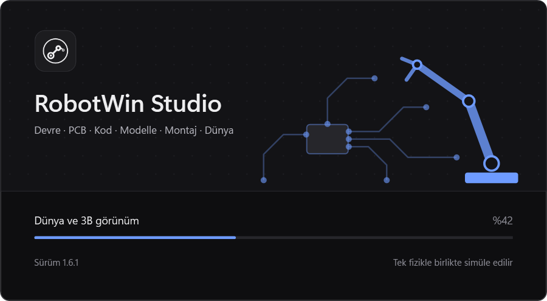
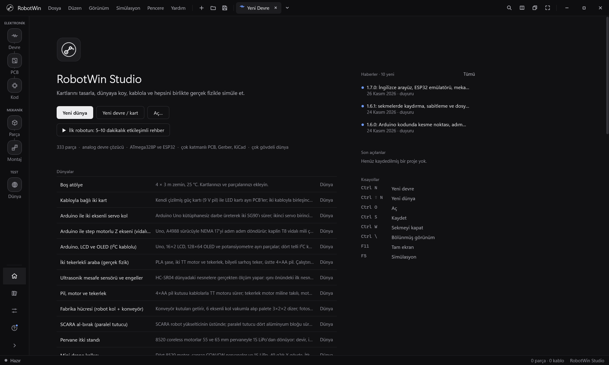
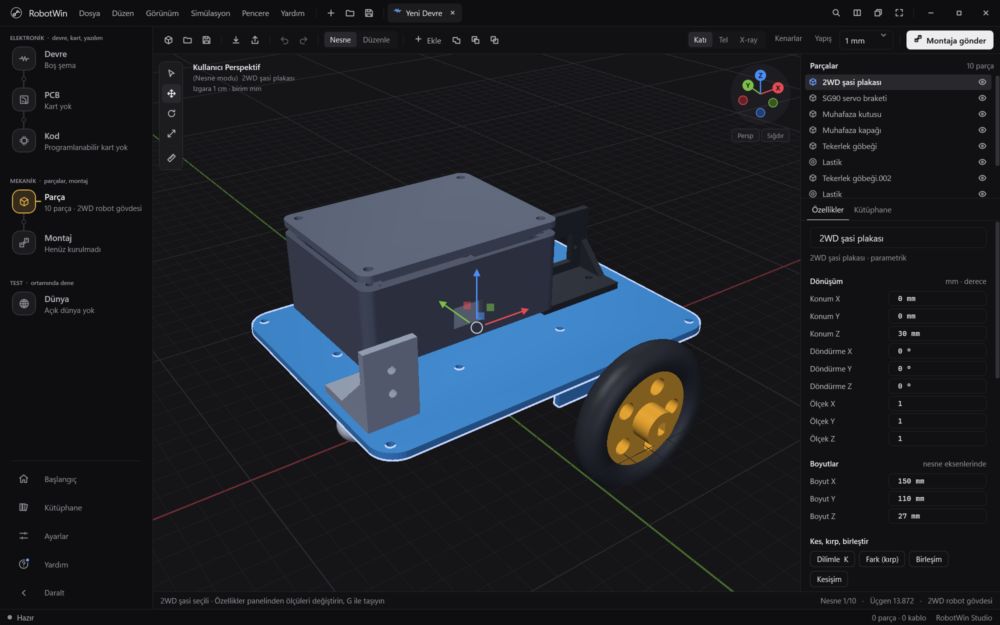

# 1. Getting started

In this chapter you install RobotWin Studio, learn the parts of the screen and open your first project.

## Installing

1. From the [GitHub Releases page](https://github.com/Kinin-Code-Offical/robotwin-studio/releases/latest) download one of the two packages:
   - `RobotWinStudio-Setup-<version>.exe`: carries .NET, nothing else to install (recommended).
   - `RobotWinStudio-Setup-<version>-lite.exe`: smaller, but needs the **.NET 9 Desktop Runtime**; the wizard offers to install it if it is missing.
2. Run the file and follow the wizard.
3. When it finishes, open **RobotWin Studio** from the Start menu.

By default it installs for your user only and does not ask for administrator rights. To uninstall, use Windows **Settings → Apps**.

### To compile your own code (optional)

The bundled examples come precompiled; these tools are needed only for code you write yourself.

| Board | Tool needed | How to install |
| --- | --- | --- |
| Arduino Uno / Nano | `arduino-cli` | In a terminal: `winget install ArduinoSA.CLI`, then `arduino-cli core install arduino:avr` |
| ESP32 | Visual Studio C++ tools (MSVC) | Visual Studio 2022 or Build Tools with the **"Desktop development with C++"** workload |

The app finds these tools itself. If it cannot, enter their paths under **Ayarlar → Derleyiciler** (Settings → Compilers).

## First launch

A splash screen appears while the app opens, then the **Başlangıç** (home) page.

The home page has:

- The **Yeni dünya** (new world), **Yeni devre / kart** (new circuit / board) and **Aç…** (open) buttons.
- **Dünyalar** (worlds): ready-made world templates (empty workshop, servo arm, two-wheel car, ultrasonic sensor, remote-controlled car, water rocket, solid-propellant motor…).
- **Devre ve robot örnekleri** (circuit and robot examples): ready circuits at beginner, intermediate and robot level (LED and button, Arduino Blink, LCD + OLED, ESP32 PWM, motor with a MOSFET, op-amp, 7805, RC filter, relay, NAND, line follower, obstacle avoider, micro quadcopter).
- On the right: **Son açılanlar** (recent), **Otomatik yedekler** (autosaves) and common **Kısayollar** (shortcuts).

> Tip: clicking an example opens it in a new tab. Do not be afraid of breaking examples; the original stays unchanged unless you save over it.

## The parts of the screen

| Part | Where | What it does |
| --- | --- | --- |
| Menu bar | Top | **Dosya** (File), **Düzen** (Edit), **Görünüm** (View), **Simülasyon** (Simulation), **Pencere** (Window), **Yardım** (Help). **F10** opens it from the keyboard. |
| Document tabs | Next to the menu | Open circuits and worlds. Drag tabs to reorder them. **Ctrl+Tab** next tab, **Ctrl+W** closes a tab. |
| Design-to-real line | Left edge | The pages in three groups: **ELEKTRONİK** (electronics: Devre → PCB → Kod), **MEKANİK** (mechanics: Parça → Montaj), **TEST** (Dünya, world). Below: Başlangıç (start), Kütüphane (library), Ayarlar (settings) and Yardım (help). The logo at the top left also returns to Başlangıç. **Ctrl+B** widens the line to show what each page is for and its status. |
| Page | Centre | The editor of the selected stage. |
| Status bar | Bottom | Latest message, simulation state, part and cable counts. |

### Window features

- **Command palette (Ctrl+K):** find any command, page or part by typing its name.
- **Split view (Ctrl+\\):** shows two pages side by side, e.g. the circuit and the PCB together.
- **Detach:** **Pencere → Bu sayfayı ayrı pencereye al** (Window → move this page to its own window) moves a page to a second window (e.g. a second monitor).
- **Focus mode:** **Görünüm → Odak modu** (View → focus mode) hides the navigation rail.
- **Moving panels (world):** on the world page, drag the palette, the inspector or a bottom tab by its header into its own window; drop the window on an edge to dock it left, right or in the bottom panel. The layout is kept. See [World → Arranging the panels](07-world.md#arranging-the-panels).
- **Full screen (F11):** leave with **Esc** or **F11**.
- **Interface scale:** **Görünüm → Arayüz ölçeği** (View → interface scale), 75–150 %.

## Files

| Extension | What it stores |
| --- | --- |
| `.rwproj` | A circuit / board project: schematic, PCB, assembly, the boards' code |
| `.rwworld` | A world: objects, cables, joints and the boards inside it |
| `.rwmodel` | A 3D model you made on the Model page |
| `.rwsim` | A simulation recording (measurements, events, serial output) |
| `.rwpart`, `.rwlib` | Your own part / part library |

- **Save:** Ctrl+S. **Save as:** Ctrl+Shift+S. **Open:** Ctrl+O.
- The app backs up unsaved work at intervals to `Documents\RobotWin\Yedekler`. Open backups from the **Otomatik yedekler** (autosaves) list on the home page.
- The installer registers these file types with Windows; double-clicking a file opens RobotWin Studio.

## Library

The **Kütüphane** (library, Ctrl+7) page shows every part with its schematic symbol, PCB footprint and 3D preview.

- **Bundan yeni parça** (new part from this): creates a new part (`.rwpart`) with your own values using an existing part's simulation model.
- **3B modeli değiştir…** (replace 3D model): replaces a part's 3D look with your own STL / OBJ / PLY file. **Üretilen modele dön** (back to the generated model) restores it.
- **İçe aktar…** (import): `.rwpart` / `.rwlib` files and KiCad symbol (`.kicad_sym`) and footprint (`.kicad_mod`, `.pretty` folder) files.
- **Kütüphanemi dışa aktar** (export my library): share your parts in one `.rwlib` file.

## Settings

The main sections of the **Ayarlar** (settings, Ctrl+,) page:

| Section | Example settings |
| --- | --- |
| Görünüm (appearance) | Interface scale, particle effects, simulation sounds and volume, current-flow animation, 3D quality, home page at startup |
| Simülasyon ve fizik (simulation and physics) | Part damage, pause on failure, ambient temperature, largest time step, starting speed |
| Dünya ve düzenleme (world and editing) | Gravity of new worlds, world editor grid, length unit (mm / mil) |
| Dosyalar ve otomatik kayıt (files and autosave) | Autosave interval, recent files list, project folder |
| Derleyiciler (compilers) | `arduino-cli` path, `vcvars64.bat` path |

The **Klavye kısayolları** (keyboard shortcuts) list, **Dosya türleri** (file types: open with this app in Windows), **Hakkında** (about) and the **Varsayılanlara dön** (restore defaults) button are here too.

---

[Contents](README.md) · [Next: 2. Circuit →](02-circuit.md)
