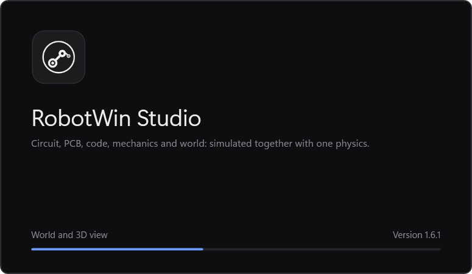
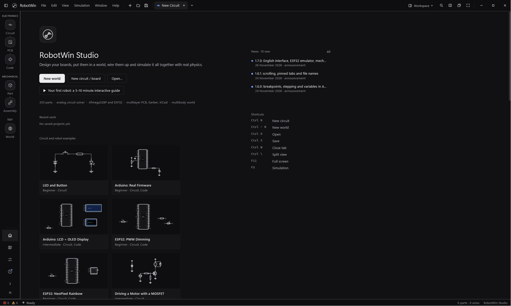
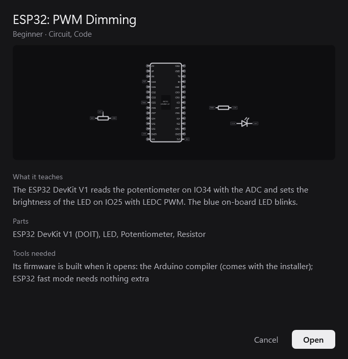
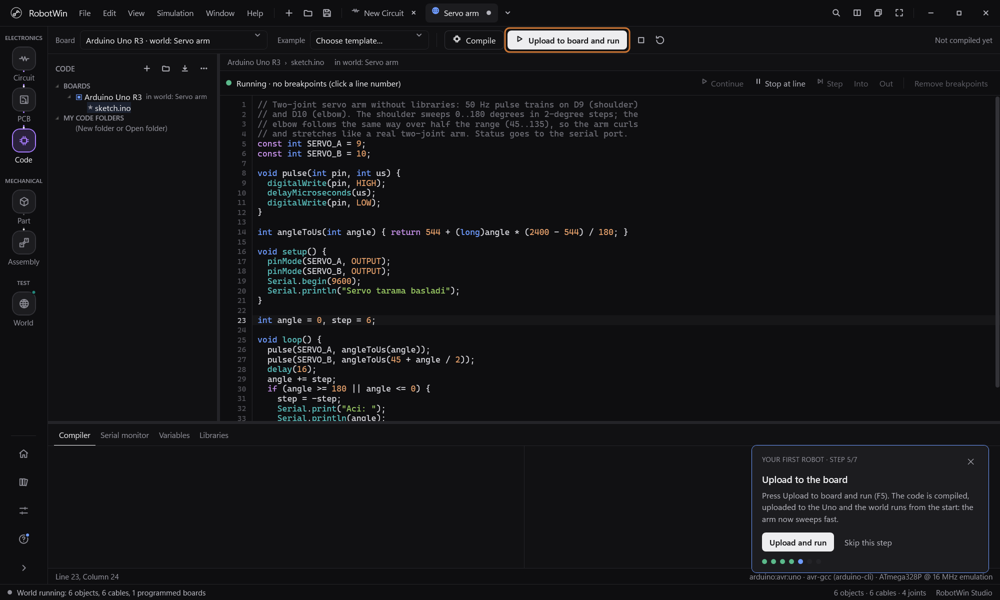
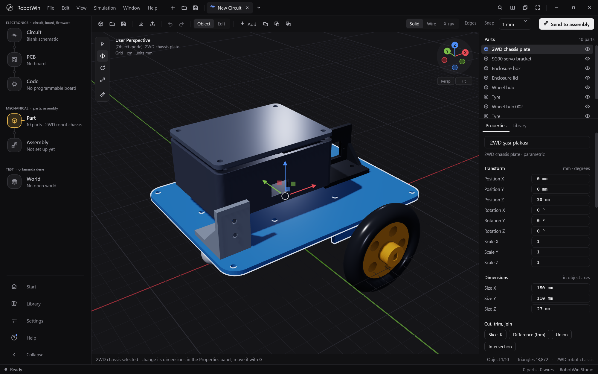
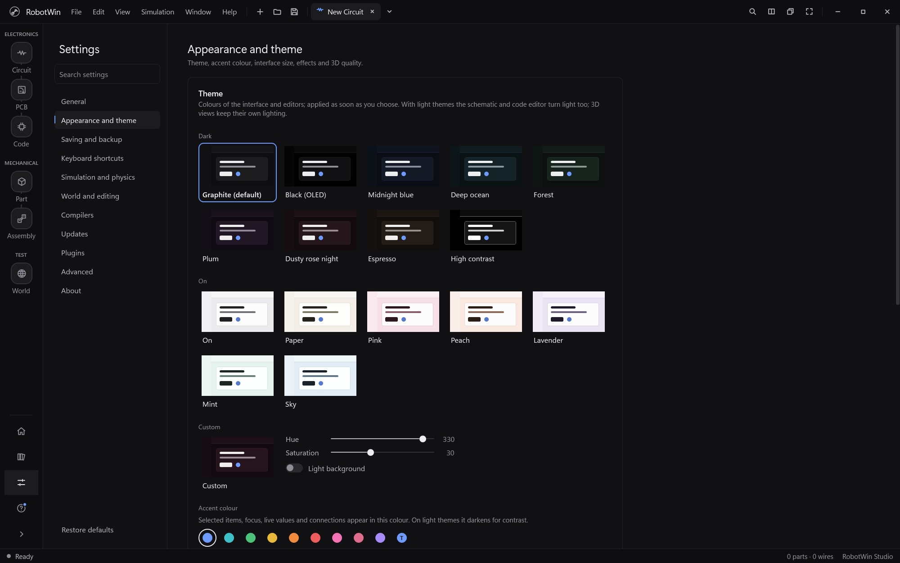

# 1. Getting started

In this chapter you install RobotWin Studio, learn the parts of the screen and open your first project.

## Installing

1. From the [GitHub Releases page](https://github.com/Kinin-Code-Offical/robotwin-studio/releases/latest) download the installer, `RobotWinStudio-Setup-<version>.exe`. It is small: it downloads the parts you choose from the same release and checks each one.
2. Run it. On the first page choose the **language** (the installer's and the app's) and the **kind of installation**:
   - **Full** (recommended): the app, its own .NET 10, the Arduino compiler and STEP / IGES support. Everything works offline right away.
   - **Lite**: the app alone; it uses the .NET 10 Desktop Runtime of your PC (and brings its own copy if there is none). The compiler and STEP / IGES can be added later.
   - **Custom**: tick the components yourself.
3. Choose **how**: for this user (default, no administrator rights), for all users (asks for an administrator) or **portable** (a folder only, e.g. on a USB stick: no shortcuts, registry entries or file types).
4. When it finishes, open **RobotWin Studio** from the Start menu.

To add or remove components later, use **Settings → Updates → Change components…** (or Windows **Settings → Apps → RobotWin Studio → Modify**). To uninstall, use Windows **Settings → Apps**. An update tries the new version once after installing it; if it does not start, the previous version is restored as it was. To install without the internet, put the release's `.rwpack` files next to the installer.

### To compile your own code

| Board | Tool needed | How to install |
| --- | --- | --- |
| Arduino Uno / Nano | The Arduino compiler: `arduino-cli`, the AVR core and the library list | **A component of the installer** (in the full installation); in a lite one, add it with **Settings → Updates → Change components…** |
| ESP32 | Visual Studio C++ tools (MSVC) | Visual Studio 2022 or Build Tools with the **"Desktop development with C++"** workload |

To use an `arduino-cli` of your own, enter its path under **Settings → Compilers**. The app finds MSVC itself; if it cannot, enter its path there too.

## First launch

A splash screen appears while the app opens: the product's name and version, on the bottom band what is being loaded and how far it has got, and a thin progress bar along the edge. The photo behind it is a licence-free stock photo standing in until RobotWin's own artwork; its author is credited on the bottom line. Then the **Start** page.

The home page has:

- The **New world**, **New circuit / board** and **Open…** buttons.
- **Circuit and robot examples**: ready circuits at beginner, intermediate and robot level (LED and button, Arduino Blink, LCD + OLED, ESP32 PWM, motor with a MOSFET, op-amp, 7805, RC filter, relay, NAND, line follower, obstacle avoider, micro quadcopter). Each example is a card: its picture is drawn from the example's own circuit, with its level and the areas it uses (Circuit, PCB, Code, Assembly, World) under it. Clicking a card first shows a short info screen: what it teaches, its parts and the tools it needs (for example whether its firmware comes prebuilt or needs the Arduino compiler); **Open** opens it.
- **Worlds**: ready-made world templates (empty workshop, servo arm, two-wheel car, ultrasonic sensor, remote-controlled car, water rocket, solid-propellant motor…).
- On the right: **Recent**, **Automatic backups** and common **Shortcuts**.

> Tip: an example opens in a new tab. Do not be afraid of breaking examples; the original stays unchanged unless you save over it.

## Your first robot: an interactive guide

The first time you open the app it offers a 5–10 minute guide. You can open it again with the **Your first robot** button on the **Start** page or with **Help → Your first robot: interactive guide (5–10 min)**.

The guide stays in the bottom right corner as a small card. At each step it says what to press and draws an orange outline around that control. It notices by itself when you have done the step and moves on. The card's button (for example **Open servo arm** or **Upload and run**) does the step for you; **Skip this step** moves on.

1. **Open the ready servo arm:** an Arduino Uno drives two SG90 servos.
2. **Run it and watch:** the arm sweeps.
3. **Open the code:** the arm's Arduino code opens on the Code page.
4. **Change the code:** the 2 in `step = 2` on line 23 comes selected; type 6. The arm sweeps three times as fast.
5. **Load it onto the board:** the code is compiled, loaded onto the Uno, and the world starts over.
6. **Measure the current:** the **Cables and measurements** tab shows the current in the servos' cables live.
7. **Save:** the world is kept with the code you changed.

## The parts of the screen

| Part | Where | What it does |
| --- | --- | --- |
| Menu bar | Top | **File**, **Edit**, **View**, **Simulation**, **Window**, **Help**. **F10** opens it from the keyboard. |
| Document tabs | Next to the menu | Open circuits and worlds; a saved file shows its own name. Unsaved changes show as a dot where the close button is. When the tabs do not fit, the strip scrolls with the mouse wheel or its arrows; **▾** lists every open tab. Right-click and **Sabitle** (pin) keeps a tab at the left, out of the bulk closes, and the file opens pinned next time too. Drag tabs to reorder them. **Ctrl+Tab** next tab, **Ctrl+W** closes a tab, **Ctrl+Shift+T** opens the closed file again. |
| Design-to-real line | Left edge | The pages in three groups: **ELECTRONICS** (Circuit → PCB → Code), **MECHANICAL** (Part → Assembly), **TEST** (World). Below: Start, Library, Settings and Help. The logo at the top left also returns to Start. **Ctrl+B** widens the line to show what each page is for and its status. |
| Page | Centre | The editor of the selected stage. |
| Status bar | Bottom | Problem counters (errors ⊗, warnings ⚠), latest message, simulation state, part and cable counts. |

### Window features

- **Workspaces:** the **Workspace** picker in the title bar (or **Window → Workspace**) opens layouts ready for a task: Circuit design, Measuring (the sheet with the oscilloscope below), Code, PCB, Mechanics, World, World simulation (cables and measurements below). The built-in workspaces also set the tool strips on the canvas edge for the task: open for designing, folded to their handle in Measuring and World simulation, and the grid strip closed in World simulation. Arrange the panels and strips as you like and **Save the layout on screen as a workspace…** to make your own (the strips' places and states are kept with the panels); **Reset to the default layout** puts the panels back where they start. **Save the layout on screen in the project** writes the layout into the project: it is saved with it, comes back by itself whenever the project opens and stands in the picker as **Project layout**; **Remove the project layout** takes it out.
- **Command palette (Ctrl+K):** find any command, page or part by typing its name. You can also type what you want like a sentence, in any word order: "add MOSFET", "watch U3 current", "run design rule check", "show the selected part on the PCB", "check the assembly mates" (the Turkish interface also takes Turkish case endings: "servo motorun akımını izle"). The open page's commands come first, and only the commands that can run right now (such as "show on the PCB" while a part is selected) are listed.
- **Split view (Ctrl+\\):** shows two pages side by side, e.g. the circuit and the PCB together.
- **Detach:** **Window → Move this page to a separate window** moves a page to a second window (e.g. a second monitor).
- **Focus mode:** **View → Focus mode** hides the navigation rail.
- **Moving, minimizing and tearing off panels:** on the world, circuit and PCB pages the side panels (palette, part library, properties, inspector) and the bottom tabs tear off into their own window when dragged by their header; drop the window on an edge to dock it left, right or in the bottom panel. The **Minimize** button in a header folds that side into a thin strip with the panels' names at the edge (as in Visual Studio); a click on the strip opens it again. **Ctrl+Space** is full view: every panel steps aside and the canvas takes the whole window; pressing it again brings the panels back as they were. The layout is kept. See [World → Arranging the panels](07-world.md#arranging-the-panels).
- **Folding sections** (as in Blender): in the Circuit, PCB and Part property panels every section heading has an arrow before it; a click on the heading folds or opens the section. The World inspector's component cards work the same way. Which sections are folded is kept between sessions.
- **Tool strips** (as in Unity): on the Circuit, PCB, Part and World pages the tools stand in a column of icons on the canvas' left edge. Drag one by its **≡** handle: dropped on another edge or a corner it settles there, elsewhere it floats. A double click on the handle, or right-click ▸ **Move to its own window**, takes the strip out into a small window (as in SolidWorks; a second screen too); a double click again or **Put back** docks it. A group's tools (drawing) open in a strip of their own beside the main one. Where they stand is kept page by page. The top bars are icons only as well; the name and the shortcut are in each icon's tooltip.
- **Problems:** the counters at the left of the status bar count the whole project's errors and warnings: the circuit's ERC, the PCB's last DRC, the last build's errors, the **Assembly** (an assembly behind its projects), what the **Project** check found missing (compilers, libraries, parts; a PCB behind its schematic) the **Assembly check** (in the open world or Montaj, run with **Check**: parts that overlap, holes off-axis, cables too short or too tight; parts fixed to each other or to the same body do not count, and a row selects the part or the cable) and, as notes, **Model limits** (what the simulation models of the circuit's parts leave out: thermal noise, core loss, the radio being a model …; a row shows the part) (like VS Code's Problems panel). When an area's check is older than its last change, an info mark shows beside them. A click on the counters (or "Problems" in the command palette) opens the list: at the top each area's state ("Circuit: OK", "PCB: 2 warnings", "Project: not checked"; a click goes to that area), below it each area's errors and warnings; items that are only info fold under a "▸ N info" line. A row goes to its place (the part selected, the DRC marker or the code line shown; Project and Assembly rows open the check's window with its fixes), and an out-of-date area is checked again with **Check**. A row with a fix has a wrench button on its right (like VS Code's quick fix; its tooltip says what it does): **Annotate** for unnumbered or duplicate designators, an NC mark on an unconnected pin, deleting a stray NC mark, removing the NC mark from a wired pin, deleting a dangling wire segment, deleting a label that touches nothing, **Redraw the net** on the PCB for a missing connection, a track too near something or a loose track end (that net's tracks are taken up, the autorouter draws it alone among the other nets and the DRC runs again), **Mark as an exception** for the other ERC and DRC markers; on Project and Assembly rows the PCB page, updating the assembly, installing the toolchain or the Library page. Fixes in the circuit undo in one step; after a fix the list is checked again and an "info" fold you opened stays open.
- **Left rail:** the rail button at the far left of the title bar, **Ctrl+Shift+B**, **View → Left rail** or **Hide** at the bottom of the rail closes and opens it; the choice is kept. With the rail closed, pages are still reached with **Ctrl+1…7** and the command palette.
- **Folding the bottom pane:** ⌄ at the right of the bottom pane folds it to a thin strip of its tabs; a click on a tab or ⌃ opens it again. The World page starts with its bottom pane folded; it opens by itself when something such as serial output arrives.
- **Sliders:** the value box beside every slider takes a typed value (Enter applies, ↑/↓ steps, Shift a large step).
- **Full screen (F11):** leave with **Esc** or **F11**.
- **Interface scale:** **View → Interface scale**. The default is **Automatic (proportional to the screen)**: the interface scales with the window; at 1920 × 1080 it is 100 %, on a smaller screen or at a large Windows display scale (150 %, 200 %) icons, text and panels shrink by the same ratio, on a large screen they grow (60–150 %). Nothing scrolls, spills over or wraps into a second column; the proportions stay the same on every screen. A fixed scale (75–150 %) can be chosen for presenting or by preference.

## Files

| Extension | What it stores |
| --- | --- |
| `.rwproj` | A circuit / board project: schematic, PCB, assembly, the boards' code |
| `.rwworld` | A world: objects, cables, joints and the boards inside it |
| `.rwmodel` | A 3D model you made on the Model page |
| `.rwsim` | A simulation recording (measurements, events, serial output) |
| `.rwpart`, `.rwlib` | Your own part / part library |

- **Save:** Ctrl+S. **Save as:** Ctrl+Shift+S. **Open:** Ctrl+O.
- The app backs up unsaved work at intervals to `Documents\RobotWin\Yedekler`. Open backups from the **Automatic backups** list on the home page.
- The installer registers these file types with Windows; double-clicking a file opens RobotWin Studio.

## Library

The **Library** (Ctrl+7) page shows every part with its schematic symbol, PCB footprint and 3D preview.

- **New part from this**: creates a new part (`.rwpart`) with your own values using an existing part's simulation model.
- **Change 3D model…**: replaces a part's 3D look with your own STL / OBJ / PLY / WRL or STEP / IGES file. **Revert to the generated model** restores it.
- **Import…**: `.rwpart` / `.rwlib` files and KiCad symbol (`.kicad_sym`) and footprint (`.kicad_mod`, `.pretty` folder) files.
- **Export my library**: share your parts in one `.rwlib` file.

## Settings

The **Settings** (Ctrl+,) page is split into categories. Pick one in the list on the left, or type a word into the **Search settings** box at the top; the search looks through every category.

| Category | What it holds |
| --- | --- |
| General | Language, home page at startup, the first-robot guide, project folder, recent files, length unit (mm, cm, inch, mil: length boxes show this unit and read a value typed with any unit, such as "1 in", "25.4 mm", "2 cm") |
| Appearance and theme | Theme gallery (9 dark, 7 light themes and a custom one), accent colour, interface scale, performance overlay, effects and sound, 3D quality, 3D renderer (our own GPU renderer or WPF) |
| Saving and backup | Autosave interval, keeping the previous version on save, crash recovery, backup folder, copies kept per document, the folder's size limit |
| Keyboard shortcuts | Change the window's and every page's shortcuts, clash warnings, reset one or all |
| Simulation and physics | Part damage, pause on failure, ambient temperature, time step, starting speed, running the simulation on its own thread |
| World and editing | Gravity of new worlds, world editor grid |
| Compilers | `arduino-cli` path, `vcvars64.bat` path |
| Updates, Plugins | Version checks; plug-in folders and scripts |
| Advanced | Export settings to a file and import them, error log, file types |

**Language:**

- The app starts in English. Choose English or Türkçe in **General → Language**. The language applies everywhere once the app starts again; the card has a **Restart now** button.
- The language changes:
  - every text of the windows, canvases and instruments;
  - number and date formats (1.5 mm in English, 1,5 mm in Turkish);
  - the guide on the Help page and the News;
  - the part catalogue's names and descriptions;
  - the examples' names and their code's comments.
- Searches (parts, settings, the command palette) work in both languages: "resistor" and "direnç" both find it.
- **To make a language pack of your own:**
  1. Copy `Lang/en.json` and name it like `de.json`. Its keys are the interface's source texts (Turkish) and its values their English: translate the values into your language. In patterns with `{…}`, numbers and names go into `{0}`, `{1}` in order.
  2. Set `"language"` at the top of the file to the language's name, and `"culture"` to its number and date format (for example `"de-DE"`).
  3. Put the new file in the folder the **Language packs folder** button opens (`%APPDATA%\RobotWin\lang`). The file name is the language's id.
  4. The pack shows in the list as "(your own pack)". Texts you have not translated show in English, not Turkish, so a pack can grow a piece at a time.

**Themes:** the gallery in **Appearance and theme** shows each theme as a small picture of the window. The theme you click is applied at once.

- **Dark:** Graphite (the default), Black (OLED), Midnight blue, Deep ocean, Forest, Plum, Dusty rose night, Espresso, High contrast.
- **Light:** Light, Paper, Pink, Peach, Lavender, Mint, Sky. On a light theme, the schematic is drawn in dark ink as if printed on paper, the PCB shows a pale board with dark silkscreen (copper keeps its colours), the code editor turns light too, and the syntax colours switch to tones that read on a light background.
- **Custom:**
  - **Ton (hue):** 0 red, 120 green, 200 blue, 330 pink.
  - **Doygunluk (tint):** how coloured the backgrounds are.
  - The **Light background** switch.
  - The window changes colour while you drag; the setting is saved when you let go.
- **Accent colour:**
  - Ten colours for selected items, focus and links; the one marked **T** is the theme's own colour.
  - On light themes the accent turns darker for contrast.
  - 3D views and instrument screens keep their own lighting.

**How backups work:**

- Unsaved tabs are copied into the backup folder at the interval you choose; your own file is not changed.
- When you save over a file, its old version is kept as `name-önceki-date`.
- Each document's newest copies are kept and the folder stays under its size limit; the oldest go first.
- If the app closes unexpectedly, the home page shows that run's backups at the next start.

**Changing a shortcut:** in **Keyboard shortcuts**, click the button and press the new keys. The keys of the Circuit, PCB, World, Code and Part pages are there too; they can be single letters. **Esc** cancels, **Backspace** removes the keys. A key that another command uses is marked with an orange note. A single letter cannot be a window shortcut, because it would fire while you type; press it with **Ctrl**, **Alt** or **Shift**. **F1–F12** work on their own.

---

[Contents](README.md) · [Next: 2. Circuit →](02-circuit.md)
