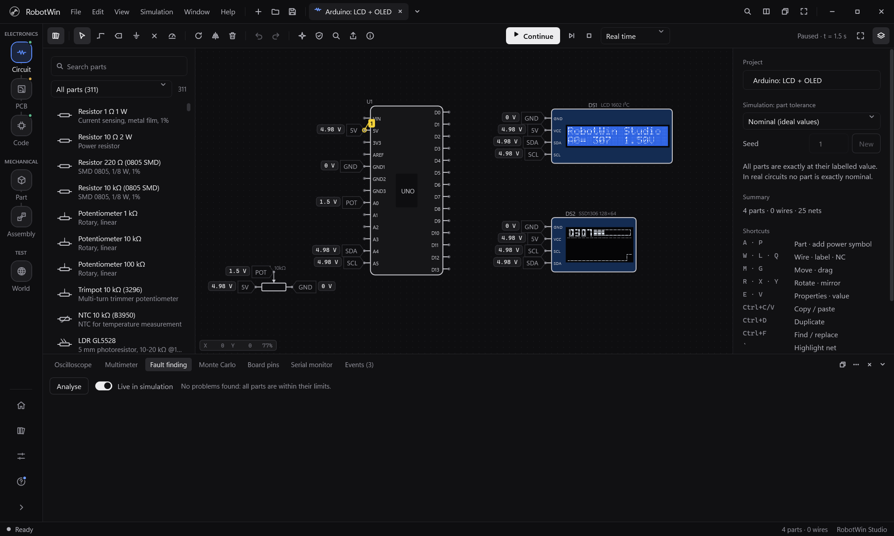
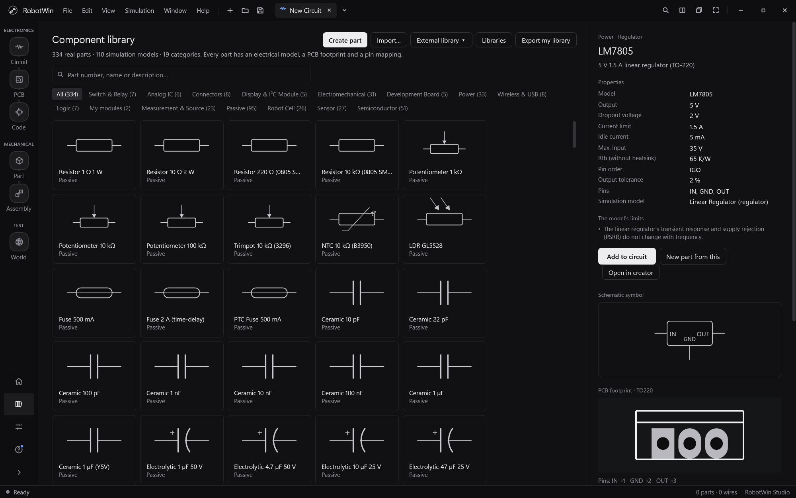
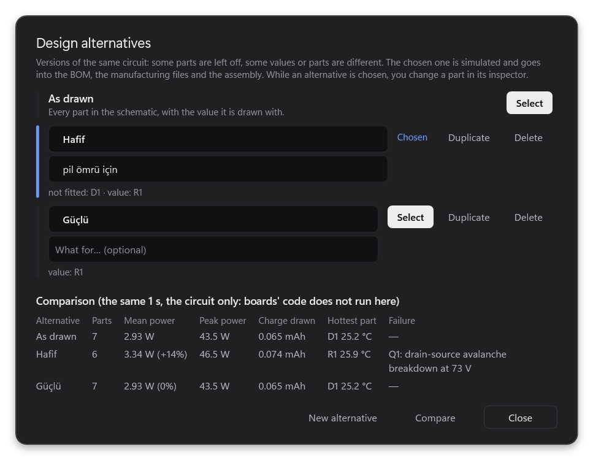

# 2. Circuit

The **Circuit** page (Ctrl+1) is where you draw schematics and simulate them live. The simulation runs on a real analog circuit solver: voltages, currents, heating and part damage are computed.

The parts of the page:

- **Left:** a searchable part list.
- **Centre:** the schematic canvas and the toolbar above it (**Simulate** button, speed selector).
- **Right:** the properties panel: the selected part, project info, part tolerance, shortcuts.
- **Bottom:** measurement and info tabs: **Oscilloscope**, **Multimeter**, **Fault finding**, **Monte Carlo**, **Board pins**, **Serial monitor**, **Events**.

## A new circuit

1. **File → New circuit / board** (Ctrl+N).
2. The empty canvas says: pick a part on the left and click on the canvas; start at a pin and click another pin to draw a wire.

## Adding parts

1. Type the part's name in the search box on the left (e.g. `resistor 10k`, `LED`, `LM358`, `arduino`).
2. Pick it from the list and click on the canvas to place it.
3. The **A** key also opens the searchable part list.
4. The **P** key adds a power symbol (GND, +5V…).

The library has passives, diodes and LEDs, transistors and MOSFETs, op-amps, 74HC logic ICs, regulators, batteries and power supplies, switches and relays, DC motors and servos, sensors, displays and I²C modules, motor drivers, Arduino Uno / Nano, ESP32 boards and wireless devices.

The category list above the search box has two levels. Main categories (e.g. **Passive**, **Power**, **Measurement & Source**) have their sub-categories under them (e.g. **Resistor**, **Capacitor**, **Power supply**, **Signal generator**). Each line shows how many parts it holds. Picking a sub-category lists only that kind of part. The **Library** page has the same layout: below the main category buttons, the picked category's sub-categories appear on a second row. Picking a part shows a **Properties** table on the right. It lists every value of its simulation model (the ones this part sets differently from the default in bold), its pins and the model's name.

**Switching regulator modules:** **Power → Regulator** has step-down modules (LM2596 3 A, MP1584 mini 3 A, XL4015 5 A) and step-up modules (MT3608, XL6009). Use them to take 5 V or 12 V from a battery or an adapter. A module's IN+ / IN− go to the input and its OUT+ / OUT− to the load; the output voltage is the board's trimmer (**Output voltage**). The model is the chip averaged over its switching period. The inductor current, the current limit and the output and input capacitors behave as they do on the bench:
- **Efficiency:** the input draws the output power plus the switch, inductor, diode and switching losses. An LM2596 from 12 V to 5 V at 1 A, for example, gives about 85 %.
- **Dropout:** a step-down's output stays below its input. The LM2596's switch drops about 1.1 V, so it cannot make 5 V from 5.5 V.
- **Current limit:** past the limit the current stays at it and the output falls.
- **Power-up:** below its UVLO voltage the module is off. When it turns on, the output rises over the soft-start time, and the capacitors' charging current shows too.
- **Heating:** the losses heat the module, up to its thermal shutdown.

**The model's limits:** every model has limits. A part's page in the library and its inspector in the circuit have a **The model's limits** heading saying what that model leaves out or simplifies. For example, the regulator modules have no switching ripple, the buttons have no contact bounce, and the MOSFET is a level 1 model. Keep it in mind when reading a result.

## Wiring

1. Click a pin; the wire starts.
2. Click where you want corners.
3. Click the target pin; the wire ends. A double-click or **Esc** also ends it.

Helper keys:

| Key | Function |
| --- | --- |
| W | Wire tool |
| / | Corner direction (horizontal first / vertical first) |
| Shift+Space | Wire mode: 90° → 45° → free |
| Backspace | Undo the last corner |
| L / Ctrl+L | Net label / global label |
| Q | No-connect (NC) marker |

Labels with the same name are connected; the name `GND` means ground. Right-clicking a wire offers **Split wire**, **Delete this segment** and **Add label**.

## Editing

| Key | Function |
| --- | --- |
| M / G | Move / drag (with G the wires stretch) |
| R / Shift+R | Rotate |
| X / Y | Mirror horizontally / vertically |
| Ctrl+D | Duplicate |
| Ctrl+C / Ctrl+X / Ctrl+V | Copy / cut / paste (also between tabs) |
| Del | Delete |
| E | Properties (also with several parts selected) |
| V, F2 or double-click | Edit the value in place (e.g. `4k7`) |
| D | The part's datasheet |
| Ctrl+F / Ctrl+H | Find / find and replace (`*` and `?` wildcards) |
| F1 or ? | All shortcuts |

- **Annotate**: numbers part names (R1, R2, C1…) by row or column; the names on the PCB and in the assembly follow.
- **Electrical rules check (ERC)**: finds unconnected pins, single-pin nets, output conflicts and unpowered power inputs.
- **PCB footprint**: choose the footprint the part uses on the PCB.

## Simulation

1. Press **Simulate** on the toolbar, or **F5**.
2. While it runs:
   - Click buttons and switches.
   - Turn potentiometers with the mouse wheel.
   - Click a wire: the oscilloscope starts measuring there.
3. **F5** again pauses, **Shift+F5** stops. **Step 1 ms** advances one step.
4. Speed: **0.01×**, **0.1×**, **Real time**, **5×**, **20×**.

The status bar shows simulation time. If the PC cannot keep up with real time it shows "…% of real time".

### Part damage

A circuit that would burn in real life burns here too: an LED without a resistor, a motor drawing too much current, an electrolytic capacitor fitted backwards… A burned part is marked and written to the **Events** tab.

- In the **Fault finding** tab, **Why?** explains why the part burned.
- After fixing the circuit, renew the parts with **Repair damaged parts**.
- To switch damage off entirely, turn off **Simulation → Part damage (burning out, fuses)**.

### Board pins

You can drive the pins of an Arduino or ESP32 that has no code by hand in the **Board pins** tab: input, pull-up, LOW, HIGH or PWM.

## Design alternatives

You can keep versions of the same circuit together: alternatives in which some parts are left off, or some values or parts are different. For example a cheaper version without the flyback diode, or one with 1 kΩ instead of 330 Ω for a longer battery life.

1. In **Simulation → Design alternative → Alternatives…**, add one with **New alternative**, and write its name and what it is for.
2. With the alternative chosen, select a part. In the **Alternative** section of its inspector, give its state in that alternative with **Not fitted in this alternative** or **Value in this alternative**. The parameters above belong to every alternative.
3. A part that is not fitted shows faded and crossed out on the sheet; a part with another value shows that value highlighted.

The chosen alternative is changed in the list beside **Simulate**. It is the one simulated, and the one that goes into the bill of materials (BOM), the manufacturing files (the BOM and pick-and-place file of the Gerber package) and the assembly. A part that is not fitted keeps its pads on the board; the board is one for every alternative.

**Compare** simulates each alternative and the design as drawn for the same second and puts them side by side: the supply's mean and peak power, the charge drawn (mAh), the hottest part and the parts that failed. Only the circuit runs here, not the boards' code.

Alternatives follow parts by their identity, not their names: renaming a part keeps what it is in each alternative.

## Exporting

From the circuit page you can export:

- Bill of materials (BOM, `.csv`)
- KiCad netlist (`.net`)
- SPICE netlist (`.cir`)
- Image (PNG / SVG)
- Print / PDF (Ctrl+P)

## Next step

When your circuit is ready, go to the **PCB** page (Ctrl+2) or write the board's code (Ctrl+3). The instruments are covered in [8. Instruments](08-instruments.md). How the solver works: [Circuit solver](../physics/01-circuit.md).

---

[← Previous: 1. Getting started](01-getting-started.md) · [Contents](README.md) · [Next: 3. PCB →](03-pcb.md)
