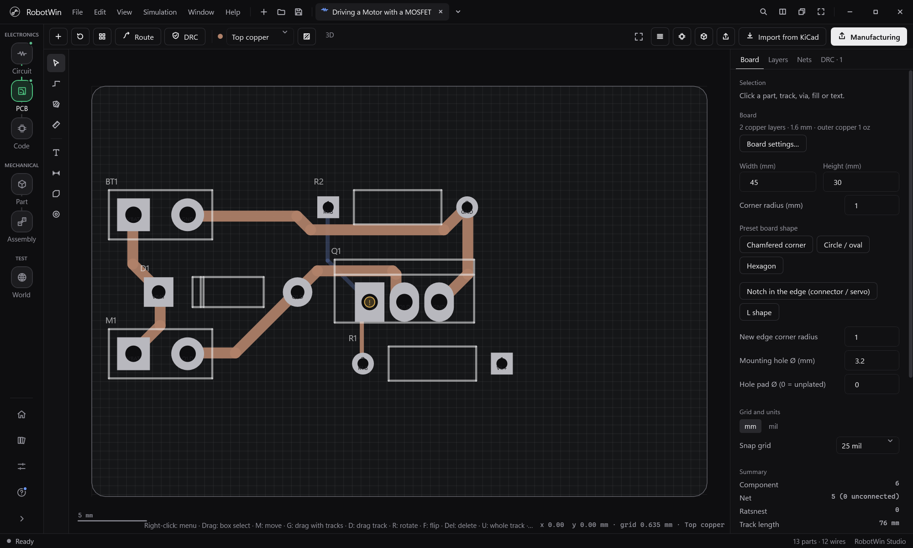
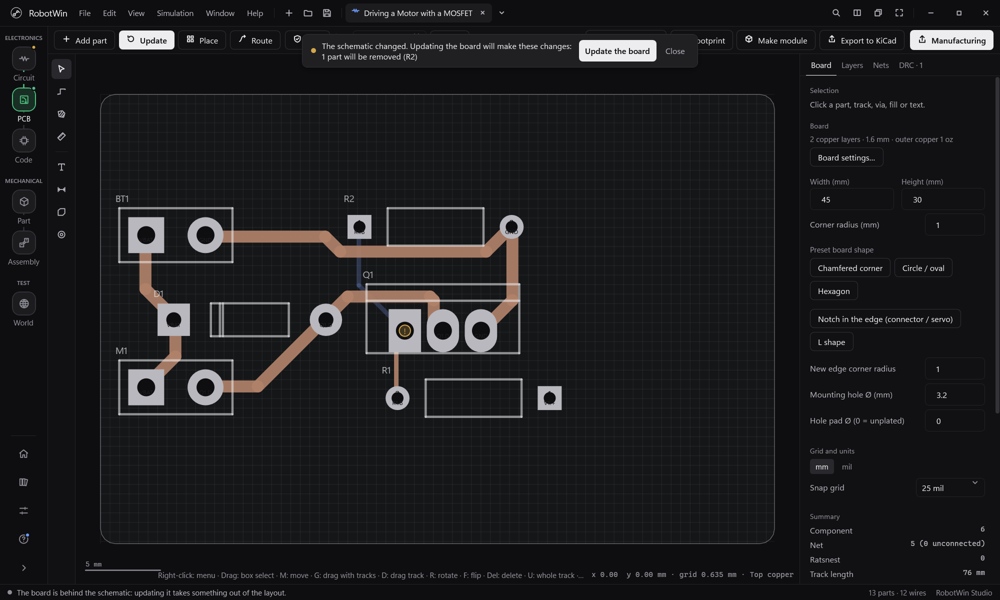

# 3. PCB

The **PCB** page (Ctrl+2) turns your circuit into a printed circuit board: you place the parts, draw the copper tracks, check the rules and produce the files to send for manufacturing.

## From schematic to board

1. Draw the circuit on the **Circuit** page.
2. Go to the **PCB** page. The schematic's parts come onto the board; pins that must be connected are shown with thin lines (ratsnest).
3. If you change the schematic later, the board is brought up to date when you come back to the PCB page, and your placement is kept. When the change would take something out of the layout (a part leaving the board or changing its footprint, tracks and vias on nets that are gone), the board is left as it is and the top of the page says what would happen: **Update the board** applies it. Until then the **Update** button stands out, and hovering it lists every change. A part that leaves the board has its place remembered; if it comes back to the schematic it goes there. The board follows parts by their identity, not their names: renaming a part (R1 → R7) leaves it where it is. When a net's name changes (its label renamed, or the part an unnamed net is called after renamed), its tracks, vias and zones stay under the new name; they used to be deleted as the copper of a net that no longer exists.
4. **Add part** puts a part from the library straight onto the board; it is added to the schematic too.

## Board settings

**Board settings** opens:

- Copper layer count: any even number from **2** to **32** (top copper, inner 1 … inner 30, bottom copper), as in KiCad. When the stack does not fit the board thickness, the window gives the least thickness it needs: make the board thicker or the prepreg thinner.
- Board thickness, copper weights, dielectric.
- Blind / buried vias.
- Net classes (track width and clearance) and manufacturing rules.

Draw the board edge as a polygon with the **Board edge** tool on the left toolbar, and add **Mounting hole**s.

## Placement

- Drag parts with the mouse. **R** rotates, **F** flips a part to the bottom / top side, **L** locks it.
- **Place** does an automatic placement by the connections; locked parts stay where they are.

## Routing

### By hand (interactive)

1. Press **X** (track tool).
2. Click a pad and move the mouse towards the target. The track walks around obstacles and keeps the clearance rules.
3. Click to fix intermediate points; clicking the target pad finishes it.

| Key | Function |
| --- | --- |
| V | Place a via and go to the other layer of the layer pair (set in the Katmanlar tab; top ↔ bottom by default, inner layers too on 4 and 6 layers) |
| PgUp / PgDn | Go to the top / bottom layer through a via |
| / | Angle direction (diagonal first / straight first) |
| Space | 45° / 90° mode |
| W / Shift+W | Track width: next / previous |
| Backspace | Undo the last segment |
| Enter or double-click | Finish |
| Esc | Cancel |

Drag a drawn track with **G**; its connected ends follow.

### Automatic

**Route** draws every connection automatically: it searches all layers, keeps the net classes' widths and clearances, and drops vias to inner planes when needed.

## Copper pours

1. Draw a pour area with **Z**, or use the ready **+ GND (top)**. Boards with 4 or more layers also have **+ GND plane (Inner 1)**.
2. Fill the areas with **Fill**. **B** fills, **Ctrl+B** empties the fill.

Filling follows the clearance, thermal relief, priority and island-removal rules.

## Teardrops

The **Teardrop** button in the toolbar switches on KiCad's and Altium's teardrops: where a narrow track meets a pad or a via, copper widens from the pad to the track, so a drill that wanders, an etch that eats in or a board that flexes does not cut the joint. The panel sets them on pads and on vias separately, curved (KiCad's default) or straight sides, length and width as a share of the pad's size (50 % and 100 % by default) and their limits (mm). A teardrop lies along the track itself, so it lines up with a track that enters the pad off its centre and never sticks out of the pad's sides. One that would come closer to another net than the rules allow is narrowed first, left out if that is not enough, so it never breaks the DRC. Teardrops are not stored; they are worked out from the tracks every time: on screen, in the Gerber copper layers (as regions) and in other nets' pours (which keep their clearance from them), always as the tracks are now. A change refills the pours. The file handed to KiCad does not carry them; KiCad makes its own from its teardrop settings.

## Drawing tools and the via

Buttons in the left tool strip with a small triangle in their corner are tool groups: press and hold or right-click to list the group's tools by name; the one picked becomes the button's face.

- **Draw** group: **Line** (each end starts the next line, Esc stops), **Rectangle** (two opposite corners), **Circle** (centre, a point on it), **Arc** (centre, start, end) and **Polygon** (corners; double-click, the first corner or Enter closes it). Backspace takes the last point back. The options bar at the canvas' top left sets the layer (top / bottom silkscreen, top / bottom fab, drawings), the line width and **Filled**. Shapes on the silkscreen go into the Gerber (filled ones hatched) and to KiCad as `gr_line`, `gr_rect`, `gr_circle`, `gr_arc`, `gr_poly`; DRC reports a silkscreen drawing over a pad. Shapes are picked, moved (M) and deleted; the selection filter lists them as **Drawings**.
- **Eraser** (on the left strip, the bin; Altium's and Eagle's delete tool): each click deletes what is under it (a track, via, part, text, drawing …; as the selection filter allows). Each deletion undoes with Ctrl+Z.
- **Full-window crosshair** and **Cursor in polar (distance and angle)** (Layers tab; KiCad's left toolbar switches): a thin cross is drawn from the pointer to the view's edges; the status line gives the pointer as its distance (r) and angle (θ, counter-clockwise) from the origin instead of x, y. The choices are kept.
- **Draw the ratsnest curved** (Layers tab; KiCad's curved ratsnest): the lines of unrouted nets are drawn with a gentle bow, so lines lying on one row are told apart. The choice is kept.
- **Preset** (at the top of the Layers tab; KiCad's layer presets): **All layers**, **Top side**, **Bottom side**, **Copper only** or **Active layer only** in one choice; picking a side makes it the active layer too.
- **45° constraint** (the angle button beside the grid on the view bar; KiCad's horizontal, vertical and 45° constraint): drawn lines and polygons, zone, keepout and board edge corners leave the previous point only level, upright or at 45°, the pointer settling on the grid along that line. A point the magnet caught (a pad, a track's end) stays where it was caught. The choice is kept.
- **Magnet** (KiCad's magnetic items; on the **Board** tab under **Grid and units**): before the grid, the pointer goes to what is near it: **Snap to pads** to a pad's, via's or hole's centre, **Snap to tracks** to a track's end or centre line (each **Never**, **While drawing** or **Always**), **Snap to drawings and the board edge** to the corners and centres of drawings, dimensions and the edge. A small diamond shows where it was caught. The drawing tools, zone and edge corners, the ruler and dimensions use it; the choices are kept.
- **Dimension** tool (Ctrl+Shift+H) with KiCad's kinds; **Type** in the options bar: **Aligned** (two points, then the side of the line), **Orthogonal (horizontal / vertical)** (two points, then pulled above or below for the horizontal distance, to the side for the vertical), **Radius** (centre, a point on the circle, then outwards; it writes "R 3.00 mm"), **Leader** (the arrow's tip, then where the text goes; it asks for the note) and **Centre mark** (centre, then the end of the cross). The **Text** box of a selected dimension takes what to write instead of the measured value (a leader's note); empty, the value is written. Dimensions come out with the same lines on screen, in Plot, in the Gerber and in KiCad.
- **Track** group: **Track** (X) and **Length tuning**. While routing, the options bar sets the track width (the net class's or a step), the via size and the active layer.
- **View bar** (the board's top right): fit the board, fit the selection, zoom in, zoom out; rotate the selection, flip it to the other side, lock it; **Find** (Ctrl+F) finds a part by designator or value, a net and a text, and goes there when picked (a net is highlighted).
- **Areas** group: **Copper zone** (Z) and **Rule area** (KiCad's keepout). A rule area is drawn by clicking its corners; the options bar sets what it forbids (tracks, vias, pours, parts) and its layers (the active one or all). The pour leaves it bare, both routers keep out of its sides, and DRC reports a track, via, pour or (if asked) part inside as a **Rule area** error. It goes to KiCad as a keepout zone. It is drawn hatched red; picked by its edge, moved and deleted.
- **Holes** group: **Mounting hole** and **Via**. The via tool puts a via where you click; it takes the net of the track, pad or fill under it (for stitching vias).

## Design rule check (DRC)

**DRC** checks the board:

- Net-class clearances, track width, hole and annular ring sizes
- Distance to the board edge
- Courtyard overlaps, silkscreen on pads
- Unconnected nets, dangling tracks and vias
- Out-of-date pours
- Track current capacity

Errors appear in a list; clicking one shows the spot on the board. **F8** goes to the next marker, **Shift+F8** to the previous one (so do the arrows above the list).

The **Errors**, **Warnings** and **Exclusions** buttons above the list show or hide that kind, with their counts. Right-clicking a row offers:

- **Mark as exclusion…**: a marker accepted on purpose (a test point at the board edge, say) leaves the counts with a note. The exclusion is saved with the board and holds as long as the same rule finds the same thing in the same place (even if the numbers change a little). If what it points at moves more than 1 mm, or it turns up between other items, it counts again. With **Exclusions** on, exclusions are listed in grey and a right-click takes them back.
- **This rule's severity**: the rule becomes an **Error**, a **Warning** or **Do not check** (never reported).

**Rule severities** lists every rule by group (Electrical, Manufacturing, Mechanical, Signal integrity, Housekeeping, Manufacturing and test) with its markers in the last run; each gets a severity, and **Reset all to default** clears the settings. Severities and exclusions are saved with the board and can be undone. **Save report…** writes the last run as a text file: date, board, counts, errors, warnings, exclusions (with their notes) and the rules not checked.

### Clearance resolution

KiCad's clearance resolution from its Inspect menu: select two items with Ctrl+click (a track, a via, a part or a pour) and open **Clearance resolution** from the command palette (Ctrl+K). The window gives both items' nets and net classes, the clearance that holds between them and the class it comes from (the larger of the two; a pour's own clearance when that is larger), and the real copper gap on every copper layer they share; a layer below the rule shows in red as **VIOLATION**. For a part, its pad of another net nearest the other item counts.

### Manufacture and test (DFM/DFT)

With **Manufacture and test (DFM/DFT)** switched on, the DRC also adds, as warnings, what the fab and the assembly line look at:

- **Acid trap:** tracks meeting at an angle sharper than 90° (not on a pad or a via; the etchant stays in the corner).
- **Mask sliver:** a solder-mask dam narrower than 0.1 mm between two pads (the openings merge, the solder can bridge).
- **Via in pad:** an open via inside an SMD pad (it wicks the solder away; it needs filling and capping).
- **SMD near the edge:** an SMD pad closer than 2 mm to the board edge (the assembly line holds the edge; add a panel rail).
- **No fiducials:** a part with a 0.65 mm or finer pitch and fewer than two fiducials.
- **Tombstoning risk:** one pad of a two-pad SMD part tied to far wider copper than the other (the two ends do not melt together).
- **Illegible silkscreen:** text lower than 0.8 mm or thinner than 0.15 mm.
- **Drill sizes:** more than eight different drill diameters (each one is a tool change).
- **No test access / probe pitch:** every net with two or more pads needs a place a test probe can touch (a through-hole pad, a test point part or a bottom pad of at least 0.8 mm); the ones without are listed, and two probes closer than 1.27 mm are flagged. The summary line gives the **test coverage**.

These are warnings, not errors: a board that breaks them can be made, at a higher cost or a lower yield.

### Enclosure

The **Box** switch in the **DRC** tab defines the box the board goes into. Switching it on suggests a box the board and its parts fit with a few millimetres to spare. The sizes are inside sizes:

- the length along the board's X, the width along its Y, the height from the floor to the lid;
- how far the board's top-left corner sits from the inner left and top walls;
- the standoff height (floor to the board's underside) and the length of the trimmed through-hole leads;
- the margin: a body closer than this to a wall is warned about.

The DRC holds every part's body (its courtyard's area, as tall as its footprint's height; under the board for bottom-side parts) to the walls, the floor and the lid:

- whatever goes into them is an error ("Q1 goes 0.6 mm into the lid (its body is 15 mm, there are 14.4 mm above the board)");
- whatever stays within the margin is a warning;
- through-hole leads touching the floor, or a board that does not fit the box, are errors too.

If a connector comes out through a wall (a USB socket, a DC jack), add an opening on that wall under **Openings in the walls**: its position in the board's coordinates, its lower edge from the floor. A part whose body stays inside the opening does not count as going into the wall. The box is saved with the board; with its settings folded away, a one-line summary shows.

### Differential pairs and length matching

In the **Nets** tab, **Differential pairs** holds two nets that must run together (USB D+/D−, CAN H/L). **Find by name** pairs the nets whose names end in `+`/`-`, `_P`/`_N` or `H`/`L`. Beside each pair are its two routed lengths, their difference and how much of the route runs side by side at the pair's gap; **Gap** and **Largest difference** (about 2.5 mm for USB 2.0 full speed, 1.25 mm for high speed) are set there. **Length groups** hold nets that must arrive together (a parallel bus, a clock and its data) within a tolerance. A net's length is its tracks plus the barrels of the vias it changes layer through (the board's thickness between the two layers). The DRC warns about a pair longer than its limit on one side, a pair less than 60 % of whose route runs side by side, and a group spread wider than its tolerance. **Track lengths** lists every net's length. Each pair's length difference is also given in time (ps): on an outer layer a track travels with the effective εr worked out from the stackup's dielectric and the track width (Hammerstad–Jensen microstrip), inside the board with εr.

**Length tuning (meanders):** in the routing tool's group (press and hold the track button). Click a long straight segment of the short net; it gets 45° meanders up to the length of its pair's other half or of its length group's longest net. The meanders keep the net class's clearance to other copper and to the board edge; when they do not fit, it says why (which track or pad is too close). The options bar sets the target (pair / group or a length in mm), the amplitude, the maximum amplitude, the spacing of the legs and the corners. It can be undone. On one half of a differential pair it works as KiCad's skew tuning: the bumps are small (from 1.5 times the track width) and go on the side away from the partner, so the two tracks stay side by side; the skew left over is reported against the pair's allowance.

**Differential pair route:** in the routing tool's group (press and hold the track button). Click a pad of a pair (D+/D−, `_P`/`_N`, CAN H/L): both of its pads are taken. Each click adds a leg to the pair's centreline (straight, then 45°); the two tracks run on either side of it at the pair's **Gap**, mitred at the corners, and leave their pads at 45° to join the pair. Both lengths and their difference show beside the cursor. A click on the pair's pads at the other end puts the tracks down; **Enter** or a double click finishes where it is, **Backspace** takes the last leg back, **Esc** drops it. A pair too close to another net's copper, or whose ends are in opposite order (the tracks would cross), is drawn red and not placed. A pair found from its names joins the board's pairs when it is placed, and the DRC holds it to its gap and skew. At corners the inner track is the shorter: when the skew is over the limit, the length tuner evens it out. The options bar sets the width and the layer.

## 3D view

**3D** shows the board with its parts in 3D. While simulating, LEDs light up and hot parts glow.

## Manufacturing files

| Button | What it produces |
| --- | --- |
| **Manufacturing** | `<name>-gerber.zip`: Gerber files of every copper layer, solder mask, paste, silkscreen, board edge, PTH / NPTH / blind drill (Excellon) files, BOM and pick-and-place file (CPL) |
| **Export to KiCad** | `<name>-kicad.zip`: a KiCad 8 project (`.kicad_pro`, `.kicad_sch`, `.kicad_pcb`), netlist, symbol and footprint libraries, SPICE and Gerber |

Upload the Gerber ZIP straight to a board maker.

### Plot (SVG / PDF)

**File → Plot the board (SVG / PDF)…** (or **Plot (SVG / PDF)** in the command palette) is KiCad's Plot window. Each layer is drawn 1:1 exactly as its Gerber is written: pours, teardrops, tracks, pads, vias, mask openings, paste, silkscreen and the edge. Format: **PDF: a page per layer**, **SVG: a file per layer** (the layer's name is added to the file name, `board-F_Cu.svg` for instance) or **SVG: all in one file** (the layers stacked as they lie on the board, each in a group of its own). Pick layers one by one or with **All**, **Copper**, **Top side**, **Bottom side**. Options: in colour or all black (toner transfer, film), mirrored, holes open at their real size, the board edge on every layer, and the board's and the layer's name underneath. The choices are remembered.

As soon as the ZIP is saved it is read back from disk and checked. The reader is written from the Gerber and Excellon specifications, independently of the code that writes the files:

- each layer is drawn in 20 µm pixels (a little coarser on large boards);
- the same layer is drawn again straight from the board's geometry: tracks, pads by their shapes, vias, copper pours, mask openings, paste, silkscreen and the board edge;
- the two are laid over each other, and every difference thicker than a pixel is reported with where it is and its area ("missing (4.00, 4.00) mm, 27.9 mm²");
- the drill files are matched hole for hole: plated or not, diameter, and the layers of blind and buried vias.

A wrong unit, a flipped axis, a wrong aperture size, an arc turning the wrong way or a lost object shows before the files go to the maker. The status bar gives the result ("9 Gerber and 2 drill files match the board"); if something differs, a window lists where.

### Bringing it back from KiCad

If you took the board to KiCad with **Export to KiCad** and placed or routed it there, choose its `.kicad_pcb` with **Import from KiCad**:

- what changed is listed first: parts moved, turned or flipped to the other side (by reference), each net's track count, length and via count, the copper pours, the mounting holes, the board size;
- **import the changes** carries them over to this board (one step to undo); the pours are filled again;
- the footprints and the schematic are this project's: a part standing on another footprint in KiCad, or one that is only in KiCad, shows in the list but is not taken;
- tracks come with their arcs (in chords of 10°); an angle that is not a quarter turn (45°) is rounded to the nearest one and the list says so;
- a board drawn elsewhere on KiCad's page is shifted so its outline's corner comes to this board's origin.

## Footprints and modules

- **Footprint:** the footprint editor. Draw SMD and THT pads, silkscreen, courtyard and fabrication layers and save to your user library.
- **Assign footprints** (command palette, Ctrl+K; as in KiCad): every part on the board with its value, kind and footprint in one table; when a pin of the part has no pad in its footprint the row turns red and names the pins left without one. **Change…** picks another footprint.
- **Make module**: saves this board to the library as one part. It is added to other circuits as a single part, and its inside is still fully simulated.

## View

**Net colours** (as in KiCad): in the **Hatlar** tab's net list, click the swatch beside a net and pick a colour; that net's copper (tracks, teardrops, pours, via rings) shows in it on every layer, so a supply or a signal can be followed across the board. **No colour** goes back to the layer's colour; **Remove all net colours** clears them. Colours are saved with the board and only change the view: Gerber, drill and KiCad files stay the same.

The grid button in the toolbox at the canvas's top right shows or hides the grid (snapping stays the same; the choice is remembered).

The **Opacity** sliders in the **Katmanlar** tab (like KiCad's Objects tab) fade tracks (with their teardrops), vias, pads and pours separately; values can be typed and are remembered. **Dolguları yalnız kenarıyla göster** draws pours by their outlines only, as KiCad can, so the tracks under them show. Only the view changes.

| Key | Function |
| --- | --- |
| Home or F | Fit |
| + / − / wheel | Zoom in / out |
| Drag with the middle or right button | Pan |
| PgUp / PgDn | Active layer |
| H | Show only the active layer / show all |
| The key left of 1 | Highlight the net under the cursor (the eye-shaped **Highlight net** tool in the left strip highlights the clicked one; clicking the same net or empty space clears it) |
| Ctrl+Shift+M | Measure |
| Ctrl+Shift+H | Dimension |
| T | Silkscreen text |
| F1 or ? | All PCB shortcuts |
| F8 / Shift+F8 | Next / previous DRC marker |

The **Selection filter** at the foot of the **Layers** tab decides which kinds a click, a box selection and Ctrl+A pick up: parts (and among them the locked ones), tracks, vias, texts, mounting holes, copper zones, dimensions, the board edge. A kind turned off is still drawn and checked, it just cannot be picked; with vias off, for example, the track under a via is picked directly. **All** turns every kind on or off.

**Statistics…** on the **Board** tab shows what the board is made of: size and area, parts on the top / bottom side, through-hole and SMD, pad kinds, vias, net and track counts, track length layer by layer, copper zones and the drill list (each size, plated or not, pad / via / mounting hole and how many). **Copy to clipboard** gives it as text for a fab quote. The command palette opens it too ("board statistics").

---

[← Previous: 2. Circuit](02-circuit.md) · [Contents](README.md) · [Next: 4. Code →](04-code.md)
