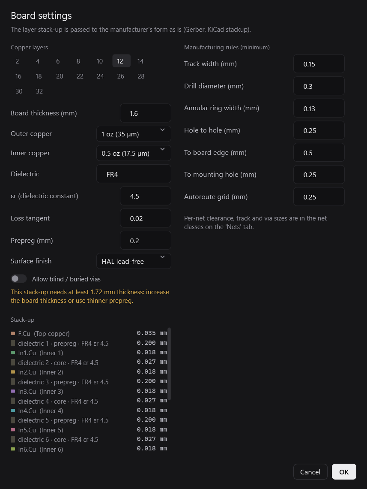

# 3. PCB

The **PCB** page (Ctrl+2) turns your circuit into a printed circuit board: you place the parts, draw the copper tracks, check the rules and produce the files to send for manufacturing.

## From schematic to board

1. Draw the circuit on the **Circuit** page.
2. Go to the **PCB** page. The schematic's parts come onto the board; pins that must be connected are shown with thin lines (ratsnest).
3. If you change the schematic later, the board is brought up to date when you come back to the PCB page, and your placement is kept. When the change would take something out of the layout (a part leaving the board or changing its footprint, tracks and vias on nets that are gone), the board is left as it is and the top of the page says what would happen: **Update the board** applies it. Until then the **Update** button stands out, and hovering it lists every change. A part that leaves the board has its place remembered; if it comes back to the schematic it goes there. The board follows parts by their identity, not their names: renaming a part (R1 → R7) leaves it where it is. When a net's name changes (its label renamed, or the part an unnamed net is called after renamed), its tracks, vias and zones stay under the new name; they used to be deleted as the copper of a net that no longer exists.
4. **Add part** puts a part from the library straight onto the board; it is added to the schematic too.

## Board settings

**Board settings** opens:

- Copper layer count: any even number from **2** to **32** (top copper, inner 1 … inner 30, bottom copper), as in KiCad. When the stack does not fit the board thickness, the window gives the least thickness it needs: make the board thicker or the prepreg thinner.
- Board thickness, copper weights, dielectric.
- Blind / buried vias.
- Net classes (track width and clearance) and manufacturing rules.

Draw the board edge as a polygon with the **Board edge** tool on the left toolbar, and add **Mounting hole**s.

## Placement

- Drag parts with the mouse. **R** rotates, **F** flips a part to the bottom / top side, **L** locks it.
- **Place** does an automatic placement by the connections; locked parts stay where they are.

## Routing

### By hand (interactive)

1. Press **X** (track tool).
2. Click a pad and move the mouse towards the target. The track walks around obstacles and keeps the clearance rules.
3. Click to fix intermediate points; clicking the target pad finishes it.

| Key | Function |
| --- | --- |
| V | Place a via and change layer |
| PgUp / PgDn | Go to the top / bottom layer through a via |
| / | Angle direction (diagonal first / straight first) |
| Space | 45° / 90° mode |
| W / Shift+W | Track width: next / previous |
| Backspace | Undo the last segment |
| Enter or double-click | Finish |
| Esc | Cancel |

Drag a drawn track with **G**; its connected ends follow.

### Automatic

**Route** draws every connection automatically: it searches all layers, keeps the net classes' widths and clearances, and drops vias to inner planes when needed.

## Copper pours

1. Draw a pour area with **Z**, or use the ready **+ GND (top)**. Boards with 4 or more layers also have **+ GND plane (Inner 1)**.
2. Fill the areas with **Fill**. **B** fills, **Ctrl+B** empties the fill.

Filling follows the clearance, thermal relief, priority and island-removal rules.

## Design rule check (DRC)

**DRC** checks the board:

- Net-class clearances, track width, hole and annular ring sizes
- Distance to the board edge
- Courtyard overlaps, silkscreen on pads
- Unconnected nets, dangling tracks and vias
- Out-of-date pours
- Track current capacity

Errors appear in a list; clicking one shows the spot on the board.

### Manufacture and test (DFM/DFT)

With **Manufacture and test (DFM/DFT)** switched on, the DRC also adds, as warnings, what the fab and the assembly line look at:

- **Acid trap:** tracks meeting at an angle sharper than 90° (not on a pad or a via; the etchant stays in the corner).
- **Mask sliver:** a solder-mask dam narrower than 0.1 mm between two pads (the openings merge, the solder can bridge).
- **Via in pad:** an open via inside an SMD pad (it wicks the solder away; it needs filling and capping).
- **SMD near the edge:** an SMD pad closer than 2 mm to the board edge (the assembly line holds the edge; add a panel rail).
- **No fiducials:** a part with a 0.65 mm or finer pitch and fewer than two fiducials.
- **Tombstoning risk:** one pad of a two-pad SMD part tied to far wider copper than the other (the two ends do not melt together).
- **Illegible silkscreen:** text lower than 0.8 mm or thinner than 0.15 mm.
- **Drill sizes:** more than eight different drill diameters (each one is a tool change).
- **No test access / probe pitch:** every net with two or more pads needs a place a test probe can touch (a through-hole pad, a test point part or a bottom pad of at least 0.8 mm); the ones without are listed, and two probes closer than 1.27 mm are flagged. The summary line gives the **test coverage**.

These are warnings, not errors: a board that breaks them can be made, at a higher cost or a lower yield.

### Differential pairs and length matching

In the **Nets** tab, **Differential pairs** holds two nets that must run together (USB D+/D−, CAN H/L). **Find by name** pairs the nets whose names end in `+`/`-`, `_P`/`_N` or `H`/`L`. Beside each pair are its two routed lengths, their difference and how much of the route runs side by side at the pair's gap; **Gap** and **Largest difference** (about 2.5 mm for USB 2.0 full speed, 1.25 mm for high speed) are set there. **Length groups** hold nets that must arrive together (a parallel bus, a clock and its data) within a tolerance. A net's length is its tracks plus the barrels of the vias it changes layer through (the board's thickness between the two layers). The DRC warns about a pair longer than its limit on one side, a pair less than 60 % of whose route runs side by side, and a group spread wider than its tolerance. **Track lengths** lists every net's length.

## 3D view

**3D** shows the board with its parts in 3D. While simulating, LEDs light up and hot parts glow.

## Manufacturing files

| Button | What it produces |
| --- | --- |
| **Manufacturing** | `<name>-gerber.zip`: Gerber files of every copper layer, solder mask, paste, silkscreen, board edge, PTH / NPTH / blind drill (Excellon) files, BOM and pick-and-place file (CPL) |
| **Export to KiCad** | `<name>-kicad.zip`: a KiCad 8 project (`.kicad_pro`, `.kicad_sch`, `.kicad_pcb`), netlist, symbol and footprint libraries, SPICE and Gerber |

Upload the Gerber ZIP straight to a board maker.

As soon as the ZIP is saved it is read back from disk and checked. The reader is written from the Gerber and Excellon specifications, independently of the code that writes the files:

- each layer is drawn in 20 µm pixels (a little coarser on large boards);
- the same layer is drawn again straight from the board's geometry: tracks, pads by their shapes, vias, copper pours, mask openings, paste, silkscreen and the board edge;
- the two are laid over each other, and every difference thicker than a pixel is reported with where it is and its area ("missing (4.00, 4.00) mm, 27.9 mm²");
- the drill files are matched hole for hole: plated or not, diameter, and the layers of blind and buried vias.

A wrong unit, a flipped axis, a wrong aperture size, an arc turning the wrong way or a lost object shows before the files go to the maker. The status bar gives the result ("9 Gerber and 2 drill files match the board"); if something differs, a window lists where.

## Footprints and modules

- **Footprint:** the footprint editor. Draw SMD and THT pads, silkscreen, courtyard and fabrication layers and save to your user library.
- **Make module**: saves this board to the library as one part. It is added to other circuits as a single part, and its inside is still fully simulated.

## View

| Key | Function |
| --- | --- |
| Home or F | Fit |
| + / − / wheel | Zoom in / out |
| Drag with the middle or right button | Pan |
| PgUp / PgDn | Active layer |
| H | Show only the active layer / show all |
| The key left of 1 | Highlight the net under the cursor |
| Ctrl+Shift+M | Measure |
| Ctrl+Shift+H | Dimension line |
| T | Silkscreen text |
| F1 or ? | All PCB shortcuts |

---

[← Previous: 2. Circuit](02-circuit.md) · [Contents](README.md) · [Next: 4. Code →](04-code.md)
