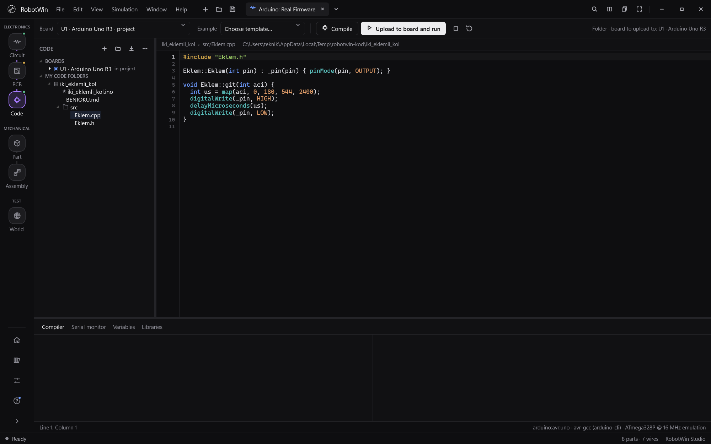
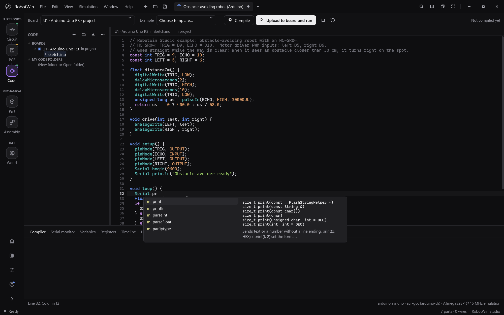
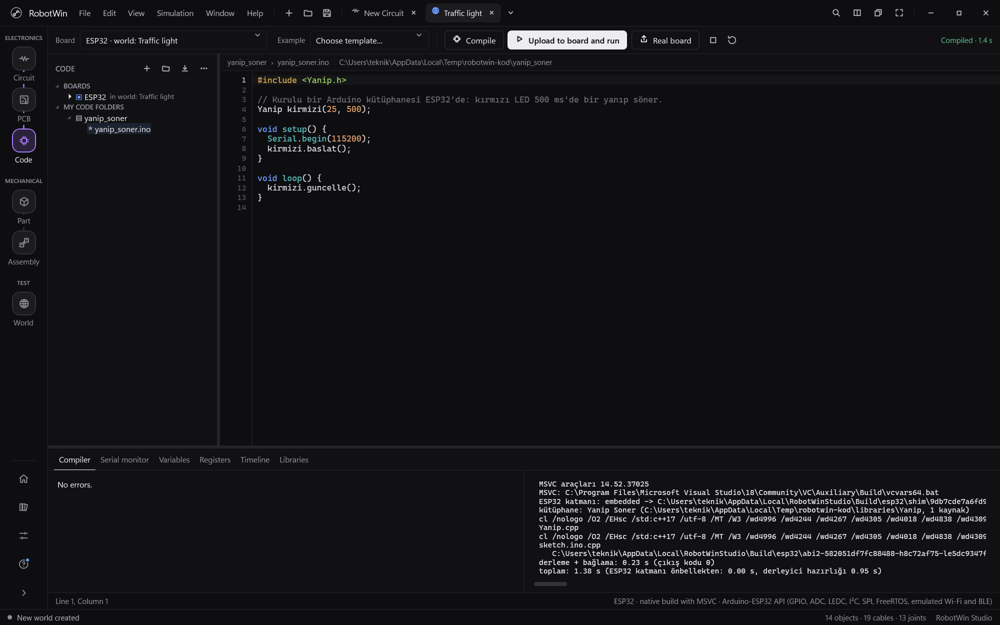
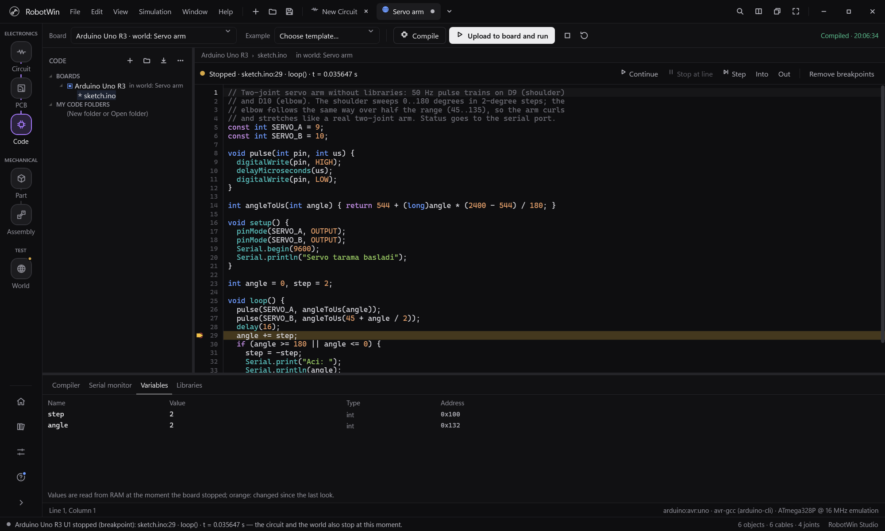

# 4. Code

The **Code** page (Ctrl+3) is where you write the boards' firmware. It works like a code editor:

- folders and files on the left;
- an editor with completion and signature help in the middle;
- the compiler, the serial monitor and the Arduino libraries below.

The code you write loads and runs on **any board** in the project or in the open world (Arduino Uno, Arduino Nano, ESP32).



## Before you start

- Compiling Arduino code needs `arduino-cli`:

  ```text
  winget install ArduinoSA.CLI
  arduino-cli core install arduino:avr
  ```

- Compiling ESP32 code needs the Visual Studio C++ tools (MSVC).

Details: [1. Getting started](01-getting-started.md#to-compile-your-own-code-optional).

## Explorer: boards and code folders

The explorer on the left has two sections:

- **BOARDS**: every programmable board of the project and of the open world. Each board's code is kept in its own folder inside the project (or the world).
- **MY CODE FOLDERS**: folders on disk. New folders open in `Documents\RobotWin\Kod`. Every folder you open from disk is listed here too (e.g. an Arduino IDE sketch folder).

The buttons above the explorer:

| Button | What it does |
| --- | --- |
| New file | Adds a `.ino`, `.h`, `.cpp` … to the selected folder |
| New code folder | Opens a new sketch folder on disk |
| Open folder | Adds any code folder on disk to the list |
| ⋯ | Import, save to disk, zip, rename, delete |

Right-clicking a folder or a file gives:

- **New file…**, **New folder…**: adds a file or a subfolder such as `src/`.
- **Import file…**, **Import folder…**: copies files or folders from elsewhere. Dragging files from Explorer onto the explorer works too.
- **Upload to board**: loads the folder onto the board you pick.
- **Save to disk (as an Arduino sketch folder)…**: saves it anywhere.
- **Export as zip…**.
- **Show the folder in Explorer**, **Rename**, **Delete**.
- **Remove from the list (stays on disk)**.

**Ctrl+S** saves files on disk.

### Multi-file sketches

A sketch can have several files: the main `.ino`, `.h` / `.cpp` files next to it and subfolders under `src/`. As in the Arduino IDE they are compiled together, on the Uno / Nano and on the ESP32 alike. Files added to a board's folder are saved in the project file.

## Step by step: your first code

1. Pick a board or a code folder in the explorer.
2. If the folder is empty, pick a template from the **Example** list, e.g. **Blink (D13 LED)**.
3. Pick the board to load onto from the **Board** list. It lists every Uno, Nano and ESP32 of the project and of the open world.
4. Press **Compile** or **F7**. The build output appears in the **Compiler** tab below. Errors are explained in Turkish; the file with the error opens and the line is marked.
5. Press **Upload to board and run** or **F5**. The folder's code is copied into the board, compiled, and the simulation starts. If the board is in a world, the world starts running.
6. See the `Serial.print` output in the **Serial monitor** tab. Type in the box below and press **Send** to send data to the board.

The explorer and the bottom tabs (Compiler, Serial monitor, Variables, Registers, Timeline, Libraries) are panels as on the other pages: drag one by its header or tab to the other side, the bottom or a window of its own (a second screen too), minimize it to a strip or hide it; the layout is kept and goes into the workspaces. The bottom pane starts closed; clicking a tab or building opens it.

The other toolbar buttons stop the simulation and reset the board.

Every build writes what it was made with into the board's code in the project: the compiler's and the board core's versions, e.g. `arduino-cli 1.6.0 · arduino:avr 1.8.8` (hover over the build status to see it). When the project is built on another computer or with an updated compiler, the **Compiler** tab says so first: the same code can give a different binary with another avr-gcc.

## Code completion and signature help

The editor reads the board's real header files:

- for the Uno / Nano, the Arduino AVR core, the installed libraries and the sketch folder;
- for the ESP32, the simulation layer.



The completion list opens:

- after `.`, `->` and `::` (e.g. `Serial.` → `print`, `println`, `begin` …);
- after `#include <` (the headers you can use);
- anywhere with **Ctrl+Space**.

The list knows your own functions, variables and `#define`s too. It knows a variable's type, so `kol.` lists the members of the `Servo` class.

Use:

- **↑ ↓** to choose; **Enter** or **Tab** to insert; **Esc** to close.
- The panel on the right shows the chosen item's signature and a short description.
- Opening a parenthesis shows the function's parameters above the line, with the one you are typing in bold. **Ctrl+Shift+Space** brings them back.

## Arduino libraries

The **Libraries** tab below searches the Arduino library index. The index holds about 10 000 libraries and is read from `arduino-cli`'s list on your PC.

- Type a name or a header in the search box, e.g. `servo`, `lcd i2c`, `dht`, `Servo.h`.
- **Install and add** downloads and installs the library with `arduino-cli lib install` and adds its `#include` line to the code.
- An installed library's header buttons (e.g. `Servo.h`) add the `#include` line; **Remove library** removes the library.
- If the index was never downloaded, **Download the library list (arduino-cli lib update-index)** runs `arduino-cli lib update-index`.
- A header in the code that no installed library provides (e.g. `#include <Servo.h>`) is flagged, and the tab shows the library that provides it.

ESP32 boards use installed Arduino libraries too:
- When a sketch includes a library's header (`#include <AccelStepper.h>`), that library is found and compiled with the sketch against the simulation layer. Its own dependencies are found too.
- The simulation layer's own headers (`Wire.h`, `Servo.h`, `WiFi.h` …) come first.
- A changed or updated library rebuilds the sketch.
- Addressable LED strips (WS2812B / NeoPixel) work in both modes: `rgbLedWrite`, the RMT functions (`rmtInit`, `rmtWrite`) and the `Adafruit_NeoPixel` class. `Adafruit_NeoPixel.h` is RobotWin's own, written on the RMT; the real-board build uses it too, and prefers an installed Adafruit library when there is one. The LEDs of a strip whose DIN is wired to the board's GPIO take the colours sent and draw current by their colours.
  - The data level is checked. A 5 V strip's datasheet asks for VIH = 0.7·VDD (3.5 V), and an ESP32's 3.3 V is below it. Since it works on most strips, the strip still lights, but the event log warns once (a 74AHCT125 level shifter, or feeding the first LED from ~4.3 V through a diode, is suggested). Data below half the strip's supply is not read at all. The next strips of a chain get their data from the strip before them, at its own supply.
  - It works on the Uno / Nano too: every edge the cycle-counted bit-bang loop of Adafruit_NeoPixel (or your own) makes on the pin happens on its exact cycle in the emulator. The strip reads these edges as a real WS2812B does: a high pulse shorter than 0.5 µs is a 0, a longer one a 1, and a low of more than 50 µs latches the frame. A pulse with broken timing drops the frame.
- Rotary encoders are counted with the ESP32's pulse counter (PCNT) in both modes: ESP-IDF's `driver/pulse_cnt.h` (units, channels, edge and level actions, limits, watch points). Wire an encoder motor's C1/C2 outputs to two GPIOs; with ×4 decoding the count matches the encoder in the circuit edge for edge. `ESP_ERROR_CHECK` on a failed call prints the error and restarts the board, as on the chip.
  - The glitch filter (`pcnt_unit_set_glitch_filter`, up to 12.8 µs) works in the fast mode as on the hardware. A new level counts only once it has held for the filter's width, so a shorter pulse is not counted at all.
  - A PWM the board drives on a pin itself (LEDC or MCPWM) is counted by a pulse counter on the same pin, as the GPIO matrix does on the real chip. When the frequency or duty changes, the count goes on with the new timing.
- To drive motors, the ESP32's MCPWM works in both modes: ESP-IDF's `driver/mcpwm_prelude.h` (timer, operator, comparator, generator, dead time). A half bridge's two pins get the complementary PWM with its dead time.
- `ledcWrite` (servo and ESC writes included) waits, as on the chip, until the channel's previous duty update lands at the end of its PWM period. A loop that writes a 50 Hz servo more often than every 20 ms drops to 50 Hz; in a fast control loop, write the servo only every 20 ms.
- The sleep modes work in both modes. `esp_deep_sleep_start()` powers the board down; the timer or EXT0 starts it again, with its `RTC_DATA_ATTR` variables kept. `esp_light_sleep_start()` sleeps until the timer, EXT0 or a pin level chosen with `gpio_wakeup_enable` wakes it, then carries on where it was: `esp_sleep_get_wakeup_cause()` names the source and `millis()` goes on by the time slept. Asleep the board draws little current (10 µA in deep sleep, 0.8 mA in light sleep), so battery life comes out as in reality.
- Other libraries that reach into the ESP32's registers directly may not exist in the simulation layer. Then the error names the library that did not compile.



## Arduino templates

| Template | What it does |
| --- | --- |
| Blink (D13 LED) | Blinks the LED on D13 once a second |
| Brightness with PWM (D9) | Slowly raises and lowers the power of the LED or motor on D9 |
| LED with button | The LED on D13 lights while the button on D2 is pressed |
| Analog read + serial | Reads the voltage on A0 and prints it to the serial monitor |
| HC-SR04 distance | Prints the distance in cm from an ultrasonic sensor |
| Obstacle-avoiding robot | Avoids obstacles with an HC-SR04 and two motors |
| Line follower (2 sensors) | Follows a line with two TCRT5000 |
| I²C scanner | Finds the addresses of the devices on the I²C bus |
| MPU-6050 acceleration | Reads the accelerometer and gyroscope values |

New code for ESP32 boards starts with an ESP32 Blink that blinks the LED on GPIO2.

## How does the Arduino work?

Your code is compiled with the real `avr-gcc` (through `arduino-cli`). The resulting HEX file runs step by step with the circuit on a cycle-accurate **ATmega328P emulator**. Supported:

- The whole instruction set and interrupts
- Digital pins, external interrupts and pin-change interrupts
- Timer0/1/2 and PWM (`analogWrite`)
- Serial port (USART), ADC (`analogRead` reads the real voltage in the circuit), EEPROM, watchdog
- I²C (TWI); the SSD1306 OLED, PCF8574 + HD44780 LCD and MPU-6050 modules really answer
- SPI (master): `SPI.transfer` clocks the byte out bit by bit on D13 (SCK) and D11 (MOSI) at the rate and mode set, reading D12 (MISO); an MCP3008 or BMP280 with its CS on any pin answers in the circuit

> Tip: if you have a `.hex` file compiled in the Arduino IDE, load it directly with **Load HEX…** in the **Board pins** tab on the **Circuit** page.

The program and the circuit share one clock. The Uno runs to the cycle that belongs to the end of each time slice; an instruction that ran over into the next slice is taken off that slice. So `millis()` never drifts from the circuit's time: after one second the program is at exactly 16 000 000 cycles.

### Arduino compatibility

The Arduino functions and the libraries that come with the AVR core are tried with a real sketch (`CoreSim/tests/RobotTwin.CoreSim.Tests/Fixtures/arduino-compat.ino`, built with `avr-gcc`). The sketch is sent a letter over the serial port and its inputs are driven at set moments; the result is read from what the sketch prints and from the chip's own pin record (what the timeline shows). The table is what those tests give (`ArduinoCompatTests`).

| Function / library | What was tried | Result |
| --- | --- | --- |
| `tone(8, 1000)` | the frequency on D8, over 60 ms | 1000.1 Hz, 61 periods |
| `SoftwareSerial` (9600) | sends "Merhaba" on D11, reads "Selam" given on D10 | "Merhaba" decoded from D11, "Selam" read |
| `pulseIn(7, HIGH)` | a 1234 µs pulse on D7 | 1229 µs (the library works the time out from a loop count) |
| `attachInterrupt(…, FALLING)` | 25 falling edges on D2 | 25 |
| `analogWrite` | D3, D5, D6, D9, D10, D11 | D5 and D6 at 976.6 Hz, the others at 490.2 Hz; duty by the value |
| `micros()`, `delay(10)` | how long the delay is | 10 012 µs |
| `delayMicroseconds(250)` | a square wave on D12 with two delays | 509.7 µs period (with `digitalWrite`'s own time) |
| `EEPROM.put` / `get` | a `float`, `long`, `char[8]` struct | read back as written |
| `Wire` | scanning addresses 1–126 | 0 on an empty bus; 2 with an MPU-6050 and a BMP280 |
| `SPI` | an MCP3008's CH0 (CS on D10, 1 MHz, mode 0) | 256 at 1.25 V; 24 clocks, 01 80 00 on MOSI; 676 from an Uno's 3.3 V in the circuit |
| `Serial.parseInt`, `readStringUntil` | "123 abc" and a line end | 246 and " abc" |
| `INPUT_PULLUP`, `analogRead(A0)` | 2.5 V on A0 | 512 |

## Debugging: breakpoints, steps, variables

You can follow Arduino Uno and Nano code line by line. When the board reaches a breakpoint, what it runs in stops at the same instant: the simulation on the **Circuit** page, or the **World**. You see the code, the circuit's voltages and currents, the cables and the parts in the world at one moment of simulated time.

1. Open the board's code and click the number of the line you want to stop on. A red dot appears. A dot on a line without code (a comment, a blank line, a declaration) stops at the next line that has code. A dot on a line where the program can never stop is drawn as a hollow ring.
2. Build and load the code with **Upload to board and run** (F5). The line information comes with the build: breakpoints work only in programs built here.
3. When the board reaches the line it stops:
   - a yellow arrow and band mark the line;
   - the bar above names the place, the function and the simulated time;
   - the **Variables** tab shows your code's global and `static` variables with their values at that moment;
   - the **Registers** tab shows the ATmega328P itself:
     - on the left, the core: PC, SP, SREG's flags (`I-----Z-`), the X/Y/Z pointers, R0–R31 and the cycle count;
     - on the right, the peripherals' registers by name, grouped (ports, timers, interrupts, ADC, USART, SPI, TWI, EEPROM): value, binary, address and the names of the bits that are set (`RXC0 UDRE0` in `UCSR0A`, say). A 16-bit pair (TCNT1, OCR1A, UBRR0, ADC, SP) is also given as one number;
     - values that changed since the last look are orange, so you see at a glance what a step did to the hardware;
     - looking does not touch the hardware: a real read takes the byte out of UDR0, latches TCNT1's high byte and clears SPIF; this one does none of that;
   - the **Timeline** tab is a logic analyzer clipped onto the chip:
     - from the program's first instruction it records every level change of every pin (outputs when the program writes them, inputs when the circuit drives them) and every interrupt's entry and `RETI`, to the cycle;
     - each pin that moves or drives is a trace, each interrupt serviced (`TIMER0_OVF`, `USART_UDRE`, `INT0`…) a row with a bar for each run of its handler;
     - the right column measures: a pin's last full period and its high time (`56.6 Hz · high 1.03 ms`), an interrupt's count and longest run (`19× · longest 5.9 µs`);
     - the wheel zooms around the pointer, dragging scrolls back, a double click returns to now; the pointer's time is read out at the top;
     - PWM pins driven by a timer are not edges here (the hardware toggles them without the program): their row gives the frequency and duty they have now. While the TWI is on, A4/A5 are not traced bit by bit.
4. Go on from there:

| Button | Shortcut | What it does |
| --- | --- | --- |
| **Continue** | F5 | Runs the program, the circuit and the world to the next breakpoint |
| **Step** | F10 | Goes to the next line; functions it calls (such as `delay`) run through |
| **Into** | F11 | Goes into the called function, to its first line in your code |
| **Out** | Shift+F11 | Runs until the current function returns |
| **Stop at line** | — | Stops the running program at its next line of your code |

The values also refresh while the board runs. A value that changed since you last looked is shown in orange. You can also resume a stopped world with **Continue** on the **World** page.



> In code compiled with `-Os`, the compiler merges some lines or inlines them into others, so steps sometimes go in a different order than you expect. The Arduino IDE's debugger behaves the same way.

ESP32 sketches run natively on the computer's processor, so for now breakpoints are only for the Arduino Uno / Nano (ATmega328P).

## How does the ESP32 work?

ESP32 code (a sketch) is compiled natively on your PC with MSVC and runs in step with the circuit. The first build takes a while because the ESP32 hardware layer is built too; later builds come quickly from the cache.

Supported:

- `pinMode`, `digitalRead/Write`, `attachInterrupt`
- `analogRead` (with attenuation and resolution settings), `analogWrite`, `ledc*` PWM, `dacWrite`, `touchRead`, `tone`, `pulseIn`
- Hardware timers, `millis`, `micros`, delays
- FreeRTOS tasks, queues, semaphores
- `Serial`, `Wire` (I²C), `EEPROM`, `Servo` / `ESP32Servo`
- `WiFi` (a virtual network inside the world; no Internet), BLE (basic features), **Bluepad32** (PS5, PS4, Xbox controllers)
- **ESP-NOW** (`esp_now.h`): short messages between boards without a router (250 bytes at most). As with the real driver, first `WiFi.mode(WIFI_STA)`, then `esp_now_init()`. A unicast send goes only to a peer added with `esp_now_add_peer` (the broadcast address FF:FF:FF:FF:FF:FF is added as a peer too). Frames cross the world's radio medium with its distance, walls and fading. A unicast send waits for its acknowledgement and is retried up to 7 times, and the send callback reports success or failure. A broadcast always reports success. Both the ESP-IDF 4 and 5 callback forms are accepted.
- **Isolation:** in the fast mode each sketch runs in its own sandboxed process. It cannot reach the network or your files. If a sketch crashes or closes its process, the app stays open: only that board restarts and the event log says why. So the ESP32 code of a project you got from someone else cannot touch your PC either.
- **Memory budget:** the fast mode runs on the PC's memory. The sketch's `malloc`/`new` allocations and task stacks are counted against a real board's heap, and `ESP.getFreeHeap()` drops by them too. The event log warns when the sketch nears a real ESP32's ~289 KB of free heap and when it passes it: the board would have run out of memory there.

- `SPI`: SPI devices (the MCP3008 ADC, a BMP280 on SPI …) connect to the SPI bus in the circuit.

## A real ESP32 board: two run modes

In the ESP32 board's inspector, **Run mode** has two choices:

- **fast simulation** (the default): the way described above. For scenes with many ESP32s and quick trials.
- **hardware-compatible**: the sketch is compiled with Espressif's real ESP32 toolchain (Arduino-ESP32 3.3.13, `xtensa-esp32-elf-gcc`); the output can be flashed to a real board. In the circuit simulation this firmware, exactly as it would go to the chip, runs on RobotWin's own Xtensa emulator: both cores, FreeRTOS, the ROM, and the GPIO, LEDC (PWM), ADC, DAC, touch pads, timers, watchdogs, Serial, Serial1 and Serial2 (both ways), I2C (Wire) and SPI, with the modules wired to the board, at register level, so `analogRead` gives the codes a real chip gives (its dead zone near 0 V, its bend near 3.1 V) and the serial monitor shows the baud the real UART achieves (115942 for 115200). The first run after a change builds the sketch for the real chip in the background and runs as the fast mode meanwhile; the next run is on the emulator. The event log says which engine runs. The same holds in the world simulation. Not modelled yet: Wi-Fi/BLE and the camera; a sketch that includes them (WiFi.h, esp_now.h, BLEDevice.h, esp_camera.h …) runs as the fast mode and the event log says why.

In either mode, with an ESP32 chosen on the Code page, the **Real board** menu does this:

1. **Install the ESP32 toolchain**: only the first time. About 1.3 GB is downloaded, 4 GB installed. It goes into RobotWin's own folder and does not touch your Arduino IDE.
2. **Build for the real board**: errors show on the sketch's lines; the status line gives the flash and RAM use.
3. **Upload to the real board → COMx**: boards connected by USB are listed; picking one builds the sketch and writes it with `esptool`. The board enters upload mode by itself; if it does not, hold its BOOT button during the upload.
4. **Export the merged image (.bin)**: bootloader, partition table and application in one file, written at address 0x0 by web flashers or `esptool`.

The detailed plan of the two modes and the emulator's stages: [The two ESP32 run modes](../../ESP32_MODES.md).

## Code of boards in the world

Every board of the open world stands in the explorer's **BOARDS** section with its own folder. Write its code there and load it with **Upload to board and run**. Selecting the board in the world and pressing **Write the board's code** in the inspector opens the same folder. To load a code folder onto a board in the world, right-click the folder and pick the board under **Upload to board**. Details: [7. World](07-world.md).

---

[← Previous: 3. PCB](03-pcb.md) · [Contents](README.md) · [Next: 5. Model →](05-model.md)
