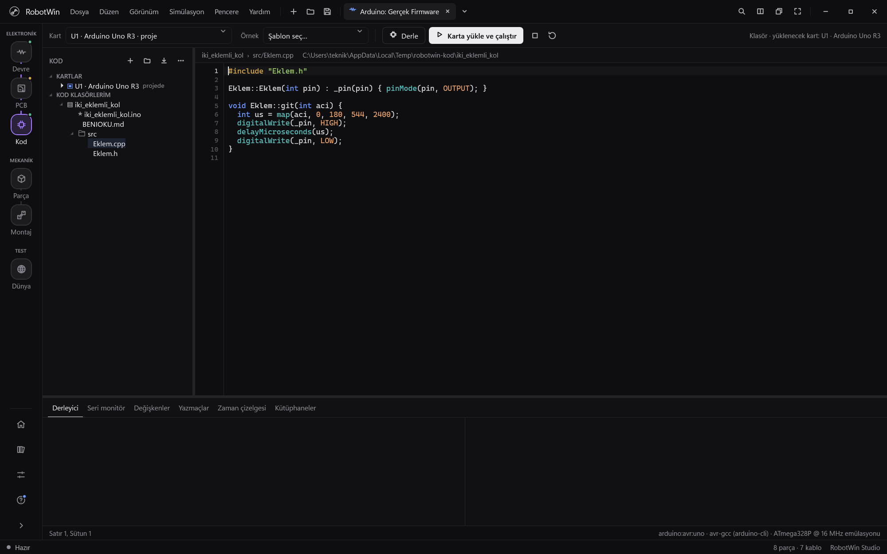
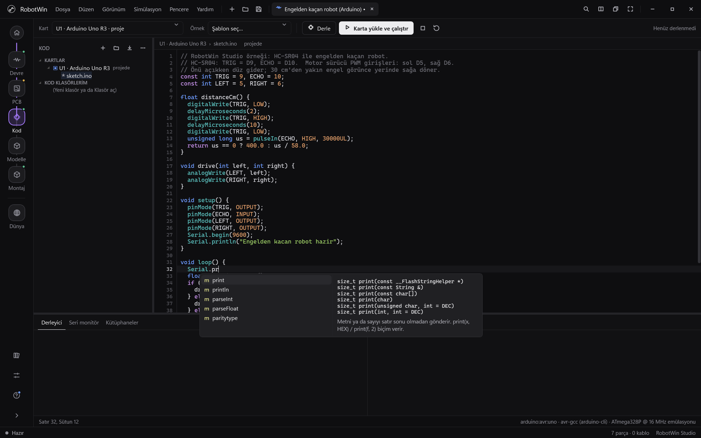
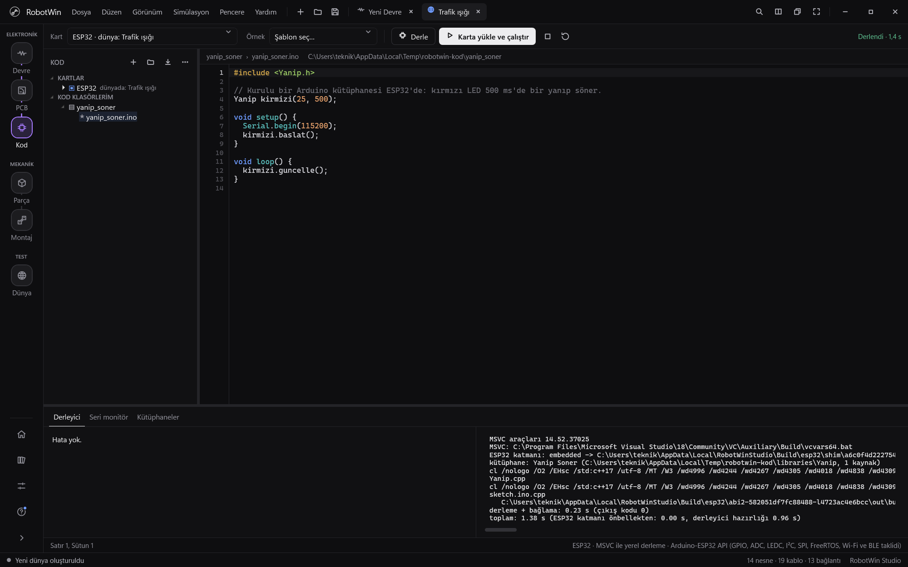

# 4. Code

The **Kod** (code) page (Ctrl+3) is where you write the boards' firmware. It works like a code editor:

- folders and files on the left;
- an editor with completion and signature help in the middle;
- the compiler, the serial monitor and the Arduino libraries below.

The code you write loads and runs on **any board** in the project or in the open world (Arduino Uno, Arduino Nano, ESP32).



## Before you start

- Compiling Arduino code needs `arduino-cli`:

  ```text
  winget install ArduinoSA.CLI
  arduino-cli core install arduino:avr
  ```

- Compiling ESP32 code needs the Visual Studio C++ tools (MSVC).

Details: [1. Getting started](01-getting-started.md#to-compile-your-own-code-optional).

## Explorer: boards and code folders

The explorer on the left has two sections:

- **KARTLAR** (boards): every programmable board of the project and of the open world. Each board's code is kept in its own folder inside the project (or the world).
- **KOD KLASÖRLERİM** (my code folders): folders on disk. New folders open in `Documents\RobotWin\Kod`. Every folder you open from disk is listed here too (e.g. an Arduino IDE sketch folder).

The buttons above the explorer:

| Button | What it does |
| --- | --- |
| New file | Adds a `.ino`, `.h`, `.cpp` … to the selected folder |
| New code folder | Opens a new sketch folder on disk |
| Open folder | Adds any code folder on disk to the list |
| ⋯ | Import, save to disk, zip, rename, delete |

Right-clicking a folder or a file gives:

- **Yeni dosya…**, **Yeni klasör…** (new file, new folder): adds a file or a subfolder such as `src/`.
- **Dosya içe aktar…**, **Klasör içe aktar…** (import file, import folder): copies files or folders from elsewhere. Dragging files from Explorer onto the explorer works too.
- **Karta yükle** (load onto a board): loads the folder onto the board you pick.
- **Diske kaydet (Arduino çizim klasörü olarak)…** (save to disk as an Arduino sketch folder): saves it anywhere.
- **Zip olarak dışa aktar…** (export as zip).
- **Klasörü Explorer'da göster**, **Yeniden adlandır**, **Sil** (show in Explorer, rename, delete).
- **Listeden kaldır (diskte kalır)** (remove from the list; stays on disk).

**Ctrl+S** saves files on disk.

### Multi-file sketches

A sketch can have several files: the main `.ino`, `.h` / `.cpp` files next to it and subfolders under `src/`. As in the Arduino IDE they are compiled together, on the Uno / Nano and on the ESP32 alike. Files added to a board's folder are saved in the project file.

## Step by step: your first code

1. Pick a board or a code folder in the explorer.
2. If the folder is empty, pick a template from the **Örnek** (example) list, e.g. **Blink (D13 LED)**.
3. Pick the board to load onto from the **Kart** (board) list. It lists every Uno, Nano and ESP32 of the project and of the open world.
4. Press **Derle** (compile) or **F7**. The build output appears in the **Derleyici** (compiler) tab below. Errors are explained in Turkish; the file with the error opens and the line is marked.
5. Press **Karta yükle ve çalıştır** (load onto the board and run) or **F5**. The folder's code is copied into the board, compiled, and the simulation starts. If the board is in a world, the world starts running.
6. See the `Serial.print` output in the **Seri monitör** (serial monitor) tab. Type in the box below and press **Gönder** (send) to send data to the board.

The other toolbar buttons stop the simulation and reset the board.

## Code completion and signature help

The editor reads the board's real header files:

- for the Uno / Nano, the Arduino AVR core, the installed libraries and the sketch folder;
- for the ESP32, the simulation layer.



The completion list opens:

- after `.`, `->` and `::` (e.g. `Serial.` → `print`, `println`, `begin` …);
- after `#include <` (the headers you can use);
- anywhere with **Ctrl+Space**.

The list knows your own functions, variables and `#define`s too. It knows a variable's type, so `kol.` lists the members of the `Servo` class.

Use:

- **↑ ↓** to choose; **Enter** or **Tab** to insert; **Esc** to close.
- The panel on the right shows the chosen item's signature and a short description.
- Opening a parenthesis shows the function's parameters above the line, with the one you are typing in bold. **Ctrl+Shift+Space** brings them back.

## Arduino libraries

The **Kütüphaneler** (libraries) tab below searches the Arduino library index. The index holds about 10 000 libraries and is read from `arduino-cli`'s list on your PC.

- Type a name or a header in the search box, e.g. `servo`, `lcd i2c`, `dht`, `Servo.h`.
- **Kur ve ekle** (install and add) downloads and installs the library with `arduino-cli lib install` and adds its `#include` line to the code.
- An installed library's header buttons (e.g. `Servo.h`) add the `#include` line; **Kütüphaneyi kaldır** (uninstall) removes the library.
- If the index was never downloaded, **Kütüphane listesini indir** (download the library index) runs `arduino-cli lib update-index`.
- A header in the code that no installed library provides (e.g. `#include <Servo.h>`) is flagged, and the tab shows the library that provides it.

ESP32 boards use installed Arduino libraries too:
- When a sketch includes a library's header (`#include <AccelStepper.h>`), that library is found and compiled with the sketch against the simulation layer. Its own dependencies are found too.
- The simulation layer's own headers (`Wire.h`, `Servo.h`, `WiFi.h` …) come first.
- A changed or updated library rebuilds the sketch.
- Libraries that reach into the ESP32's registers directly (say, driving an LED strip through the RMT) may not exist in the simulation layer. Then the error names the library that did not compile.



## Arduino templates

| Template | What it does |
| --- | --- |
| Blink (D13 LED) | Blinks the LED on D13 once a second |
| PWM ile parlaklık (D9) (PWM brightness) | Slowly raises and lowers the power of the LED or motor on D9 |
| Buton ile LED (LED with a button) | The LED on D13 lights while the button on D2 is pressed |
| Analog okuma + seri (analog read + serial) | Reads the voltage on A0 and prints it to the serial monitor |
| HC-SR04 mesafe (distance) | Prints the distance in cm from an ultrasonic sensor |
| Engelden kaçan robot (obstacle avoider) | Avoids obstacles with an HC-SR04 and two motors |
| Çizgi izleyen (2 sensör) (line follower, 2 sensors) | Follows a line with two TCRT5000 |
| I²C tarayıcı (I²C scanner) | Finds the addresses of the devices on the I²C bus |
| MPU-6050 ivme (acceleration) | Reads the accelerometer and gyroscope values |

New code for ESP32 boards starts with an ESP32 Blink that blinks the LED on GPIO2.

## How does the Arduino work?

Your code is compiled with the real `avr-gcc` (through `arduino-cli`). The resulting HEX file runs step by step with the circuit on a cycle-accurate **ATmega328P emulator**. Supported:

- The whole instruction set and interrupts
- Digital pins, external interrupts and pin-change interrupts
- Timer0/1/2 and PWM (`analogWrite`)
- Serial port (USART), ADC (`analogRead` reads the real voltage in the circuit), EEPROM, watchdog
- I²C (TWI); the SSD1306 OLED, PCF8574 + HD44780 LCD and MPU-6050 modules really answer

> Tip: if you have a `.hex` file compiled in the Arduino IDE, load it directly with **HEX yükle…** (load HEX) in the **Kart pinleri** (board pins) tab on the **Devre** (circuit) page.

## How does the ESP32 work?

ESP32 code (a sketch) is compiled natively on your PC with MSVC and runs in step with the circuit. The first build takes a while because the ESP32 hardware layer is built too; later builds come quickly from the cache.

Supported:

- `pinMode`, `digitalRead/Write`, `attachInterrupt`
- `analogRead` (with attenuation and resolution settings), `analogWrite`, `ledc*` PWM, `dacWrite`, `touchRead`, `tone`, `pulseIn`
- Hardware timers, `millis`, `micros`, delays
- FreeRTOS tasks, queues, semaphores
- `Serial`, `Wire` (I²C), `EEPROM`, `Servo` / `ESP32Servo`
- `WiFi` (a virtual network inside the world; no Internet), BLE (basic features), **Bluepad32** (PS5, PS4, Xbox controllers)

`SPI` is only an empty stub; SPI devices do not work.

## Code of boards in the world

Every board of the open world stands in the explorer's **KARTLAR** (boards) section with its own folder. Write its code there and load it with **Karta yükle ve çalıştır**. Selecting the board in the world and pressing **Kartın kodunu yaz** (write the board's code) in the inspector opens the same folder. To load a code folder onto a board in the world, right-click the folder and pick the board under **Karta yükle**. Details: [7. World](07-world.md).

---

[← Previous: 3. PCB](03-pcb.md) · [Contents](README.md) · [Next: 5. Model →](05-model.md)
