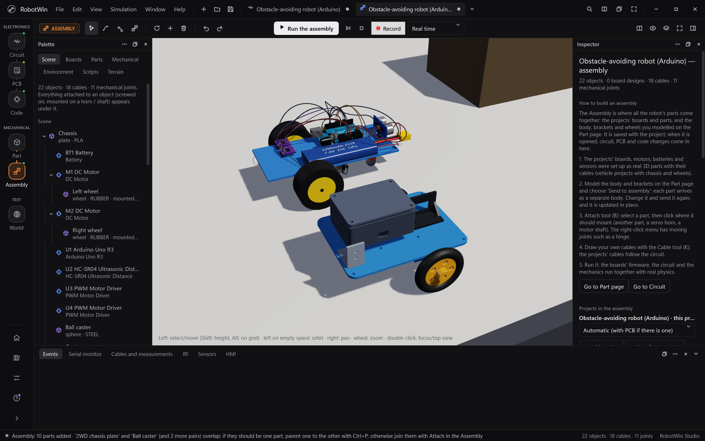

# 5. Part

The **Part** page (Ctrl+4) is where you model your robot's mechanical parts (chassis, brackets, boxes, wheel hubs …) in 3D. It works like Blender: object mode, edit mode and quick keyboard transforms.

One file holds as many parts as you like:
- In the **Parts** list on the right, every top-level object is a part of its own.
- Parent one object to another (**Ctrl+P**) and the two are one part, like a tyre on its hub.
- Finished parts go into the robot's [Assembly](06-assembly.md) with **Send to assembly**; each one becomes a body of its own.

## Navigation

| Mouse / key | Function |
| --- | --- |
| Drag with the middle button | Orbit |
| Shift + drag with the middle button | Pan |
| Wheel | Zoom in / out |
| Numpad 1 / 3 / 7 | Front / right / top view |
| Numpad 5 | Perspective / orthographic |
| Home | Fit everything |
| Numpad . | Focus on the selection |

## Adding objects

With **Add** or **Shift+A**:

- **Basic shapes**: box, cylinder, cone, sphere, torus, tube, wedge, perforated plate.
- **Profile**: extrude a rectangle, circle, polygon, channel or a free sketch to a thickness.
- **Revolve**: turn a profile around an axis into a solid.
- **Robot parts**: 2WD chassis plate, SG90 servo bracket, L bracket, wheel hub, enclosure + lid. Their dimensions can be changed later.

## Move, rotate, scale

1. Click an object to select it (**A** selects all, **Alt+A** clears the selection).
2. **G** move, **R** rotate, **S** scale.
3. Optionally lock to an axis with **X**, **Y** or **Z** and type a number (e.g. `G` `X` `20` → 20 mm along X).
4. **Enter** confirms, **Esc** cancels.

You can also drag the on-screen move / rotate / scale handles. With **Snap** on it snaps to the grid; holding **Ctrl** turns snapping off for the moment.

## Boolean (CSG) operations

To drill holes, cut pockets or join parts:

1. Select the "tool" objects first and the main object last (the last selected is the active one; Shift+click adds to the selection).
2. Pick in the **Cut, trim, join** section of the properties panel (or on the toolbar or the right-click menu):
   - **Difference (trim)**: carves the volume of the overlapping tools out of the active object (hole, pocket, trim).
   - **Union**: joins the tools with the active object into one closed body.
   - **Intersection**: keeps only the shared volume.

The tool objects are removed afterwards; the result is again a closed (watertight) body.

## Slicing

To split an object in two, select it and press **K** (or **Slice**). Click the start and the end of the cut line on the screen: the object is cut along that line, in the viewing direction. Both pieces are capped with the section, so both are closed bodies. Holes in the section stay open (a sliced tube shows a ring). Then select one piece and move it with **G** or turn it with **R**.

Other object operations: **Ctrl+J** join, mirror copy (X / Y / Z), linear and circular array, **Ctrl+P** set parent, **Alt+P** clear parent, **Shift+D** duplicate, **H** hide, **Alt+H** show all.

## Edit mode

Enter edit mode with **Tab**. **1**, **2**, **3** select vertices, edges and faces. Move, rotate and scale the selected vertices, edges or faces with **G** / **R** / **S** (with axis locks and typed numbers, as in object mode).

Selection: **Alt+click** (without dragging) selects the loop of the clicked edge, the face loop in face mode; **Shift+Alt+click** adds to it. **L** selects the whole piece connected to the selection. **Ctrl+Numpad +/−** grows or shrinks the selection by one ring.

| Key | Function |
| --- | --- |
| E | Extrude: pulls faces out along their normal; in vertex/edge mode new faces grow from the selected edges and move with the mouse |
| I | Inset |
| K | Knife: cuts along a line drawn on the screen (only the selected faces when there is a selection). **C** switches the mode: cut / delete the right side / delete the left side; the opening of the deleted side is capped |
| Ctrl+R | Loop cut: hover over an edge and new edge loops are added along its ring of quads; the wheel or +/− changes the number of cuts |
| Ctrl+B | Bevel: flat chamfer faces in place of the selected edges; set the width with the mouse or type mm. A corner face closes the corner where three chamfers meet |
| F | Fill a face |
| M | Merge |
| P | Separate the selection into its own object |
| X or Del | Delete |
| Shift+N | Recalculate normals |

**Solidify** gives the surface a wall thickness inward: an open surface becomes a thick wall, a closed body becomes a hollow shell (for example a box without its top face → a tray). The thickness stays even at the corners.

**Subdivide**, **Smooth** (Catmull–Clark), merge by distance, triangulate and flip normals are in the panel and the right-click menu.

## Material and mass

Give each object a material (PLA, PETG, ABS, nylon, acrylic, plywood, MDF, FR4, aluminium, steel, carbon, rubber) and an infill ratio (for 3D printing). The mass is computed from the volume; it is used when you send the part to the world.

## View modes

- **Solid** (Z), **Wireframe** (Shift+Z), **X-ray (transparent)** (Alt+Z), **Edges**.
- **Measure** tool: click two points to see the distance (snaps to vertices).

## Saving and exporting

- The model is saved as a `.rwmodel` file (Ctrl+S).
- **Import**: STL, OBJ, PLY and CAD files: STEP (.step, .stp) and IGES (.iges, .igs). CAD files are meshed with Open CASCADE; every body of an assembly comes at its place and in its colour.
- **Export**: STL (mm), OBJ, PLY and STEP (mm). In STEP the triangles are sewn and, when they close, made a solid body that CAD programs such as SolidWorks, Fusion or FreeCAD open as one. Open (not closed) meshes are warned about. Use STL for 3D printers.

## Send to the assembly

**Send to assembly** sends the selected parts (all of them when nothing is selected) to the project's [Assembly](06-assembly.md):

- Each part becomes a body of its own, with its computed mass.
- The parts arrive arranged as modelled, set up beside what is in the Assembly, on the floor.
- A project without an Assembly gets one first. You stay on the Part page.
- Sending a changed part again updates it where it stands. Its own origin and joints stay put.
- Two separate parts inside each other get a warning. Deleted parts are offered for removal from the Assembly.

Each part's collision body is its own shape ([Rigid bodies and contact](../physics/02-mechanics.md)). To put a part into a test world as **one body** (an obstacle, a ramp), use **Put into the test world as a single body (obstacle, ramp …)** in the right-click menu. It targets an open test world, never the Assembly.

---

[← Previous: 4. Code](04-code.md) · [Contents](README.md) · [Next: 6. Assembly →](06-assembly.md)
