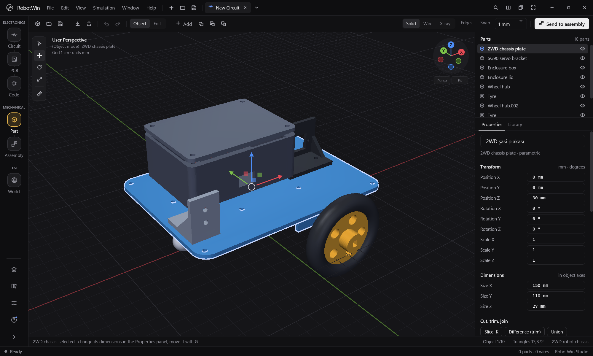
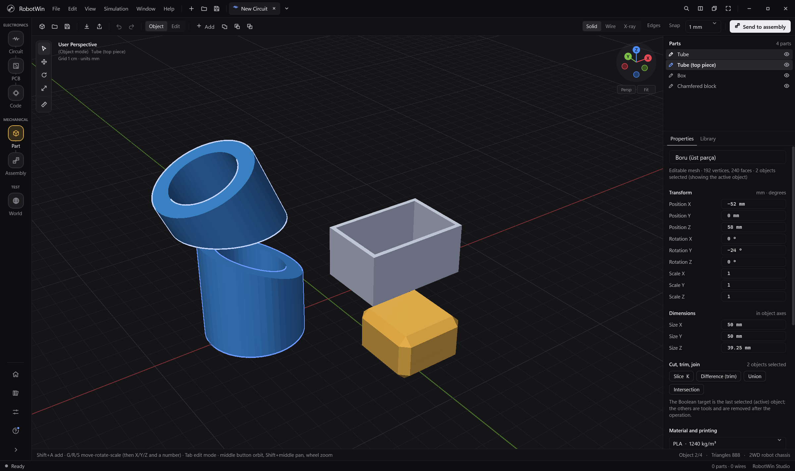
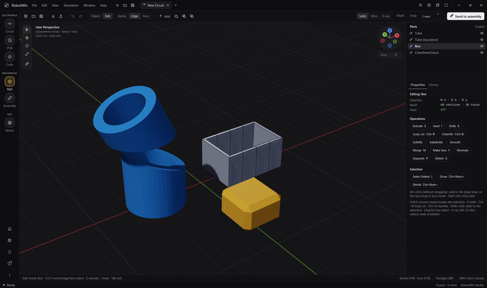

# 5. Part

The **Part** page (Ctrl+4) is where you model your robot's mechanical parts (chassis, brackets, boxes, wheel hubs …) in 3D. It works like Blender: object mode, edit mode and quick keyboard transforms.

One file holds as many parts as you like:
- In the **Parts** list on the right, every top-level object is a part of its own.
- Parent one object to another (**Ctrl+P**) and the two are one part, like a tyre on its hub.
- Finished parts go into the robot's [Assembly](06-assembly.md) with **Send to assembly**; each one becomes a body of its own.

## Navigation

| Mouse / key | Function |
| --- | --- |
| Drag with the middle button | Orbit |
| Shift + drag with the middle button | Pan |
| Wheel | Zoom in / out |
| Numpad 1 / 3 / 7 | Front / right / top view |
| Numpad 5 | Perspective / orthographic |
| Home | Fit everything |
| Numpad . | Focus on the selection |

## Adding objects

With **Add** or **Shift+A**:

- **Basic shapes**: box, cylinder, cone, sphere, torus, tube, wedge, perforated plate.
- **Profile**: extrude a rectangle, circle, polygon, channel or a free sketch to a thickness. A **Draft** angle (SolidWorks' draft) leans the walls inwards going up and opens the holes, for parts that come out of a mould or print easily; a negative angle widens instead.
- **Loft**: a solid passing from the bottom profile to the top one (SolidWorks' and Fusion's loft): a funnel from a square base to a round mouth, a duct transition. Either profile can be a rectangle, circle, polygon or channel; **Height** is the distance between them, **Twist** turns the top profile.
- **Sweep**: carries a section along a 3D path (SolidWorks' and Fusion's sweep): a handle, a pipe, a bent bar, a cable duct. The section comes from the profile editor, the path is typed into **Path points** as "x,y,z; …" (mm). At a corner the section lies in the bisecting plane, so the wall keeps its thickness round the bend; the section does not turn about the path as it goes.
- **Revolve**: turn a profile around an axis into a solid.
- **Robot parts**: 2WD chassis plate, SG90 servo bracket, L bracket, wheel hub, enclosure + lid. Their dimensions can be changed later.

### Dimensioned sketch

You can also draw a profile as a dimensioned sketch. Select the profile and press **Turn into a dimensioned sketch…** in the inspector. A rectangular outline and round holes come with their dimensions. In the sketch window:

1. Draw roughly with **Line**, **Rectangle**, **Circle** and **Arc**. Clicking near a point shares it; a line drawn nearly level or upright stays so.
2. Select and give relations: horizontal, vertical, parallel, perpendicular, equal, tangent, coincident, midpoint, concentric, symmetric, fixed.
3. Give dimensions: length, distance, horizontal/vertical dimension, diameter, radius, angle. Change a value in the constraint list.
4. Select the point where two lines meet and **Corner fillet** and **Chamfer** appear beside an mm box (SolidWorks' sketch fillet and sketch chamfer). The lines are cut back and joined by an arc tangent to both (its radius comes as a dimension) or by a straight edge. The corner stays as a virtual sharp on the lines' extensions, and the lines' length dimensions keep measuring to it. With **Construction geometry** on, what is drawn makes no edge of the profile; it only guides.
5. **Mirror**: select one construction line (the axis) together with the lines, circles and arcs to mirror. The copies land on the other side of the axis; each copied point is held symmetric to its original, so the copy follows any later change. Points on the axis are shared, not copied; copied circles stay equal to their originals.
6. **Trim** (SolidWorks' power trim): the clicked piece of a line, between the crossings on either side, goes; a line nothing crosses goes whole. A cut end is held on the entity that cut it. **Extend**: the line's free end nearer the click runs on to the first line, circle or arc ahead of it. A trimmed or extended line loses its length dimension (that line is no longer there).
7. **Linear pattern / Circular pattern** (SolidWorks' sketch pattern): with lines, circles or arcs selected, a **Qty** box (the original included) and the X and Y step (mm) appear below; select a point as well and the copies turn round it, with the **Angle** they spread over in place of the step (360° is a full turn, evenly spaced). Each copy is held to the one before it by dimensions: in a row, a horizontal and a vertical dimension; round a point, construction spokes from the centre, equal and at the step's angle. Move or grow the original and the whole pattern follows; change any one gap's dimension in the constraint list.

Each change is solved at once and the drawing settles onto the dimensions. The right side of the window shows the sketch's state:
- how many degrees of freedom are left;
- that it is **fully constrained** (every point and radius set, the lines turn green);
- which constraint repeats others.

A constraint that contradicts the others is taken back, and the ones it fights are named. Closed loops of lines and arcs become the profile: the largest is the outline, the ones inside it holes.

After the window closes, the dimensions stay in the inspector. Change one and the part is solved again.

### Parameters and formulas

With nothing selected, the inspector has a **Parameters** section. Define named values there: `genislik = 80`, `yukseklik = genislik / 2`, `delik_x = genislik * 3 / 4`. A parameter is a number or a formula of other parameters. Whatever order the list is in, they are worked out in the order they need each other. A loop (a = b, b = a), an unknown name and a name defined twice are reported by name.

Type a formula such as `=genislik` into a part's dimension (thickness, diameter…) or a dimensioned sketch's dimension to bind it to the parameter. A bound value shows **ƒ** before its name, and clicking its box shows the formula. When a parameter changes, the bound dimensions and the sketches are solved again. Typing a plain number into the value removes the binding.

Formulas can use:
- `+ − * / % ^` and brackets;
- a decimal point or comma (`2,5`);
- `pi`;
- `sin cos tan asin acos atan atan2` in degrees, and `sqrt abs min max round floor ceil hypot`.

Separate function arguments with `;` (`max(a; b)`), or with a comma followed by a space (`max(a, b)`). Plain number fields take arithmetic too: `20*2`, `sqrt(2)*10`.

## Move, rotate, scale

1. Click an object to select it (**A** selects all, **Alt+A** clears the selection).
2. **G** move, **R** rotate, **S** scale.
3. Optionally lock to an axis with **X**, **Y** or **Z** and type a number (e.g. `G` `X` `20` → 20 mm along X).
4. **Enter** confirms, **Esc** cancels.

You can also drag the on-screen move / rotate / scale handles. With **Snap** on it snaps to the grid; holding **Ctrl** turns snapping off for the moment. Rotation snaps to the rotate step of the **Grid and snap** window of Assembly and World (15° by default): the three pages share one step. The handles behave alike too: only the camera-facing half of each rotate ring is drawn and picked, the handle stays while it is dragged, and the turn so far shows as a sector on the ring's plane with its angle beside it.

## Boolean (CSG) operations

To drill holes, cut pockets or join parts:

1. Select the "tool" objects first and the main object last (the last selected is the active one; Shift+click adds to the selection).
2. Pick in the **Cut, trim, join** section of the properties panel (or on the toolbar or the right-click menu):
   - **Difference (trim)**: carves the volume of the overlapping tools out of the active object (hole, pocket, trim).
   - **Union**: joins the tools with the active object into one closed body.
   - **Intersection**: keeps only the shared volume.

The tool objects are removed afterwards; the result is again a closed (watertight) body.

### Hole wizard

**Hole wizard…** in the **Cut, trim, combine** section (as in SolidWorks) makes a hole by the screw size, not by a diameter: **Type** (clearance, socket head counterbore, 90° countersink, tap drill, heat-set insert), **Size** (M2–M8), **Fit** (close / normal / loose, ISO 273) and **Depth** (0: all the way through; for an insert, the insert's length). The figures are the standards': counterbores DIN 974-1, countersinks ISO 15065, coarse-thread tap drills. After **Place on a surface**, each click drills a hole into the clicked surface along its normal; a right click finishes. Every hole can be undone.

## Slicing

To split an object in two, select it and press **K** (or **Slice**). Click the start and the end of the cut line on the screen: the object is cut along that line, in the viewing direction. Both pieces are capped with the section, so both are closed bodies. Holes in the section stay open (a sliced tube shows a ring). Then select one piece and move it with **G** or turn it with **R**.

Other object operations: **Ctrl+J** join, mirror copy (X / Y / Z), linear and circular array, **Ctrl+P** set parent, **Alt+P** clear parent, **Shift+D** duplicate, **H** hide, **Alt+H** show all.

**Reference geometry** (SolidWorks' reference plane, axis and point): **Add** (Shift+A) ▸ **Reference plane**, **Reference axis** or **Reference point** is made from what is selected. A plane: through three points selected in edit mode, 20 mm from a selected plane, half way between two selected parallel planes, or square to a selected axis. An axis: through two points, along a selected round part (cylinder, cone, tube, torus, revolve), or where two selected planes meet. A point: at a selected point or at the middle of the selected parts. With nothing selected, a level plane, an upright axis or a point comes at the middle of the view. References have no solid: they stay out of export, mass and the assembly; each is drawn as a thin frame, a dashed axis line or a cross, with its name, and is selected by clicking its line. Moving, turning and parenting work as on any object; the inspector shows only its place and drawn size. With a plane selected together with parts, right-click ▸ **Mirror copy · across Plane1** mirrors the parts in that plane; with an axis selected, **Circular array…** spreads the copies round that axis.

As in Blender, **N** hides and brings back the side panel on the right (parts and properties), **T** the tool shelf on the left; **Ctrl+Space** clears everything round the view.

## Edit mode

Enter edit mode with **Tab**. **1**, **2**, **3** select vertices, edges and faces. Move, rotate and scale the selected vertices, edges or faces with **G** / **R** / **S** (with axis locks and typed numbers, as in object mode).

Selection: **Alt+click** (without dragging) selects the loop of the clicked edge, the face loop in face mode; **Shift+Alt+click** adds to it. **L** selects the whole piece connected to the selection. **Ctrl+Numpad +/−** grows or shrinks the selection by one ring.

| Key | Function |
| --- | --- |
| E | Extrude: pulls faces out along their normal; in vertex/edge mode new faces grow from the selected edges and move with the mouse |
| I | Inset |
| K | Knife: cuts along a line drawn on the screen (only the selected faces when there is a selection). **C** switches the mode: cut / delete the right side / delete the left side; the opening of the deleted side is capped |
| Ctrl+R | Loop cut: hover over an edge and new edge loops are added along its ring of quads; the wheel or +/− changes the number of cuts |
| Ctrl+B | Bevel: flat chamfer faces in place of the selected edges; set the width with the mouse or type mm. A corner face closes the corner where three chamfers meet. The wheel or **+** adds segments: the chamfer becomes round |
| Round (fillet) | SolidWorks' fillet: the selected edges are rounded by a circular arc tangent to both faces (starts with 8 segments, the wheel changes them); a corner whose edges are all rounded closes with a piece of a sphere and the body stays closed |
| F | Fill a face |
| M | Merge |
| P | Separate the selection into its own object |
| X or Del | Delete |
| Shift+N | Recalculate normals |

**Solidify** gives the surface a wall thickness inward: an open surface becomes a thick wall, a closed body becomes a hollow shell (for example a box without its top face → a tray). The thickness stays even at the corners. **Shell** (as in SolidWorks) does the same with the selected faces opened: in face mode (3) select the faces to open (a box's top, one side), press **Shell** and drag or type the wall thickness; the body becomes an open-mouthed housing with even walls.

**Subdivide**, **Smooth** (Catmull–Clark), merge by distance, triangulate and flip normals are in the panel and the right-click menu.

## Material and mass

Give each object a material (PLA, PETG, ABS, nylon, acrylic, plywood, MDF, FR4, aluminium, steel, carbon, rubber) and an infill ratio (for 3D printing). The mass is computed from the volume; it is used when you send the part to the world. The **Measurement** section of the properties panel shows the size, volume, surface area, mass, centre of mass and principal moments of inertia. **Mass properties…** opens the full report (as in SolidWorks): the inertia tensor at the centre of mass (g·mm², world axes), the principal axes and moments; with several objects selected, their total (by the parallel axis theorem). **Copy to clipboard** gives the report as text.

### 3D print check

A part in a printed material (PLA, PETG, ABS, nylon) has a **3D printing** section in its inspector. Pick your printer; the part is checked as it stands (Z up, its lowest point on the bed):
- **Bed:** whether it fits the printer's build volume (turned sideways too).
- **Mesh:** whether it is closed; an open mesh cannot be sliced.
- **Overhang:** the area of downward faces flatter than 45° that are not on the bed; they need support. If one of the six ways down gives less overhang it says so, and **Put this face on the bed** turns the part that way.
- **Wall:** the thinnest wall, measured from each face through the part to the other side. Places thinner than two lines (0.9 mm) are flagged.
- **Bed contact** and the **estimate:** filament (g, m), time and layer count. The estimate counts the perimeters, the infill inside and the support under the overhangs at the printer's flow.

## View modes

- **Solid** (Z), **Wireframe** (Shift+Z), **X-ray (transparent)** (Alt+Z), **Edges**.
- **Measure** tool: click two points to see the distance (snaps to vertices).
- **Section** (SolidWorks' section view): every object is cut by a plane across X, Y or Z, the half facing the camera is taken away and the cut is filled in its own colour, so walls, holes and ribs show. The bar over the view picks the axis, the slider moves the plane through the model, **Flip** shows the other half. Display only: the objects do not change; the object in edit mode is not cut. **Properties…** on the bar is SolidWorks' section properties: the area of the cut at the plane, its perimeter, centroid, second moments and product about axes through the centroid, principal moments and the principal axis' angle, polar moment, radii of gyration and section moduli (mm, mm², mm³, mm⁴). It takes the selected objects, or the visible ones when nothing is selected, and copies to the clipboard. Use it to see how well a beam or a profile resists bending.

## Saving and exporting

- The model is saved as a `.rwmodel` file (Ctrl+S).
- **Import**: STL, OBJ, PLY and CAD files: STEP (.step, .stp) and IGES (.iges, .igs). CAD files are meshed with Open CASCADE; every body of an assembly comes at its place and in its colour.
- **Export**: STL (mm), OBJ, PLY and STEP (mm). In STEP the triangles are sewn and, when they close, made a solid body that CAD programs such as SolidWorks, Fusion or FreeCAD open as one. Open (not closed) meshes are warned about. Use STL for 3D printers.

## Send to the assembly

**Send to assembly** sends the selected parts (all of them when nothing is selected) to the project's [Assembly](06-assembly.md):

- Each part becomes a body of its own, with its computed mass.
- The parts arrive arranged as modelled, set up beside what is in the Assembly, on the floor.
- A project without an Assembly gets one first. You stay on the Part page.
- Sending a changed part again updates it where it stands. Its own origin and joints stay put.
- Two separate parts inside each other get a warning. Deleted parts are offered for removal from the Assembly.

Each part's collision body is its own shape ([Rigid bodies and contact](../physics/02-mechanics.md)). To put a part into a test world as **one body** (an obstacle, a ramp), use **Put into the test world as a single body (obstacle, ramp …)** in the right-click menu. It targets an open test world, never the Assembly.

---

[← Previous: 4. Code](04-code.md) · [Contents](README.md) · [Next: 6. Assembly →](06-assembly.md)
