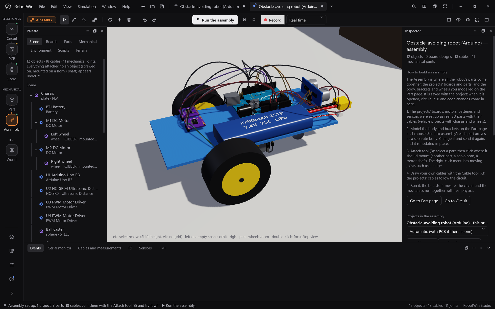
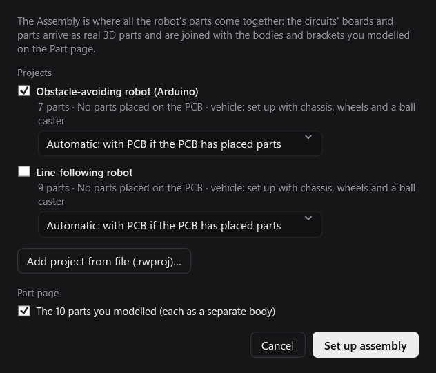
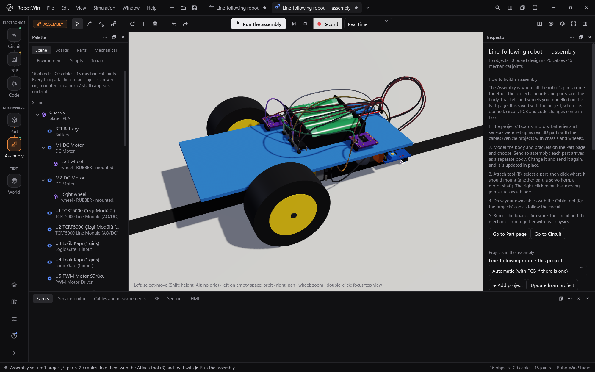

# 6. Assembly

**Assembly** (Ctrl+5) is where all of a robot's parts come together:
- your projects' boards and parts arrive as real 3D parts,
- they are joined with the bodies, brackets and wheels you modelled on the [Part](05-model.md) page.

The Assembly is part of its project:
- it is saved inside the project file,
- **Ctrl+S** saves it with the project,
- each time it is opened it takes the project's circuit, PCB and code changes.

Everything runs on the same real physics as the [World](07-world.md) page. While an Assembly is open, the page shows an orange **ASSEMBLY** badge on the left, and the run button reads **Run the assembly**.

## Setting the Assembly up

The first time you open **Assembly** in a project it asks what goes in. Nothing is guessed silently.

- **Projects**: this project and the other open projects are listed. Pick a form for each:
  - **With PCB**: the parts placed on the board on the PCB page arrive as one board, soldered. Parts off the board (motors, batteries, servos) arrive separately and are cabled to it.
  - **Without PCB**: every part arrives separately and is cabled pin to pin, like a prototype on jumper wires.
  - **Automatic**: with its PCB when parts are placed on it, without otherwise.
- **Add project from file (.rwproj)…**: another `.rwproj` joins the same Assembly, set up beside what is there. This is how several projects' circuits come together in one Assembly.
- **Part page**: should the parts you modelled come too? Each one becomes a body of its own.

Robot examples (**Robot: Obstacle Avoider (Arduino)**, **Robot: Line Follower**) do not ask: the example is the robot.

## What goes where

| In the project | In the Assembly |
| --- | --- |
| Parts placed on the PCB (with PCB) | On the board; the board is one object with its circuit and code inside |
| Other parts (motors, servos, batteries, sensors, Arduino/ESP32 modules …) | Each its own real 3D part |
| Nets | Cables; jumpers in real lengths, in 5 cm steps. The board's pins appear as `RefDes.Pin` (e.g. `J2.1`) |
| The vehicle's mechanics (a two-motor rover) | A chassis plate, wheels on the motor shafts and a ball caster. The board, battery and modules stand on the deck without touching; the sensors are where the mechanics put them; the robot stands at its arena's start |

On a rover the right motor is mounted mirrored and its leads are swapped, as on real kits, so "forward" in the code drives forward.

Each project joining the Assembly is set up beside what is there, on the floor. Nothing starts inside anything else (the physics would throw such bodies apart).

## The Assembly follows its project

Each time you open the Assembly (or press **Update from project** on the right), the project's changes come in:

- A part added to the circuit is added and cabled. A part removed is removed.
- A changed part (type, values) and its code are updated where they stand. The board takes the latest PCB and code.
- The cables follow the nets.

What you did is kept:
- where you put things,
- the joints you made,
- the cables you laid yourself.

The assembly follows parts by their identity, not their names: renaming a part in the circuit (R1 → R7) leaves it where it is in the assembly; only its name changes.

The status bar says what changed.

A board's code in the Assembly is its project's code. The **Code** page does not list these boards as separate boards: you write the code in the project. Selecting a board in the Assembly and choosing **Edit board (circuit · PCB · code)** opens the project itself, not a copy.

## The Assembly's projects

With nothing selected, the inspector has a **Projects in the assembly** section:

- Each project's form can be changed (With PCB / Without PCB / Automatic). The Assembly switches at once.
- **+ Add project** adds another project.
- **Remove from assembly** removes the project's board, parts and cables.

## Parts from the Part page

On the Part page, **Send to assembly** sends each part as a body of its own:

- The parts arrive arranged as modelled (a chassis and its wheels in place), set up beside what is in the Assembly, on the floor.
- Sending a changed part again updates its shape, mass and material where it stands. Even when the part grew on one side, its own origin, and with it its screw holes and joints, stays put.
- A part you deleted on the Part page but still in the Assembly is offered for removal.
- Two separate parts inside each other (a tyre and its hub) get a warning. If they are one part, parent one to the other with **Ctrl+P** on the Part page; if they are separate, join them in the Assembly with **Attach**.

## Joining and trying it

1. **Attach** (B): select a part and click where it goes. That can be another part, a servo horn or a motor shaft. The right-click menu has moving joints such as hinges.
2. Lay your own cables with **Wire** (K).
3. **Run the assembly** (F5): the boards' code, the circuit and the mechanics run together. Motors turn at the speed the circuit computes, sensors measure the world, and load and collisions feed back into the circuit.
4. **Test environment**: pick a workshop, an empty floor, an oval or figure-eight line track, or an obstacle or ramp field from the list on the right. The robot moves with its Assembly to the environment's start.

Several robots or a custom test area go in separate worlds on the [World](07-world.md) page.

## Interference detection

The **Interference detection** button beside **Align** on the toolbar (in the command palette: "detect interference") lists, as SolidWorks does, the pairs of parts taking up the same space with their common volume (mm³). Parts are compared by the outer shapes of their 3D models where they stand. Options:

- **Count touching faces as interference:** parts that only touch are listed too.
- **Check parts joined by a joint too:** parts overlapping on purpose, as a servo horn and its servo or a wheel and its motor, count too (skipped by default).
- **Only the selected part:** the selected part's interferences with the others.

Picking a row selects its first part, and the status bar gives the overlap's volume and middle. The scene stays usable while the window is open; **Calculate** checks again.

## Recording and fault experiments

The Assembly is a world, so all world tools work here too:
- **Record** records the run for replay in the render window.
- You can try faults such as a shorted battery or a stalled motor.
- **View → Thermal camera (world)** and **View → Collision shapes (world)** show what is inside.

---

[← Previous: 5. Part](05-model.md) · [Contents](README.md) · [Next: 7. World →](07-world.md)
