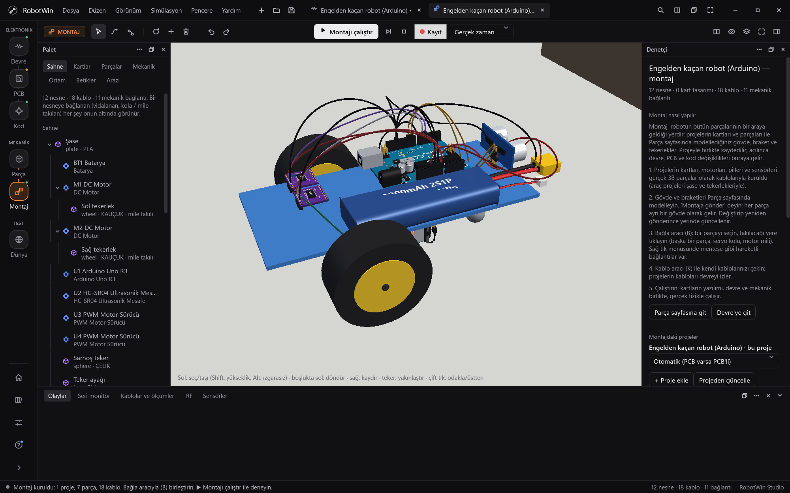
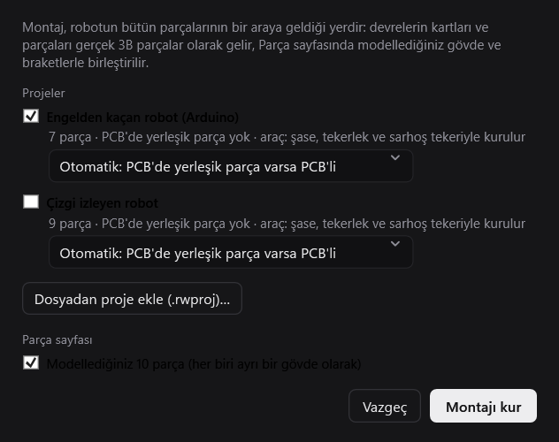
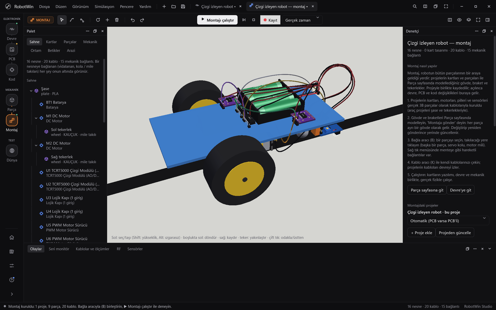

# 6. Assembly

**Montaj** (assembly, Ctrl+5) is where all of a robot's parts come together:
- your projects' boards and parts arrive as real 3D parts,
- they are joined with the bodies, brackets and wheels you modelled on the [Parça](05-model.md) (part) page.

The Montaj is part of its project:
- it is saved inside the project file,
- **Ctrl+S** saves it with the project,
- each time it is opened it takes the project's circuit, PCB and code changes.

Everything runs on the same real physics as the [World](07-world.md) page. While a Montaj is open, the page shows an orange **MONTAJ** badge on the left, and the run button reads **Montajı çalıştır** (run the assembly).

## Setting the Montaj up

The first time you open **Montaj** in a project it asks what goes in. Nothing is guessed silently.

- **Projeler** (projects): this project and the other open projects are listed. Pick a form for each:
  - **PCB'li** (with PCB): the parts placed on the board on the PCB page arrive as one board, soldered. Parts off the board (motors, batteries, servos) arrive separately and are cabled to it.
  - **PCB'siz** (without PCB): every part arrives separately and is cabled pin to pin, like a prototype on jumper wires.
  - **Otomatik** (automatic): with its PCB when parts are placed on it, without otherwise.
- **Dosyadan proje ekle** (add a project from a file): another `.rwproj` joins the same Montaj, set up beside what is there. This is how several projects' circuits come together in one Montaj.
- **Parça sayfası** (part page): should the parts you modelled come too? Each one becomes a body of its own.

Robot examples (**Robot: Engelden Kaçan**, obstacle avoider; **Robot: Çizgi İzleyen**, line follower) do not ask: the example is the robot.

## What goes where

| In the project | In the Montaj |
| --- | --- |
| Parts placed on the PCB (with PCB) | On the board; the board is one object with its circuit and code inside |
| Other parts (motors, servos, batteries, sensors, Arduino/ESP32 modules …) | Each its own real 3D part |
| Nets | Cables; jumpers in real lengths, in 5 cm steps. The board's pins appear as `RefDes.Pin` (e.g. `J2.1`) |
| The vehicle's mechanics (a two-motor rover) | A chassis plate, wheels on the motor shafts and a ball caster. The board, battery and modules stand on the deck without touching; the sensors are where the mechanics put them; the robot stands at its arena's start |

On a rover the right motor is mounted mirrored and its leads are swapped, as on real kits, so "forward" in the code drives forward.

Each project joining the Montaj is set up beside what is there, on the floor. Nothing starts inside anything else (the physics would throw such bodies apart).

## The Montaj follows its project

Each time you open the Montaj (or press **Projeden güncelle**, update from the project on the right), the project's changes come in:

- A part added to the circuit is added and cabled. A part removed is removed.
- A changed part (type, values) and its code are updated where they stand. The board takes the latest PCB and code.
- The cables follow the nets.

What you did is kept:
- where you put things,
- the joints you made,
- the cables you laid yourself.

The status bar says what changed.

A board's code in the Montaj is its project's code. The **Kod** (code) page does not list these boards as separate boards: you write the code in the project. Selecting a board in the Montaj and choosing **Kartı düzenle** (edit board) opens the project itself, not a copy.

## The Montaj's projects

With nothing selected, the inspector has a **Montajdaki projeler** (projects in the assembly) section:

- Each project's form can be changed (PCB'li / PCB'siz / Otomatik). The Montaj switches at once.
- **+ Proje ekle** (add project) adds another project.
- **Montajdan çıkar** (take out of the assembly) removes the project's board, parts and cables.

## Parts from the Parça page

On the Parça page, **Montaja gönder** (send to assembly) sends each part as a body of its own:

- The parts arrive arranged as modelled (a chassis and its wheels in place), set up beside what is in the Montaj, on the floor.
- Sending a changed part again updates its shape, mass and material where it stands. Even when the part grew on one side, its own origin, and with it its screw holes and joints, stays put.
- A part you deleted on the Parça page but still in the Montaj is offered for removal.
- Two separate parts inside each other (a tyre and its hub) get a warning. If they are one part, parent one to the other with **Ctrl+P** on the Parça page; if they are separate, join them in the Montaj with **Bağla** (join).

## Joining and trying it

1. **Bağla** (B, join): select a part and click where it goes. That can be another part, a servo horn or a motor shaft. The right-click menu has moving joints such as hinges.
2. Lay your own cables with **Kablo** (K, cable).
3. **Montajı çalıştır** (F5, run the assembly): the boards' code, the circuit and the mechanics run together. Motors turn at the speed the circuit computes, sensors measure the world, and load and collisions feed back into the circuit.
4. **Denemek için ortam** (environment to try it in): pick a workshop, an empty floor, an oval or figure-eight line track, or an obstacle or ramp field from the list on the right. The robot moves with its Montaj to the environment's start.

Several robots or a custom test area go in separate worlds on the [World](07-world.md) page.

## Recording and fault experiments

The Montaj is a world, so all world tools work here too:
- **Kayıt** (record) records the run for replay in the render window.
- You can try faults such as a shorted battery or a stalled motor.
- **Görünüm → Isı kamerası** (thermal camera) and **Görünüm → Çarpışma şekilleri** (collision shapes) show what is inside.

---

[← Previous: 5. Part](05-model.md) · [Contents](README.md) · [Next: 7. World →](07-world.md)
