# 7. World

The **World** page (Ctrl+6) is where everything comes together. Put the boards you designed, catalogue parts, mechanical bodies and 3D models into an environment with real physics, connect them with cables, join them with screws or hinges and run them all together. The circuit, the boards' firmware, the radio and the physics are computed at the same time, step by step.

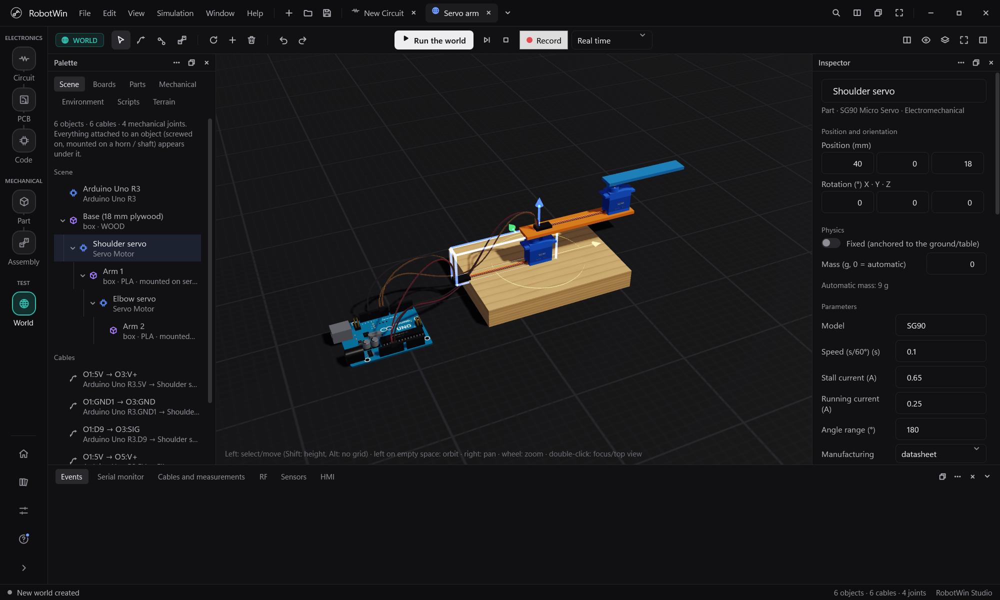

## Inspector: an object's properties

The **Inspector** on the right shows only the sections the selected object really uses: first its name, position and orientation, physics (fixed, material, mass), size and look, then the sections of its kind (board, component, wing linkage, shell, switch, controller). The extra physics a body can be given (**Shell**, **Pressure vessel**, **Recovery parachute**, **Air (custom setting)**, **Behaviour**) appear only when they are on, with **Remove** in their header; the others are under **Properties → Add feature ▾**.

## Opening a world

- **New world** (Ctrl+Shift+N): an empty 4 × 3 m workshop.
- **Put this circuit into a new world**: puts your open circuit into a new world as a board.
- **Open…**: a saved `.rwworld` file.
- **World templates** (home page or **File → From a world template**):

| Template | Contents |
| --- | --- |
| Empty workshop | 4 × 3 m floor, 25 °C |
| Two boards connected by cable | A 9 V power board and an LED board on separate PCBs; the LEDs light once two cables connect them |
| Two-axis servo arm with Arduino | An Uno drives two SG90 servos; the second servo is screwed to the first one's horn |
| Stepper Z axis with Arduino (lead screw) | An Uno turns a NEMA 17 through an A4988; a T8 lead screw lifts the carriage 40 mm and lowers it with a speed ramp |
| Arduino, LCD and OLED (I²C wired) | Uno, 16×2 LCD, 128×64 OLED and a potentiometer on I²C cables |
| Two-wheeled car (real physics) | PLA chassis, two TT motors and wheels on one axle, ball caster, 4×AA pack |
| Ultrasonic distance sensor and obstacles | An HC-SR04 really measures the obstacle in front of it |
| Battery, motor and wheel | A 4×AA pack drives a TT motor with a wheel on its shaft |
| Factory cell (robot arm + conveyor) | Six-axis arm, conveyor belt, light curtain |
| SCARA pick-and-place (parallel gripper) | A SCARA arm carries parts with a parallel gripper |
| Propeller thrust stand | 8520 motors with propellers: speed, thrust, torque, current live |
| Mini drone take-off | A 40 g X frame with four 8520 motors lifts off on its thrust |
| ESP32 quad | Brushless motors, ESCs, MPU-6050; the flight firmware on the ESP32 keeps the frame level |
| Electronics box | A hollow body with a lid, an Uno and a 9 V battery inside; fit check, X-ray and exploded views |
| Powered glider (UAV) | A 1 m glider, a 2212 brushless motor, an ESP32 flight board; balanced by the battery's position alone |
| Glider | Balsa pod, carbon tail boom, Nano + two servos, pushrods; hand-launched |
| Mecanum-wheel car (moves sideways) | Four TT motors on mecanum wheels slide sideways |
| Lights | LEDs, an RGB LED, a power LED, a bulb and an LED strip in a dark room |
| Gamepad-controlled car (ESP32 + PS5 controller) | Its own ESP32 + DRV8833 PCB, a USB-C rechargeable 2S pack, a paired DualSense |
| PS5 gamepad-controlled aircraft: runway take-off | 1 m trainer, ailerons, tricycle gear, Bluepad32 flight controller, model airfield ([details](#the-ps5-controlled-plane)) |
| Water rocket | 2 L PET bottle, 0.6 L water, 4 bar; water jet, air thrust, fins |
| Solid rocket motor test stand (KNSB) | Two BATES sugar grains; pressure and thrust follow from the burn rate |
| Solid-fuel rocket: e-match launch and parachute | A 41 mm rocket on a G-class KNSB motor; a switch closed by a 2 s countdown fires the e-match, the rocket climbs to ~1 km and throws its parachute at apogee |
| Container and balls: hollow parts | A tray and a tube made in the modeller; balls and cubes fall into the tray, one ball drops down the tube's bore to the ground |
| Glass of water: a servo pours the water | An ESP32 tips a glass held on a sideways SG90's horn by 90°; 193 ml of water pours into a bowl ([liquids](#liquids)) |
| Line-following robot | A 5-channel TCRT5000 over matte, faded and glossy tape |
| Sensor rover | Camera, LiDAR, GPS, IMU, compass and encoders live |
| Tape finding with ESP32 + OV2640 camera | The camera sees the track from above, the ESP32 finds the tape |
| Wind, fan, conveyor and expressions | Turbulent wind, a fan, a conveyor and forces written as expressions |
| Terrain course, Indoor workshop | Sculpted terrain, painted floor layers |

## The parts of the screen

- **Top toolbar:** select and move, **Draw cable** (K), **Attach** (B), rotate, duplicate, delete, undo / redo; **Run the world**, **Step 10 ms**, **Stop and rewind**, speed; camera follow, top view, fit all.
- **Left panel tabs:** **Scene**, **Boards**, **Parts**, **Mechanical**, **Environment**.
- **Centre:** the 3D view.
- **Right:** the inspector: the selected object's name, position, physics, cables and joints.
- **Bottom tabs:** **Events**, **Serial monitor**, **Cables and measurements**, **RF**, **Sensors**.

### Arranging the panels

The palette, the inspector and each bottom tab (events, serial monitor, cables and measurements, RF, sensors) are movable panels:

- **Into its own window:** drag a panel's header or its bottom tab. The panel tears off into its own window and follows the mouse; the window button in the header does the same. Move the window to a second screen if you like. A panel in its own window keeps updating live while the world runs.
- **Docking:** drag the window by its title over the main window and the **Left**, **Right** and **Bottom** guides appear. Near an edge, the area the panel will take is highlighted; release to dock it there. A window released in the middle stays a window. The **To the left / To the right / To the bottom** buttons at the top of the window dock it without dragging. Closing the window puts the panel back where it last was.
- **Several panels on one side:** panels docked on the same side stack. Drag the line between them to share the height, and the edge line to set the column width. For example, put the serial monitor under the inspector and the events under the palette, then hide the bottom panel to give the scene more room.
- **Panel menu:** the **⋯** button in the header, or a right click on the header or tab: **On the left**, **On the right**, **In the bottom pane (tab)**, **In a separate window**, **Move up** / **Move down**, **Hidden**. The palette and the inspector cannot go in the bottom panel.
- **Panel layout** (the button at the right end of the toolbar) or **View → World panels**: shows and changes where each panel is. Hidden panels come back from here. It also has **Show bottom pane**, **Swap the left and right panels**, **Dock separate windows back** and **Reset layout**.

The layout is kept, including the position and size of each panel window, and comes back the next time you start the program. In the Scene + Game view (G) with **Panels** off, the side columns and the bottom panel are hidden; panels in their own windows stay open.

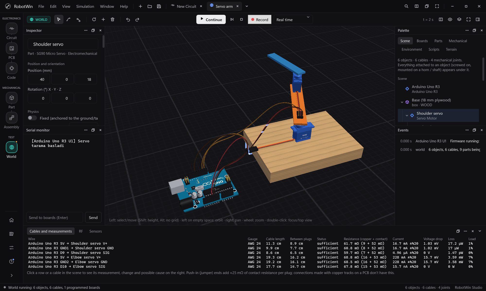

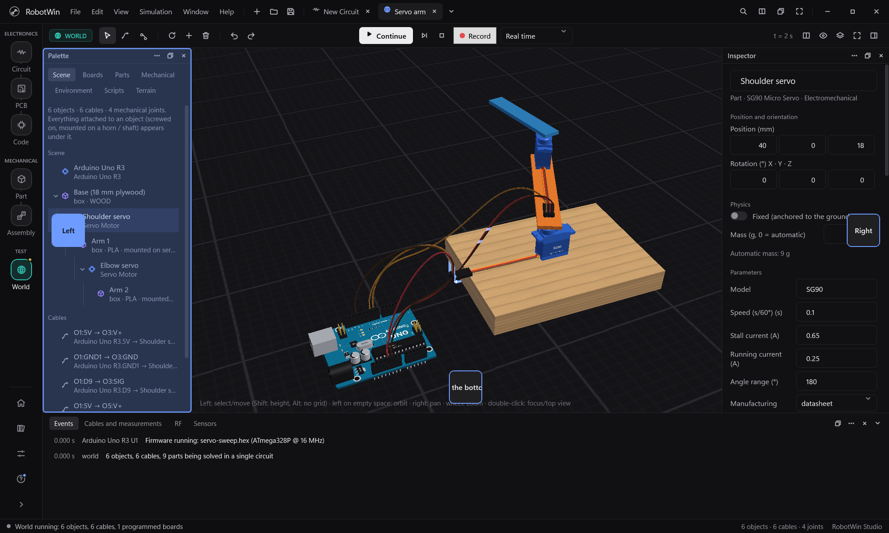

## Step by step: your first world

In this example a battery turns a motor and the motor turns a wheel.

1. Open a **New world** (Ctrl+Shift+N).
2. In the **Parts** tab search for `battery` and add **4×AA Battery 6 V**. Then search `motor` and add **TT Gear Motor 1:48**.
3. Select the motor. In the **Physics** section on the right switch on **Fixed (anchored to the ground/table)**, so the motor does not run away while turning.
4. Add a **Wheel** from the **Mechanical** tab.
5. With the wheel selected, take the **Attach** tool (B) and click the motor. In the menu that opens choose **"… · fix to Motor shaft where it is (rotates with it)"**.
6. Take the **Draw cable** tool (K). Click the battery's `+` pin, then a pin of the motor. Do the same for the battery's `−` pin and the motor's other pin. With the mouse over a pin you see its name, live voltage and how many cables are connected.
7. **Run the world** (F5). The motor turns, the wheel turns, you hear the motor.
8. In the **Cables and measurements** tab below, see each cable's current, power and load percentage.
9. **Stop and rewind** (Shift+F5) puts everything back to the start.

## Object types

### Boards

Your own circuit + PCB + code. In the **Boards** tab:

- **From open tab**: turns an open circuit into a board and adds it.
- **Add board from project file (.rwproj)…**
- **Design a new blank board**
- **Ready-made module boards**: Arduino Uno, Arduino Nano, ESP32 DevKit V1, ESP32 DevKitC, a brushed flight controller.

The same design can be placed several times; the copies share one circuit. With a board selected, the inspector has:

- **Edit board (circuit · PCB · code)**: the board opens in its own tab.
- **Write the board's code**: opens its code on the Code page ([4. Code](04-code.md)).
- **Export as a separate project file…**

### Parts

A single catalogue part: servo, motor, battery, sensor, display, Arduino… The **Parts** tab has a search box and categories: Development, Electromechanical, Power, Sensor, Display, Switching, **Wireless and USB**. Change parameters in the inspector's **Parameters** section.

A loose Arduino or ESP32 becomes a programmable board with **Convert to board design and open its code**.

### Mechanical bodies

The **Basic shapes** in the **Mechanical** tab: box, plate / chassis, arm / bar, cylinder, wheel (with a rubber tyre), sphere / ball, table / fixed floor. Set size and colour in the inspector. **Enclosure shells (hollow, with lids)** hold boards and batteries inside; **Flight surfaces** (wing, tailplane with elevator, fin with rudder) produce real lift, drag and moments.

### Collision shapes

Every part's rigid body comes from its own 3D model: a round motor can rolls, a wing collides with its tapered shape, a controller with its own outline (not a bounding box). Thin pieces such as leads, pins and cable ends are left out. **View → Collision shapes (world)** draws the bodies the physics really collides, translucent over the models; they move with the bodies while the simulation runs. Hollow models (a tray, cup, tube or U bracket made in the modeller or imported) are split into convex pieces, so things can be put inside them and a ball passes down a tube's bore. Example: the **Container and balls: hollow parts** template. The maths: [Rigid bodies and contact](../physics/02-mechanics.md).

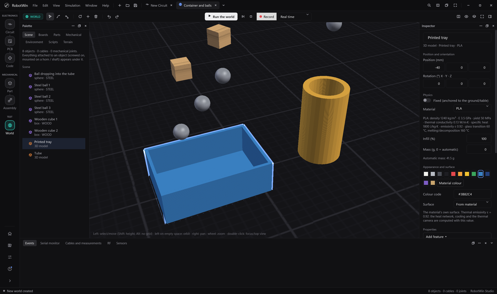

### Pressure vessels and rockets

The **Mechanical → Pressure vessels and rockets (gas physics)** section has a PET bottle (water rocket), an air tank, a solid-propellant motor and a rocket fin. Any cylinder, box or sphere body becomes a vessel with **Add feature → Pressure vessel (gas physics)** in the inspector:

- **Gas, pressure, inner volume, wall, water:** what the vessel holds. The gas follows the ideal gas law (p·V = m·R·T).
- **Nozzle:** throat and exit diameter, the face the jet leaves from. The flow is isentropic; at a high enough pressure ratio it reaches the speed of sound at the throat, and an expanding nozzle accelerates the gas supersonically. The thrust ṁ·vₑ + (pₑ − pₐ)·Aₑ acts on the body where the nozzle is.
- **Valve opens (s, releases from the pad)**: the launcher holds the nozzle closed until then.
- **Water:** while it covers the nozzle, water leaves first (Bernoulli; the rocket's acceleration presses the water onto the nozzle), then the air.
- **Solid propellant:** a KNSB, KNDX or APCP grain; the burn rate depends on pressure (r = a·pⁿ). The chamber pressure comes out of the balance between the gas the burning surface makes and the gas leaving the nozzle; no ready thrust curve is read. It ignites when an **e-match** joined to the motor is fired from the circuit, or at the **Ignition time (s, empty = e-match)**.
- **Bursting:** if the pressure brings the wall's hoop stress (σ = p·r/t) to the material's strength, the vessel bursts.

The vessel's mass falls as gas, water and propellant leave; hot gas heats the wall and the nozzle throat (visible in the thermal camera). While running, the inspector shows pressure, temperature, thrust, the grain surface temperature, the burning share of the surface and the state live. Start with the **Water rocket**, **Solid rocket motor test stand (KNSB)** and **Solid-fuel rocket** templates. The maths: [Gas and rockets](../physics/05-gas-and-rockets.md).

### Ignition and launch

A solid grain does not burn the moment the e-match fires. The match and the pyrogen on it burn; their hot gas heats the grain surface, a zone whose surface reaches the ignition temperature lights and the flame spreads towards the nozzle. In the inspector set **Igniter powder (g, extra per e-match)** and **Igniter burn time (ms)**. With the charge at 0 only the match head is left; a sugar motor usually fails to light and the event log says why ("the grain surface reached at most 122 °C").

There are two ways to fire the e-match:

- **Launch controller:** battery → switch → e-match → battery. In the switch's inspector, **Closes by itself (s, countdown)** gives a countdown. While the simulation runs, the **Close** button closes the switch by hand.
- **From a board:** drive a MOSFET from a board to fire the e-match (for example from an altimeter or a radio).

The e-match is chosen in the motor's **Ignition (e-match)** setting or mechanically joined to the motor.

### Parachute

Give any body a parachute with **Add feature → Recovery parachute** in its inspector and set its **Canopy diameter (m)**. The parachute is thrown when the altimeter sees the climb end (or at the set **Deployment time**). The canopy opens over its filling time once the lines are taut; the opening shock and the descent rate come out of the physics. While running, the canopy is drawn in the scene.

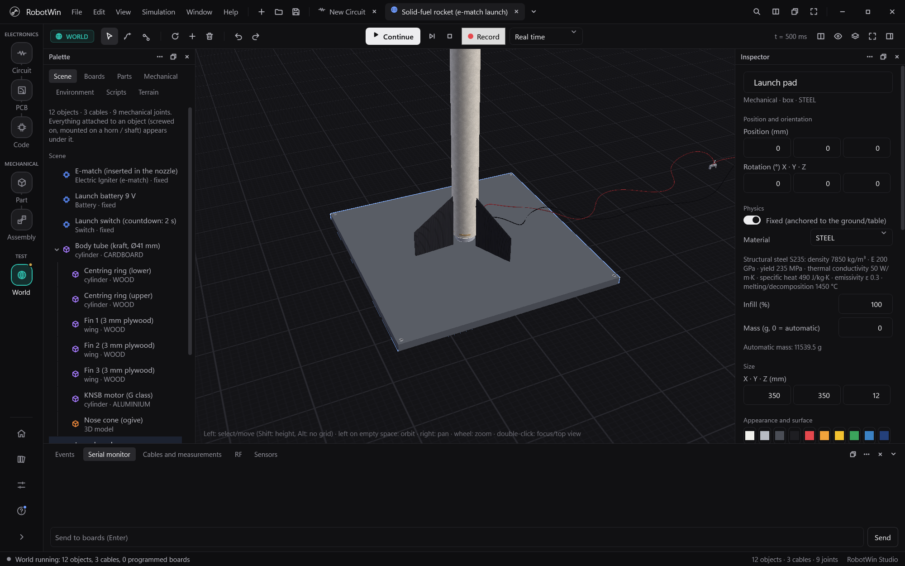

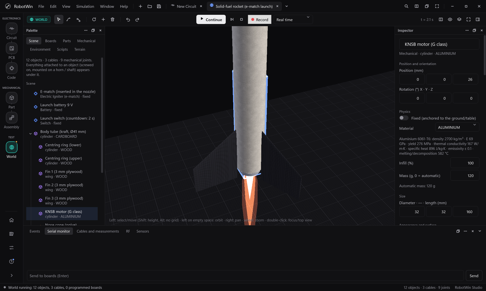

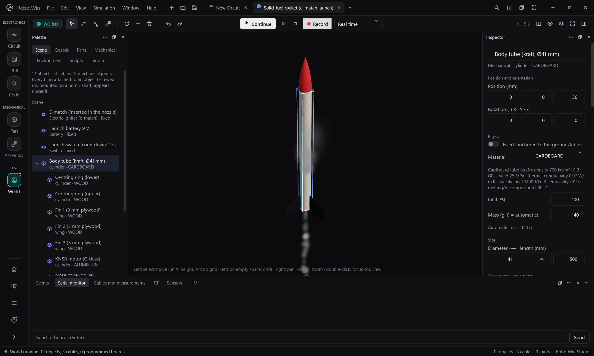

### Liquids

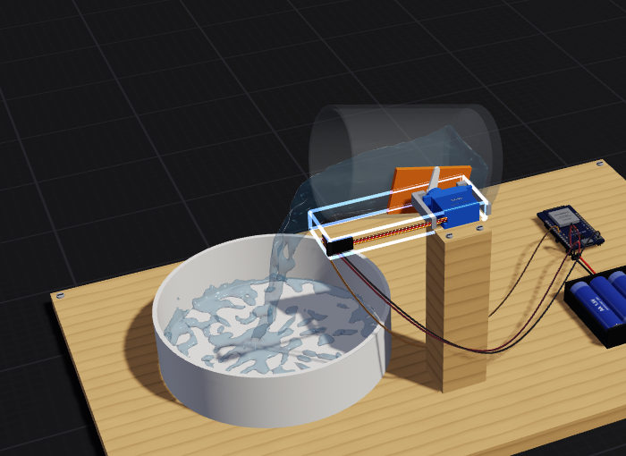

**Mechanical → Liquids (real flow with particles)** adds a glass, full of water or empty, or a volume of water (a box or a cylinder). A liquid object's box or cylinder is the volume the liquid fills when the world starts; solid parts standing in it are left out. In the inspector you pick the liquid: water, sea water, ethanol, milk, sunflower oil, glycerol or honey. Each one's real density, viscosity and surface tension are used.

- The liquid is solved as particles and presses on its container's walls with its real pressure. A glass carries the weight of its water, a part dropped in water feels buoyancy, honey flows slowly.
- Glass (material **CAM**) and acrylic are drawn see-through, so water shows through a glass. A cylinder with a wall thickness (**tube.wall**) and a bottom (**tube.bottom**) becomes a glass or a cup.
- The live view uses about 3000 particles per liquid, solved every 1 ms; still water sleeps.
- A render computes everything in full (6000–30 000 particles by accuracy, on every physics step) and replays the liquid with a finer surface.

Equations and validation: [Liquids](../physics/07-liquids.md).

### 3D models

Add your own model with **External model → Import 3D model or robot (STL, OBJ, PLY, STEP, IGES, URDF)…**. Mass, centre of mass and inertia are computed from the material. A part you made on the Part page comes here as one body with **Put into the test world as a single body (obstacle, ramp …)** in its right-click menu; the robot's parts go to its assembly with **Send to assembly** ([5. Part](05-model.md), [6. Assembly](06-assembly.md)).


### Robot descriptions (URDF and xacro)

Bring in a robot written for ROS (`.urdf` or `.xacro`) with the same button, or with **File → Open**, which opens it in a world of its own. Every link with a body becomes a part, placed at the zero configuration; its shape comes from its visual meshes (STL, OBJ, PLY, STEP), or its collision meshes when a visual cannot be read, its colours from the URDF's materials. Frames without a body (such as `tool0`) fold into the link above. Revolute and continuous joints become hinges, prismatic ones sliders, with their limits. Every moving joint has a **motor** (when the URDF lists its actuated joints with `<ros2_control>` or `<transmission>`, only those; the others, such as a caster's swivel, turn freely. A listed joint whose `command_interface` is `velocity` takes a speed, `position` a position. A `<mimic>` joint, such as a gripper's second finger, has no target of its own: it follows its joint with the `multiplier` and `offset`, and the inspector shows that joint instead of a target): the URDF's `effort` is its torque limit, its `velocity` its top speed. Revolute and prismatic joints hold a position (0 at first), continuous ones take a speed (standing at first), so an arm keeps its pose against gravity. Select a part and change **Motor target** in the inspector's **Mechanical joints** section; while running, the joint turns there at once.

When the root link is ROS's `world`, the part fixed to it is bolted down as the base. Any other root without a body (a mobile robot's `base_footprint`) is a frame of the robot, carried by the part below it. Otherwise an arm stands fixed and a robot on wheels of its own (continuous joints with *wheel* in the name) stays free. `package://pkg/…` meshes are found by looking for the package's folder (by its name or the one in its `package.xml`) from the URDF's folder upwards. In xacro, properties, `${…}` expressions (arithmetic, comparisons, `pi`, `radians()` and the other math functions), macros with default and block parameters, `include`, `if`/`unless`, `insert_block`, `arg` and `$(find …)` work; reading YAML (`load_yaml`) and DAE (Collada) meshes do not yet. Sensors written for Gazebo (`<gazebo reference="link"><sensor type="ray">` or `gpu_lidar`, and `type="imu"`) are put on the part with their rate, their pose on the link, scan angles, range, noise and their plugin's topic name (`~/out:=scan`, `<topicName>`, `<topic>`), and are published on the ROS connection; cameras and depth sensors are not taken yet. Whatever could not be read is listed at the end of the import.

### ROS 2 connection (rosbridge)

A world can connect to `rosbridge_server` running on the ROS 2 side (in ROS 2: `ros2 launch rosbridge_server rosbridge_websocket_launch.xml`, in WSL or on another computer). In the palette's **Environment** tab, type the address in **ROS 2 (rosbridge)** (by default `ws://localhost:9090`) and press **Connect to ROS 2**. While the world runs:

| Topic | Direction | Type | Content |
| --- | --- | --- | --- |
| `/clock` | published | `rosgraph_msgs/msg/Clock` | The simulation's clock, 100 Hz (for nodes running with `use_sim_time`). |
| `/joint_states` | published | `sensor_msgs/msg/JointState` | Each hinge's and slider's position (rad / m) and velocity, by its URDF name, 50 Hz. |
| `/joint_command` | subscribed | `sensor_msgs/msg/JointState` | The named joints' motor targets: a position (rad / m), or a velocity (rad/s) for continuous joints. |
| `/joint_trajectory` | subscribed | `trajectory_msgs/msg/JointTrajectory` | Position-driven joints pass the points at their times (as on ros2_control's trajectory controller topic): a cubic through positions and velocities between two points, a straight line without velocities; they hold the last point. The motors track with their own torque and speed limits. A new trajectory or a `/joint_command` replaces the running one. |
| `/joint_trajectory_controller/follow_joint_trajectory` | action server | `control_msgs/action/FollowJointTrajectory` | MoveIt's controller: the goal's trajectory runs as on `/joint_trajectory`, with feedback (desired, actual, error) ten times a second. At its end the goal succeeds when the joints it gives position tolerances for are within them; if they are not there within its time tolerance (1 s when none is given), it is aborted with GOAL_TOLERANCE_VIOLATED. A joint the world lacks gives INVALID_JOINTS, a new goal preempts the running one, and a cancel holds the joints where they are. Needs rosbridge's action support (ROS 2 Jazzy and later). In MoveIt's `moveit_controllers.yaml` it is `joint_trajectory_controller` with `action_ns: follow_joint_trajectory`. |
| `/odom` | published | `nav_msgs/msg/Odometry` | A robot free on the ground: its root frame's (`base_footprint`) pose from where it started and its velocity in its own frame, 50 Hz. The simulation's truth (no wheel slip in it). |
| `/tf` | published | `tf2_msgs/msg/TFMessage` | `odom` → the root frame. The links above it are published by `robot_state_publisher` from the URDF and `/joint_states`. |
| `/cmd_vel` | subscribed | `geometry_msgs/msg/Twist` | Forward speed (`linear.x`, m/s) and turn rate (`angular.z`, rad/s), turned into the drive wheels' speeds as a differential drive does. With no new command for 0.5 s the wheels stop. |
| `/scan` | published | `sensor_msgs/msg/LaserScan` | A laser scanner the URDF declares: its rays are cast into this world at its rate (it does not see its own robot), with its declared noise; a ray with no return reads past `range_max`. |
| `/imu` | published | `sensor_msgs/msg/Imu` | An IMU the URDF declares: orientation, angular rate and specific force (9.81 m/s² upwards on a robot standing still) from the motion of the part it rides on, with its declared noise. |
| `/robotwin/<part>/scan` | published | `sensor_msgs/msg/LaserScan` | A LiDAR part in the world (RPLIDAR, LD06, 16-channel): the sweep it measured with its own scan pattern and noise, counter-clockwise in even steps; of a many-channel one, the channel nearest the horizon. `<part>` is the part's name (`Front LiDAR` → `front_lidar`), and so is the frame. |
| `/robotwin/<part>/imu` | published | `sensor_msgs/msg/Imu` | An IMU in the world (MPU-6050 …): the acceleration and angular rate it measured, with its bias and noise. |
| `/robotwin/<part>/image_raw` | published | `sensor_msgs/msg/Image` | A camera in the world: every new frame, processed with its exposure and noise (bgra8). |
| `/robotwin/<part>/fix`, `/magnetic_field` | published | `sensor_msgs/msg/NavSatFix`, `MagneticField` | A GPS's position (covariance from its HDOP) and the field a compass measured (tesla). A sensor without supply publishes nothing. |

The drive wheels are the speed-driven joints on the base whose axis points across the robot; their track and radius are measured from the robot's own shapes (the values written by hand into ros2_control's diff drive controller). A second robot's topics and frames go under `/robot2`. The section shows the messages sent and received, the joints ROS sees, the rover's wheels, track and radius, the last `/cmd_vel` and unknown names in the commands. The connection stays open when the world stops and is used by the next run.
### Path checking on the robot arm

The arm with a controller in **Parts → Robot Cell** tries every move along its whole path before it starts: the move is sampled so that no joint turns more than 1° (a prismatic one 2 mm) between samples, and at each sample the link boxes, the tool on the flange and the part it carries are tested against every other solid in the world, the floor, and the arm's own links two joints away. Contacts that already exist when the move starts (the box it picks touching the conveyor) do not count. With **Collision check along the path** on *warn* (the default) a move that would collide goes to **Events** with what hits what and how many seconds into the move, and the arm goes ahead (the physics plays the collision out); on *stop* the arm faults before it moves; *off* turns the check off. Obstacles are taken where they are now: where a box riding the conveyor will be later is not predicted.

The **Sag** line on the cell panel gives how far the arm's tool sinks under the weight it holds: each axis's reducer winds up under load (about 350 N·m/rad per N·m of rating for an industrial reducer, about 6 for a hobby servo's position loop) and those small joint angles are carried to the tool through the Jacobian. **from the load** is what the picked part adds: a point taught with no load sits that much lower once the box is held. A six-axis industrial arm reaching out sags a few tenths of a millimetre with 5 kg, a servo arm millimetres with 150 g.

### Photoelectric sensor and limit switch

Under **Parts → Robot Cell**. The **photoelectric sensor**'s lens faces the part's +X. In *diffuse* mode it sees the light an object returns: its range is for a white card (90 % reflectance), and as the returned light falls with the square of the distance it is shorter on a dark object (rubber, 8 %: about 90 mm on a 300 mm sensor). In *retro-reflective* and *through-beam* modes the beam goes to a reflector or receiver at the range, and anything that comes between cuts it, whatever its colour. **Output on** chooses whether OUT is high while an object is there or while none is; the output follows after the **response time**. While the world runs the beam is drawn in the scene.

The **limit switch**'s roller lever reaches out along +X. When something pushes the roller past the **pre-travel**, C–NO closes and C–NC opens; it lets go half a millimetre before. The contacts are real switches in the circuit: wire them to a PLC input, a Modbus module, a relay or straight into a motor's circuit.

### PLC (Structured Text)

**Parts → Robot Cell → PLC** is a PLC with eight digital inputs (I0–I7 → `%IX0.0`–`%IX0.7`) and eight outputs (Q0–Q7 ← `%QX0.0`–`%QX0.7`) that runs IEC 61131-3 Structured Text (ST). Every **cycle time** it reads its inputs (1 above half the I/O voltage), runs the program once and writes its outputs. The editor in the inspector checks the program as you write it and shows errors with their line. **Save and download to the PLC** also downloads the program into a running world's PLC (it starts cold). The panel shows RUN/STOP, the scan count, the input and output bits and the variables live; the PLC's lamp is green in RUN and red in STOP.

Supported: `VAR … END_VAR` (with `AT %IX0.0`, `%QX0.0`, `%MW0` addresses), BOOL, INT, DINT, UINT, WORD, REAL, TIME (`T#1s500ms`), 16#FF and 2#1010 numbers; the TON, TOF, TP, R_TRIG, F_TRIG, CTU, CTD, CTUD, SR, RS blocks; the Modbus client blocks MB_READ and MB_WRITE (below); `IF … ELSIF … ELSE`, `CASE … OF` (a station's steps), `FOR`, `WHILE`, `REPEAT`, `EXIT`; ABS, SQRT, MIN, MAX, LIMIT, SEL and conversions such as `INT_TO_REAL`. Integers wrap as in a PLC (INT is 16-bit). A program that does not compile, or a fault while running (division by zero, a loop that does not end), puts the PLC in STOP with its outputs off; **Restart** takes it back to RUN. A new PLC comes with an example program: a lamp, a flasher and a pusher station (when a part comes, drive the cylinder out, bring it back when it is out, count when it is back). Turn on its **Modbus TCP server** (port 5021 by default) and a SCADA or HMI connects to the PLC: holding registers are `%MW0`–`%MW255` (writable; the program sees a write at its next scan), discrete inputs `%IX`, coils `%QX`.

**Modbus client.** The PLC reads and writes the world's other Modbus devices (remote I/O modules, other PLCs with Modbus on) over the plant network by their unit ID:

- `MB_READ`: on a rising edge of `REQ` it asks the device at `UNIT` for the value at `ADDR` with `FC` 1 (coil), 2 (discrete input), 3 (holding register) or 4 (input register);
- `MB_WRITE`: writes `VALUE` with `FC` 5 (coil) or 6 (holding register);
- `BUSY` until the answer comes back (the plant network's round trip, 5 ms), then `DONE` for one scan (a read's value is in `VALUE`);
- on a failure, `ERROR` and `STATUS`: the device's exception code (1 function, 2 address, 3 value), or 11 when nothing answered within 200 ms (no such device, or the network is down).

```
Read(REQ := TRUE, UNIT := 2, FC := 3, ADDR := 1);
IF Read.DONE THEN Level := Read.VALUE; END_IF
```

**OPC UA client.** `UA_READ` and `UA_WRITE`: the PLC as an OPC UA client. On a rising edge of `REQ` they read or write the variable `NODE` (`'ns=1;s=Line1.SPEED'`, `'ns=2;i=1001'`) on the server at `URL` (`'opc.tcp://192.168.0.10:4840'`). `UA_READ` gives a number in `VALUE` and text in `TEXT`; `UA_WRITE` writes `VALUE`, or `TEXT` to a String node, in the node's own type. `BUSY` while the request is on the network, then `DONE` for one scan, or `ERROR` with `STATUS` (the OPC UA status code's upper word: 32820 = 0x8034 no such node, 0x803B not writable, 32773 = 0x8005 no connection). The scan never waits; the connection stays open between requests. For a secured server give `SECURITY := 'SIGNANDENCRYPT'` (or `'SIGN'`) and, for a user, `USER` and `PASSWORD` (Basic256Sha256). The PLC's own certificate is made on first use. It refuses a server it does not know (`STATUS` 0x801A); the server's certificate lands in `%LOCALAPPDATA%\RobotWinStudio\pki\rejected`, and once moved to `trusted` the PLC connects. A wrong password gives `STATUS` 0x801F.

**OPC UA server.** With the PLC's **OPC UA server** on (port 4840 by default) a running world is an OPC UA server: UaExpert, a SCADA or an HMI connects to `opc.tcp://127.0.0.1:4840`. Under **Objects** there is an object named after the PLC, holding each program variable (`ns=1;s=<PLC>.<VARIABLE>`, array elements as `A[3]`) and its RUN state. The types come from the IEC types: BOOL → Boolean, INT → Int16, DINT → Int32, UINT/WORD → UInt16, REAL → Float, LREAL and TIME (ms) → Double. Inputs (%IX) are read-only; a value written to the others is seen by the program at its next scan. Browse, Read, Write and subscriptions (a notification when a value changes, a keep-alive when nothing does) are supported. PLCs on the same port and address are separate objects on the same server.

**OPC UA security.** With the OPC UA server on, three more settings appear on the PLC:

- **OPC UA security:** `none` (no security, the default), `signed` (Basic256Sha256 signed, or signed and encrypted) or `signed and encrypted` (encrypted only). With security on, no unsecured session can be opened; only the endpoints can be asked for. The server's certificate is made on the first start and kept (`%LOCALAPPDATA%\RobotWinStudio\pki\own`); clients such as UaExpert trust it once.
- **OPC UA users:** `operator:password, viewer:password:ro`. A user ending in `:ro` (or `:okur`) reads but cannot write. With users named, anonymous login is off. The password always crosses the network encrypted with the server's certificate.
- **Accepted clients:** `trusted only` accepts the certificates in the `pki\trusted` folder. An unknown client is refused; its certificate lands in `pki\rejected` and the event log says where to move it. `all` accepts every client (for a closed test network).

With the listening address `0.0.0.0` and neither security nor users, the event log warns: anyone on the network can read and write the PLC.

**Code in a file from elsewhere.** If a project or world downloaded from the internet (marked so by Windows) carries code that would run directly on the PC (an FMU part, C# scripts), you are asked whether you trust its source before the simulation starts. **Trust and run** removes the file's mark and it is not asked again. ESP32 code runs in a sandbox and Arduino code in the emulator, so they are not asked about.

**Your own blocks, functions and arrays.** A program can define its own `FUNCTION_BLOCK`s and `FUNCTION`s (before or after the program):

- A `FUNCTION_BLOCK`'s `VAR_INPUT`, `VAR_OUTPUT` and `VAR` variables are separate in each instance and kept between scans; it can use blocks such as TON and other blocks of your own. An instance is called like the standard blocks: `D1(IN := Button, Q => Lamp);`, its output `D1.Q`.
- A `FUNCTION` keeps nothing (its variables start afresh at every call); its result is assigned to its own name. It is called with named arguments (`Scale(Raw := x, Hi := 10.0)`) or in the order of its `VAR_INPUT` (`Scale(x, 0.0, 10.0)`); an input not given takes its initial value. It cannot call itself.
- Arrays: `ARRAY[1..8] OF INT := [3, 1, 4]`, arrays of timers and blocks too (`Delay : ARRAY[0..3] OF TON;` → `Delay[i](IN := …);`, `Delay[i].Q`). An index outside the array puts the PLC in STOP. In the panel and on an HMI the elements show as `A[3]`.
- Inside blocks and functions there are no direct addresses (`%IX0.0`) or `AT`: the program reads the inputs and gives them to the block.
- Types are defined in `TYPE … END_TYPE`. Structures: `Part : STRUCT Id : INT; Weight : REAL := 0.5; END_STRUCT;`. Their fields are read and written as `P.Id`; structures nest, a field can be an array (`P.Marks[2]`), and there are arrays of structures (`Line[i].Id`). `P := Q;` and `Line[i] := P;` copy a whole structure field by field; an initial value is given as `P : Part := (Id := 1, Weight := 2.0);`. In the panel and on an HMI the fields show as `P.Id`, `Line[2].Id`.
- Enumerations: `State : (Idle, Run := 10, Fault);`. Their values are used by name (`Run`) or as `State#Run`, and can be `CASE` labels.
- `VAR_IN_OUT` gives a block or a function the caller's own variable; what the block changes is written back to the caller. Structures and arrays are passed to blocks this way: `Move(Target := Line[2]);`. It must be given on every call.
- Text is declared as `STRING` (at most 80 characters) or `STRING[20]`; longer text is cut to that length. It is written `'Hello'`; inside it `$'` is a quote, `$$` a dollar, `$N` a line break, and two hex digits like `$41` one character. The functions are IEC 61131-3's, positions counting from 1: `LEN`, `LEFT(S, 3)`, `RIGHT`, `MID(S, L, P)`, `CONCAT(A, B, …)`, `INSERT`, `DELETE`, `REPLACE`, `FIND`; inputs can be named too (`MID(IN := S, L := 2, P := 3)`). To convert: `INT_TO_STRING`, `REAL_TO_STRING`, `TIME_TO_STRING`, `STRING_TO_INT('42')`, `STRING_TO_REAL`. Strings compare with `=`, `<`, `>` and join with `CONCAT`, not `+`. There are arrays of strings, and strings can be structure fields, block inputs and function results; the panel shows them in quotes, and OPC UA reads and writes them as String.
- Arrays of more dimensions: `M : ARRAY[1..3, 0..3] OF INT;`, an element is `M[i, j]`. Initial values go row by row; `[10(0), 2(1)]` is ten 0s and two 1s. Arrays of structures, strings and blocks can have more dimensions too (`Grid[1, 2].Full`).

```
FUNCTION_BLOCK Debounce
VAR_INPUT IN : BOOL; PT : TIME := T#30ms; END_VAR
VAR_OUTPUT Q : BOOL; END_VAR
VAR OnDelay, OffDelay : TON; END_VAR
OnDelay(IN := IN, PT := PT);
OffDelay(IN := NOT IN, PT := PT);
IF OnDelay.Q THEN Q := TRUE; ELSIF OffDelay.Q THEN Q := FALSE; END_IF
END_FUNCTION_BLOCK
```

With **Language** set to *Ladder* the program is a ladder diagram (LD): **Open the ladder editor** shows the variables on the left (`VAR … END_VAR`) and the rungs in the middle. Each rung has seven columns of contacts and blocks and the coil column on the right; from the toolbar put on the selected cell a normally open or closed contact, a rising or falling edge, a comparison, TON, TOF, TP, CTU, a wire, a coil, a negated coil, a set or a reset coil; **│ link** draws a vertical link from the cell's right side to the row below (a parallel branch: this is how a seal-in latch is built). The selected cell's variable, parameter (`T#2s`, `5`, `>= 50`) and a counter's reset are in the boxes below. The program is checked as it is drawn; **Generated Structured Text** shows what the rungs turn into. While the world runs, the contacts that pass power and the coils that are TRUE light green.

**Cycle time and bottleneck:** the PLC's **Step variable** (by default `Adim`, the variable a station's `CASE` steps run on) is watched: the panel shows the current step and how long it has been there, the finished cycles (each return to the first step) and the average cycle time, the step that takes longest and its share of the cycle. The step that slows the station (a throttled cylinder stroke, say) is found this way.

### HMI (operator panel)

The **HMI** tab in the bottom panel is an operator panel bound to the PLCs' variables. In the **+ Element** card choose the kind (lamp, button, switch, number, set point, bar), the PLC and the variable (by its name in the program, or an address such as `%MW3`), then press **Add**. While the world runs, lamps and numbers show the program's values; a **button** holds its variable TRUE while pressed (as an operator's finger), a **switch** turns it on and off, a **set point** gives the program the value typed when Enter is pressed. Variables bound to an input (`%IX`) cannot be written: their pins set them. The panel is saved with the world.

### Pneumatic cylinder

**Parts → Robot Cell → Pneumatic Cylinder** is a double-acting cylinder with a single-coil 5/2 valve on top; the rod comes out along the part's +X. When the **SOL** coil is energised (it pulls in at 70 % of the coil voltage and drops out at 40 %) the supply goes to the cap end, the rod end to exhaust, and the piston goes out; released, it comes back. Each chamber is solved with its own mass and temperature of air: the valve's flow follows ISO 6358 (choked below the critical pressure ratio), filling air heats, expanding air cools and the wall brings it back to room temperature. Pressure × area pushes the piston, the seals rub and the stroke ends at the stops. **Speed** throttles the exhaust (meter-out speed control). **EXT** and **RET** are the outputs of the magnetic sensors at the end positions. The coil is a real load in the circuit: drive it from a Modbus module, a board or a limit switch's contacts. The rod pushes boxes; the panel shows the position, speed, both chambers' pressures, the force and the air used (normal litres).

With **Valve** set to `double coil` (or with the *double solenoid* ready-made part) the valve has no spring: **SOL** sends the piston out, **SOL2** back, with both released it stays where it was (a valve with memory), and with both energised it does not move. Choose it when the cylinder must stay where it is when the power goes.

### Compressor and air tank

**Parts → Robot Cell → Compressor** is a piston compressor, its tank and its pressure switch:

- the motor starts when the tank falls to the **cut-in pressure** (6 bar by default) and stops at the **cut-out pressure** (8 bar); the pump delivers its **free air delivery**, a little less the harder the pressure it works against;
- name the compressor (e.g. `KMP1`) as a cylinder's **Air source** and the cylinder takes its air from that tank. Its supply is the lower of its own **supply pressure** (the regulator) and the tank's;
- the air the cylinders draw leaves the tank: if the compressor cannot keep up, the pressure falls and the cylinders slow down and weaken. A line stroking a Ø32 × 200 mm cylinder twice a second wants about 116 NL a minute, which a small 30 L/min compressor cannot keep up with;
- **RUN** is high while the motor runs, **PS** while the tank is above the cut-in pressure: a PLC builds its "no air" alarm from it;
- the panel shows the tank pressure, the motor's duty, how often it cut in, and the air pumped and drawn.

With a vacuum cup's **Vacuum generator** set to `ejector` (or with the *with ejector* ready-made part) its vacuum comes from a venturi run on compressed air:

- the vacuum it can reach rises with its supply pressure: it gets to its best (85 kPa by default) at about 4.5 bar and to a third of it at 1.5 bar;
- while on, it draws its **air consumption** from the tank of the compressor named as its **Air source**;
- a weak air line weakens the hold: a Ø50 mm cup lifts a 5 kg box at 6 bar and drops it at 1.5 bar.

### Fault scenarios

A photoelectric sensor, limit switch, pneumatic cylinder or Modbus module can fail at a set time with **Add feature → Fault scenario** in the inspector: a dirty lens (the range drops), a stuck or dead output, a welded contact, a broken lever, a seal leak, a stuck valve, a low supply, a lost network. Set its **start time** and, where it has one, its **size** (the range left, the leak, the pressure); when it begins it is written to **Events**. A PLC program's reaction to the fault (a step that waits forever, a timeout alarm) can so be tried before it meets the real one.

A robot's sensors can fail the same way:
- **IMU (MPU-6050):** gyro drift (°/s), vibration noise (m/s²), a frozen reading, no answer on I²C.
- **Compass (HMC5883L):** a magnet nearby (µT), no answer on I²C.
- **GPS:** sky lost (the NMEA goes on with no valid position), multipath (a shift east, m).
- **LiDAR:** a dirty window (the range shortens), a stalled motor.
- **Line sensors:** a dirty lens (the signal drops), a burnt-out IR LED on the TCRT5000.

The firmware's reaction to bad readings can so be tried: a heading integrator drifting, a timeout when a sensor goes silent, sensor fusion rejecting the bad input.

### Modbus TCP remote I/O

The **Parts → Robot Cell → Modbus TCP Remote I/O** module has 8 digital inputs (DI1–DI8) and 8 digital outputs (DO1–DO8), wired with cables to a light curtain, a conveyor's photo-eye or a robot's inputs. While the world runs the module is a Modbus TCP server (by default `127.0.0.1:5020`, unit 1): a PLC, HMI or SCADA program on the same computer (Codesys, Node-RED, `pymodbus` …) connects as to a real module. Set **Listening address** to `0.0.0.0` to let other computers on the network connect.

| Modbus | Address | Meaning |
| --- | --- | --- |
| Coil (01, 05, 15) | 0–7 | DO1–DO8: the value written drives the output pin |
| Discrete input (02) | 0–7 | DI1–DI8: 1 when the pin's voltage is above half the I/O voltage |
| Input register (04) | 0 | The inputs' bit word (DI1 = bit 0) |
| Holding register (03, 06, 16, 23) | 0 | The outputs' bit word; writing it sets the coils |
| Input register (04) | 1–4 | AI1–AI4: 0–10 V analog inputs, in millivolts (12 bits, 2.44 mV steps; 100 kΩ input) |
| Holding register (03, 06, 16) | 1–2 | AO1–AO2: 0–10 V analog outputs, in millivolts (12 bits) |

Modules sharing a port are told apart by their unit ID (as devices behind a gateway). The ports opened, and any that could not be, are listed in the **Events** tab.

#### Modbus RTU (serial line)

With **Bus** set to `rtu` (or with the **Modbus RTU Remote I/O** ready-made part) the same table is served by Modbus RTU on the module's 5 V TTL serial header (**RX**, **TX**). Wire an Arduino's TX (D1) to the module's RX and the module's TX to the Arduino's RX (D0), and join their GNDs: the sketch is the master over the cable.

- The **RTU baud rate** (1200–115200) and **RTU frame** (`8E1`, Modbus's default, `8O1`, `8N2`, `8N1`) must match the sketch's `Serial.begin(9600, SERIAL_8E1)`. If they do not, the characters arrive broken and the module does not answer, as a real one would not.
- A frame ends with 3.5 characters of silence (1.75 ms above 19200 baud); one whose CRC-16 does not hold, that has a broken character or is for another address goes unanswered.
- Address 0 is a broadcast: carried out, never answered.
- The answer goes out on TX bit by bit 3.5 characters after the request ends.
- The inspector shows the answers, the CRC errors and the broken characters; a line fault injector on the RX line shows how errors are counted.

## Cables

- Every cable has a gauge (AWG), a length and a colour. The default is 24 AWG; 22 AWG when connecting a DC motor or a battery.
- A cable's resistance is real copper resistance. If its current limit is exceeded the cable heats and burns; the **Cables and measurements** tab says **BURNT**.
- Boards are electrically separate until a cable connects them. If you carry a signal between two boards, connect GND too.
- To remove a cable press **Disconnect cable** in the inspector.

### Power report

Every module whose supply range its datasheet gives (GY-521, HC-SR04, GPS and compass modules, LiDARs, the camera, WS2812, servos, TCRT5000, PIR, character LCDs) has its supply pin watched against its own GND through the run. Once the voltage has come into range, a drop below the minimum (a motor's starting current, a weak battery, a thin cable, a regulator's dropout) goes to **Events** at once as a brown-out, and its recovery with how long it lasted and how low it went. Going over the maximum is logged too. When the world stops, the **Power report** lists the order the parts came into range, each one's brown-outs and the ones that never had enough. Boards (Arduino, ESP32) report their own brown-out resets as before.

## Mechanical joints

With an object selected, click another object with the **Attach** (B) tool:

| Option | What happens |
| --- | --- |
| **… · fix to Servo horn / Motor shaft where it is (rotates with it)** | The object is fixed to the servo horn or motor shaft and turns with it. Only offered if the target has a horn or shaft. |
| **Fix to the body of … (screw / glue)** | The two objects move as one |
| **Attach with hinge (rotates freely)** | Turns freely about one axis |
| **Attach with slider (slides linearly)** | Slides along a line |

Parts joined by at most two joints do not collide with each other. Dragging an object brings everything attached to it. Remove a joint with **Detach** in the inspector.

### Screwing, gluing, tape, zip ties, solder

For a fixed joint, choose its **fastening** in the inspector. It is not just a label; it sets three pieces of the joint's physics:

1. **Strength:** for screws, the load one screw carries × the number of screws; for adhesives, the lap-shear strength × the bonded area. The bonded area is taken as half of the smaller part's largest face. When the force through the joint exceeds this, the joint breaks and the event log says so.
2. **Heat path:** heat crosses the fastening layer (conductivity ÷ thickness) over the share of the footprint that really touches. A thin glue line passes heat far better than screw heads: two aluminium blocks joined with epoxy reach the same temperature within a minute, while with a zip tie they stay 55 K apart.
3. **Temperature:** adhesives and plastic threads soften. Strength falls linearly from the softening to the release temperature. The joint's temperature is the mean of the two parts in the heat network. A 1 kg block hot-glued under a beam holds at 25 °C and falls when the parts are at 95 °C.

| Fastening | Strength | Heat path (layer, contact share) | Softens → lets go |
| --- | --- | --- | --- |
| Fixed (unspecified) | unbreakable | 400 W/m²K, 15 % | — |
| M3 screw + nut (2) | 2 × 1000 N | 400 W/m²K, 15 % | — |
| Screw into plastic (M3, 2, self-tapping) | 2 × 250 N | 400 W/m²K, 12 % | 60 → 110 °C |
| Cyanoacrylate (super glue) | 6 MPa × area | 4000 W/m²K, 50 % | 80 → 120 °C |
| Epoxy | 15 MPa × area | 2000 W/m²K, 70 % | 60 → 110 °C |
| Hot glue | 1.5 MPa × area | 400 W/m²K, 30 % | 55 → 85 °C |
| Double-sided foam tape | 0.5 MPa × area | 100 W/m²K, 80 % | 90 → 150 °C |
| Zip tie | 220 N | 400 W/m²K, 5 % | 80 → 160 °C |
| Solder (Sn63/Pb37) | 30 MPa × area | 200 000 W/m²K, 30 % | 150 → 183 °C |

A box lid can also be set to **Lid screwed on**; it is screwed down when it seats on the rim, and a "cannot be screwed" warning appears when it does not.

### Gears, belts and lead screws

Select a part on a hinge or a slider, choose **Add feature ▾ → Gear, belt, lead screw**, then another joint of the world and the kind:

| Kind | Joints | What happens |
| --- | --- | --- |
| **Gear pair** | hinge + hinge | The other gear turns at the ratio of the teeth, the other way. |
| **Belt** | hinge + hinge | It turns at the ratio of the pulley diameters, the same way (a chain does too). |
| **Rack and pinion** | hinge + slider | Each turn of the pinion slides it by its circumference. |
| **Belt-driven carriage** | hinge + slider | Like a 3D printer's X/Y axis: each turn of the pulley moves it by the pulley's circumference. |
| **Lead screw** | hinge + slider | Each turn of the screw advances the nut by its lead. |

It is a constraint, not a motor: the two joints move together and the driven side's load comes back to the driving one. The motor of a screw lifting a carriage feels its weight as torque. The sizes come from the parts: a cylinder's diameter is its gear's tooth count (module 1), or its pulley's or screw rod's diameter. Other shapes start at 20 and 40 teeth, a GT2 pulley or a T8×8 screw. **Reverse** is a crossed belt, an idler gear between the two, or a left-hand thread.

**Efficiency** is the friction of the teeth or the thread, proportional to the load they carry. The defaults are 98 % for spur gears, 95 % for a rack and 97 % for a belt. A lead screw's efficiency comes from its thread's angle (trapezoidal thread, plastic or bronze nut, μ = 0.15): about 66 % for a T8×8, about 36 % for a T8×2. At 50 % or less the screw is **self-locking**: with the motor stopped the load cannot turn it back. So a vertical axis on a T8×2 stays where it is, while one on a T8×8 slowly comes down. While running, **Live readings** show the coupling's load and the joint's speed.

**Backlash** is the total play between the teeth, given at the driven side: degrees for a gear, millimetres for a rack, a belt-driven carriage or a screw. Inside the play the two sides move independently, and the teeth push only once their flanks meet. A motor that reverses does not move the driven side until it has crossed the play: 1° of play at 0.1 rad/s is a 175 ms wait. **Belt stiffness** (N/mm) is how much the belt stretches under load: a belt joins the two sides like a spring, and 0 is rigid.

### Spring and damper

Give a part on a hinge or a slider a spring of its own with **Add feature ▾ → Spring and damper**. On a hinge it is a torsion spring (**N·mm/°**), along a slider a coil spring (**N/mm**). Enter the spring rate as the catalogue gives it. The spring pulls the joint toward its **Free position** and works together with a motor: a motor holding a lever against its return spring carries the spring's k·θ torque. **Damping** is a brake proportional to speed (a shock absorber, a gas strut, a door closer). The spring is solved implicitly, so even a very stiff one stays stable. On a slider, 1 kg on a 1000 N/m spring sags 9.81 mm and swings with a 199 ms period; critically damped, it settles without overshooting. While running, **Live readings** show the spring's torque or force and the joint's position.

### Bearings

**Add feature ▾ → Bearing** chooses what the joint turns in or slides on. Its friction grows with the load it carries. On a hinge the friction torque is μ × load × bore / 2 (SKF's simplified friction moment). On a slider the friction force is μ × the load across the rail.

| Hinge | μ | Slider | μ |
| --- | --- | --- | --- |
| Ball bearing (608) | 0.0015 | Linear bearing (LM8UU) | 0.003 |
| Needle bearing | 0.0025 | Ball rail (MGN) | 0.004 |
| Bronze bushing (oiled) | 0.08 | Wheeled carriage (V-slot) | 0.005 |
| Plastic bushing (POM / PTFE) | 0.15 | Plain slide (plastic, dry) | 0.15 |
| Pin in a printed part (dry) | 0.3 | | |

A 10 kg flywheel at 10 rad/s on an 8 mm ball bearing loses only 0.02 rad/s in two seconds; on a bronze bushing it loses 1.26 rad/s. A heavy part brakes its bearing more. The joint's **friction** value stays as the load-free part (seals, grease). While running, **Live readings** show the bearing's friction at that moment.

### Power transmission parts: a mechanism built as in reality

The **Power transmission** group of the **Mechanical** palette has parts at their real sizes: POM spur gears (module 1, 20/30/40/60 teeth, involute profile), a brass z12 pinion, GT2 pulleys (20/40/60 teeth), 608ZZ, 688ZZ, 625ZZ and 6000ZZ bearings, a KP08 pillow block, Ø8 and Ø5 steel shafts, T8 lead screws (lead 8 and 2) with their brass nuts, an LM8UU linear bearing, a shaft collar and a 5 × 8 flexible coupler. Their 3D models are generated from their dimensions: the gear's involute teeth, the pulley's GT2 grooves, the bearing's rings and shields, the screw's multi-start trapezoidal thread. Their masses come from their materials (POM, brass, die-cast zinc, steel, aluminium) or the catalogue. Ring-shaped parts also collide as rings, so a shaft passes through the bore.

Place the parts as in a real machine. You do not draw the joints; **Build the mechanism** (or starting the world) reads them from where the parts are:

- A shaft through the bore of a bearing or a KP08 **turns** in it, with that bearing's friction.
- A gear, pulley, collar or coupler whose bore sits on a shaft is **fixed** to it with its set screw.
- An LM8UU on a rod **slides** along it.
- Two gears with parallel axes and the same module whose pitch circles touch **mesh**: the centre distance must be m·(z₁+z₂)/2.
- A nut on a lead screw **drives** the carriage on slides it is fixed to. A right-hand screw turned clockwise, seen from above, raises its nut.
- Meshing gears start with a tooth in a space, not tooth on tooth: when they are assembled, the driven gear is turned by at most half a tooth pitch.
- A pinion with its axis across a rack and its pitch circle on the rack's pitch line **meshes** with it (an m1 rack's pitch line is 1 mm under its top). If the rack slides on a rail, the pinion drives it. If the rack is fixed, the pinion rolls along it and carries the carriage its shaft turns in, as on a CNC gantry. Each turn of the pinion moves it by its circumference: 62.8 mm for a z20.

**Belts:** select a pulley and press **Fit a belt → (the other pulley)** in the inspector. The axes must be parallel and the belt grooves in one plane. The belt's length comes from its two straight spans and the arcs it wraps. The inspector names the closed GT2 belt to buy and how far to move a pulley to tension it. A 20T and a 40T pulley 80 mm apart need a 220.5 mm belt; for a 232 mm belt, move a pulley 5.75 mm. The shafts are coupled at the ratio of the diameters, turning the same way. The scene draws the belt at real GT2 sizes: a 0.63 mm back, and teeth at a 2 mm pitch that sit in the first pulley's grooves and run with the belt as it turns.

Nothing is assumed: a gear on no shaft falls, a shaft in no bearing is not held, a bore that is too small does not go on, and in one too large the shaft is loose. The **Events** tab and the part's inspector say so. Bolt the bearings and pillow blocks to the frame or mark them **Fixed**; a fixed KP08 shows two M6 bolts in its base slots. The joints it builds appear in **Mechanical joints**, where you can edit them.

**Stepper motor:** build a whole axis with the NEMA 17 (17HS4401 or the pancake 17HS08) and the A4988 driver from the **Parts** tab. Wire it up:
- 12 V → VMOT, 5 V → VDD;
- a board's pin or a square wave to STEP, the direction to DIR;
- 1A/1B → the motor's A+/A−, 2A/2B → B+/B−.

A coupler, gear or pulley that goes on the motor's Ø5 D-cut shaft is fixed to it, and a lead screw in the coupler's other end turns with the motor. The motor runs on its real equations:
- each winding's resistance and inductance;
- back-EMF and torque that follow the rotor's angle (1.8° a step);
- the magnets' detent torque.

The driver counts STEP edges, microsteps down to 1/16 with MS1–MS3, and drives the phase currents to the current limit as far as VMOT allows, so the torque falls as the speed rises. The motor's torque turns the rotor in the physics. The shaft's inertia and the screw's load and friction reach the motor itself: overloaded, or started too fast without a ramp, it loses steps as a real one does.

Two more drivers sit beside the A4988, with the same pinout:
- **DRV8825:** 1/32 microstepping with M0–M2. It makes its own 3.3 V logic and has no VDD pin (that pin is FAULT). VMOT 8.2–45 V.
- **TMC2209:** 1/8, 1/16, 1/32 or 1/64 with MS1/MS2. It spreads each step to 1/256 between two STEP edges (MicroPlyer), so the motor turns quietly and smoothly. VM 4.75–29 V.

Set the current limit with the driver's **Current limit** value; it stands for the Vref setting on the board.

**A Z axis with an Arduino:** the `z-axis-stepper` firmware in the **Stepper Z axis with Arduino** template (built in, no libraries) drives an A4988 from an Uno: D2 → DIR, D3 → STEP, D8 → EN. It lifts the carriage 40 mm on a T8 lead screw and lowers it again, raising and lowering the speed at a steady acceleration (the ramp AccelStepper makes). A motor started at full speed without a ramp stalls; ramped, it follows.

**Assembly mates:** place parts by their faces and axes relative to each other. Pick the **Align** tool on the toolbar (H) and click a face or axis on two parts; clicking the round side of a shaft, wheel or gear picks its axis. The menu that opens offers the relations that fit:
- **Face to face:** two faces against each other.
- **Flush:** two faces the same way, in one plane.
- **Concentric:** a shaft in its hole.
- **Parallel**, **perpendicular**, **distance** and **angle**.

A fixed part stays put and the other settles into place with as little motion as it can. Parts screwed or grouped to it go along. The part's inspector has an **Assembly mates** section. There you can change offsets and angles or remove a mate, and it says how many degrees of freedom the part has left. A shaft in its hole, for example, keeps two (it slides and turns), and one once its shoulder rests on the bearing.

Mates place a part; while running, a joint holds it. When one degree of freedom or none is left, **Build the joint from the mates** makes that joint: a hinge on the axis if turning is left, a slider if sliding is, a fixed joint if nothing is. A mate that contradicts the others is not added, and the ones it fights are named. When you drag a part, the parts mated to it come along.

The physics is not an animation. Gears and screws are joined by constraints in the solver, as engineering multibody programs do it. The motor's torque comes from the load, the efficiency, the backlash and the bearing friction. Solving each tooth touching the next with collisions would be slow and unstable, so gears meet in the meshing constraint rather than through their bodies. If you want to use your own 3D models, join them with hinges or slides using the **Join** tool, then pair them with **Add feature → Gear, belt, lead screw**. The physics works the same way.

### Arm kinematics: forward and inverse

Select a part of an arm you built with servos (for example **Arm 2** in the servo-arm template). The inspector shows a **Kinematics (arm tip)** section. The program follows the joints to find the chain from a base to the part you selected.

- **Base:** a fixed object or a part joined to the ground. If the arm stands free, the heaviest part of the chain is the base.
- **Axes:** each servo horn, motor shaft, hinge and slider on the chain.
- **Tool point:** the middle of the selected part's face farthest from its last axis.

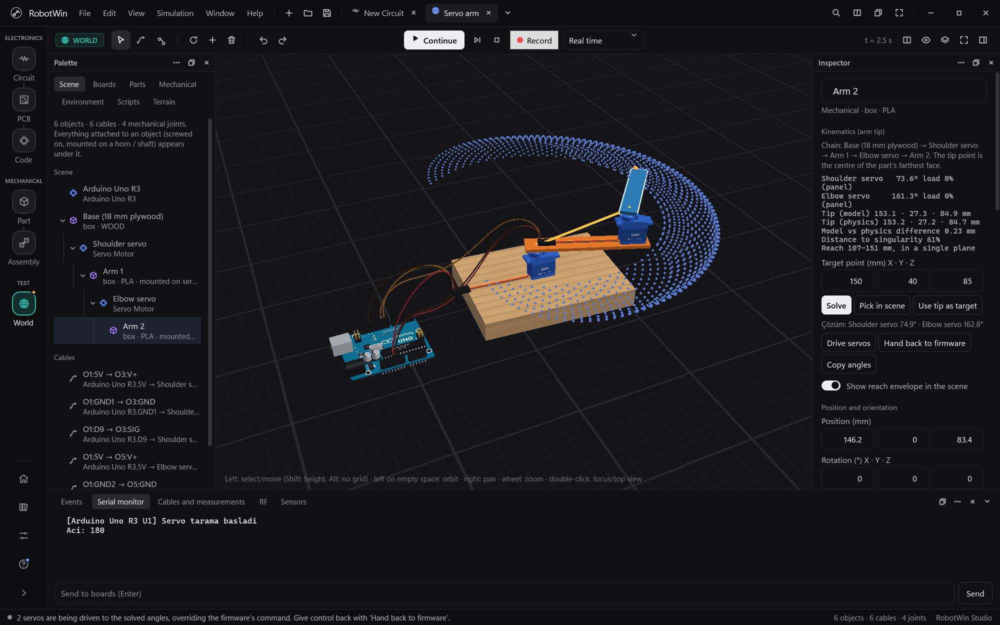

| In the section | What it shows |
| --- | --- |
| Servo rows | Each servo's angle (90° as built, 0–180° travel) and the torque the weight puts on it, as a share of its stall torque. Hinges and sliders read "free": physics decides them. |
| Tip (model) | The tool point computed from the angles (forward kinematics). |
| Tip (physics) | While running, the tool point the physics measures and its difference from the model. The difference comes from joint compliance and the servo's dead band; on the servo arm it is 0.2–0.3 mm. |
| Distance to singularity | At 0% the arm is stretched or folded: the tip moves in some directions only with very large angles. A warning shows below 10%. |
| Reach | The nearest and farthest the tip gets over the servos' whole travel. |

**Inverse kinematics:**

1. Type a target in millimetres, or press **Pick in scene** and click in the scene. The point is taken on the plane at the tip's current height.
2. Press **Solve**. The servo angles are found; free hinges stay as they are.
3. Use the solution:
   - While the world is stopped, **Preview** turns the servos to these angles and shows the arm in the scene.
   - While it runs, **Drive servos** gives the servos these angles. This is like a servo tester on the signal wire: it replaces the firmware's pulses, and the servo turns with its own speed, torque and supply. **Hand back to firmware** gives the command back to the firmware.
   - **Copy angles** puts the angles on the clipboard as constants for your code, with the pin each servo is wired to (for example `const int SHOULDER_SERVO = 75;   // 74.9° · D9`).

If a target cannot be reached, the nearest point and the reason are shown. The reason is either that the target is out of reach or that it is past a servo's limit.

If all the servo axes are parallel (as on the servo-arm template), the tip moves in one plane. The target is then brought onto that plane. If it moves by more than 1 mm, this is noted too.

**Motorised axes (imported robots):** the joints of an arm brought in with URDF or xacro have motors ([Robot descriptions](#robot-descriptions-urdf-and-xacro)); inverse kinematics solves them too and their rows show the link's name. While stopped, **Preview** shows the arm in the solved pose and **Make motor targets** saves the solution as the motors' targets (the arm goes there when the world runs; it can be undone). While running, **Drive the axes** gives the motors the solved values; each axis goes with the URDF's torque and speed limits and its row shows the motor's target (→). Motorised axes are not in the board's code: **Copy angles** shows only for servos.

A warning shows when a servo spends more than half its stall torque in the solution. With **Show reach envelope in the scene** on, the scene shows:

| Colour | What |
| --- | --- |
| Blue points | Where the tip can go |
| Yellow line | The arm's skeleton, from the axes to the tip |
| Orange | The target |
| Green | The nearest point reached |

### Kinematics and odometry of a wheeled robot

Select a wheeled robot's chassis (for example the plate of the car template). The inspector shows a **Drive kinematics** section.

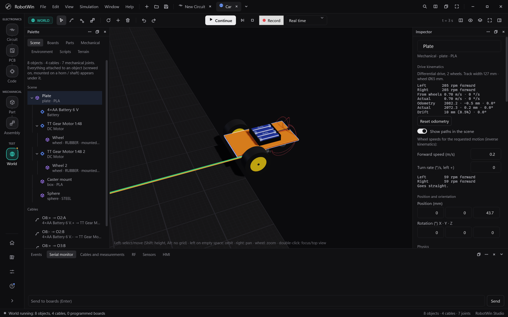

The program finds the motors with wheels on their shafts and recognises the kind of drive:

| Kind | What it can do |
| --- | --- |
| Differential (2 wheels and a ball caster) | Drives forward and turns; cannot move sideways. |
| Skid steering (4 wheels) | The wheels slide sideways when it turns. |
| Mecanum | Goes in every direction. |
| Omni | Goes in every direction. |

The track, wheelbase and wheel diameter are noted.

| In the section | What it shows |
| --- | --- |
| Wheel rows | While running, each wheel's speed in rpm and whether it turns forward or back. |
| Tekerleklerden (from the wheels) | The chassis speed and turn rate computed from the wheel speeds (forward kinematics). |
| Actual | The speed the chassis really has in the physics. If the difference is large, the slip is shown as a percentage. |
| Odometri (odometry) | The position and heading estimated from the wheel encoders. |
| Sapma (drift) | How far the estimate is from the true pose, and that as a share of the distance driven. |

**Reset odometry** puts the estimate back on the true pose. Every run also starts from zero. With **Show paths in the scene** on, two paths are drawn:

- orange: the estimated path;
- green: the true path.

On a flat floor the two-wheel car drifts less than 1% of the distance over a 46 cm arc. Wheel spin, skid steering and bumps make the drift larger, as they do in reality.

**Inverse kinematics:** type the forward speed you want, the sideways speed (for mecanum and omni) and the turn rate. Right below, each wheel's speed in rpm and its direction appear, with the turning radius. For a skid-steered vehicle a note says the real turn will be slower than the wheels compute.

### PID tuner: a motor's speed loop

Select a DC motor. In the inspector press **Speed control → PID tuner…**, or right-click the motor in the scene tree. The tuner opens in a window of its own.

The experiments run on a copy of the world: no firmware runs, and the physics is complete. The motor's load is the wheel you fitted and the vehicle it drives. Units are your firmware's: the command in PWM (0–255), the speed in rpm of the output shaft.

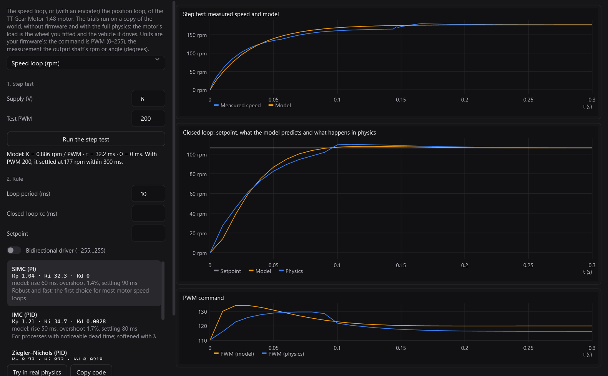

1. **Step test:**
   - Enter the supply voltage (taken from the world's battery) and the test PWM, and press **Run the step test**.
   - The PWM is applied to the motor at standstill, and its speed is measured until it settles.
   - A first-order-plus-dead-time model is fitted to it (Smith's two-point method). The gain (K), time constant (τ) and dead time (θ) are shown, and the model is drawn over the measurement.
2. **Rule:**
   - Enter the period your PID runs at in the firmware; half a period is added to the dead time.
   - Optionally, also enter the closed-loop time constant (τc) and the speed to try.
   - Four rules are listed. Each shows its gains (Kp, Ki, Kd) and the rise, overshoot and settling the model predicts:

     | Rule | When to use it |
     | --- | --- |
     | SIMC (PI) | First choice for most motor speed loops |
     | IMC (PID) | When dead time matters |
     | Ziegler–Nichols | Classic, aggressive |
     | Cohen–Coon | Large dead time |

3. **Try in real physics**:
   - The chosen gains run in the physics as the same discrete PID as the copied code: derivative on the measurement, output limits, and the integral held at a limit (anti-windup).
   - The response the model predicts and the one the physics gives are drawn on one graph and compared in numbers.
   - If the PWM sits at its limit most of the time, or the physics overshoots much more than the model, the reason is given.
4. **Copy code**: a `pidStep(setpoint, y)` function for Arduino, with the gains, the period and the limits.

**Position loop (a motor with an encoder, a DC servo):** choose **Position loop** at the top of the window. The step test is the same; the model gives the speed, and the position is its integral.

- The rules are SIMC's rules for an integrating process:

  | Rule | When to use it |
  | --- | --- |
  | SIMC (PD) | First choice: fast, no overshoot |
  | SIMC (PID) | A load that pulls (an arm, gravity): closes the lasting error |
  | SIMC (PID), smooth | Friction and backlash |

- The setpoint is in degrees (empty: 90°). In the physics the angle is counted like an encoder, past a full turn too.
- A position loop drives the motor both ways: **Bidirectional driver** stays on.
- In the copied code `y` is the angle read from the encoder. The sign of the result gives the direction, its size the PWM.

## Physics and environment

Every object's inspector has a **Physics** section:

- **Sabit** (fixed): the object is fixed to the floor or table and does not move.
- **Material**: every material the physics knows: PLA, PETG, ABS, PET, acrylic, aluminium, steel, copper, lead, carbon, wood, plywood, balsa, MDF, cardboard, rubber, FR4. Friction and bounce depend on the material. The card under the list gives the material's numbers: density, Young's modulus, yield strength, thermal conductivity, specific heat, emissivity and softening/melting temperature.

The **Appearance and surface** section, for bodies and imported models:

- **Colour**: click a swatch, type `#RRGGBB` in **Colour code**, or go back to the material's own colour with **Material colour**.
- **Surface**: matte paint, gloss paint/varnish, polished metal, brushed metal, black anodising, oxidised/rusty, wood grain, carbon twill, kraft paper, rubber coating, 3D-print layers. The texture is drawn at real size (0.2 mm print layers, 2×2 twill carbon…). The finish is not only a look: it sets the thermal emissivity (ε). Polished aluminium (ε 0.05) radiates very little heat, black anodising (ε 0.85) cools much faster. The heat network, cooling and the thermal camera use this value. Example: the **Material and surface showcase** template.

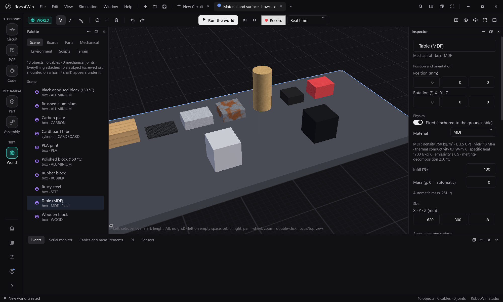

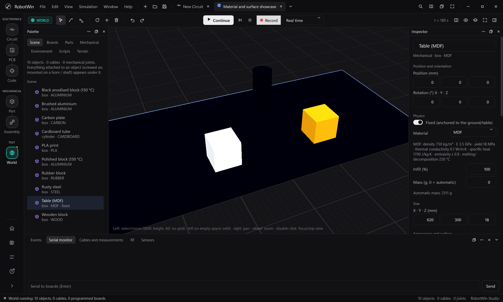
- **Infill (%)** and **Mass (g, 0 = automatic)**.

The **Environment** tab:

- **Gravity**: Earth 9.81, Moon 1.62, Mars 3.71, Jupiter 24.8, zero gravity.
- **Ambient temperature**, floor width / depth, floor friction (μ), surrounding walls.
- **Add obstacle** / **Clear obstacles**.
- Air, wind, turbulence and force fields: see [Physics scripts (SDK)](../../SDK.md).

Servos read the pulse command from the circuit; the horn's angle and the current it draws go back to the circuit. DC motors turn at the speed the circuit computes; the load on the shaft reflects back into the motor. Hard impacts and broken joints are written to the **Events** tab. Air drag acts face by face: a part's face that a joined part covers sees no air ([Aerodynamics](../physics/04-aerodynamics.md)).

## Thermal camera

**View → Thermal camera (world)** colours the models by temperature like a real thermal camera (iron palette). With the mouse over a part you see the temperature of that point and the part's nodes (a TT motor's winding, can and gearbox). The maths: [Heat](../physics/03-heat.md).

## Sensors and displays

Sensors do not produce ready-made values. They measure the world with their datasheet properties: they cast rays, look at the floor or take the body's motion, then add their own noise and errors. All of them are on the **Parts** tab.

| Sensor | Measures | How it is computed | Errors and limits |
| --- | --- | --- | --- |
| **HC-SR04 ultrasonic** | Distance to an obstacle | A ray is cast into the physics scene; the first body hit counts, the sensor's own assembly does not | Echo time from the speed of sound at the air's temperature; 2 cm–4 m, 38 ms out of range; σ 1.5 mm jitter per measurement; 450 µs delay |
| **Line sensor** (TCRT5000, QRE1113, TCRT/QTR arrays) | A line on the floor | IR LED and phototransistor: the floor's diffuse reflectance, mirror-like reflection on glossy tape, sun and lamp light. The phototransistor is a real current source in the circuit and saturates | Signal changes with height (TCRT5000 peaks at 2.5 mm, 0.2–15 mm). Matte black tape reflects ≈ 6 % |
| **LiDAR** (A1 class, LD06 class) | 360° range scan | A ray per sample into the scene; scan rate and sample count from the datasheet | A1: 8000 samples/s, 5.5 Hz, 0.15–12 m, ≈ 1 %. LD06: 4500 samples/s, 10 Hz, 0.02–12 m, ±45 mm. Dark surfaces return from shorter |
| **IMU** (MPU-6050, GY-521) | Acceleration and rate | The body's real motion in the physics gives specific force and angular rate | Turn-on bias, slow bias drift, white noise (400 µg/√Hz, 0.005 °/s/√Hz), digital low-pass |
| **GPS** (NEO-6M, NEO-M8N) | Position, velocity | From the environment's geographic position; NMEA output | CEP 2.5 m (M8N: 2.0 m), growing with poor sky view; cold start 27 s, hot 1 s; up to 5 Hz (M8N: 10 Hz); a solution describes 80 ms before (stamped with that epoch) |
| **Compass** | Magnetic heading | The environment's magnetic field and the body's orientation | Hard-iron offset; 2 mG noise floor per axis; 0.73–4.35 mG/LSB resolution and ±0.88–8.1 G range by gain; sensitivity −0.3 % per °C |
| **Barometer** (BMP280, MS5611) | Pressure, altitude | Standard atmosphere (ISA) at the sensor's height | MS5611: 10 cm resolution, conversion times and PROM checksum |
| **±200 g accelerometer** (ADXL375) | Launch and impact acceleration | The body's real acceleration plus motor vibration | 49 mg/LSB, 13 bit, datasheet noise |
| **Depth** (MS5837) | Water pressure, depth | p = p_atm + ρ·g·h | The liquid's density sets the reading |
| **Motor with encoder** | Rotation | The motor shaft's angle in the physics | Pulse count from the motor model |
| **Camera** | Image | See below | |

- **I²C displays** (SSD1306 OLED, 16×2 LCD) show what the board writes, live on the 3D model.
- LEDs and lamps light up; overheated parts glow red, failing parts spark.

### How the camera works

A camera (OV7670, OV2640 / ESP32-CAM, 720p USB, Pi camera v2 / IMX219) really images the scene through its own lens. The image goes through the steps the sensor itself would take, in order:

1. **Capture:** the camera draws the scene from its lens position (it looks along the object's +X) at the model's horizontal field of view and the chosen resolution. For example 54.5° for the OV2640 and 62.2° for the IMX219.
2. **Exposure:** auto exposure sets the shutter first, then the gain. The darker the scene, the noisier the image.
3. **Noise:** photon shot noise (from how full the pixel well gets) and read noise grow with gain. The values come from the model's pixel size and well capacity.
4. **Motion:** while the camera turns, motion blur builds up over the exposure. The rolling shutter reads rows one after another, so a fast turn skews the image.
5. **Lens and output:** vignetting darkens the corners, then the image is quantised. If the driver asked for JPEG, the frame is compressed to JPEG.
6. **Frame rate:** limited by the sensor at that resolution (OV2640: 15 fps at UXGA, 30 at SVGA, 60 at CIF). When an ESP32 drives it, its DVP port's limit applies too.

ESP32 sketches use the camera through the real `esp_camera` interface: `esp_camera_init`, `esp_camera_fb_get`, `sensor->set_framesize`. If the camera is not powered by the board, initialisation returns an error. The **Sensors** tab shows each sensor's latest reading and the camera's latest frame.

With **Record sensor data (CSV, labelled)** switched on, every reading of every sensor through the run goes into a table. Beside what the sensor measured stands the true value the simulation knows (an IMU's real acceleration and rotation rate, a GPS position's real error, the real reflectance of the floor under a line sensor). The last column is the label: the fault scenario active on the sensor at that moment, or `normal`. When the world stops the tables are written to **Documents\RobotWin\Sensor logs\&lt;world&gt;-&lt;time&gt;**, one CSV per sensor and a README; **Open folder** opens it. Labelled data for sensor fusion and fault detection comes from the same run.

**Temperature reaches the sensors.** The ambient temperature (Environment → Ambient temperature) sets the air's density and its speed of sound: an HC-SR04's echo comes back at 331 m/s at 0 °C and 355 m/s at 40 °C, so a sketch dividing by 58 µs/cm reads 1 m as 104 cm in the cold and 97 cm in the heat. An IMU's zero points and sensitivities move with its chip's temperature, each chip by its own coefficients. The chip warms about 3 °C above what it is mounted on over a few minutes, so a gyro calibrated at power-on drifts in the first minutes and again when the motor driver beside it heats the board. The MPU-6050's TEMP_OUT register and the Sensors card show the chip's temperature, and the CSV log has a `chip_temp_c` column. A compass loses 0.3 % of its sensitivity per °C, and a line sensor's phototransistor follows its own temperature.

With **Compare attitude fusion** switched on, the readings of the world's first IMU (and of a compass, if there is one) go through four attitude estimators at once: gyro integration alone, a complementary filter, Mahony and Madgwick. The IMU card shows each one's tilt error (the angle between the true and the estimated vertical) and heading error, now and as RMS over the run. The filters see the sensor's real noise, bias, temperature drift and fault scenarios; the true attitude comes from the simulation. With the log on as well, `fusion_<IMU>.csv` writes every filter's roll, pitch and yaw and their errors beside the truth. Mahony's integral term also estimates the gyro's bias.

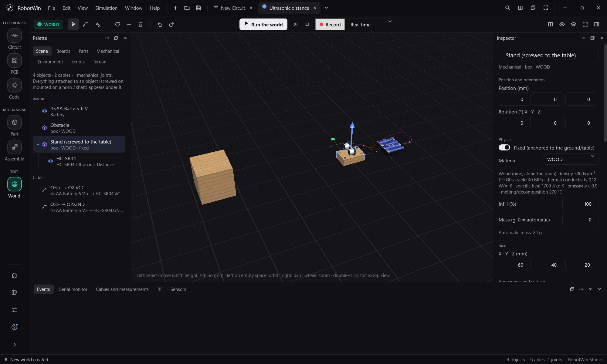

## Controllers, radio and USB

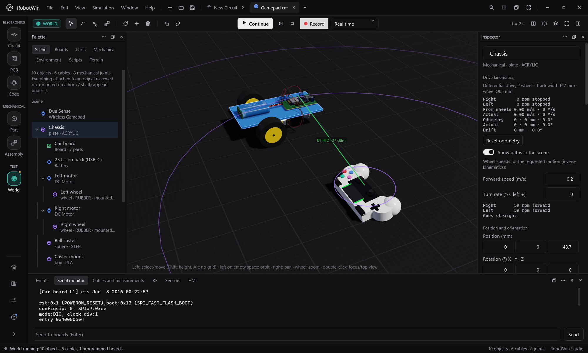

In **Parts → Wireless and USB**: DualSense (PS5), DualShock 4 and Xbox controllers, **Computer + USB cable**, **Wi-Fi Modem (2.4 GHz)**, **BLE Beacon Tag**, **IR Remote (NEC, 21 buttons)**, **TSOP38238 IR Receiver**.

### Controller

1. Select the controller. Pair it with the ESP32 with **Pairing mode (PS + Create held)** in the inspector.
2. Use the on-screen controller with **Open the virtual gamepad (mouse / keyboard)** (W/S throttle, A/D steering), or connect a real controller to the PC over USB or Bluetooth. If it does not show, **Rescan gamepads**.
3. The **Distance to ESP32** slider (while running) shows how the signal weakens with distance.
4. **Switch gamepad on** / **Switch gamepad off** and **Forget pairing** are here too.

With an ESP32 selected, **Upload example code: gamepad-controlled car (Bluepad32)** loads a ready car program.

### The PS5-controlled plane

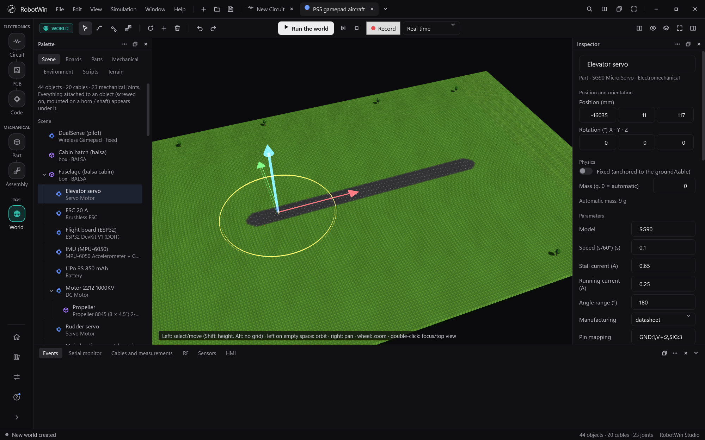

The **PS5 gamepad-controlled aircraft** template is a 1 m trainer standing at the end of an asphalt runway on a model airfield. Nothing is scripted: you fly it, and the physics and the flight controller's firmware decide what happens.

- **Airframe:** hollow balsa pod (closed by a screwed balsa hatch under the wing), Ø8 carbon tail boom, 4° dihedral Clark Y wing (ailerons on the outer halves, driven through torque rods by one SG90 standing in the pod right under the wing), elevator and rudder on pushrods.
- **Power:** 2212 1000KV brushless motor, 8×4.5" prop, 20 A ESC, 3S 850 mAh LiPo. 402 g; the centre of gravity sits at 30 % of the chord from the battery position alone, no nose weight.
- **Gear:** steel wire legs and an aluminium strap. The wheels turn freely on their axles, with the friction of a nylon hub on steel wire.
- **Flight controller:** ESP32 + MPU-6050, reading the DualSense through Bluepad32. The code also runs on a real ESP32 (select the ESP32 and open **Code**).

| Controller | Keyboard (on-screen controller) | Does |
| --- | --- | --- |
| Options (≡), with R2 released | Enter | Arms the motor (light bar green, short rumble) |
| ✕ | Space | Disarms: throttle cut at once (light bar red) |
| R2 | F | Throttle |
| Right stick right / left | L / J | Ailerons (roll) |
| Right stick back / forward | K / I | Elevator (nose up / down) |
| Left stick right / left | D / A | Rudder |
| △ | R | **Stabilised** (self-levelling) / **Manual** mode (light bar green / orange) |
| D-pad up / down | ↑ / ↓ | Pitch trim (0.5°) |

**Flying:** arm with Options, squeeze R2 fully. The plane accelerates down the runway; at about 9–10 m/s pull the right stick back a little and it lifts off. In **Stabilised** mode the stick asks for an angle (up to 45° of bank, 25° of pitch) and the plane levels itself when you let go. As the throttle comes back the nose drops slightly by itself, so with the power off it keeps its speed and glides (about 7 m/s, 6:1) instead of stalling. In **Manuel** mode the stick moves the surfaces directly.

**Range and failsafe:** the Bluetooth link between the DualSense and the ESP32 weakens with distance like a real radio link and drops at about 90 m in the open (the **RF** tab shows the RSSI). If the link is lost the flight controller cuts the motor and the plane glides down in a wide circle, nose slightly down, banked 10°. As soon as the controller is back in range, control returns.

**Camera:** in the **Scene + Game** view (G) the game side opens on **Pilot view**: it looks at the plane from where the controller is, as an RC pilot sees it, and zooms with the distance. The **chase camera** follows from behind at a distance set by the plane's size.

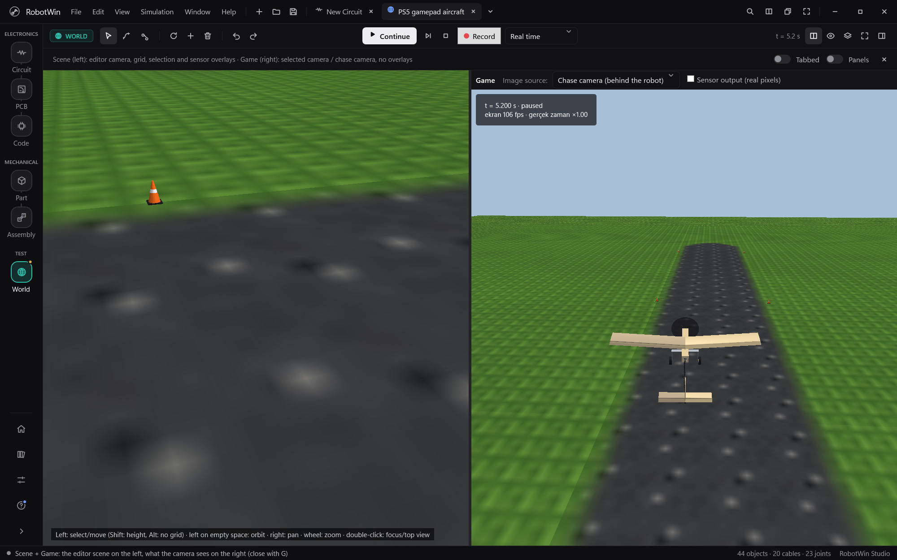

### USB

Point the **Computer (USB)** object at a board and press **Plug in USB**. While plugged, the board is powered with 5 V and its serial port is connected to the **Serial monitor** tab. **Unplug USB** disconnects it.

**USB-C rechargeable lithium batteries** (**Parts → Power**): an 18650 cell with a USB-C input, a 2S 18650 pack (7.4 V) and USB-C AA cells with a steady 1.5 V. Real electronics run inside: a protection board (cuts at 2.4 V over-discharge, over-charge and over-current; a flat pack wakes only when a charger is connected) and a constant-current / constant-voltage charger (1 A up to 4.2 V, then the current tapers). Point the **Computer + USB cable** object at the battery and plug it in: the battery charges; unplugged, charging stops.

### Radio environment

Wi-Fi, BLE and Bluetooth signals weaken with distance, obstacles and bodies. The **RF** tab below lists devices, signal strength (RSSI), channel and packets per second. **Fading (log-normal, σ = 4 dB)**, **Waves** and **Link lines** switch the radio visualisation on and off. IR remotes work only in line of sight; their keys are in the inspector's **IR remote buttons (NEC)** section. The maths: [Radio](../physics/06-radio.md).

## Scene tree

The **Scene** tab shows everything in the world as a tree of what is attached to what (e.g. "mounted on servo horn", "mounted on shaft", "fixed"). While running it shows temperatures above 60 °C and **FAULTY** objects. The **Cables** list is below it. Right-click: **Focus**, **Hide child objects** / **Show child objects**; double-click focuses the object.

## Running

| Button / key | Function |
| --- | --- |
| **Run the world** / **Pause** / **Continue** (F5) | Start, pause, resume |
| **Step 10 ms** | One step |
| **Stop and rewind** (Shift+F5) | Stops and puts everything back to the start |
| Speed | 0.01×, 0.1×, 0.5×, real time, 5× |

If a board has no firmware, the **Events** tab says "No firmware loaded (the board is idle)".

## Recording and rendering

Real-time running has to keep up with the screen. A **render** recomputes a recording from start to end at the accuracy you choose, independent of the screen, then plays it like a video.

1. Press **● Record** on the toolbar (Ctrl+R). The world restarts from the beginning.
2. Press **Stop recording** whenever you like. The render window opens and starts computing that span. You can also enter the duration yourself with **Simulation → Render: full physics, stress, flow, heat…** (Ctrl+F5).


**What is computed**

- **Every frame:** every object's position and orientation, servo horn and motor shaft angles, velocities, accelerations, contact and joint forces, every part's current, voltage, power and temperature signals, circuit nodes, serial output.
- **Stress:** every part you mark is solved with FEM at the "stress frame rate" (default 15 frames/s) and at its most loaded moments, with its real loads at that instant. Slender parts use beam elements. Besides bodies and models, servos, motors and boards are listed too; the ones something is fastened to (a servo carrying a second servo, say) are marked by default.
- **Air flow (3D, over time):** the real air of the world, solved through the whole recording (3D lattice-Boltzmann) in a box fixed to the world in which the parts move exactly as recorded:
  - every moving part pushes and drags the air with its own surface velocity;
  - the world's wind (with its gusts) blows in at the faces;
  - the ground is a wall;
  - the box is fitted around the parts that really move, with cells small enough for the thinnest moving part.

  Nothing else drives the air: with no wind and nothing moving there is no flow, and the **Log** says so. The air is shown in 3D as **smoke** carried by it: each particle leaves a short streak along its velocity (blue slow, red fast), and still air stays invisible. Each frame also gives the force of the air on the moving parts.
- **Wind-tunnel test (optional):** a measurement with steady air the world does not have. The assembly is held at its recorded pose at a few instants and air of the chosen **speed**, **direction** (0° = +X, 90° = +Y) and **elevation** is blown at it. The result is the force on the assembly, its drag coefficient (Cd) and streamlines. The notes say how far to trust it:
  - y+;
  - whether the force settled;
  - the grid uncertainty from the first instant solved on two grids.

  How far each solver is from theory: [12. Validation](12-validation.md).
- **Heating:** conduction, convection and radiation from the components' power losses on the boards.

**Playback**

- **Play / pause:** Space. **Frame by frame:** ← →. **Start / end:** Home / End. Speed from ×0.05 to ×2 (slow motion).
- **Colour:** stress (von Mises, deformed shape exaggerated) or velocity arrows. **Scale:** the render's maximum, or each material's yield strength.
- **Forces:** contact forces as orange arrows, joint forces as cyan arrows. **Air:** the smoke at that instant (in the wind tunnel: streamlines and the aerodynamic force, purple arrow).
- **Cables** are drawn in the render as the simulated ropes themselves: they sag, tighten, and a pulled plug comes out of its pin. The render scene is for watching only; its parts and cables cannot be moved.
- While you type in the channel search, Space and the arrow keys go to the text; the playback shortcuts work outside the box.
- **Graphs:** every recorded channel. Clicking or dragging on a graph jumps to that second.
- **Parts · stress**: each part's worst moment and safety factor. Clicking a row goes to that moment.
- **Heat** and **Log** tabs; results are saved as `.rwanalysis` or CSV.

**Live inputs are recorded too.** While recording, every input you give is kept with the simulation time it took effect at: controller reports (sticks, triggers, buttons, motion; only when they change), switching a controller on or off, pairing, text sent from the serial monitor, plugging a USB cable in or out, IR key presses, conveyor start / stop, light-curtain tests and launch switches. The render applies them again at the same instants; the **Log** tab says how many were replayed. Dragging objects with the mouse is not recorded yet.

The render computes at the accuracy (step size) you choose. With the same inputs, a chaotic motion (a stalling plane, say) can still drift slightly away from the live run over time.

## Comparing with the bench

The best way to see how close the simulation is to reality is to run the same setup on the bench and measure it. In the render window's **Charts** tab open a measurement log with **Import bench measurement (CSV)…**, pick the simulation channel to compare on the left (e.g. the servo's current) and press **Compare with selected channel**.

RobotWin aligns the two signals in time, draws the measurement in orange and reports:

- **gecikme** (delay): how far the log is shifted relative to the simulation;
- **measured ≈ k × sim + c**: the real part's proportional difference from the model (e.g. a clone servo at 1.30×);
- RMSE, the largest difference and when;
- **uyum** (agreement): the share of time the difference stays within 10 % of the measured range;
- **first divergence**: the first moment the two signals part for longer than 50 ms (e.g. when the real arm caught on something).

Log format: the first line is a header, the first column time. If the header has `ms` or `us` that unit is used, otherwise seconds. Separators may be commas, semicolons or tabs; decimal commas work too. Columns with `mA` / `mV` in their header are converted automatically when compared with A / V channels.

An example logging sketch (Arduino + INA219, in series with the servo's supply):

```cpp
#include <Wire.h>
#include <Adafruit_INA219.h>
#include <Servo.h>
Adafruit_INA219 ina;
Servo s;
void setup() {
  Serial.begin(115200);
  ina.begin();
  s.attach(9);
  Serial.println("t_ms,current_mA");
}
void loop() {
  unsigned long t = millis();
  s.write((t / 1000) % 2 ? 135 : 45);   // the same motion as the simulation's command
  Serial.print(t); Serial.print(','); Serial.println(ina.getCurrent_mA());
  delay(5);                             // 200 Hz
}
```

Save the serial monitor output as `.csv` and import it. Load the same sketch into the board in the simulation and render.

## Mouse and keyboard

| Mouse | Function |
| --- | --- |
| Drag an object with the left button | Move (with everything attached) |
| Shift + drag | Change height |
| Alt + drag | Ignore the 5 mm grid |
| Drag on empty space with the left button | Orbit |
| Drag with the right button | Pan |
| Wheel | Zoom |
| Double-click an object / empty space | Focus / top view |

| Key | Function |
| --- | --- |
| K | Draw cable |
| B | Connect |
| R / Shift+R | Rotate 15° / the other way |
| Ctrl+D | Duplicate |
| Del | Delete |
| Ctrl+Z / Ctrl+Y | Undo / redo |
| T | Camera follows the selected object |
| F | Fit the selection / everything |
| Esc | Cancel, back to the select tool |

Objects can only be moved while the simulation is stopped. You can also type position and angle into the inspector's **Position and orientation** fields.

## Saving

**Save** (Ctrl+S) stores the world as a `.rwworld` file. The boards inside are saved with their full projects (circuit, PCB, code); open the file on another PC and everything is ready.

---

[← Previous: 6. Assembly](06-assembly.md) · [Contents](README.md) · [Next: 8. Instruments →](08-instruments.md)
