# 7. World

The **Dünya** (world) page (Ctrl+6) is where everything comes together. Put the boards you designed, catalogue parts, mechanical bodies and 3D models into an environment with real physics, connect them with cables, join them with screws or hinges and run them all together. The circuit, the boards' firmware, the radio and the physics are computed at the same time, step by step.

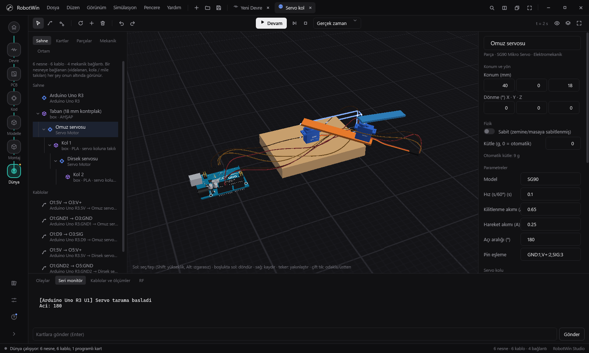

## Inspector: an object's properties

The **Denetçi** (inspector) on the right shows only the sections the selected object really uses: first its name, position and orientation, physics (fixed, material, mass), size and look, then the sections of its kind (board, component, wing linkage, shell, switch, controller). The extra physics a body can be given (**Kabuk** shell, **Basınçlı kap** pressure vessel, **Kurtarma paraşütü** parachute, **Hava (özel ayar)** own air settings, **Davranış** behaviour) appear only when they are on, with **Kaldır** (remove) in their header; the others are under **Özellikler → Özellik ekle ▾** (add feature).

## Opening a world

- **Yeni dünya** (new world, Ctrl+Shift+N): an empty 4 × 3 m workshop.
- **Bu devreyi yeni bir dünyaya koy** (put this circuit into a new world): puts your open circuit into a new world as a board.
- **Aç…** (open): a saved `.rwworld` file.
- **World templates** (home page or **Dosya → Dünya şablonundan**, File → from a world template):

| Template | Contents |
| --- | --- |
| Boş atölye (empty workshop) | 4 × 3 m floor, 25 °C |
| Kabloyla bağlı iki kart (two boards joined by cables) | A 9 V power board and an LED board on separate PCBs; the LEDs light once two cables connect them |
| Arduino ile iki eksenli servo kol (two-axis servo arm) | An Uno drives two SG90 servos; the second servo is screwed to the first one's horn |
| Arduino, LCD ve OLED (I²C kablolu) | Uno, 16×2 LCD, 128×64 OLED and a potentiometer on I²C cables |
| İki tekerlekli araba (two-wheel car) | PLA chassis, two TT motors and wheels on one axle, ball caster, 4×AA pack |
| Ultrasonik mesafe sensörü ve engeller (ultrasonic sensor and obstacles) | An HC-SR04 really measures the obstacle in front of it |
| Pil, motor ve tekerlek (battery, motor and wheel) | A 4×AA pack drives a TT motor with a wheel on its shaft |
| Fabrika hücresi (factory cell) | Six-axis arm, conveyor belt, light curtain |
| SCARA al-bırak (SCARA pick and place) | A SCARA arm carries parts with a parallel gripper |
| Pervane itki standı (propeller thrust stand) | 8520 motors with propellers: speed, thrust, torque, current live |
| Mini drone kalkışı (mini drone take-off) | A 40 g X frame with four 8520 motors lifts off on its thrust |
| ESP32 dörtlü (ESP32 quad) | Brushless motors, ESCs, MPU-6050; the flight firmware on the ESP32 keeps the frame level |
| Elektronik kutusu (electronics box) | A hollow body with a lid, an Uno and a 9 V battery inside; fit check, X-ray and exploded views |
| Motorlu planör (powered glider, UAV) | A 1 m glider, a 2212 brushless motor, an ESP32 flight board; balanced by the battery's position alone |
| Planör (glider) | Balsa pod, carbon tail boom, Nano + two servos, pushrods; hand-launched |
| Mekanum tekerlekli araba (mecanum car) | Four TT motors on mecanum wheels slide sideways |
| Işıklar (lights) | LEDs, an RGB LED, a power LED, a bulb and an LED strip in a dark room |
| Kumandalı araba (remote-controlled car, ESP32 + PS5 controller) | Its own ESP32 + DRV8833 PCB, a USB-C rechargeable 2S pack, a paired DualSense |
| PS5 kumandalı uçak (PS5-controlled plane, take-off from a runway) | 1 m trainer, ailerons, tricycle gear, Bluepad32 flight controller, model airfield ([details](#the-ps5-controlled-plane)) |
| Su roketi (water rocket) | 2 L PET bottle, 0.6 L water, 4 bar; water jet, air thrust, fins |
| Katı yakıtlı motor test standı (solid motor test stand, KNSB) | Two BATES sugar grains; pressure and thrust follow from the burn rate |
| Katı yakıtlı roket (solid rocket: e-match launch and parachute) | A 41 mm rocket on a G-class KNSB motor; a switch closed by a 2 s countdown fires the e-match, the rocket climbs to ~1 km and throws its parachute at apogee |
| Kap ve bilyeler: içi boş parçalar (containers: hollow parts) | A tray and a tube made in the modeller; balls and cubes fall into the tray, one ball drops down the tube's bore to the ground |
| Su bardağı: servo suyu döker (glass of water poured by a servo) | An ESP32 tips a glass held on a sideways SG90's horn by 90°; 193 ml of water pours into a bowl ([liquids](#liquids)) |
| Çizgi izleyen robot (line follower) | A 5-channel TCRT5000 over matte, faded and glossy tape |
| Sensör gezgini (sensor rover) | Camera, LiDAR, GPS, IMU, compass and encoders live |
| ESP32 + OV2640 kamera ile bant bulma (tape finding with a camera) | The camera sees the track from above, the ESP32 finds the tape |
| Rüzgâr, fan, konveyör ve ifadeler (wind, fan, conveyor and expressions) | Turbulent wind, a fan, a conveyor and forces written as expressions |
| Arazi parkuru, Kapalı atölye (terrain course, indoor workshop) | Sculpted terrain, painted floor layers |

## The parts of the screen

- **Top toolbar:** select and move, **Kablo çek** (draw cable, K), **Bağla** (connect, B), rotate, duplicate, delete, undo / redo; **Dünyayı çalıştır** (run world), **10 ms ilerlet** (step 10 ms), **Durdur ve başa dön** (stop and rewind), speed; camera follow, top view, fit all.
- **Left panel tabs:** **Sahne** (scene), **Kartlar** (boards), **Parçalar** (parts), **Mekanik** (mechanical), **Ortam** (environment).
- **Centre:** the 3D view.
- **Right:** the inspector: the selected object's name, position, physics, cables and joints.
- **Bottom tabs:** **Olaylar** (events), **Seri monitör** (serial monitor), **Kablolar ve ölçümler** (cables and measurements), **RF**, **Sensörler** (sensors).

### Arranging the panels

The palette, the inspector and each bottom tab (events, serial monitor, cables and measurements, RF, sensors) are movable panels:

- **Into its own window:** drag a panel's header or its bottom tab. The panel tears off into its own window and follows the mouse; the window button in the header does the same. Move the window to a second screen if you like. A panel in its own window keeps updating live while the world runs.
- **Docking:** drag the window by its title over the main window and the **Sol** (left), **Sağ** (right) and **Alt** (bottom) guides appear. Near an edge, the area the panel will take is highlighted; release to dock it there. A window released in the middle stays a window. The **Sola / Sağa / Alta** buttons at the top of the window dock it without dragging. Closing the window puts the panel back where it last was.
- **Several panels on one side:** panels docked on the same side stack. Drag the line between them to share the height, and the edge line to set the column width. For example, put the serial monitor under the inspector and the events under the palette, then hide the bottom panel to give the scene more room.
- **Panel menu:** the **⋯** button in the header, or a right click on the header or tab: **Solda** (left), **Sağda** (right), **Alt bölmede (sekme)** (bottom tab), **Ayrı pencerede** (own window), **Yukarı / Aşağı taşı** (move up / down), **Gizli** (hidden). The palette and the inspector cannot go in the bottom panel.
- **Panel layout** (the button at the right end of the toolbar) or **Görünüm → Dünya panelleri** (View → world panels): shows and changes where each panel is. Hidden panels come back from here. It also has **Alt bölmeyi göster** (show the bottom panel), **Sol ve sağ panelleri yer değiştir** (swap left and right), **Ayrı pencereleri geri yerleştir** (dock all windows) and **Düzeni sıfırla** (reset layout).

The layout is kept, including the position and size of each panel window, and comes back the next time you start the program. In the Scene + Game view (G) with **Paneller** off, the side columns and the bottom panel are hidden; panels in their own windows stay open.

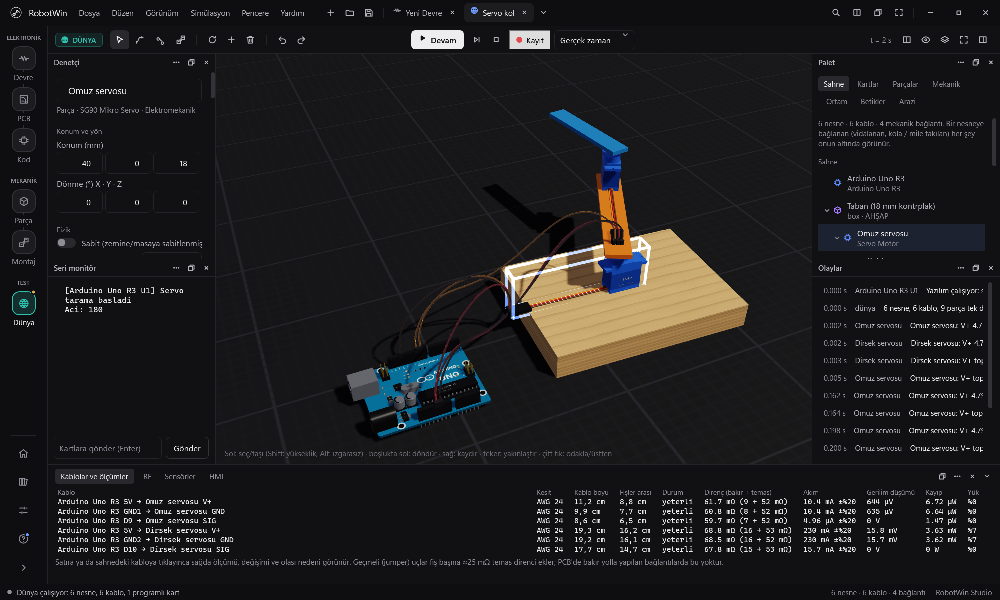

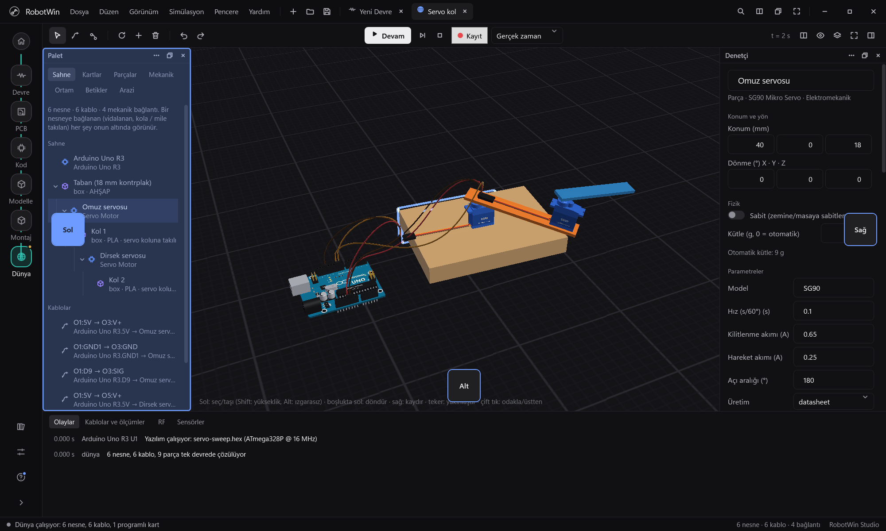

## Step by step: your first world

In this example a battery turns a motor and the motor turns a wheel.

1. Open a **Yeni dünya** (new world, Ctrl+Shift+N).
2. In the **Parçalar** (parts) tab search for `pil` (battery) and add **4×AA Pil 6 V**. Then search `motor` and add **TT Redüktörlü Motor 1:48** (TT gear motor).
3. Select the motor. In the **Fizik** (physics) section on the right switch on **Sabit (zemine/masaya sabitlenmiş)** (fixed to the floor/table), so the motor does not run away while turning.
4. Add a **Tekerlek** (wheel) from the **Mekanik** (mechanical) tab.
5. With the wheel selected, take the **Bağla** (connect) tool (B) and click the motor. In the menu that opens choose **"Motor miline sabitle (birlikte döner)"** (fix to the motor shaft: turns with it).
6. Take the **Kablo çek** (draw cable) tool (K). Click the battery's `+` pin, then a pin of the motor. Do the same for the battery's `−` pin and the motor's other pin. With the mouse over a pin you see its name, live voltage and how many cables are connected.
7. **Dünyayı çalıştır** (run world, F5). The motor turns, the wheel turns, you hear the motor.
8. In the **Kablolar ve ölçümler** (cables and measurements) tab below, see each cable's current, power and load percentage.
9. **Durdur ve başa dön** (stop and rewind, Shift+F5) puts everything back to the start.

## Object types

### Boards

Your own circuit + PCB + code. In the **Kartlar** (boards) tab:

- **Açık sekmeden** (from an open tab): turns an open circuit into a board and adds it.
- **Proje dosyasından kart ekle (.rwproj)…** (add a board from a project file)
- **Yeni boş kart tasarla** (design a new empty board)
- **Hazır modül kartları** (ready module boards): Arduino Uno, Arduino Nano, ESP32 DevKit V1, ESP32 DevKitC, a brushed flight controller.

The same design can be placed several times; the copies share one circuit. With a board selected, the inspector has:

- **Kartı düzenle (devre · PCB · kod)** (edit board: circuit · PCB · code): the board opens in its own tab.
- **Kartın kodunu yaz** (write the board's code): opens its code on the Code page ([4. Code](04-code.md)).
- **Ayrı proje dosyası olarak dışa aktar…** (export as a separate project file)

### Parts

A single catalogue part: servo, motor, battery, sensor, display, Arduino… The **Parçalar** (parts) tab has a search box and categories: Geliştirme (development), Elektromekanik (electromechanical), Güç (power), Sensör (sensor), Ekran (display), Anahtarlama (switching), **Kablosuz ve USB** (wireless and USB). Change parameters in the inspector's **Parametreler** (parameters) section.

A loose Arduino or ESP32 becomes a programmable board with **Kart tasarımına dönüştür ve kodunu aç** (turn into a board design and open its code).

### Mechanical bodies

The **Temel şekiller** (basic shapes) in the **Mekanik** (mechanical) tab: box, plate / chassis, arm / bar, cylinder, wheel (with a rubber tyre), sphere / ball, table / fixed floor. Set size and colour in the inspector. **Gövde kabukları** (hollow shells with a lid) hold boards and batteries inside; **Uçuş yüzeyleri** (flying surfaces: wing, tailplane with elevator, fin with rudder) produce real lift, drag and moments.

### Collision shapes

Every part's rigid body comes from its own 3D model: a round motor can rolls, a wing collides with its tapered shape, a controller with its own outline (not a bounding box). Thin pieces such as leads, pins and cable ends are left out. **Görünüm → Çarpışma şekilleri (dünya)** (View → collision shapes) draws the bodies the physics really collides, translucent over the models; they move with the bodies while the simulation runs. Hollow models (a tray, cup, tube or U bracket made in the modeller or imported) are split into convex pieces, so things can be put inside them and a ball passes down a tube's bore. Example: the **Kap ve bilyeler** (containers) template. The maths: [Rigid bodies and contact](../physics/02-mechanics.md).

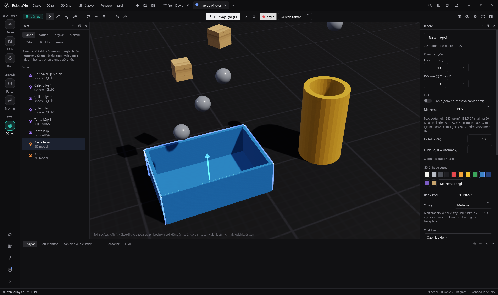

### Pressure vessels and rockets

The **Mekanik → Basınçlı kaplar ve roketler** (mechanical → pressure vessels and rockets) section has a PET bottle (water rocket), an air tank, a solid-propellant motor and a rocket fin. Any cylinder, box or sphere body becomes a vessel with **Özellik ekle → Basınçlı kap (gaz fiziği)** (add feature → pressure vessel) in the inspector:

- **Gas, pressure, inner volume, wall, water:** what the vessel holds. The gas follows the ideal gas law (p·V = m·R·T).
- **Nozzle:** throat and exit diameter, the face the jet leaves from. The flow is isentropic; at a high enough pressure ratio it reaches the speed of sound at the throat, and an expanding nozzle accelerates the gas supersonically. The thrust ṁ·vₑ + (pₑ − pₐ)·Aₑ acts on the body where the nozzle is.
- **Vana açılır (s)** (valve opens): the launcher holds the nozzle closed until then.
- **Water:** while it covers the nozzle, water leaves first (Bernoulli; the rocket's acceleration presses the water onto the nozzle), then the air.
- **Solid propellant:** a KNSB, KNDX or APCP grain; the burn rate depends on pressure (r = a·pⁿ). The chamber pressure comes out of the balance between the gas the burning surface makes and the gas leaving the nozzle; no ready thrust curve is read. It ignites when an **e-match** joined to the motor is fired from the circuit, or at the **Ateşleme zamanı** (ignition time).
- **Bursting:** if the pressure brings the wall's hoop stress (σ = p·r/t) to the material's strength, the vessel bursts.

The vessel's mass falls as gas, water and propellant leave; hot gas heats the wall and the nozzle throat (visible in the thermal camera). While running, the inspector shows pressure, temperature, thrust, the grain surface temperature, the burning share of the surface and the state live. Start with the **Su roketi** (water rocket), **Katı yakıtlı motor test standı** (solid motor test stand) and **Katı yakıtlı roket** (solid rocket) templates. The maths: [Gas and rockets](../physics/05-gas-and-rockets.md).

### Ignition and launch

A solid grain does not burn the moment the e-match fires. The match and the pyrogen on it burn; their hot gas heats the grain surface, a zone whose surface reaches the ignition temperature lights and the flame spreads towards the nozzle. In the inspector set **Ateşleyici barutu (g)** (igniter charge) and **Ateşleyici yanma süresi (ms)** (igniter burn time). With the charge at 0 only the match head is left; a sugar motor usually fails to light and the event log says why ("the grain surface reached at most 122 °C").

There are two ways to fire the e-match:

- **Launch controller:** battery → switch → e-match → battery. In the switch's inspector, **Kendiliğinden kapanır (s)** (closes by itself) gives a countdown. While the simulation runs, the **Kapat** (close) button closes the switch by hand.
- **From a board:** drive a MOSFET from a board to fire the e-match (for example from an altimeter or a radio).

The e-match is chosen in the motor's **Ateşleme** (ignition) setting or mechanically joined to the motor.

### Parachute

Give any body a parachute with **Özellik ekle → Kurtarma paraşütü** (add feature → recovery parachute) in its inspector and set its **Kanopi çapı (m)** (canopy diameter). The parachute is thrown when the altimeter sees the climb end (or at **Açılma zamanı**, the deploy time). The canopy opens over its filling time once the lines are taut; the opening shock and the descent rate come out of the physics. While running, the canopy is drawn in the scene.

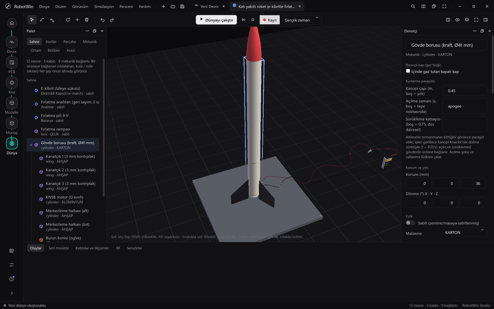

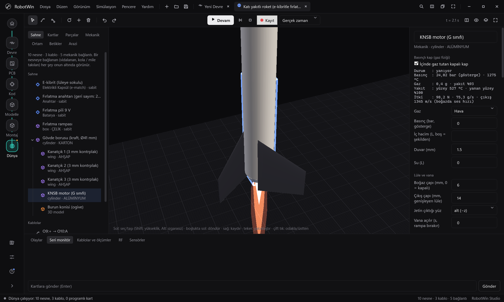

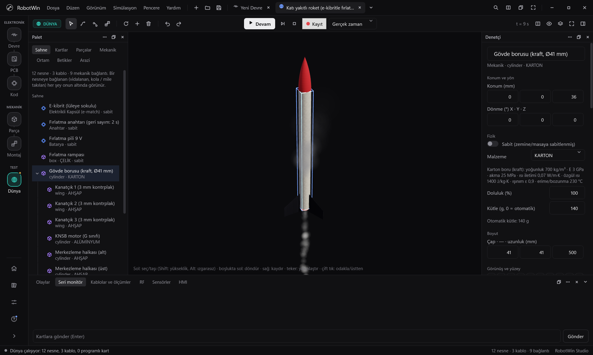

### Liquids

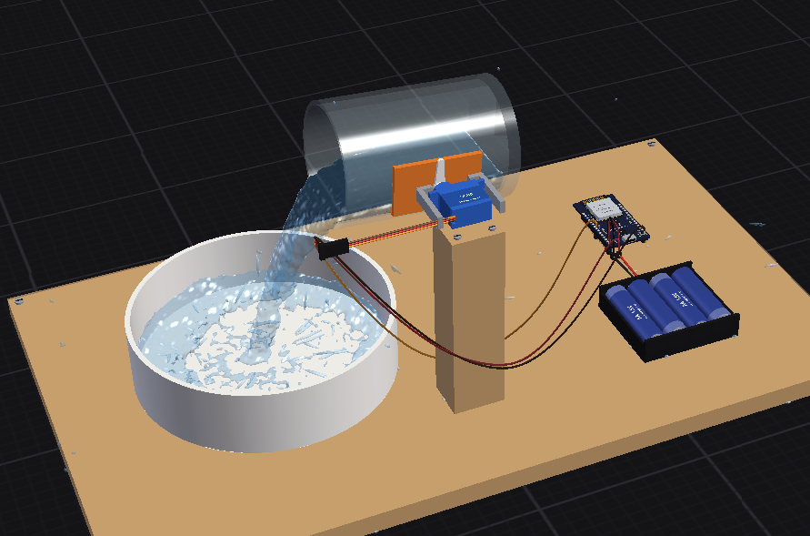

**Mekanik → Sıvılar** (mechanics → liquids) adds a glass, full of water or empty, or a volume of water (a box or a cylinder). A liquid object's box or cylinder is the volume the liquid fills when the world starts; solid parts standing in it are left out. In the inspector you pick the liquid: water, sea water, ethanol, milk, sunflower oil, glycerol or honey. Each one's real density, viscosity and surface tension are used.

- The liquid is solved as particles and presses on its container's walls with its real pressure. A glass carries the weight of its water, a part dropped in water feels buoyancy, honey flows slowly.
- Glass (material **CAM**) and acrylic are drawn see-through, so water shows through a glass. A cylinder with a wall thickness (**tube.wall**) and a bottom (**tube.bottom**) becomes a glass or a cup.
- The live view uses about 3000 particles per liquid, solved every 1 ms; still water sleeps.
- A render computes everything in full (6000–30 000 particles by accuracy, on every physics step) and replays the liquid with a finer surface.

Equations and validation: [Liquids](../physics/07-liquids.md).

### 3D models

Add your own model with **Dışarıdan model → 3D model içe aktar (STL, OBJ, PLY)…** (import a 3D model). Mass, centre of mass and inertia are computed from the material. A part you made on the Parça page comes here as one body with **Test dünyasına tek gövde olarak koy** (put into a test world as one body) in its right-click menu; the robot's parts go to its assembly with **Montaja gönder** (send to assembly) ([5. Part](05-model.md), [6. Assembly](06-assembly.md)).

## Cables

- Every cable has a gauge (AWG), a length and a colour. The default is 24 AWG; 22 AWG when connecting a DC motor or a battery.
- A cable's resistance is real copper resistance. If its current limit is exceeded the cable heats and burns; the **Kablolar ve ölçümler** (cables and measurements) tab says **YANDI** (burned).
- Boards are electrically separate until a cable connects them. If you carry a signal between two boards, connect GND too.
- To remove a cable press **Kabloyu sök** (remove cable) in the inspector.

## Mechanical joints

With an object selected, click another object with the **Bağla** (connect, B) tool:

| Option | What happens |
| --- | --- |
| **Servo kolu / Motor miline sabitle (birlikte döner)** (fix to the servo horn / motor shaft) | The object is fixed to the servo horn or motor shaft and turns with it. Only offered if the target has a horn or shaft. |
| **… gövdesine sabitle (vida / yapıştırıcı)** (fix to the body: screw / glue) | The two objects move as one |
| **Menteşe ile bağla (serbest döner)** (hinge: turns freely) | Turns freely about one axis |
| **Kızakla bağla (doğrusal kayar)** (slider) | Slides along a line |

Parts joined by at most two joints do not collide with each other. Dragging an object brings everything attached to it. Remove a joint with **Bağlantıyı çöz** (release joint) in the inspector.

### Screwing, gluing, tape, zip ties, solder

For a fixed joint, choose its **fastening** in the inspector. It is not just a label; it sets three pieces of the joint's physics:

1. **Strength:** for screws, the load one screw carries × the number of screws; for adhesives, the lap-shear strength × the bonded area. The bonded area is taken as half of the smaller part's largest face. When the force through the joint exceeds this, the joint breaks and the event log says so.
2. **Heat path:** heat crosses the fastening layer (conductivity ÷ thickness) over the share of the footprint that really touches. A thin glue line passes heat far better than screw heads: two aluminium blocks joined with epoxy reach the same temperature within a minute, while with a zip tie they stay 55 K apart.
3. **Temperature:** adhesives and plastic threads soften. Strength falls linearly from the softening to the release temperature. The joint's temperature is the mean of the two parts in the heat network. A 1 kg block hot-glued under a beam holds at 25 °C and falls when the parts are at 95 °C.

| Fastening | Strength | Heat path (layer, contact share) | Softens → lets go |
| --- | --- | --- | --- |
| Fixed (unspecified) | unbreakable | 400 W/m²K, 15 % | — |
| M3 screw + nut (2) | 2 × 1000 N | 400 W/m²K, 15 % | — |
| Screw into plastic (M3, 2, self-tapping) | 2 × 250 N | 400 W/m²K, 12 % | 60 → 110 °C |
| Cyanoacrylate (super glue) | 6 MPa × area | 4000 W/m²K, 50 % | 80 → 120 °C |
| Epoxy | 15 MPa × area | 2000 W/m²K, 70 % | 60 → 110 °C |
| Hot glue | 1.5 MPa × area | 400 W/m²K, 30 % | 55 → 85 °C |
| Double-sided foam tape | 0.5 MPa × area | 100 W/m²K, 80 % | 90 → 150 °C |
| Zip tie | 220 N | 400 W/m²K, 5 % | 80 → 160 °C |
| Solder (Sn63/Pb37) | 30 MPa × area | 200 000 W/m²K, 30 % | 150 → 183 °C |

A box lid can also be marked **vidalı** (screwed); it is screwed down when it seats on the rim, and a "cannot be screwed" warning appears when it does not.

## Physics and environment

Every object's inspector has a **Fizik** (physics) section:

- **Sabit** (fixed): the object is fixed to the floor or table and does not move.
- **Malzeme** (material): every material the physics knows: PLA, PETG, ABS, PET, acrylic, aluminium, steel, copper, lead, carbon, wood, plywood, balsa, MDF, cardboard, rubber, FR4. Friction and bounce depend on the material. The card under the list gives the material's numbers: density, Young's modulus, yield strength, thermal conductivity, specific heat, emissivity and softening/melting temperature.

The **Görünüş ve yüzey** (look and surface) section, for bodies and imported models:

- **Renk** (colour): click a swatch, type `#RRGGBB` in **Renk kodu**, or go back to the material's own colour with **Malzeme rengi**.
- **Yüzey** (finish): matte paint, gloss paint/varnish, polished metal, brushed metal, black anodising, oxidised/rusty, wood grain, carbon twill, kraft paper, rubber coating, 3D-print layers. The texture is drawn at real size (0.2 mm print layers, 2×2 twill carbon…). The finish is not only a look: it sets the thermal emissivity (ε). Polished aluminium (ε 0.05) radiates very little heat, black anodising (ε 0.85) cools much faster. The heat network, cooling and the thermal camera use this value. Example: the **Malzeme ve yüzey vitrini** (materials and finishes) template.

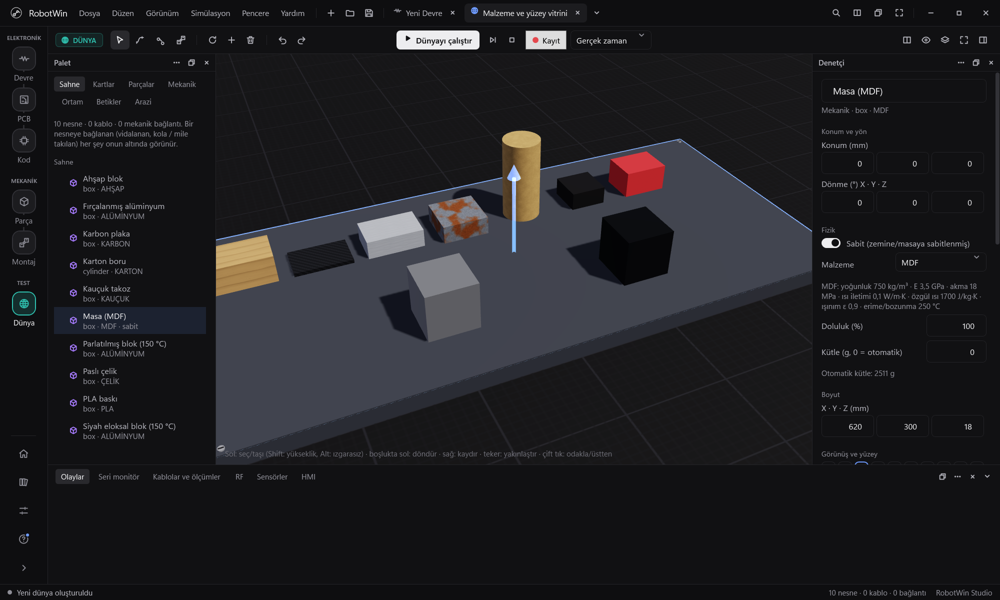

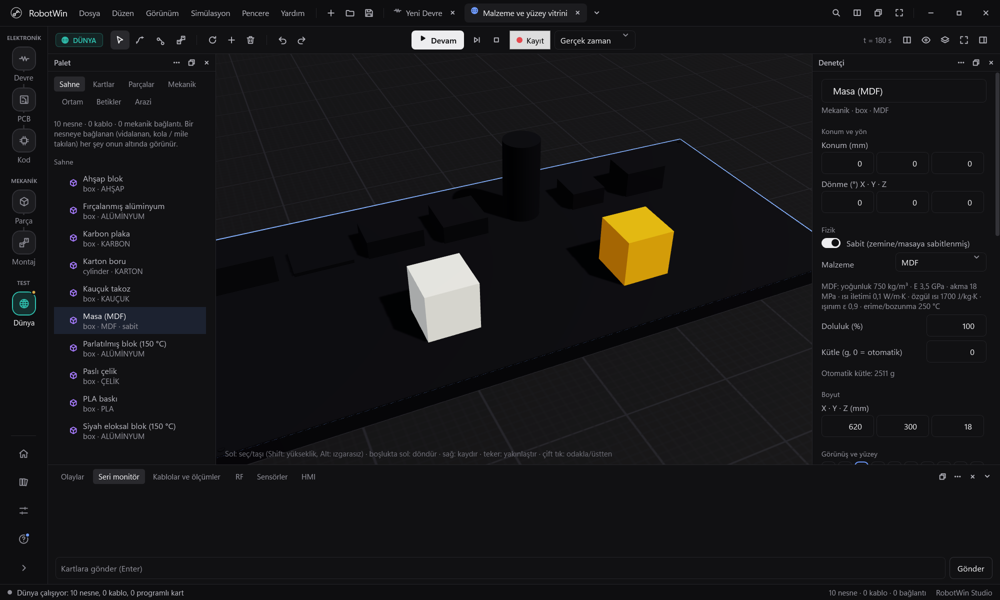
- **Doluluk (%)** (infill) and **Kütle (g, 0 = otomatik)** (mass, 0 = automatic).

The **Ortam** (environment) tab:

- **Yerçekimi** (gravity): Earth 9.81, Moon 1.62, Mars 3.71, Jupiter 24.8, zero gravity.
- **Ortam sıcaklığı** (ambient temperature), floor width / depth, floor friction (μ), surrounding walls.
- **Engel ekle** / **Engelleri temizle** (add / clear obstacles).
- Air, wind, turbulence and force fields: see [Physics scripts (SDK)](../../SDK.md).

Servos read the pulse command from the circuit; the horn's angle and the current it draws go back to the circuit. DC motors turn at the speed the circuit computes; the load on the shaft reflects back into the motor. Hard impacts and broken joints are written to the **Olaylar** (events) tab. Air drag acts face by face: a part's face that a joined part covers sees no air ([Aerodynamics](../physics/04-aerodynamics.md)).

## Thermal camera

**Görünüm → Isı kamerası (dünya)** (View → thermal camera) colours the models by temperature like a real thermal camera (iron palette). With the mouse over a part you see the temperature of that point and the part's nodes (a TT motor's winding, can and gearbox). The maths: [Heat](../physics/03-heat.md).

## Sensors and displays

Sensors do not produce ready-made values. They measure the world with their datasheet properties: they cast rays, look at the floor or take the body's motion, then add their own noise and errors. All of them are on the **Parçalar** (parts) tab.

| Sensor | Measures | How it is computed | Errors and limits |
| --- | --- | --- | --- |
| **HC-SR04 ultrasonic** | Distance to an obstacle | A ray is cast into the physics scene; the first body hit counts, the sensor's own assembly does not | Echo time from the speed of sound; range and beam angle from the datasheet |
| **Line sensor** (TCRT5000, QRE1113, TCRT/QTR arrays) | A line on the floor | IR LED and phototransistor: the floor's diffuse reflectance, mirror-like reflection on glossy tape, sun and lamp light. The phototransistor is a real current source in the circuit and saturates | Signal changes with height (TCRT5000 peaks at 2.5 mm, 0.2–15 mm). Matte black tape reflects ≈ 6 % |
| **LiDAR** (A1 class, LD06 class) | 360° range scan | A ray per sample into the scene; scan rate and sample count from the datasheet | A1: 8000 samples/s, 5.5 Hz, 0.15–12 m, ≈ 1 %. LD06: 4500 samples/s, 10 Hz, 0.02–12 m, ±45 mm. Dark surfaces return from shorter |
| **IMU** (MPU-6050, GY-521) | Acceleration and rate | The body's real motion in the physics gives specific force and angular rate | Turn-on bias, slow bias drift, white noise (400 µg/√Hz, 0.005 °/s/√Hz), digital low-pass |
| **GPS** (NEO-6M, NEO-M8N) | Position, velocity | From the environment's geographic position; NMEA output | CEP 2.5 m (M8N: 2.0 m), growing with poor sky view; cold start 27 s, hot 1 s; up to 5 Hz (M8N: 10 Hz) |
| **Compass** | Magnetic heading | The environment's magnetic field and the body's orientation | Bias and noise |
| **Barometer** (BMP280, MS5611) | Pressure, altitude | Standard atmosphere (ISA) at the sensor's height | MS5611: 10 cm resolution, conversion times and PROM checksum |
| **±200 g accelerometer** (ADXL375) | Launch and impact acceleration | The body's real acceleration plus motor vibration | 49 mg/LSB, 13 bit, datasheet noise |
| **Depth** (MS5837) | Water pressure, depth | p = p_atm + ρ·g·h | The liquid's density sets the reading |
| **Motor with encoder** | Rotation | The motor shaft's angle in the physics | Pulse count from the motor model |
| **Camera** | Image | See below | |

- **I²C displays** (SSD1306 OLED, 16×2 LCD) show what the board writes, live on the 3D model.
- LEDs and lamps light up; overheated parts glow red, failing parts spark.

### How the camera works

A camera (OV7670, OV2640 / ESP32-CAM, 720p USB, Pi camera v2 / IMX219) really images the scene through its own lens. The image goes through the steps the sensor itself would take, in order:

1. **Capture:** the camera draws the scene from its lens position (it looks along the object's +X) at the model's horizontal field of view and the chosen resolution. For example 54.5° for the OV2640 and 62.2° for the IMX219.
2. **Exposure:** auto exposure sets the shutter first, then the gain. The darker the scene, the noisier the image.
3. **Noise:** photon shot noise (from how full the pixel well gets) and read noise grow with gain. The values come from the model's pixel size and well capacity.
4. **Motion:** while the camera turns, motion blur builds up over the exposure. The rolling shutter reads rows one after another, so a fast turn skews the image.
5. **Lens and output:** vignetting darkens the corners, then the image is quantised. If the driver asked for JPEG, the frame is compressed to JPEG.
6. **Frame rate:** limited by the sensor at that resolution (OV2640: 15 fps at UXGA, 30 at SVGA, 60 at CIF). When an ESP32 drives it, its DVP port's limit applies too.

ESP32 sketches use the camera through the real `esp_camera` interface: `esp_camera_init`, `esp_camera_fb_get`, `sensor->set_framesize`. If the camera is not powered by the board, initialisation returns an error. The **Sensörler** (sensors) tab shows each sensor's latest reading and the camera's latest frame.

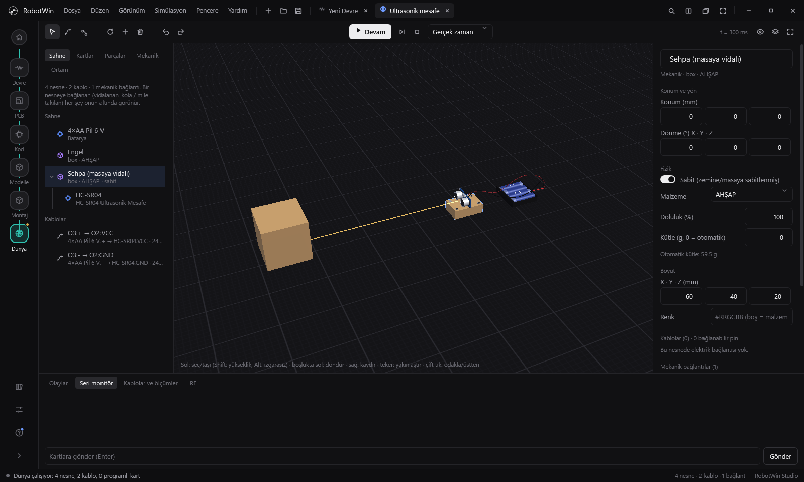

## Controllers, radio and USB

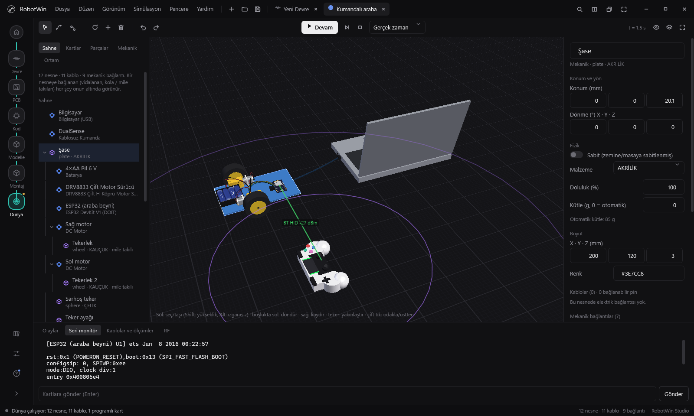

In **Parçalar → Kablosuz ve USB** (parts → wireless and USB): DualSense (PS5), DualShock 4 and Xbox controllers, **Bilgisayar + USB kablosu** (PC + USB cable), **Wi-Fi Modem (2.4 GHz)**, **BLE Beacon Etiketi** (BLE beacon tag), **IR Kumanda (NEC, 21 tuş)** (IR remote, 21 keys), **TSOP38238 IR Alıcı** (IR receiver).

### Controller

1. Select the controller. Pair it with the ESP32 with **Eşleştirme modu (PS + Create basılı)** (pairing mode: PS + Create held) in the inspector.
2. Use the on-screen controller with **Sanal kumandayı aç (fare / klavye)** (open the on-screen controller: mouse / keyboard; W/S throttle, A/D steering), or connect a real controller to the PC over USB or Bluetooth. If it does not show, **Kumandaları yeniden tara** (rescan controllers).
3. The **ESP32'ye uzaklık** (distance to the ESP32) slider (while running) shows how the signal weakens with distance.
4. **Kumandayı aç/kapat** (controller on/off) and **Eşleşmeyi unut** (forget pairing) are here too.

With an ESP32 selected, **Örnek kodu yükle: kumandalı araba (Bluepad32)** (load sample code: remote-controlled car) loads a ready car program.

### The PS5-controlled plane

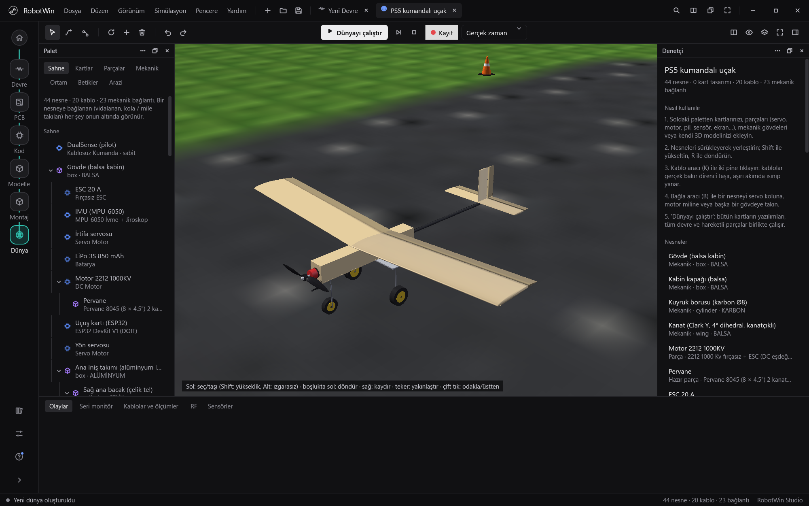

The **PS5 kumandalı uçak** (PS5-controlled plane) template is a 1 m trainer standing at the end of an asphalt runway on a model airfield. Nothing is scripted: you fly it, and the physics and the flight controller's firmware decide what happens.

- **Airframe:** hollow balsa pod (closed by a screwed balsa hatch under the wing), Ø8 carbon tail boom, 4° dihedral Clark Y wing (ailerons on the outer halves, driven through torque rods by one SG90 standing in the pod right under the wing), elevator and rudder on pushrods.
- **Power:** 2212 1000KV brushless motor, 8×4.5" prop, 20 A ESC, 3S 850 mAh LiPo. 402 g; the centre of gravity sits at 30 % of the chord from the battery position alone, no nose weight.
- **Gear:** steel wire legs and an aluminium strap. The wheels turn freely on their axles, with the friction of a nylon hub on steel wire.
- **Flight controller:** ESP32 + MPU-6050, reading the DualSense through Bluepad32. The code also runs on a real ESP32 (select the ESP32 and open **Kod**).

| Controller | Keyboard (on-screen controller) | Does |
| --- | --- | --- |
| Options (≡), with R2 released | Enter | Arms the motor (light bar green, short rumble) |
| ✕ | Space | Disarms: throttle cut at once (light bar red) |
| R2 | F | Throttle |
| Right stick right / left | L / J | Ailerons (roll) |
| Right stick back / forward | K / I | Elevator (nose up / down) |
| Left stick right / left | D / A | Rudder |
| △ | R | **Dengeli** (self-levelling) / **Manuel** mode (light bar green / orange) |
| D-pad up / down | ↑ / ↓ | Pitch trim (0.5°) |

**Flying:** arm with Options, squeeze R2 fully. The plane accelerates down the runway; at about 9–10 m/s pull the right stick back a little and it lifts off. In **Dengeli** mode the stick asks for an angle (up to 45° of bank, 25° of pitch) and the plane levels itself when you let go. As the throttle comes back the nose drops slightly by itself, so with the power off it keeps its speed and glides (about 7 m/s, 6:1) instead of stalling. In **Manuel** mode the stick moves the surfaces directly.

**Range and failsafe:** the Bluetooth link between the DualSense and the ESP32 weakens with distance like a real radio link and drops at about 90 m in the open (the **RF** tab shows the RSSI). If the link is lost the flight controller cuts the motor and the plane glides down in a wide circle, nose slightly down, banked 10°. As soon as the controller is back in range, control returns.

**Camera:** in the **Scene + Game** view (G) the game side opens on **Pilot gözü** (pilot's eye): it looks at the plane from where the controller is, as an RC pilot sees it, and zooms with the distance. The **chase camera** follows from behind at a distance set by the plane's size.

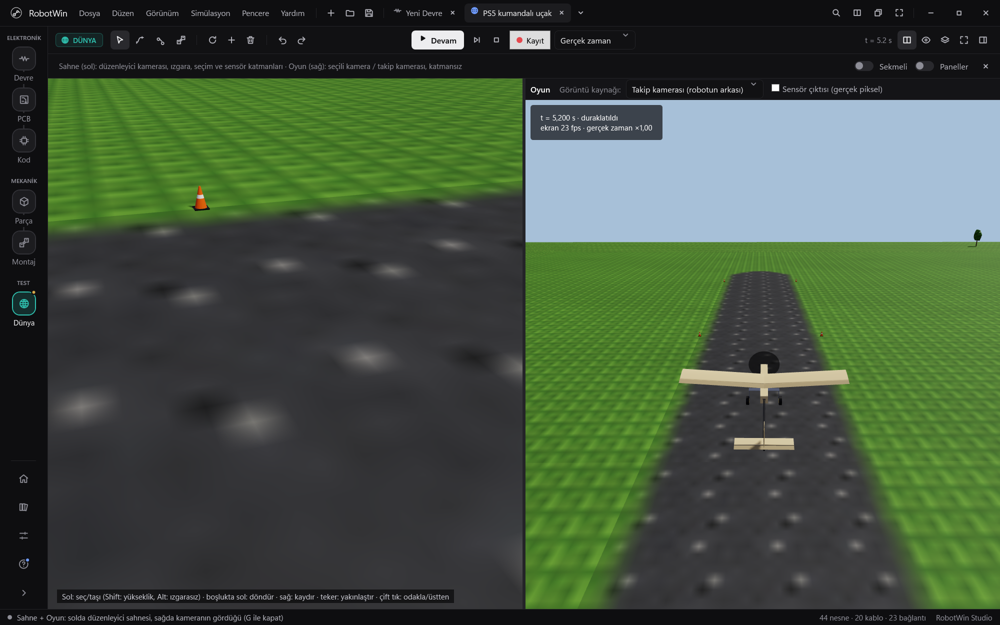

### USB

Point the **Bilgisayar** (PC) object at a board and press **USB'yi tak** (plug in USB). While plugged, the board is powered with 5 V and its serial port is connected to the **Seri monitör** (serial monitor) tab. **USB'yi çıkar** (unplug USB) disconnects it.

**USB-C rechargeable lithium batteries** (**Parçalar → Güç**, parts → power): an 18650 cell with a USB-C input, a 2S 18650 pack (7.4 V) and USB-C AA cells with a steady 1.5 V. Real electronics run inside: a protection board (cuts at 2.4 V over-discharge, over-charge and over-current; a flat pack wakes only when a charger is connected) and a constant-current / constant-voltage charger (1 A up to 4.2 V, then the current tapers). Point the **Bilgisayar + USB kablosu** (PC + USB cable) object at the battery and plug it in: the battery charges; unplugged, charging stops.

### Radio environment

Wi-Fi, BLE and Bluetooth signals weaken with distance, obstacles and bodies. The **RF** tab below lists devices, signal strength (RSSI), channel and packets per second. **Sönümleme** (fading), **Dalgalar** (waves) and **Bağlantı çizgileri** (link lines) switch the radio visualisation on and off. IR remotes work only in line of sight; their keys are in the inspector's **IR kumanda tuşları (NEC)** (IR remote keys) section. The maths: [Radio](../physics/06-radio.md).

## Scene tree

The **Sahne** (scene) tab shows everything in the world as a tree of what is attached to what (e.g. "servo koluna takılı" on the servo horn, "mile takılı" on the shaft, "sabit" fixed). While running it shows temperatures above 60 °C and **ARIZALI** (failed) objects. The **Kablolar** (cables) list is below it. Right-click: **Odakla** (focus), **Alt nesneleri gizle/göster** (hide/show children); double-click focuses the object.

## Running

| Button / key | Function |
| --- | --- |
| **Dünyayı çalıştır** / **Duraklat** / **Devam** (run / pause / continue, F5) | Start, pause, resume |
| **10 ms ilerlet** (step 10 ms) | One step |
| **Durdur ve başa dön** (stop and rewind, Shift+F5) | Stops and puts everything back to the start |
| Speed | 0.01×, 0.1×, 0.5×, real time, 5× |

If a board has no firmware, the **Olaylar** (events) tab says "Yüklü yazılım yok (kart boşta)" (no firmware loaded, board idle).

## Recording and rendering

Real-time running has to keep up with the screen. A **render** recomputes a recording from start to end at the accuracy you choose, independent of the screen, then plays it like a video.

1. Press **● Kayıt** (record) on the toolbar (Ctrl+R). The world restarts from the beginning.
2. Press **Kaydı bitir** (end recording) whenever you like. The render window opens and starts computing that span. You can also enter the duration yourself with **Simülasyon › Render** (Ctrl+F5).

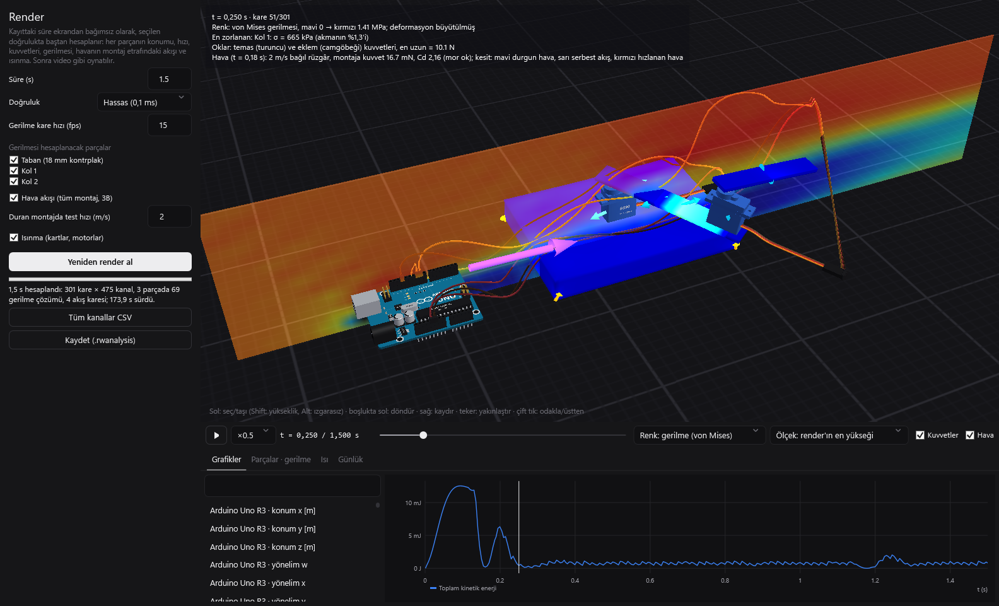

**What is computed**

- **Every frame:** every object's position and orientation, servo horn and motor shaft angles, velocities, accelerations, contact and joint forces, every part's current, voltage, power and temperature signals, circuit nodes, serial output.
- **Stress:** every part you mark is solved with FEM at the "stress frame rate" (default 15 frames/s) and at its most loaded moments, with its real loads at that instant. Slender parts use beam elements. Besides bodies and models, servos, motors and boards are listed too; the ones something is fastened to (a servo carrying a second servo, say) are marked by default.
- **Air flow (3D, over time):** the real air of the world, solved through the whole recording (3D lattice-Boltzmann) in a box fixed to the world in which the parts move exactly as recorded:
  - every moving part pushes and drags the air with its own surface velocity;
  - the world's wind (with its gusts) blows in at the faces;
  - the ground is a wall;
  - the box is fitted around the parts that really move, with cells small enough for the thinnest moving part.

  Nothing else drives the air: with no wind and nothing moving there is no flow, and the **Log** says so. The air is shown in 3D as **smoke** carried by it: each particle leaves a short streak along its velocity (blue slow, red fast), and still air stays invisible. Each frame also gives the force of the air on the moving parts.
- **Wind-tunnel test (optional):** a measurement with steady air the world does not have. The assembly is held at its recorded pose at a few instants and air of the chosen **speed**, **direction** (0° = +X, 90° = +Y) and **elevation** is blown at it. The result is the force on the assembly, its drag coefficient (Cd) and streamlines. The notes say how far to trust it:
  - y+;
  - whether the force settled;
  - the grid uncertainty from the first instant solved on two grids.

  How far each solver is from theory: [12. Validation](12-validation.md).
- **Heating:** conduction, convection and radiation from the components' power losses on the boards.

**Playback**

- **Play / pause:** Space. **Frame by frame:** ← →. **Start / end:** Home / End. Speed from ×0.05 to ×2 (slow motion).
- **Colour:** stress (von Mises, deformed shape exaggerated) or velocity arrows. **Scale:** the render's maximum, or each material's yield strength.
- **Forces:** contact forces as orange arrows, joint forces as cyan arrows. **Air:** the smoke at that instant (in the wind tunnel: streamlines and the aerodynamic force, purple arrow).
- **Cables** are drawn in the render as the simulated ropes themselves: they sag, tighten, and a pulled plug comes out of its pin. The render scene is for watching only; its parts and cables cannot be moved.
- While you type in the channel search, Space and the arrow keys go to the text; the playback shortcuts work outside the box.
- **Graphs:** every recorded channel. Clicking or dragging on a graph jumps to that second.
- **Parçalar · gerilme** (parts · stress): each part's worst moment and safety factor. Clicking a row goes to that moment.
- **Isı** (heat) and **Günlük** (log) tabs; results are saved as `.rwanalysis` or CSV.

**Live inputs are recorded too.** While recording, every input you give is kept with the simulation time it took effect at: controller reports (sticks, triggers, buttons, motion; only when they change), switching a controller on or off, pairing, text sent from the serial monitor, plugging a USB cable in or out, IR key presses, conveyor start / stop, light-curtain tests and launch switches. The render applies them again at the same instants; the **Günlük** (log) tab says how many were replayed. Dragging objects with the mouse is not recorded yet.

The render computes at the accuracy (step size) you choose. With the same inputs, a chaotic motion (a stalling plane, say) can still drift slightly away from the live run over time.

## Comparing with the bench

The best way to see how close the simulation is to reality is to run the same setup on the bench and measure it. In the render window's **Grafikler** (graphs) tab open a measurement log with **Tezgâh ölçümü içe aktar (CSV)** (import a bench measurement), pick the simulation channel to compare on the left (e.g. the servo's current) and press **Seçili kanalla karşılaştır** (compare with the selected channel).

RobotWin aligns the two signals in time, draws the measurement in orange and reports:

- **gecikme** (delay): how far the log is shifted relative to the simulation;
- **ölçüm ≈ k × sim + c** (measurement ≈ k × sim + c): the real part's proportional difference from the model (e.g. a clone servo at 1.30×);
- RMSE, the largest difference and when;
- **uyum** (agreement): the share of time the difference stays within 10 % of the measured range;
- **ilk ayrılma** (first divergence): the first moment the two signals part for longer than 50 ms (e.g. when the real arm caught on something).

Log format: the first line is a header, the first column time. If the header has `ms` or `us` that unit is used, otherwise seconds. Separators may be commas, semicolons or tabs; decimal commas work too. Columns with `mA` / `mV` in their header are converted automatically when compared with A / V channels.

An example logging sketch (Arduino + INA219, in series with the servo's supply):

```cpp
#include <Wire.h>
#include <Adafruit_INA219.h>
#include <Servo.h>
Adafruit_INA219 ina;
Servo s;
void setup() {
  Serial.begin(115200);
  ina.begin();
  s.attach(9);
  Serial.println("t_ms,current_mA");
}
void loop() {
  unsigned long t = millis();
  s.write((t / 1000) % 2 ? 135 : 45);   // the same motion as the simulation's command
  Serial.print(t); Serial.print(','); Serial.println(ina.getCurrent_mA());
  delay(5);                             // 200 Hz
}
```

Save the serial monitor output as `.csv` and import it. Load the same sketch into the board in the simulation and render.

## Mouse and keyboard

| Mouse | Function |
| --- | --- |
| Drag an object with the left button | Move (with everything attached) |
| Shift + drag | Change height |
| Alt + drag | Ignore the 5 mm grid |
| Drag on empty space with the left button | Orbit |
| Drag with the right button | Pan |
| Wheel | Zoom |
| Double-click an object / empty space | Focus / top view |

| Key | Function |
| --- | --- |
| K | Draw cable |
| B | Connect |
| R / Shift+R | Rotate 15° / the other way |
| Ctrl+D | Duplicate |
| Del | Delete |
| Ctrl+Z / Ctrl+Y | Undo / redo |
| T | Camera follows the selected object |
| F | Fit the selection / everything |
| Esc | Cancel, back to the select tool |

Objects can only be moved while the simulation is stopped. You can also type position and angle into the inspector's **Konum ve yön** (position and orientation) fields.

## Saving

**Kaydet** (save, Ctrl+S) stores the world as a `.rwworld` file. The boards inside are saved with their full projects (circuit, PCB, code); open the file on another PC and everything is ready.

---

[← Previous: 6. Assembly](06-assembly.md) · [Contents](README.md) · [Next: 8. Instruments →](08-instruments.md)
