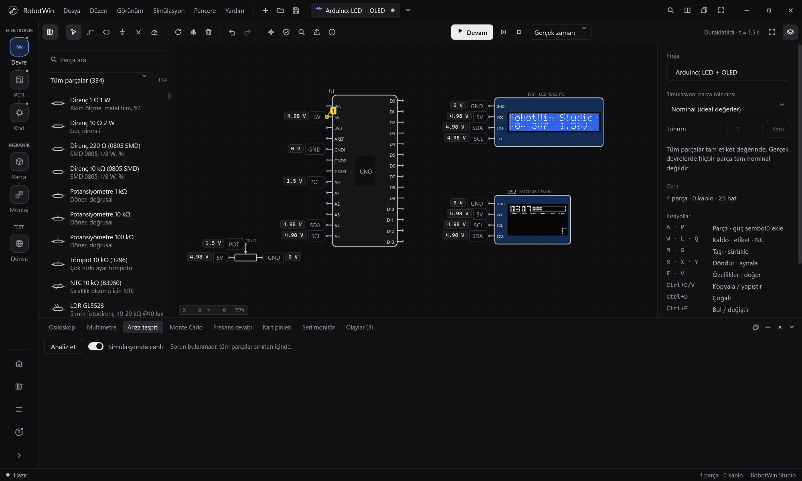

# 8. Instruments

The instruments in RobotWin Studio behave like real ones: the oscilloscope's probe loads the circuit, the multimeter's fuse can blow, the bench supply goes into current limit. Most of them are in the tabs at the bottom of the **Devre** (circuit) page.

## Oscilloscope

The **Osiloskop** (oscilloscope) tab is a 4-channel digital oscilloscope.

### Attaching a probe

1. Start the simulation (F5).
2. Click the wire you want to measure; the probe goes on the first free channel.
3. For a particular channel, right-click the wire and choose **… → osiloskop CH1** … **CH4**. A probe can be attached before the simulation too; it measures once the simulation starts.

### Settings

| Section | Settings |
| --- | --- |
| Horizontal | Time/div, position, roll mode |
| Channel | Volts/div, position, coupling (DC / AC / GND), probe 1× / 10×, 20 MHz bandwidth limit, invert, current probe |
| Trigger | Mode (**Auto**, **Normal**, **Tek** (single)), source (1–4), slope (rising / falling), level, holdoff |
| Maths | 1+2 or 1−2 |
| Buttons | **RUN / STOP**, **TEK** (single), **AUTOSET**, cursors |

With **Prob yüklemesi** (probe loading) on, the probe connects to the circuit as 1 MΩ ∥ 110 pF (1×) or 10 MΩ ∥ 12 pF (10×); in high-impedance circuits you see how the measurement disturbs the circuit.

Automatic measurements: maximum, minimum, peak-to-peak, amplitude, mean, RMS, period, frequency, duty cycle, rise and fall time.

## Multimeter

The **Multimetre** (multimeter) tab is a 6000-count, true-RMS, autoranging handheld multimeter.

1. Choose **Prob multimetre (kırmızı / siyah uçlar)** (probe multimeter: red / black leads) in the **Ölçü aleti** (instrument) list.
2. Right-click a wire and choose **Multimetre kırmızı ucu → …** (red lead), and on another wire **Multimetre siyah ucu (COM) → …** (black lead).
3. Pick the function with the rotary switch: DC V, AC V, DC A, AC A, Ω, continuity (beeps below 30 Ω), diode, capacitance, frequency + duty cycle.

Things to watch (as on a real multimeter):

- To measure current the multimeter goes **in series** with the circuit. The mA input has a 440 mA fuse, the A input an 11 A fuse; too much current blows the fuse.
- The voltage input loads the circuit with 10 MΩ.
- Trying to measure resistance in a live circuit gives a warning.

You can also put a multimeter into the circuit as a part: **Dijital Multimetre (6000 sayım)** (digital multimeter, 6000 counts) or **Multimetre (akım, mA girişi)** (multimeter, current, mA input). Then pick that part in the **Ölçü aleti** (instrument) list.

## Bench power supply

The library has **Lab. Güç Kaynağı 0-30 V 3 A** and **Lab. Güç Kaynağı 5 V / 100 mA** (bench supplies).

- **CV / CC:** gives the set voltage; at the current limit it switches to constant current (CC). A short circuit does not burn your circuit: the supply goes to CC.
- **OVP:** over-voltage protection; when it trips it switches the output off.
- It has an output switch; the supply cannot sink current (it only sources).

Using the **5 V / 100 mA** supply when first trying a new circuit stops mistakes from burning parts.

## Tolerances

Real parts are not at their labelled values. The **Simülasyon: parça toleransı** (simulation: part tolerance) option in the right panel:

| Mode | What happens |
| --- | --- |
| **Nominal (ideal değerler)** (ideal values) | Every part exactly at its label value |
| **Gerçekçi (sabit tohum)** (realistic, fixed seed) | Each part takes a fixed real value within its tolerance (resistor ±5 %, ceramic ±10 %, electrolytic −20/+80 %, hFE, LED Vf…). The same **Tohum** (seed) always gives the same board; **Yeni** (new) draws another board. |
| **Monte Carlo (N koşu)** (N runs) | Use the **Monte Carlo** tab below to see the spread |

## Monte Carlo

The **Monte Carlo** tab runs the circuit N times, drawing the tolerances anew each time, and measures a net you choose.

1. Choose the net and the measure (final value, mean, maximum, minimum, peak-to-peak, RMS).
2. Press **Çalıştır** (run) (**İptal** cancels).
3. The result appears as a histogram with the smallest and largest values, the runs they came from and the spread.

Board firmware does not run during Monte Carlo; the analog circuit is examined.

## Fault finding

The **Arıza tespiti** (fault finding) tab finds design mistakes in your circuit.

- **Analiz et** (analyse): scans the circuit by rules: supply short, LED without a resistor, reversed LED, reversed electrolytic capacitor, floating inputs, missing ground, driving a motor straight from a pin, missing flyback diode, regulator problems…
- **Simülasyonda canlı** (live in the simulation): watches during simulation how close parts get to their limits, whether the battery is overloaded, whether the supply enters CC mode, and the multimeter fuse.
- **Neden?** (why?): explains why a part burned.

## Measuring in the world

On the **Dünya** (world) page:

- The **Kablolar ve ölçümler** (cables and measurements) tab below shows each cable's current, power and load percentage.
- With the cable tool, the live voltage of the pin under the mouse is shown.
- The selected object's inspector has a **Canlı ölçüm** (live measurement) section.

## Recording

**Dosya → Simülasyon kaydını kaydet (.rwsim)…** (File → save simulation recording) stores the measurement channels, events and serial output with the project. Opening the recording brings the waveforms back on the oscilloscope and the events in the log.

---

[← Previous: 7. World](07-world.md) · [Contents](README.md) · [Next: 9. Keyboard shortcuts →](09-shortcuts.md)
