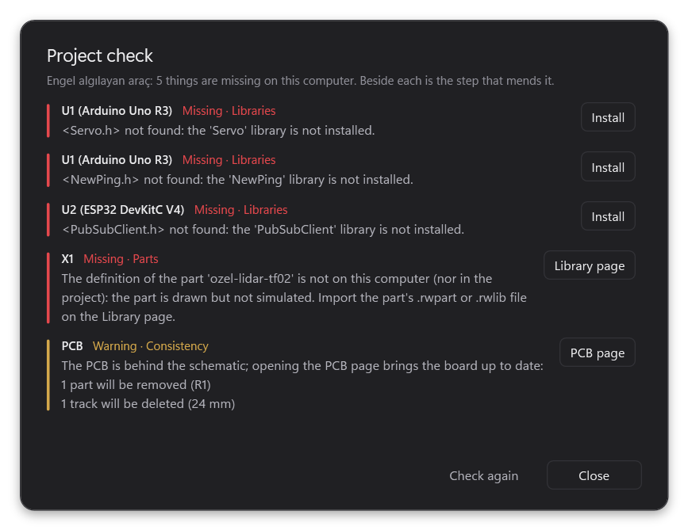
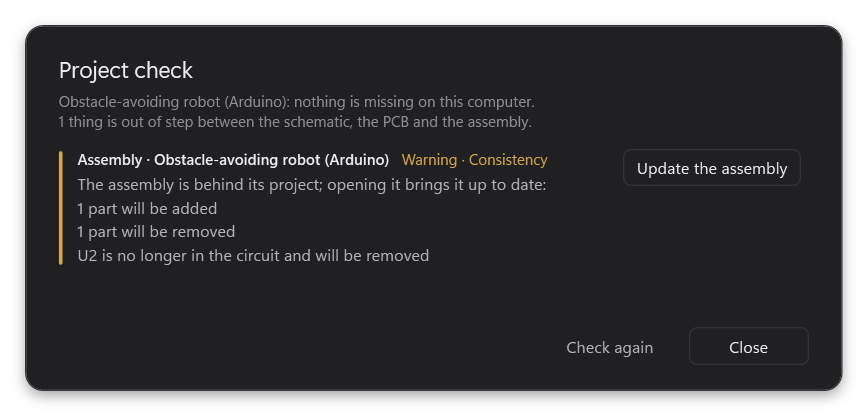
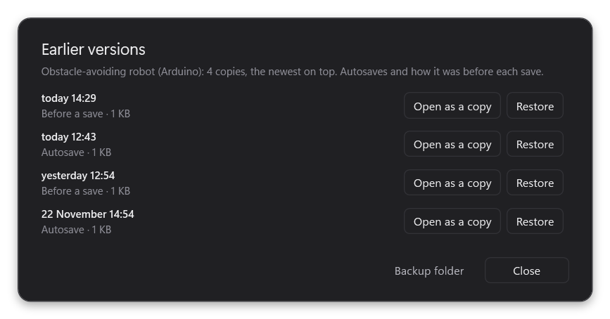

# 10. FAQ

## Installing and starting

**The app does not start or asks for .NET.**
A lite installation uses the PC's .NET 10 Desktop Runtime. Run the installer again and choose **Full** (or add the **.NET 10 runtime** component with **Custom**): the app then carries its own copy. Or install ".NET 10 Desktop Runtime (x64)" from Microsoft's site.

**Windows warns about the setup file.**
Make sure you downloaded it from the project's GitHub Releases page, then choose **More info → Run anyway**.

**Can I run the app from a USB stick?**
Yes. Choose **Portable** on the installer's "how to install" page and a folder on the stick (or run `RobotWinStudio-Setup-<version>.exe /S /PORTABLE /D=E:\RobotWin`); only the files are written, no shortcuts or registry entries are created. The release's `-win-x64-portable.zip` is the same folder, ready to unzip.

**The interface is too small / too large.**
Set it between 75 % and 150 % with **View → Interface scale**.

**Can the interface be in English?**
Yes: English is the default language, and Turkish is the interface's own. Choose the language on the installer's first page or in **Settings → General → Language** (it applies everywhere once the app is opened again). For another language, take the English pack (`Lang/en.json`) as a model and put your own pack in `%APPDATA%\RobotWin\lang`. The documentation is complete in both Turkish and English.

**A project from another computer says "… things are missing on this computer".**
The project needs something this computer lacks: the Arduino compiler to build its code (a lite installation has none), the Visual Studio C++ tools for ESP32 code, an Arduino library its code `#include`s, or the definition of a part that came from another library. **Show** (or **File → Check the project…**) lists each missing thing with the step that mends it: adding the compiler as a component of the installer, installing the library with one click, importing the part on the Library page. Uno code that can run as last built is listed only as a note.

**The project check says "… things are out of step between the schematic, the PCB and the assembly".**
The schematic has moved on from the board or the assembly. When the board waits for a change that would take something out of the layout, the PCB page asks before applying it (the **PCB page** button goes there). An assembly is brought up to date with its project when it is opened; the check says beforehand what will change (parts to be added and removed, which ones), and **Update the assembly** does it at once. It also says when the project file an assembly follows has been moved or deleted.

**How do I go back to an earlier state of a file?**
**File → Earlier versions…** lists the open document's copies in the backup folder, the newest on top: the autosaves taken every few minutes and how it was before each save. **Open as a copy** opens that version in a new tab beside it (to compare, or to take a piece from it); **Restore** takes the file back to that version, and since its current state is kept as an earlier version too, that step can be undone the same way. How many copies are kept and how large the folder may grow are in **Settings → Saving and backup**.

## Code and compiling

**It says "arduino-cli not found".**
In a terminal run `winget install ArduinoSA.CLI` and then `arduino-cli core install arduino:avr`, then restart the app. If it still cannot find it, enter the path of `arduino-cli.exe` under **Settings → Compilers → arduino-cli path**.

**It says "… not found (library not installed)".**
An Arduino library your code uses is not installed. For example: `arduino-cli lib install "Adafruit SSD1306"`.

**ESP32 code does not compile: "MSVC (vcvars64.bat) not found".**
Install Visual Studio 2022 or Build Tools with the **"Desktop development with C++"** workload. If you installed it somewhere else, fill in **Settings → Compilers → vcvars64.bat path**.

**The first ESP32 build took very long.**
That is normal. The first build also compiles and caches the ESP32 hardware layer; later builds are fast.

**My ESP32 code cannot reach the Internet.**
Wi-Fi is simulated only inside the world, between boards; there is no real Internet connection.

**My SPI display / sensor does not work.**
SPI is not supported yet (there is only an empty stub). Use I²C modules: SSD1306 OLED, 16×2 / 20×4 LCD (PCF8574), MPU-6050.

## Simulation

**A part burned and the circuit no longer works.**
The simulation computes part damage as in real life. See the reason with **Fault finding → Why?**, fix the circuit and press **Repair damaged parts**. To switch damage off, turn off **Simulation → Part damage (burning out, fuses)**.

**The status bar says "…% of real time".**
The PC cannot keep up with the simulation in real time. Lower the speed, reduce **Settings → 3D quality** or close tabs you are not using. The results are still correct; it just advances more slowly.

To see what slows it, open **View → Performance overlay** (Ctrl+Shift+F). While a world runs, it lists how many milliseconds each solver (circuit, board firmware, rigid bodies, liquids, cables, heat…) takes per simulated second, and its share. When they add up to more than a thousand, the world cannot keep up with real time. On the water glass, for example, most of it is the liquid; a coarser particle spacing makes it faster.

**The 3D view stays black, flickers or draws wrongly.**
The 3D views (the world, the game view, the modeller, the board's 3D view, part previews) are drawn by RobotWin's own renderer on the graphics card: realistic materials, the sun's soft shadow, lamps and LEDs lit pixel by pixel. If the graphics card or its driver gives trouble, go back to the old drawing with **Settings → Appearance and theme → 3D renderer → WPF**. When the graphics card cannot be used at all, the app goes back to WPF by itself and says so in the status bar.

**My board in the world does nothing.**
If the **Events** tab says "No firmware loaded (the board is idle)", the board has no code: select the board and write code with **Write the board's code**. Also make sure the board is powered (a battery cable or **Plug in USB**).

**The signal between two boards does not work.**
Boards in the world are electrically separate until a cable connects them. Connect their GNDs too, next to the signal cable.

**A cable became "YANDI" (burned).**
More current flowed through it than its gauge can carry. Choose a thicker cable (smaller AWG) or limit the current.

**I cannot drag an object in the world.**
Objects can only be moved while the simulation is stopped. Stop it with **Stop and rewind** (Shift+F5).

**My controller does not show up.**
Select the controller and press **Rescan gamepads**. Without a real controller use the on-screen one with **Open the virtual gamepad (mouse / keyboard)**. Make sure the controller is paired with the ESP32 (**Pairing mode (PS + Create held)**).

**A part collides oddly or does not roll.**
**View → Collision shapes (world)** shows the body the physics really uses: the outline of the part's own 3D model.

**There is no sound.**
Check that **Simulation → Simulation sounds** is on and **Settings → Volume** is not zero.

## Files

**I forgot to save; is my work gone?**
The app backs up your work at intervals to `Documents\RobotWin\Yedekler`. Look at the **Automatic backups** list on the home page or **File → Automatic backups folder**. Change the interval under **Settings → Saving and backup**.

**Double-clicking a file does not open the app.**
Press **Settings → File types → Open with this app in Windows**.

**Can I open my project in KiCad?**
Yes. **Export to KiCad** on the **PCB** page makes a KiCad 8 project. For a board maker, **Manufacturing** gives the Gerber files. Details: [3. PCB](03-pcb.md).

**I want to 3D-print a part.**
Make it on the **Part** page and export it as STL: [5. Part](05-model.md).

## Reporting a bug

If you find a bug, open an issue on GitHub with **Help → Report a problem…**. If possible include the steps, a screenshot and the `%APPDATA%\RobotWinStudio\crash.log` file (**Settings → About → Open settings and log folder**).

---

[← Previous: 9. Keyboard shortcuts](09-shortcuts.md) · [Contents](README.md)
