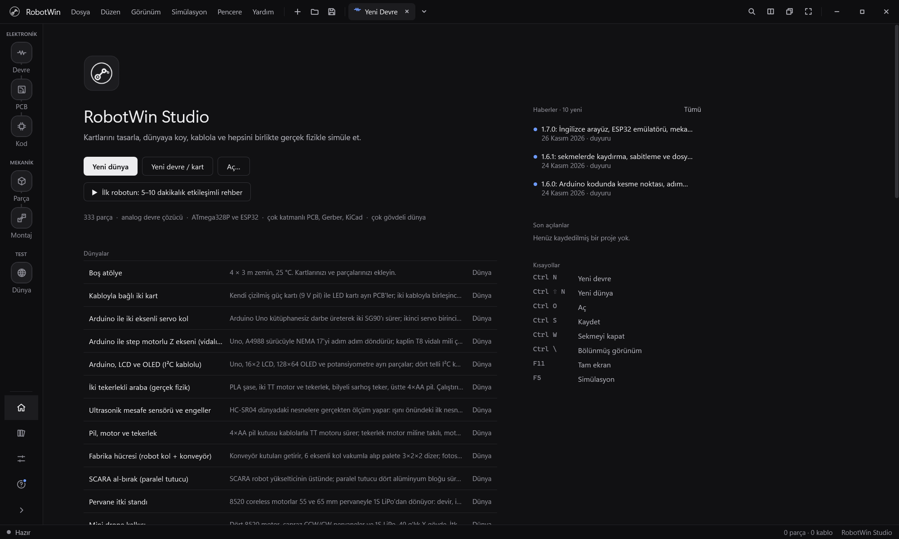
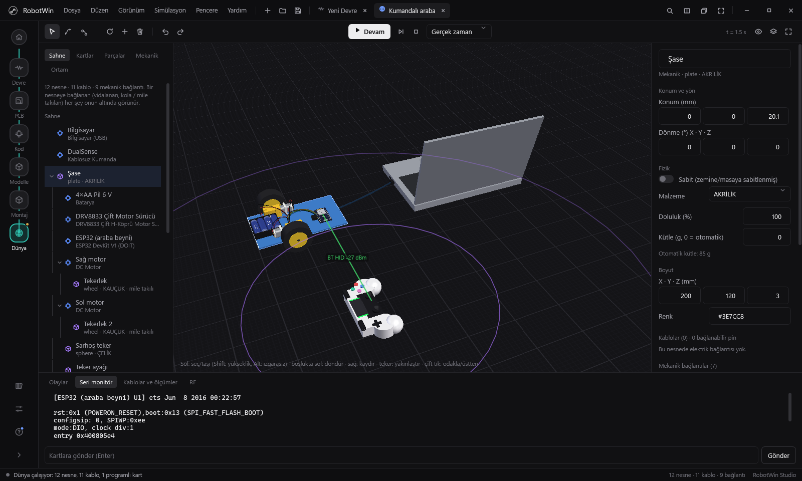

# RobotWin Studio user guide

With RobotWin Studio you take a robot project from start to finish in one app: draw the circuit, lay out its PCB, write its code, model its body, then run it all together in a world with real physics.

This guide walks through the app step by step. Read it in order or jump straight to the chapter you need. Every solver's equations are in [Physics and maths](../physics/README.md).

> The app's interface is in Turkish. This guide gives every label as it appears on screen, in bold, followed by its meaning where it helps.

## Contents

| Chapter | Topic |
| --- | --- |
| [1. Getting started](01-getting-started.md) | Installing, first launch, the parts of the screen, files, settings |
| [2. Circuit](02-circuit.md) | Drawing a schematic, adding parts, wiring, live simulation |
| [3. PCB](03-pcb.md) | Board design, routing, copper pours, DRC, manufacturing files |
| [4. Code](04-code.md) | Writing, compiling and loading Arduino and ESP32 code, serial monitor |
| [5. Model](05-model.md) | 3D part modelling: chassis, bracket, box; sending to the world |
| [6. Assembly](06-assembly.md) | Turning the circuit into a real assembly: board, real parts, pin-to-pin cables |
| [7. World](07-world.md) | The open world: boards, parts, cables, mechanical joints, physics, controllers, pressure vessels and rockets |
| [8. Instruments](08-instruments.md) | Oscilloscope, multimeter, bench supply, tolerances, Monte Carlo, fault finding |
| [9. Keyboard shortcuts](09-shortcuts.md) | Shortcuts of every page |
| [10. FAQ](10-faq.md) | Problems and their fixes |
| [11. What's new](11-whats-new.md) | What each release brought, changed and fixed |

## What can I do in five minutes?

1. Open the app; on the **Başlangıç** (home) page pick the **Kumandalı araba (ESP32 + PS5 kumanda)** (remote-controlled car) template from the **Dünyalar** (worlds) list.
2. Press **F5** to run the world.
3. Select the controller and drive the car with **Sanal kumandayı aç (fare / klavye)** (open the on-screen controller: mouse / keyboard).

Details: [7. World](07-world.md).

## The design-to-real line

The vertical line on the left of the screen shows a project's stages in order, each with its status. **Ctrl+B** expands or collapses it.

| Stage | Shortcut | Guide |
| --- | --- | --- |
| Başlangıç (Home) | Ctrl+0 | [1. Getting started](01-getting-started.md) |
| Devre (Circuit) | Ctrl+1 | [2. Circuit](02-circuit.md) |
| PCB | Ctrl+2 | [3. PCB](03-pcb.md) |
| Kod (Code) | Ctrl+3 | [4. Code](04-code.md) |
| Modelle (Model) | Ctrl+4 | [5. Model](05-model.md) |
| Montaj (Assembly) | Ctrl+5 | [6. Assembly](06-assembly.md) |
| Dünya (World) | Ctrl+6 | [7. World](07-world.md) |
| Kütüphane (Library) | Ctrl+7 | [1. Getting started](01-getting-started.md#library) |
| Ayarlar (Settings) | Ctrl+, | [1. Getting started](01-getting-started.md#settings) |
