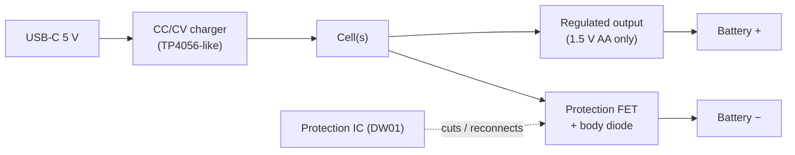

# Circuit solver

All boards, parts and cables in a world are solved as one analog circuit. Cables are in the circuit with their real copper resistance; two boards without a GND cable between them share no ground either.

## Modified nodal analysis (MNA)

The unknowns are every node voltage and the current of every voltage source (battery, regulator output, inductor). Kirchhoff's current law gives one equation per node and every source adds a constraint:

```math
\begin{bmatrix} G & B \\ C & D \end{bmatrix}
\begin{bmatrix} \mathbf{v} \\ \mathbf{i} \end{bmatrix}
=
\begin{bmatrix} \mathbf{i}_s \\ \mathbf{e} \end{bmatrix}
```

$`G`$ is the conductance matrix, $`B, C`$ connect the sources to their nodes, $`\mathbf{i}_s`$ are current sources and $`\mathbf{e}`$ source voltages. Every device "stamps" its contribution into this matrix: a resistor $`R`$ adds $`1/R`$ between its two nodes.

## Nonlinear devices: Newton-Raphson

Diodes, transistors, MOSFETs and motor drivers are not linear. Every step solves $`\mathbf{F}(\mathbf{x}) = 0`$ by Newton-Raphson:

```math
J(\mathbf{x}_k)\,\Delta\mathbf{x} = -\mathbf{F}(\mathbf{x}_k), \qquad \mathbf{x}_{k+1} = \mathbf{x}_k + \Delta\mathbf{x}
```

Each device stamps its slope at the present operating point (its Jacobian entries) and an equivalent current. A diode (Shockley):

```math
I = I_s\left(e^{V/(n V_T)} - 1\right), \qquad V_T = \frac{kT}{q} \approx 25.9\ \text{mV}\ (27\,^\circ\text{C})
```

The voltage step is limited so the exponential cannot overflow (SPICE's "pnjlim").

## Time stepping

Capacitors and inductors are replaced in every step by an equivalent conductance and current source (companion model). Trapezoidal rule:

```math
i_{n+1} = \frac{2C}{h}\left(v_{n+1} - v_n\right) - i_n
```

After an abrupt change (a switch, a PWM edge, a device failing) a few backward-Euler steps follow so the trapezoidal rule cannot ring: $`i_{n+1} = \tfrac{C}{h}(v_{n+1} - v_n)`$.

The step size follows the local truncation error, estimated for the trapezoidal rule from the third derivative of the voltages:

```math
\text{LTE} \approx \frac{h^3}{12}\,\dddot{v}, \qquad h_\text{new} = h\left(\frac{\varepsilon}{\text{LTE}}\right)^{1/3}
```

| Situation | Method | Step |
| --- | --- | --- |
| Quiet circuit | Trapezoidal | up to 1 ms |
| Fast change, PWM edge | Trapezoidal, shrinking step | microseconds |
| After a switch / failure | Backward Euler (a few steps) | smallest step |

## Device models (a selection)

### DC motor

The electrical and mechanical equations are solved together:

```math
V = R(T)\,I + L\frac{dI}{dt} + K_e\,\omega, \qquad
J\frac{d\omega}{dt} = K_t I - b\,\omega - T_c\tanh\!\left(\frac{\omega}{\omega_0}\right) - \frac{T_\text{load}}{N}
```

The winding resistance follows copper's temperature coefficient: $`R(T) = R_{25}\,[1 + 0.00393\,(T - 25)]`$. The winding temperature comes from the [heat network](03-heat.md); the load torque $`T_\text{load}`$ from the [rigid body](02-mechanics.md) on the shaft.

### Battery

```math
V = n\,\text{OCV}(\text{SoC}) - V_p - I\,R(\text{SoC}), \qquad
\frac{dV_p}{dt} = \frac{I R_p - V_p}{\tau}, \qquad
\frac{d\,\text{SoC}}{dt} = -\frac{I}{3600\,Q}
```

| Chemistry | OCV (0 / 20 / 50 / 100 % charge) | Cell resistance | Polarization (per cell $`R_p`$, $`\tau`$) |
| --- | --- | --- | --- |
| Alkaline | 0.90 / 1.20 / 1.30 / 1.60 V | 0.15 Ω | 0.25 Ω, 15 s |
| NiMH | 1.00 / 1.20 / 1.25 / 1.40 V | 0.03 Ω | 0.02 Ω, 30 s |
| Li-ion | 3.00 / 3.70 / 3.82 / 4.20 V | 0.05 Ω | 0.02 Ω, 30 s |
| LiFePO4 | 2.50 / 3.25 / 3.30 / 3.45 V | 0.03 Ω | 0.015 Ω, 30 s |

The resistance rises towards the end of the discharge: $`R = R_0\,[1 + 3(1-\text{SoC})^4]`$. Over the last 0.2 % the voltage falls linearly off the knee to zero (not in one step).

### USB-C rechargeable lithium battery

The electronics inside the pack are built from real devices:



| Protection | Threshold | Reconnects |
| --- | --- | --- |
| Over-discharge | cell < 2.4 V | only when a charger is connected (its current flows through the body diode) |
| Over-charge | cell > 4.28 V | cell < 4.1 V |
| Over-current | > 3 A (single cell) / > 6 A (2S pack), 10 ms | retries after 1 s |

The charger is a 4.2 V-per-cell regulator limited to $`I_\text{charge}`$: constant current until the cell reaches 4.2 V, then constant voltage with a tapering current.

## Losses and failures

Every device reports its instantaneous power loss; the [heat network](03-heat.md) turns it into temperature. Devices driven beyond their ratings fail as real ones do: a resistor burns open, a MOSFET's gate oxide punches through, a lithium cell goes into thermal runaway, a cable melts. A failed device stays in the circuit in its new state (open / short).
