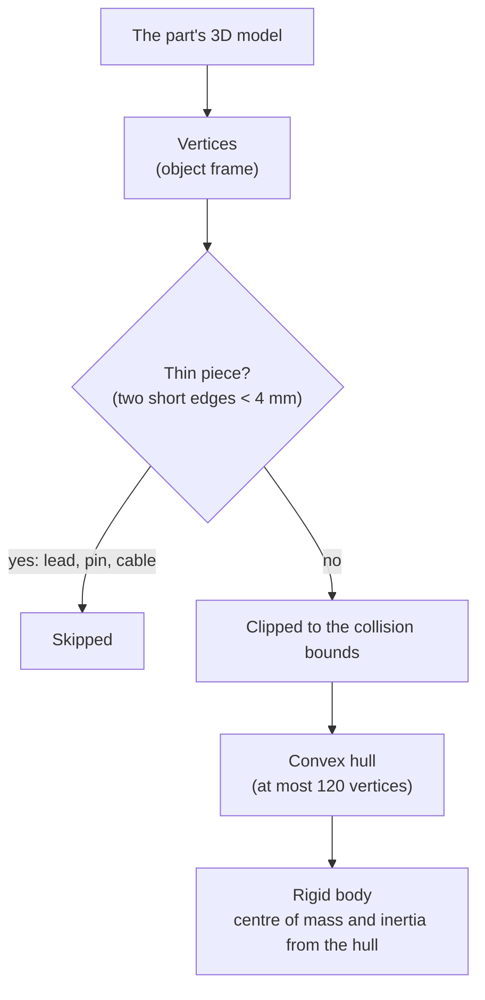

# Rigid bodies and contact

Every object in the world is a rigid body: a position at its centre of mass, an orientation (unit quaternion), linear and angular velocity, a mass and principal moments of inertia. Servo horns and motor shafts are separate small rotors hinged to their body.

## Equations of motion

```math
m\,\dot{\mathbf{v}} = \mathbf{F}, \qquad
I\,\dot{\boldsymbol{\omega}} + \boldsymbol{\omega} \times (I\boldsymbol{\omega}) = \boldsymbol{\tau}
```

Forces: gravity, contacts, joints, [air](04-aerodynamics.md) (drag, wings, propellers), [gas thrust](05-gas-and-rockets.md), cables (as ropes), environment force fields (wind, fans, magnets).

## Integration

Each physics step (1 ms) is split into fixed sub-steps. Each sub-step uses semi-implicit (symplectic) Euler with the gyroscopic term solved implicitly, so a fast-spinning propeller or wheel does not gain energy and drift:

```math
\mathbf{v}_{n+1} = \mathbf{v}_n + h\,\frac{\mathbf{F}}{m}, \qquad
\mathbf{x}_{n+1} = \mathbf{x}_n + h\,\mathbf{v}_{n+1}, \qquad
q_{n+1} = \operatorname{normalize}\!\left(q_n + \tfrac{h}{2}\,\boldsymbol{\omega}_{n+1} \otimes q_n\right)
```

Thin, fast bodies (a propeller blade, a falling bullet-like part) get more sub-steps (continuous collision detection), so they cannot pass through something in one step.

## Contacts and joints: soft sequential impulses

Contacts and joints are velocity-level constraints solved with Catto's "soft step". The impulse of a constraint:

```math
\lambda = -\,m_\text{eff}\,\big(J\mathbf{v} + \beta\,C/h\big)\,\gamma, \qquad m_\text{eff} = \left(J M^{-1} J^\top\right)^{-1}
```

$`C`$ is the constraint error (penetration depth, joint drift), $`\beta`$ the soft position correction and $`\gamma`$ the softness. The constraints are swept 4 times in Gauss-Seidel order, then 2 relax passes follow; the previous step's impulses are the starting point (warm starting).

| Constraint | What it does |
| --- | --- |
| Contact (normal) | Prevents penetration; restitution from the material pair |
| Friction | Coulomb cone: $`\lvert \lambda_t \rvert \le \mu\,\lambda_n`$, separate static and kinetic $`\mu`$ |
| Rolling resistance | Tyres, balls: $`\tau \le c_{rr}\,r\,\lambda_n`$ |
| Fixed joint | Two bodies as one (screws, glue) |
| Hinge | Rotation about one axis; limits, drives (position: PD, speed: motor) |
| Slider | Translation along one axis |
| Ball | Anchors coincide, rotation free |

A joint breaks when its design force is exceeded; the event goes to the **Events** tab.

## Collision shapes



| Object | Collision shape |
| --- | --- |
| Box, plate | Box (exact) |
| Cylinder, wheel | Cylinder (exact, analytic) |
| Sphere, ball | Sphere (exact) |
| Catalogue part, board, wing | Convex hull of its own 3D model |
| Imported model (STL/OBJ) | Convex hull of the mesh |
| Static obstacle, terrain | Box / triangle mesh (with a BVH) |

To see them: **Görünüm → Çarpışma şekilleri (dünya)** (View → Collision shapes).

Parts joined by at most two joints (e.g. motor – rotor – wheel) do not collide with each other; in reality screws and sockets hold an assembly together.

## Materials

Friction and restitution come from the material pair of the two surfaces (rubber–floor, steel–steel, PLA–wood…). Floor regions (carpet, tiles, sand) carry their own friction. Mass is volume × material density × infill, or typed in.
