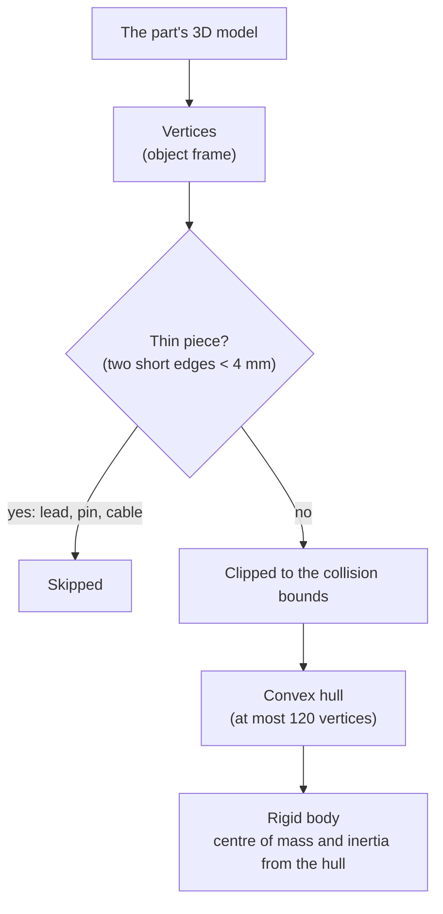

# Rigid bodies and contact

Every object in the world is a rigid body: a position at its centre of mass, an orientation (unit quaternion), linear and angular velocity, a mass and principal moments of inertia. Servo horns and motor shafts are separate small rotors hinged to their body.

## Equations of motion

```math
m\,\dot{\mathbf{v}} = \mathbf{F}, \qquad
I\,\dot{\boldsymbol{\omega}} + \boldsymbol{\omega} \times (I\boldsymbol{\omega}) = \boldsymbol{\tau}
```

Forces: gravity, contacts, joints, [air](04-aerodynamics.md) (drag, wings, propellers), [gas thrust](05-gas-and-rockets.md), cables (as ropes), environment force fields (wind, fans, magnets).

## Integration

Each physics step (1 ms) is split into fixed sub-steps. Each sub-step uses semi-implicit (symplectic) Euler with the gyroscopic term solved implicitly, so a fast-spinning propeller or wheel does not gain energy and drift:

```math
\mathbf{v}_{n+1} = \mathbf{v}_n + h\,\frac{\mathbf{F}}{m}, \qquad
\mathbf{x}_{n+1} = \mathbf{x}_n + h\,\mathbf{v}_{n+1}, \qquad
q_{n+1} = \operatorname{normalize}\!\left(q_n + \tfrac{h}{2}\,\boldsymbol{\omega}_{n+1} \otimes q_n\right)
```

Thin, fast bodies (a propeller blade, a falling bullet-like part) get more sub-steps (continuous collision detection), so they cannot pass through something in one step.

## Contacts and joints: soft sequential impulses

Contacts and joints are velocity-level constraints solved with Catto's "soft step". The impulse of a constraint:

```math
\lambda = -\,m_\text{eff}\,\big(J\mathbf{v} + \beta\,C/h\big)\,\gamma, \qquad m_\text{eff} = \left(J M^{-1} J^\top\right)^{-1}
```

$`C`$ is the constraint error (penetration depth, joint drift), $`\beta`$ the soft position correction and $`\gamma`$ the softness. The constraints are swept 4 times in Gauss-Seidel order, then 2 relax passes follow; the previous step's impulses are the starting point (warm starting).

| Constraint | What it does |
| --- | --- |
| Contact (normal) | Prevents penetration: acts like a stiff, heavily damped spring from the first micrometre (no dead band), so the pressed side of a tilted interface pushes back. A corner's depth is measured against the face of the other body that it faces. Restitution from the material pair |
| Friction | Coulomb cone: $`\lvert \lambda_t \rvert \le \mu\,\lambda_n`$, separate static and kinetic $`\mu`$. A contact slipping slower than 5 mm/s at the start of the step sticks ($`\mu_s`$); the velocity the step's own forces add (gravity along a slope, a push) does not change that, static friction cancels it |
| Rolling resistance | Tyres, balls: $`\tau \le c_{rr}\,r\,\lambda_n`$ |
| Fixed joint | Two bodies as one (screws, glue) |
| Hinge | Rotation about one axis; limits, drives (position: PD, speed: motor) |
| Slider | Translation along one axis |
| Ball | Anchors coincide, rotation free |

A joint breaks when its design force is exceeded; the event is written to the **Olaylar** (events) tab.

### Welded parts: one rigid body

A soft constraint is as stiff as the bodies it joins are heavy. A chain between a heavy body and a light part, such as a 400 g airframe → a 6 g wire leg → a 10 g wheel, is therefore far softer than real steel: the wheel toes in by degrees under load. So **unbreakable fixed bonds** (fixed joints with no break force or fastening set, shell walls, screwed lids) are not solved as separate constraints. Every step, the parts they join are gathered into one rigid body:

```math
M = \sum m_i, \qquad \mathbf{x}_G = \frac{\sum m_i \mathbf{x}_i}{M}, \qquad I_G = \sum \Big( R_i I_i R_i^\top + m_i \big(\lVert\mathbf{d}_i\rVert^2 E - \mathbf{d}_i\mathbf{d}_i^\top\big) \Big), \quad \mathbf{d}_i = \mathbf{x}_i - \mathbf{x}_G
```

- **The group's velocity** comes from the parts' momentum and angular momentum, so nothing done to a part between steps (a launch, a push) is lost.
- **Forces:** forces and torques on any part (gravity, drag, wings, propellers, motors) are summed onto the group, which is integrated as one body with its full inertia tensor and an implicit gyroscopic term.
- **Contacts and joints:** each part still collides with its own shape. Contacts, and joints to other bodies, act on the group with arms from its centre of mass.
- **Internal loads:** what the welds inside a group carry comes from inverse dynamics. For the parts on one side of a weld, the change of momentum over the step minus every outside impulse (applied, contact, other joints) is the weld's load. Recordings, strain readings and the render's FEM loads use these values.

Validation: a 0.5 kg part welded on a block makes its weld carry 4.905 N (0.5 × 9.81). A 0.2 kg cantilever with its centre 0.1 m out gives a weld moment of 0.196 N·m (expected 0.1962). In a chain shoved with 2 N at its light end, the parts turn less than 10⁻⁶ degrees relative to each other. Breakable fastenings (screws, glue) stay ordinary joints, because their failure is tested against the joint's own force.

### Cables: action and reaction

Cables are ropes with mass. A cable resting against a body pushes it: the correction the wire receives, $`m\,\Delta x/h^2`$, is applied to the body equal and opposite. In earlier versions the contact was one-way: a wire pulled on its plugs while the body it rested on felt nothing, which lifted a resting quad off the floor before its motors ran. A cable with both plugs on the same rigid body still rests on it (for its shape), but the forces between them are internal: its pull on the plugs and its push on the frame cancel, so neither is applied. If they were, the difference between a lagging, filtered plug tension and an instant contact push would kick the frame. Propeller discs are not solid to cables, because the disc is only the volume the blades sweep. A wire in a real prop disc would be cut; that is not modelled yet.

### Cable routes, holes and continuous collision

A cable runs only where a real wire can:

- **Routing:** The space around the plugs is cut into cells. A cell is blocked when a solid (or the floor) comes closer to its centre than the wire's radius plus a third of a cell, so even a 2 mm wall blocks a whole layer of 4 mm cells. The shortest chain of free cells (A*) is then pulled taut and runs straight wherever the straight line touches no solid. When the coarse grid cannot pass a narrow opening (a 10 mm cable hole, the gap between two servos), a finer one is searched, and the path is checked with exact ray tests. The automatic cable length is that run plus 10 % and 15 mm.
- **Plug exit:** A wire leaves its pin along the part's up axis, or the first clear direction of the part's frame when another part is right there (a motor's terminals under a plate).
- **Real holes:** A shell wall listed in `holes` is the four-piece frame around its opening (`hole`, `hole.z`, `hole.u`, or per side such as `hole.+x.size`). Wires and pushrods pass through the opening only, and the editor draws the same frame.
- **Hollow tubes:** A cylinder with `tube.wall` (m) is a tube open at both ends. It collides as 16 wall segments and has a tube's inertia. A rocket's motor sits in its body tube's bore on centering rings.
- **Continuous collision:** A wire particle's move over a substep, judged in the body's frame (the body may have moved too), stops on the face it reached instead of entering or crossing a solid. A 1 cm move crosses a 2 mm wall in one step, and the push-out alone would put the wire out on the far side. Each segment is a capsule of the wire's radius, and separating axes give the least push that frees it, so a wire drawn against the top edge of a cable hole slides back into the hole instead of through the wall. These contacts are applied once more after the length pass, so a taut wire's chords do not cut the corners it wraps.
- **Step order:** Cables are stepped after the bodies and collide with where the parts are now. Stepped first, a wire inside a plane at 12 m/s trailed its fuselage by 12 mm. Their pull on the plugs is applied in the next step.
- **Damping and air:** The wire's own (material) damping acts on its motion relative to its plugged ends, not relative to the world, which would push a wire inside a plane at 12 m/s back with about 4 g. Air drag is separate and real: a cylinder across the flow (Cd ≈ 1.2), against the wind for an exposed wire, and against the air carried inside a closed fuselage when both plugs sit in it.
- **Wiring carried with its body:** A wire with both plugs on one rigid body, and nothing else within 5 mm of it, is carried rigidly with that body once it has lain still relative to it for 0.2 s. This holds while the effective gravity the body feels (g − a, in its frame) stays within 15 % of g. Beyond that (a take-off run, a turn, a landing) the wire is stepped again. An aircraft's wiring in steady flight costs nothing, as a still cable on a bench already does.

### Consistency audit

Parts joined to each other do not collide, because they touch at their mounting faces, so a motor sunk halfway into the firewall it is screwed to would never be noticed by the physics. The audit reports what the collision filter hides:

- **gömülü** (sunk in): two joined parts overlap by more than 1 mm. Bearings are excluded, because an axle runs through its bore. The pins and leads under boards and modules reach 2.9 mm below them, and a board is set on a surface standing on those pins.
- **kablo** (wire): a wire runs through a solid, or a plug sits inside another part.
- **yol yok** (no way): there is no way between a wire's ends that avoids every solid (a closed box with no hole).

It is written to the **Olaylar** (events) tab when a run starts, to the snapshot log, and to the all-templates overlap report (`--overlap-report`). A known limit: a populated board collides as its convex hull, so a wire running between its components can count as inside it.

## Collision shapes



| Object | Collision shape |
| --- | --- |
| Box, plate | Box (exact) |
| Cylinder, wheel | Cylinder (exact, analytic) |
| Sphere, ball | Sphere (exact) |
| Catalogue part, board, wing | Convex hull of its own 3D model |
| Model from the modeller or imported (STL/OBJ) | The mesh itself: its hull when convex, the union of convex pieces when hollow (tray, cup, tube, U bracket) |
| Static obstacle, terrain | Box / triangle mesh (with a BVH) |

To see them: **Görünüm → Çarpışma şekilleri (dünya)** (View → Collision shapes).

### Hollow parts: convex decomposition

A single convex hull fills the inside of a tray or a tube, so nothing could be put in it. A closed model mesh whose hull clearly exceeds the solid is therefore split into convex pieces, and collisions use their union. Mass, centre of mass and inertia always come from the mesh itself.

The "slack" of a piece is how much its hull exceeds it:

```math
E = V_{\text{hull}} - V
```

The split is greedy: the piece with the largest $`E`$ is cut by a plane into two closed pieces (the sections are capped, holes in a section stay open), and each side splits into its separate solids. Planes come in two kinds:

| Inside of the piece | Candidate planes | Choice |
| --- | --- | --- |
| A few flat inside faces (tray, bracket, pocket) | Planes of the faces next to reflex (inside-corner) edges | Least remaining hull volume; cut even when the volume does not drop yet, as every cut removes an inside corner |
| Curved inside (bore, bend) | Axis planes at vertex coordinates and planes through the deepest notch | Largest drop of $`\sum V_{\text{hull}}`$ |

It stops when every piece has $`E \le 0.03\,V_{\text{total}}`$ or at 24 pieces. Example: a 90 × 60 × 30 mm tray with 2.5 mm walls splits into exactly 5 pieces (floor and four walls), a Ø40/Ø30 mm tube into 14 slices.

When two bodies collide every pair of pieces is tested; rays (ultrasonic, LiDAR, cameras) and cable contact use the pieces too, so a ray from above hits the tray's inner floor.

Parts joined by at most two joints (e.g. motor – rotor – wheel) do not collide with each other; in reality screws and sockets hold an assembly together.

## Materials

Friction and restitution come from the material pair of the two surfaces (rubber–floor, steel–steel, PLA–wood…). Floor regions (carpet, tiles, sand) carry their own friction. Mass is volume × material density × infill, or typed in.

## Validity range

The model's accuracy has been measured over the range below; the test behind each figure is in the [Validation](../guide/12-validation.md) chapter.

| Subject | Model | Measured | Outside the model |
| --- | --- | --- | --- |
| Bodies | Rigid: parts neither bend nor stretch | Linear and angular momentum kept to machine precision | Flexing, vibration, shape change before breaking (stress is a separate, static FEM analysis) |
| Time step | 0.5 ms substep, semi-implicit Euler (first order) | A thrown body 2.45 mm ahead after 1 s; a pendulum's period right to 2·10⁻⁷ | Oscillations above ~100 Hz (the torsion of a short stiff shaft) are not resolved at the step and behave as if damped |
| Contact | Soft constraints that act like a stiff, heavily damped spring: micrometres of overlap under load, and the pressed side of a tilted interface pushes back | A dropped box's centre rests at 29.999 mm at 0.5 ms, 29.936 mm at 4 ms (theory 30); the top of a twenty-block (2 m) stack drifts 0.029 mm in 20 s | Deforming contact patches, surface roughness. Very tall stacks: at 0.5 ms thirty blocks sway by about 1 mm and forty creep slowly; at 2 ms fifteen blocks stand, twenty topple |
| Friction | Coulomb, static and kinetic μ apart, from the material pair; whether a contact sticks or slides follows the motion at the start of the step | Wood on wood (μs 0.50): a box on a 25° slope (the limit is 26.6°) creeps 0.000 mm in 30 s, at 2 ms too; on 30° it breaks away and slides at 2.357 m/s² (theory 2.356) | Lubrication, μ that changes with temperature, the frequency of stick-slip |
| Mass ratio | Sequential impulses (4 passes + 2 relaxation) | A light block under one 100 times heavier is pressed 0.16 mm into the ground and into it | Ratios beyond a thousand: joints may stretch visibly when a heavy load hangs from a light, long chain |
| Joints | Velocity-level constraints + position correction | A swinging chain of five links separates 0.05 mm (0.54 mm at 4 ms) | Backlash and joint compliance, gear tooth contact |
| Fast bodies | More substeps for thin fast bodies (continuous collision) | Propellers and bullet-like parts do not pass through walls | Supersonic speeds, shock waves |
