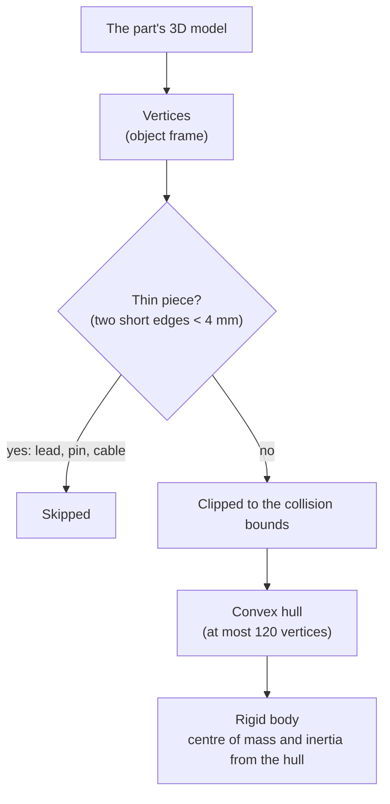

# Rigid bodies and contact

Every object in the world is a rigid body: a position at its centre of mass, an orientation (unit quaternion), linear and angular velocity, a mass and principal moments of inertia. Servo horns and motor shafts are separate small rotors hinged to their body.

## Equations of motion

```math
m\,\dot{\mathbf{v}} = \mathbf{F}, \qquad
I\,\dot{\boldsymbol{\omega}} + \boldsymbol{\omega} \times (I\boldsymbol{\omega}) = \boldsymbol{\tau}
```

Forces: gravity, contacts, joints, [air](04-aerodynamics.md) (drag, wings, propellers), [gas thrust](05-gas-and-rockets.md), cables (as ropes), environment force fields (wind, fans, magnets).

## Integration

Each physics step (1 ms) is split into fixed sub-steps. Each sub-step uses semi-implicit (symplectic) Euler with the gyroscopic term solved implicitly, so a fast-spinning propeller or wheel does not gain energy and drift:

```math
\mathbf{v}_{n+1} = \mathbf{v}_n + h\,\frac{\mathbf{F}}{m}, \qquad
\mathbf{x}_{n+1} = \mathbf{x}_n + h\,\mathbf{v}_{n+1}, \qquad
q_{n+1} = \operatorname{normalize}\!\left(q_n + \tfrac{h}{2}\,\boldsymbol{\omega}_{n+1} \otimes q_n\right)
```

Thin, fast bodies (a propeller blade, a falling bullet-like part) get more sub-steps (continuous collision detection), so they cannot pass through something in one step.

## Contacts and joints: soft sequential impulses

Contacts and joints are velocity-level constraints solved with Catto's "soft step". The impulse of a constraint:

```math
\lambda = -\,m_\text{eff}\,\big(J\mathbf{v} + \beta\,C/h\big)\,\gamma, \qquad m_\text{eff} = \left(J M^{-1} J^\top\right)^{-1}
```

$`C`$ is the constraint error (penetration depth, joint drift), $`\beta`$ the soft position correction and $`\gamma`$ the softness. The constraints are swept 4 times in Gauss-Seidel order, then 2 relax passes follow; the previous step's impulses are the starting point (warm starting).

| Constraint | What it does |
| --- | --- |
| Contact (normal) | Prevents penetration; restitution from the material pair |
| Friction | Coulomb cone: $`\lvert \lambda_t \rvert \le \mu\,\lambda_n`$, separate static and kinetic $`\mu`$ |
| Rolling resistance | Tyres, balls: $`\tau \le c_{rr}\,r\,\lambda_n`$ |
| Fixed joint | Two bodies as one (screws, glue) |
| Hinge | Rotation about one axis; limits, drives (position: PD, speed: motor) |
| Slider | Translation along one axis |
| Ball | Anchors coincide, rotation free |

A joint breaks when its design force is exceeded; the event is written to the **Olaylar** (events) tab.

### Welded parts: one rigid body

A soft constraint is as stiff as the bodies it joins are heavy. A chain between a heavy body and a light part, such as a 400 g airframe → a 6 g wire leg → a 10 g wheel, is therefore far softer than real steel: the wheel toes in by degrees under load. So **unbreakable fixed bonds** (fixed joints with no break force or fastening set, shell walls, screwed lids) are not solved as separate constraints. Every step, the parts they join are gathered into one rigid body:

```math
M = \sum m_i, \qquad \mathbf{x}_G = \frac{\sum m_i \mathbf{x}_i}{M}, \qquad I_G = \sum \Big( R_i I_i R_i^\top + m_i \big(\lVert\mathbf{d}_i\rVert^2 E - \mathbf{d}_i\mathbf{d}_i^\top\big) \Big), \quad \mathbf{d}_i = \mathbf{x}_i - \mathbf{x}_G
```

- **The group's velocity** comes from the parts' momentum and angular momentum, so nothing done to a part between steps (a launch, a push) is lost.
- **Forces:** forces and torques on any part (gravity, drag, wings, propellers, motors) are summed onto the group, which is integrated as one body with its full inertia tensor and an implicit gyroscopic term.
- **Contacts and joints:** each part still collides with its own shape. Contacts, and joints to other bodies, act on the group with arms from its centre of mass.
- **Internal loads:** what the welds inside a group carry comes from inverse dynamics. For the parts on one side of a weld, the change of momentum over the step minus every outside impulse (applied, contact, other joints) is the weld's load. Recordings, strain readings and the render's FEM loads use these values.

Validation: a 0.5 kg part welded on a block makes its weld carry 4.905 N (0.5 × 9.81). A 0.2 kg cantilever with its centre 0.1 m out gives a weld moment of 0.196 N·m (expected 0.1962). In a chain shoved with 2 N at its light end, the parts turn less than 10⁻⁶ degrees relative to each other. Breakable fastenings (screws, glue) stay ordinary joints, because their failure is tested against the joint's own force.

### Cables: action and reaction

Cables are ropes with mass. A cable resting against a body pushes it: the correction the wire receives, $`m\,\Delta x/h^2`$, is applied to the body equal and opposite. In earlier versions the contact was one-way: a wire pulled on its plugs while the body it rested on felt nothing, which lifted a resting quad off the floor before its motors ran. A cable with both plugs on the same rigid body still rests on it (for its shape), but the forces between them are internal: its pull on the plugs and its push on the frame cancel, so neither is applied. If they were, the difference between a lagging, filtered plug tension and an instant contact push would kick the frame. A new cable's slack is bowed up, down or to either side, whichever runs through the fewest surrounding parts, so a wire inside a closed fuselage stays inside instead of arching through the lid and being pushed out over the wing. Propeller discs are not solid to cables, because the disc is only the volume the blades sweep. A wire in a real prop disc would be cut; that is not modelled yet.

## Collision shapes



| Object | Collision shape |
| --- | --- |
| Box, plate | Box (exact) |
| Cylinder, wheel | Cylinder (exact, analytic) |
| Sphere, ball | Sphere (exact) |
| Catalogue part, board, wing | Convex hull of its own 3D model |
| Model from the modeller or imported (STL/OBJ) | The mesh itself: its hull when convex, the union of convex pieces when hollow (tray, cup, tube, U bracket) |
| Static obstacle, terrain | Box / triangle mesh (with a BVH) |

To see them: **Görünüm → Çarpışma şekilleri (dünya)** (View → Collision shapes).

### Hollow parts: convex decomposition

A single convex hull fills the inside of a tray or a tube, so nothing could be put in it. A closed model mesh whose hull clearly exceeds the solid is therefore split into convex pieces, and collisions use their union. Mass, centre of mass and inertia always come from the mesh itself.

The "slack" of a piece is how much its hull exceeds it:

```math
E = V_{\text{hull}} - V
```

The split is greedy: the piece with the largest $`E`$ is cut by a plane into two closed pieces (the sections are capped, holes in a section stay open), and each side splits into its separate solids. Planes come in two kinds:

| Inside of the piece | Candidate planes | Choice |
| --- | --- | --- |
| A few flat inside faces (tray, bracket, pocket) | Planes of the faces next to reflex (inside-corner) edges | Least remaining hull volume; cut even when the volume does not drop yet, as every cut removes an inside corner |
| Curved inside (bore, bend) | Axis planes at vertex coordinates and planes through the deepest notch | Largest drop of $`\sum V_{\text{hull}}`$ |

It stops when every piece has $`E \le 0.03\,V_{\text{total}}`$ or at 24 pieces. Example: a 90 × 60 × 30 mm tray with 2.5 mm walls splits into exactly 5 pieces (floor and four walls), a Ø40/Ø30 mm tube into 14 slices.

When two bodies collide every pair of pieces is tested; rays (ultrasonic, LiDAR, cameras) and cable contact use the pieces too, so a ray from above hits the tray's inner floor.

Parts joined by at most two joints (e.g. motor – rotor – wheel) do not collide with each other; in reality screws and sockets hold an assembly together.

## Materials

Friction and restitution come from the material pair of the two surfaces (rubber–floor, steel–steel, PLA–wood…). Floor regions (carpet, tiles, sand) carry their own friction. Mass is volume × material density × infill, or typed in.
