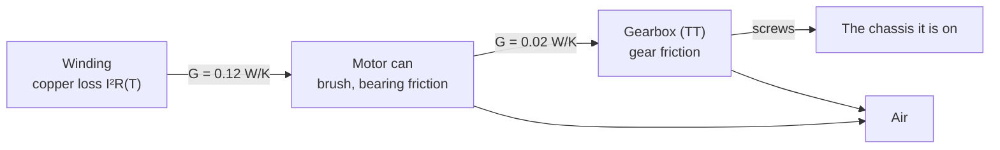

# Heat

Every part is one or more thermal nodes. Electrical losses, friction and hot gas heat the nodes; heat flows by conduction to the parts they are screwed to and by convection and radiation to the air. The temperature feeds back into the circuit and the mechanics.

## Node equation

```math
C_i\,\frac{dT_i}{dt} = P_i \;-\; \sum_j G_{ij}\,(T_i - T_j) \;-\; h_c A_i\,(T_i - T_\infty) \;-\; \varepsilon\,\sigma A_i\,\left(T_i^4 - T_\infty^4\right)
```

| Symbol | Meaning |
| --- | --- |
| $`C_i = m_i\,c_p`$ | Heat capacity (J/K): mass × the material's specific heat |
| $`P_i`$ | Power heating the node (W): $`I^2R`$, switching, friction, gas |
| $`G_{ij}`$ | Conductance between joined parts (W/K) |
| $`h_c`$ | Convection coefficient (W/m²K) |
| $`\varepsilon`$ | The material's emissivity (PLA 0.92, aluminium 0.1…) |

The network advances in 50 ms steps. Radiation is linearised: $`h_r = \varepsilon\sigma\,(T^2 + T_\infty^2)(T + T_\infty)`$.

## Convection with the real air speed

```math
h_c = \max\left(6,\; 10.45 - v + 10\sqrt{v}\right)\ \text{W/m²K}
```

Here $`v`$ is the real air speed over the part: the body's speed relative to the air (wind included), the slipstream of a propeller above it and its own spinning surface (an outrunner's bell). The slipstream, from disc theory with induced velocity $`v_i`$, at a distance $`d`$ from the disc:

```math
v_\text{slip} = v_i\left(1 + \frac{d}{\sqrt{d^2 + r^2}}\right)
```

## Motors: the real heat path

A motor is not one node; heat goes through the parts it really passes:



The winding temperature changes copper's resistance (+0.393 % per °C): a warm motor draws less current at the same voltage and gives less torque. A yellow TT motor's screws go into its plastic gearbox, so little heat reaches the chassis: the winding heats, not the chassis.

## Battery

A battery heats by its internal resistance and polarization loss: $`P = I^2R + \lvert I\,V_p \rvert`$. Lithium cells above 130 °C go into thermal runaway (they turn into an open circuit and an event is written).

## How materials respond

| State | Criterion | Effect |
| --- | --- | --- |
| Softening | above the glass transition (PLA 60 °C, ABS 105 °C) | Young's modulus drops, joints loosen |
| Melting | at the melting point | The joint lets go, an event is written |
| Thermal stress | $`\sigma = -E\,\alpha\,\Delta T`$ (in the FEM analysis) | Added to the stress map |

To see it: **Görünüm → Isı kamerası (dünya)** (View → Thermal camera). With the mouse over a part, the temperature at that point and the part's nodes are shown.
