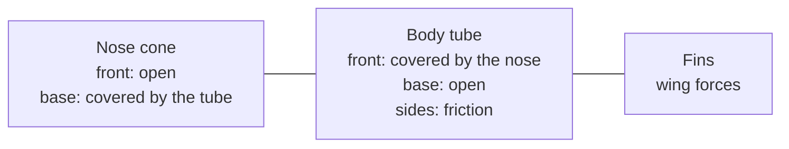

# Aerodynamics

## Atmosphere

Air density, pressure and temperature come from the International Standard Atmosphere (ISA) at the body's height. In the troposphere:

```math
T = T_0 - L\,h, \qquad p = p_0\left(\frac{T}{T_0}\right)^{g/(R L)}, \qquad \rho = \frac{p}{R\,T}
```

$`T_0 = 288.15`$ K, $`L = 0.0065`$ K/m, $`p_0 = 101\,325`$ Pa, $`R = 287.05`$ J/kg·K.

## Drag, face by face

A body's resistance to the air has three parts, each computed where it really acts:

| Part | Where | Coefficient |
| --- | --- | --- |
| Stagnation pressure | The face meeting the flow (leading) | 70 % of the lone body's pressure drag |
| Base suction | The face behind (trailing) | 30 % |
| Skin friction | The sides the flow runs along | $`C_f = 0.004`$ (turbulent plate, $`Re \approx 10^5\text{–}10^6`$) |

```math
\mathbf{F} = -\tfrac{1}{2}\,\rho\,(C_D A)(\hat{\mathbf{u}})\,\lvert\mathbf{u}\rvert\,\mathbf{u}, \qquad \mathbf{u} = \mathbf{v}_\text{body} - \mathbf{v}_\text{wind}
```

A body on its own keeps its measured $`C_D`$ exactly (friction is part of it):

| Shape | $`C_D`$ | Source |
| --- | --- | --- |
| Sphere | 0.47 | subcritical $`Re`$ (10³–2·10⁵) |
| Box face | 1.05 | flat-faced block |
| Cylinder, side-on | 1.0 | cross-flow |
| Cylinder, along its axis | 0.9 | short cylinder |
| Model body (hull) | from its faces | see below |

A body from the modeller or a file gets its drag from its own faces, not from the box around it. A face meeting the flow at angle $`\theta`$ carries $`C_p \approx 0.8\,\sin^2\theta`$ on its projected area (Hoerner's subsonic forebody estimate): a flat face 0.8, a 20° cone ≈ 0.09, a slender ogive nose almost nothing. Trailing faces see a base suction of $`0.15\,\sin^2\theta`$; a tapering tail recovers it, a blunt base does not.

### Joined parts shield each other

Where a joined part covers a face of another, that face sees neither stagnation pressure nor base suction. Coverage is measured on every axis face of every body with lines through the real collision shapes (12 × 12 samples):



So a rocket's drag is not "the sum of its parts flying alone" but the nose's front + the tail's base + friction along it. Coverage is sampled over each body's own extent, so a slender tube (Ø41 × 500 mm) is measured correctly too. Validation: nose + tube axial $`C_D`$ was 1.37 as separate parts and is 0.64 as an assembly (real blunt-based rockets: 0.5–0.7); the solid rocket with an ogive nose and three square-edged fins has 0.62 (OpenRocket-class estimates 0.5–0.7) and keeps it through the flight; the water rocket's apogee went from 26 m to 39.6 m (published flights: 30–50 m).

### Oblique flow

Each axis sees the dynamic pressure of its own velocity component (Allen and Perkins' cross-flow principle). The force need not be exactly against the flow; a tilted flat face also pushes sideways:

```math
F_i = -\tfrac{1}{2}\,\rho\,(C_D A)_i\,\lvert u_i\rvert\,u_i \quad (\text{box, each axis on its own}), \qquad
\mathbf{F}_\perp = -\tfrac{1}{2}\,\rho\,(C_D A)_\text{side}\,\lvert\mathbf{u}_\perp\rvert\,\mathbf{u}_\perp \quad (\text{a cylinder's round section})
```

So the cross-flow drag a slender body adds at a small angle of attack ($`\alpha`$) grows as $`\sin^2\alpha`$, not as $`\sin\alpha`$: a 2° wobble barely changes a rocket's drag. A sphere shows the same area every way and sees the whole speed. For model bodies, whether a section is round or flat is found by measuring the shadow at 45°.

## Wings: strip theory + lifting line

A wing is cut into spanwise strips. Each strip sees its own local air velocity ($`\mathbf{V} + \boldsymbol{\omega}\times\mathbf{r}`$), so roll damping and asymmetric stall follow from the geometry.

```math
\alpha_e = \alpha - \alpha_i, \qquad \alpha_i = \frac{C_L}{\pi\,e\,AR}, \qquad C_{D,i} = \frac{C_L^2}{\pi\,e\,AR}
```

This gives a finite wing's lift slope $`a = a_0 / (1 + a_0/(\pi e AR))`$. Section coefficients come from the airfoil's polar over ±180° (Clark Y, NACA 0012, NACA 2412, flat plate), stall and post-stall included. Control surfaces shift the angle by $`\tau\,\eta(\delta)\,\delta`$ and return their hinge moment to the servo. A tail sees the downwash of the wing ahead: $`\varepsilon = 2C_{L,w}/(\pi AR_w)`$.

## Propellers

With the advance ratio $`J = V/(nD)`$ (fitted to the trends of the UIUC database, Brandt & Selig 2011):

```math
T = C_T\,\rho\,n^2 D^4, \qquad Q = \frac{C_P}{2\pi}\,\rho\,n^2 D^5, \qquad
C_T = C_{T0}\left(1 - \frac{J}{J_0}\right), \qquad C_P = C_{P0}\left(1 - \left(\frac{J}{1.2\,J_0}\right)^2\right)
```

$`J_0 \approx 1.05\,P/D`$ (pitch / diameter). The propeller's torque loads its motor; the thrust acts on the body.

## Wind and turbulence

Random gusts filtered to first order with the Dryden model are added to the mean wind. Wind changes the drag, the angle the wings see and [convective cooling](03-heat.md).
