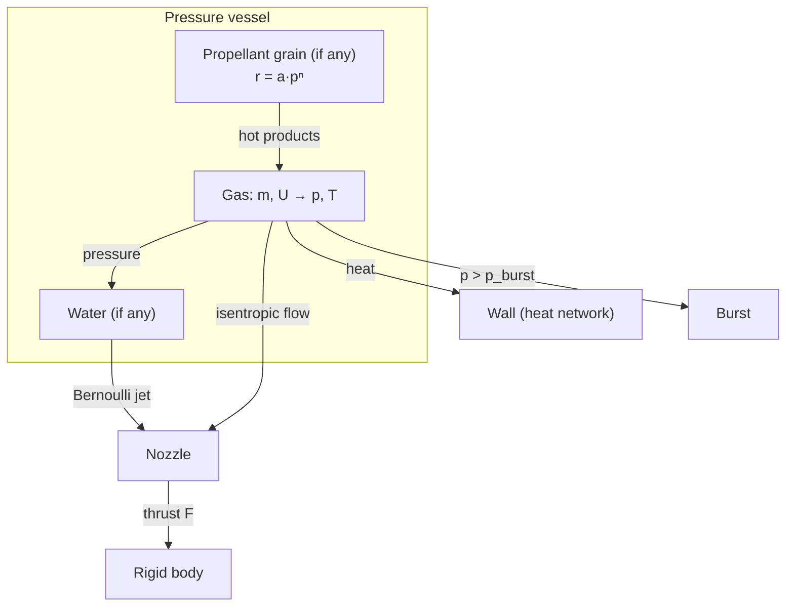

# Gas and rockets

A pressure vessel, a water rocket, an air tank and a solid-propellant motor are not separate "features": they are one gas physics. The vessel holds gas (and optionally water or a propellant grain); what leaves the nozzle sets the thrust.



## State of the gas

The vessel tracks the gas mass $`m`$ and internal energy $`U`$; pressure and temperature follow (ideal gas):

```math
T = \frac{U}{m\,c_v}, \qquad p = \frac{m\,R\,T}{V_\text{gas}}, \qquad V_\text{gas} = V - V_\text{water} - V_\text{grain}
```

As combustion products mix into the air, $`R`$ and $`c_p`$ mix by mass.

| Gas | $`R`$ (J/kg·K) | $`\gamma`$ |
| --- | --- | --- |
| Air | 287.05 | 1.40 |
| CO₂ | 188.9 | 1.29 |
| Nitrogen | 296.8 | 1.40 |
| Helium | 2077.1 | 1.66 |

## Gas flow through the nozzle

Below the critical pressure ratio the flow is sonic at the throat (choked):

```math
\frac{p_a}{p} \le \left(\frac{2}{\gamma+1}\right)^{\frac{\gamma}{\gamma-1}}
\quad\Rightarrow\quad
\dot{m} = C_d\,A_t\,p\,\sqrt{\frac{\gamma}{R\,T}}\left(\frac{2}{\gamma+1}\right)^{\frac{\gamma+1}{2(\gamma-1)}}
```

Not choked (subsonic):

```math
\dot{m} = C_d\,A_t\,p\,\sqrt{\frac{2\gamma}{(\gamma-1)\,R\,T}\left[\left(\frac{p_a}{p}\right)^{2/\gamma} - \left(\frac{p_a}{p}\right)^{(\gamma+1)/\gamma}\right]}
```

In an expanding (de Laval) nozzle the exit Mach number is solved from the area ratio (supersonic branch):

```math
\frac{A_e}{A_t} = \frac{1}{M_e}\left[\frac{2}{\gamma+1}\left(1 + \frac{\gamma-1}{2}M_e^2\right)\right]^{\frac{\gamma+1}{2(\gamma-1)}}
```

If the exit pressure falls below 40 % of ambient, the flow separates from the nozzle wall and the exit is taken at that point. The thrust is momentum plus pressure thrust, applied to the body at the nozzle, opposite the jet:

```math
F = \dot{m}\,v_e + (p_e - p_a)\,A_e
```

$`C_d = 0.95`$. The ambient pressure $`p_a`$ is the atmosphere at the nozzle's height.

## Water leaves first

Water covers the nozzle and leaves before the gas as long as the acceleration the rocket feels presses it towards the nozzle ($`\mathbf{f} = \mathbf{a} - \mathbf{g}`$):

```math
v_e = \sqrt{\frac{2(p - p_a)/\rho_w + 2\,f\,h}{1 - (A_e/A_v)^2}}, \qquad \dot{m}_w = \rho_w\,C_d\,A_e\,v_e, \qquad F = \dot{m}_w\,v_e
```

$`h`$ is the height of the water column and $`A_v`$ the vessel's cross-section. As the water leaves, the gas expands and does work ($`dU = -p\,dV`$), so it cools (−10 °C at launch, −23 °C in flight).

## Solid propellant: pressure-dependent burning

The burn rate depends on pressure by Saint-Robert's / Vieille's law (Nakka's measurements, piecewise by pressure range):

```math
r = a\,p^n, \qquad \dot{m}_\text{gen} = \rho_p\,A_b\,r
```

BATES grains burn from the core and both ends; the burning surface changes with time:

```math
A_b = N\left[\pi\,(d + 2w)(L - 2w) + 2\cdot\frac{\pi}{4}\left(D^2 - (d + 2w)^2\right)\right]
```

The chamber pressure comes out of the balance between the gas generated and the gas leaving the nozzle; no thrust curve is read. At steady state:

```math
\rho_p\,A_b\,a\,p^n = \frac{p\,A_t}{c^*} \quad\Rightarrow\quad p = \left(K_n\,\rho_p\,a\,c^*\right)^{\frac{1}{1-n}}, \qquad K_n = \frac{A_b}{A_t}, \qquad c^* = \frac{\sqrt{R\,T_c}}{\sqrt{\gamma}\left(\frac{2}{\gamma+1}\right)^{\frac{\gamma+1}{2(\gamma-1)}}}
```

| Propellant | Density | Flame temperature | Products $`M`$, $`\gamma`$ | Burn rate |
| --- | --- | --- | --- | --- |
| KNSB (KNO₃ + sorbitol) | 1800 kg/m³ | 1600 K | 39.9 g/mol, 1.137 | 7.9 mm/s (1.5–3.8 MPa) |
| KNDX (KNO₃ + dextrose) | 1785 kg/m³ | 1500 K | 42.4 g/mol, 1.131 | 8.9·p^0.62 mm/s |
| APCP (composite) | 1700 kg/m³ | 2800 K | 25 g/mol, 1.20 | 3.5·p^0.35 mm/s |

The chamber's time constant can be under a millisecond, so the gas advances in its own small sub-steps within every physics step.

## Wall heat and bursting

Hot gas heats the wall: $`h \approx 1500`$ W/m²K while burning, 20 W/m²K in still gas. The wall bursts when its thin-wall hoop stress reaches the material's strength:

```math
\sigma = \frac{p\,r}{t} \quad (\text{cylinder}), \qquad \sigma = \frac{p\,r}{2t} \quad (\text{sphere}), \qquad p_\text{burst} = \frac{\sigma_\text{strength}\,t}{r}
```

| Vessel | Material, wall | Burst pressure |
| --- | --- | --- |
| 2 L PET bottle (r = 52 mm) | biaxially stretched PET 160 MPa, 0.3 mm | ≈ 9 bar |
| KNSB motor casing (r = 14.5 mm) | 6061-T6 aluminium 276 MPa, 1.5 mm | ≈ 28 MPa |

## Validation

| Experiment | Expected | Simulation |
| --- | --- | --- |
| 1 L tank, 6 bar, 2 mm hole: blowdown | between the adiabatic and isothermal closed forms | within 1 % of adiabatic at 0.5 s, then drifting towards isothermal as the wall warms the gas |
| KNSB, Kn 169 | $`p`$ = 2.26 MPa | 2.36 MPa, 1.10 s burn, 121 N·s, Isp 130 s |
| Water rocket 2 L / 0.6 L / 4 bar / 21.5 mm | water gone in ~0.1 s, 30–50 m | 70 ms, 300 N peak, 43 m/s, apogee 39.6 m |
| Nozzle choked down to 1.5 mm | the casing bursts | bursts |
| Bottle pumped to 12 bar | bursts at ~9 bar | bursts |
