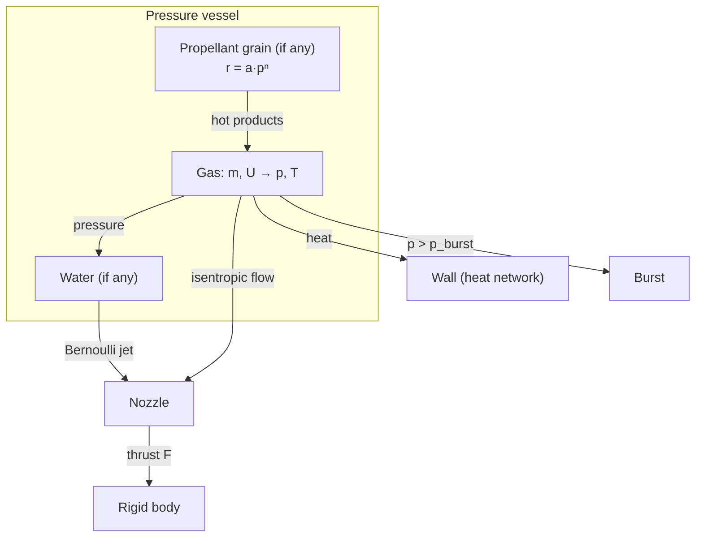

# Gas and rockets

A pressure vessel, a water rocket, an air tank and a solid-propellant motor are not separate "features": they are one gas physics. The vessel holds gas (and optionally water or a propellant grain); what leaves the nozzle sets the thrust.



## State of the gas

The vessel tracks the gas mass $`m`$ and internal energy $`U`$; pressure and temperature follow. Cold gas is ideal; for hot combustion products the molecules' own volume counts too (Noble–Abel, the equation of state of interior ballistics, co-volume $`b \approx 1`$ L/kg):

```math
T = \frac{U}{m\,c_v}, \qquad p = \frac{m\,R\,T}{V_\text{gas} - b\,m_\text{products}}, \qquad V_\text{gas} = V - V_\text{water} - V_\text{grain}
```

Air, propellant products and igniter products are tracked as three components; $`R`$ and $`c_p`$ mix by mass.

| Gas | $`R`$ (J/kg·K) | $`\gamma`$ |
| --- | --- | --- |
| Air | 287.05 | 1.40 |
| CO₂ | 188.9 | 1.29 |
| Nitrogen | 296.8 | 1.40 |
| Helium | 2077.1 | 1.66 |

## Gas flow through the nozzle

Below the critical pressure ratio the flow is sonic at the throat (choked):

```math
\frac{p_a}{p} \le \left(\frac{2}{\gamma+1}\right)^{\frac{\gamma}{\gamma-1}}
\quad\Rightarrow\quad
\dot{m} = C_d\,A_t\,p\,\sqrt{\frac{\gamma}{R\,T}}\left(\frac{2}{\gamma+1}\right)^{\frac{\gamma+1}{2(\gamma-1)}}
```

Not choked (subsonic):

```math
\dot{m} = C_d\,A_t\,p\,\sqrt{\frac{2\gamma}{(\gamma-1)\,R\,T}\left[\left(\frac{p_a}{p}\right)^{2/\gamma} - \left(\frac{p_a}{p}\right)^{(\gamma+1)/\gamma}\right]}
```

In an expanding (de Laval) nozzle the exit Mach number is solved from the area ratio (supersonic branch):

```math
\frac{A_e}{A_t} = \frac{1}{M_e}\left[\frac{2}{\gamma+1}\left(1 + \frac{\gamma-1}{2}M_e^2\right)\right]^{\frac{\gamma+1}{2(\gamma-1)}}
```

In an over-expanded nozzle the boundary layer separates where the wall pressure falls to Schmucker's limit; the jet leaves the wall there and the exit is taken at that point:

```math
\frac{p_\text{sep}}{p_a} = \left(1.88\,M - 1\right)^{-0.64}
```

The thrust is momentum plus pressure thrust, applied to the body at the nozzle, opposite the jet:

```math
F = \dot{m}\,v_e + (p_e - p_a)\,A_e
```

$`C_d = 0.95`$. The ambient pressure $`p_a`$ is the atmosphere at the nozzle's height.

## Water leaves first

Water covers the nozzle and leaves before the gas as long as the acceleration the rocket feels presses it towards the nozzle ($`\mathbf{f} = \mathbf{a} - \mathbf{g}`$):

```math
v_e = \sqrt{\frac{2(p - p_a)/\rho_w + 2\,f\,h}{1 - (A_e/A_v)^2}}, \qquad \dot{m}_w = \rho_w\,C_d\,A_e\,v_e, \qquad F = \dot{m}_w\,v_e
```

$`h`$ is the height of the water column and $`A_v`$ the vessel's cross-section. As the water leaves, the gas expands and does work ($`dU = -p\,dV`$), so it cools (−10 °C at launch, −23 °C in flight).

## Ignition: e-match, igniter, flame spread

The grain does not burn the moment the e-match fires. The chain is:

1. Current through the circuit heats the e-match's bridgewire; at its ignition temperature the match fires and goes open-circuit (≈ 1.6 Ω, steady all-fire current ≈ 0.35 A, thermal time constant 3 ms).
2. The match head (≈ 0.03 g) and the pyrogen dipped on it ("Igniter charge", 0.5 g by default) burn in 20 ms; their products enter the chamber's head end at ≈ 2000 K.
3. The hot gas heats the grain surface as it flows down the port, by convection (Dittus–Boelter) and radiation:

```math
q = h\,(T_\text{gas} - T_s) + \varepsilon\,\sigma\,(T_\text{gas}^4 - T_s^4), \qquad h = 0.023\,\frac{k}{D}\,Re^{0.8}\,Pr^{0.4}, \qquad Re = \frac{G\,D}{\mu}
```

4. The heat soaks into the propellant (1-D transient conduction, implicit, 8 µm grid). A zone whose surface reaches the ignition temperature ($`T_\text{ign}`$) starts burning. The gas cools as it gives heat to the surface on its way to the nozzle, so the flame spreads from the head end aft.

The grain is split into axial zones from the head to the nozzle; each has its own temperature profile, its own moment of ignition and its own burn depth. With too small an igniter the surface never reaches the ignition temperature and the motor does not light: a bare e-match head usually cannot light a sugar motor.

| Propellant | $`T_\text{ign}`$ | Burning surface temperature | Solid $`k`$, $`c`$ | Gas emissivity |
| --- | --- | --- | --- | --- |
| KNSB | 590 K | 800 K | 0.4 W/m·K, 1300 J/kg·K | 0.3 |
| KNDX | 580 K | 800 K | 0.4 W/m·K, 1300 J/kg·K | 0.3 |
| APCP | 690 K | 950 K | 0.4 W/m·K, 1250 J/kg·K | 0.4 |

## Solid propellant: pressure-dependent burning

The burn rate depends on pressure by Saint-Robert's / Vieille's law (Nakka's measurements, piecewise by pressure range):

```math
r = a\,p^n, \qquad \dot{m}_\text{gen} = \rho_p\,A_b\,r
```

BATES grains burn from the core and both ends; the burning surface changes with time:

```math
A_b = N\left[\pi\,(d + 2w)(L - 2w) + 2\cdot\frac{\pi}{4}\left(D^2 - (d + 2w)^2\right)\right]
```

In a narrow port the gas flowing past speeds the burning up (erosive burning, Lenoir–Robillard). The mass flux $`G`$ grows towards the nozzle, so the aft end burns faster and the pressure spikes at start-up:

```math
r = a\,p^n + \alpha\,\frac{G^{0.8}}{D^{0.2}}\,e^{-\beta\,r\,\rho_p / G}, \qquad \beta = 53, \qquad \alpha = \frac{0.0288\,c_p\,\mu^{0.2}\,Pr^{-2/3}}{\rho_p\,c_s}\cdot\frac{T_f - T_s}{T_s - T_i}
```

The core reaches the grain's outer diameter first at the nozzle end; the casing is exposed there early and the thrust tails off gently.

The chamber pressure comes out of the balance between the gas generated and the gas leaving the nozzle; no thrust curve is read. At steady state:

```math
\rho_p\,A_b\,a\,p^n = \frac{p\,A_t}{c^*} \quad\Rightarrow\quad p = \left(K_n\,\rho_p\,a\,c^*\right)^{\frac{1}{1-n}}, \qquad K_n = \frac{A_b}{A_t}, \qquad c^* = \frac{\sqrt{R\,T_c}}{\sqrt{\gamma}\left(\frac{2}{\gamma+1}\right)^{\frac{\gamma+1}{2(\gamma-1)}}}
```

| Propellant | Density | Flame temperature | Products $`M`$, $`\gamma`$ | Burn rate |
| --- | --- | --- | --- | --- |
| KNSB (KNO₃ + sorbitol) | 1800 kg/m³ | 1600 K | 39.9 g/mol, 1.137 | 7.9 mm/s (1.5–3.8 MPa) |
| KNDX (KNO₃ + dextrose) | 1785 kg/m³ | 1500 K | 42.4 g/mol, 1.131 | 8.9·p^0.62 mm/s |
| APCP (composite) | 1700 kg/m³ | 2800 K | 25 g/mol, 1.20 | 3.5·p^0.35 mm/s |

The chamber's time constant can be under a millisecond, so the gas advances in its own small sub-steps within every physics step.

## Wall heat and bursting

Hot gas heats only the casing wall the grain does not cover: the closures, the gaps between grains and where the core has reached the casing. Heat reaches those surfaces by convection with the port flow (Dittus–Boelter) and radiation. The nozzle throat heats by Bartz's correlation; it is the hottest place of the motor:

```math
h_\text{throat} = \frac{0.026}{D_t^{0.2}}\,\frac{\mu^{0.2}\,c_p}{Pr^{0.6}}\left(\frac{p_c}{c^*}\right)^{0.8}
```

This heat goes to the motor's node in the heat network; View → Thermal camera shows the aft end of the motor heating up. The wall bursts when its thin-wall hoop stress reaches the material's strength:

```math
\sigma = \frac{p\,r}{t} \quad (\text{cylinder}), \qquad \sigma = \frac{p\,r}{2t} \quad (\text{sphere}), \qquad p_\text{burst} = \frac{\sigma_\text{strength}\,t}{r}
```

| Vessel | Material, wall | Burst pressure |
| --- | --- | --- |
| 2 L PET bottle (r = 52 mm) | biaxially stretched PET 160 MPa, 0.3 mm | ≈ 9 bar |
| KNSB motor casing (r = 14.5 mm) | 6061-T6 aluminium 276 MPa, 1.5 mm | ≈ 28 MPa |

## Validation

| Experiment | Expected | Simulation |
| --- | --- | --- |
| 1 L tank, 6 bar, 2 mm hole: blowdown | between the adiabatic and isothermal closed forms | within 1 % of adiabatic at 0.5 s, then drifting towards isothermal as the wall warms the gas |
| KNSB, Kn 169 | $`p`$ = 2.26 MPa (without erosive burning) | 2.58 MPa at 0.25 s (erosive burning in the narrow port), peak 3.3 MPa, 1.10 s burn, 127 N·s, Isp 136 s |
| Water rocket 2 L / 0.6 L / 4 bar / 21.5 mm | water gone in ~0.1 s, 30–50 m | 70 ms, 300 N peak, 43 m/s, apogee 39.6 m |
| Nozzle choked down to 1.5 mm | the casing bursts | bursts |
| Bottle pumped to 12 bar | bursts at ~9 bar | bursts |
| Grain surface soak (h = 2000 W/m²K, 2000 K gas) | semi-infinite solid: $`T_s = T_0 + (T_g - T_0)[1 - e^{\beta^2}\mathrm{erfc}\,\beta]`$ | within 1 % at 2, 5 and 20 ms |
| 0.5 g igniter, KNSB | lights in a few ms, flame spreads from the head | head end lights at 5.3 ms, flame over the whole surface 0.6 ms later |
| Bare e-match head (0.03 g), KNSB | usually fails | surface peaks at 122 °C, no ignition |
| Ø8 mm port, 4 MPa | aft end burns erosively | head 8.2, aft end 10.4 mm/s; 3 % difference with an Ø18 mm port |

## Parachute

Any body can carry a recovery parachute ("Canopy diameter"). It is thrown when the altimeter sees the climb end (or at a set time). Once the lines are taut the canopy opens by Knacke's filling model: filling time $`t_f = n\,D_0 / v`$ ($`n \approx 8`$), drag area growing as $`(C_D S)(t) = (C_D S)_0\,(t/t_f)^2`$, $`C_D \approx 0.75`$. The force acts at the top of the body; the opening shock and the swing come out of the rigid-body physics.

## Model rocket: the launch template

The "Solid rocket" template uses all of it: a 41 mm kraft tube, an ogive nose, three plywood fins, a KNSB motor with two BATES grains (G class), a 9 V battery on the pad, an arming switch closed by a 2 s countdown and the e-match, and a 45 cm parachute at apogee.

| Measure | Simulation |
| --- | --- |
| Switch closes → e-match fires | 2.001 s → 2.003 s (2.68 A) |
| Grain lights, flame spreads | 2.007 s, 2.008 s |
| Total impulse, burn time | 128 N·s, 1.05 s |
| Drag coefficient (on Ø41 mm) | 0.62 (OpenRocket-class estimates 0.5–0.7) |
| Peak speed, apogee | 270 m/s, 1033 m |
| Tilt under thrust | 0.4° |
| Descent rate under the canopy | 7.0 m/s |
