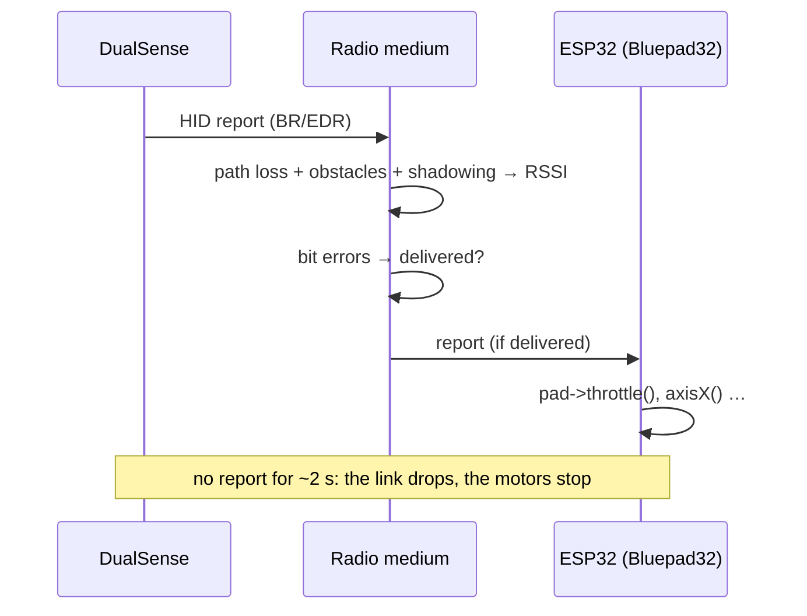

# Radio

ESP32s (Wi-Fi, BLE, Bluetooth), game controllers (DualSense, DualShock 4, Xbox), the Wi-Fi router and BLE tags share one 2.4 GHz medium. Every packet either arrives or is lost, depending on the signal strength computed from the two devices' positions at that moment.

## Path loss

Free space up to a reference distance $`d_0`$, log-distance beyond:

```math
L(d) = 20\log_{10}\!\left(\frac{4\pi d_0 f}{c}\right) + 10\,n\,\log_{10}\!\left(\frac{d}{d_0}\right) + \sum L_\text{obstacle} + X_\sigma(t)
```

| Environment | Path-loss exponent $`n`$ |
| --- | --- |
| Open space | 2.0 |
| Home | 2.7 |
| Office | 3.0 |
| Cluttered | 3.5 |

| Obstacle (crossed by the direct ray) | Extra loss |
| --- | --- |
| Wood, MDF | 4 dB |
| Plastic body | 2 dB |
| Carbon | 12 dB |
| Metal (steel, aluminium) | 20 dB |
| Arena walls, world obstacles | 5 dB |

$`X_\sigma(t)`$ is slow log-normal shadowing with standard deviation $`\sigma`$. It is a fixed function of the link's two ends, the seed and time: the same run gives the same RSSI trace.

## Received power and errors

```math
P_r = P_t - L(d), \qquad \frac{E_b}{N_0} = P_r - N_\text{floor}, \qquad \text{BER}_\text{FSK} = \tfrac{1}{2}\,e^{-\frac{E_b/N_0}{2}}
```

A packet arrives with the probability that none of its bits is wrong. Below the detection threshold the receiver does not see the packet at all.



## IR

38 kHz infrared remotes work only in line of sight: nothing opaque to the light between transmitter and receiver. The light fades smoothly off axis ($`\cos^m\theta`$; the transmitter's half-intensity angle is 25°, the receiver's 45°) and with the square of the distance; the receiver sees it when their product passes its threshold. The NEC code is generated bit by bit and fed to the receiver's output pin.

## Validity range

The model's accuracy has been measured over the range below; the figures come from `RadioTests`.

| Subject | Model | Measured | Outside the model |
| --- | --- | --- | --- |
| Path loss | Free space up to 1 m, log-distance beyond ($`n`$ from the environment), the loss of obstacles on the direct ray | 40.2 dB at 1 m and 2.44 GHz (the free-space formula), $`10\,n`$ dB per decade; an obstacle beside the ray adds nothing | Reflection and diffraction, fast multipath fading on the scale of a wavelength |
| Shadowing | Log-normal, changing slowly with time, a function of the two ends and the seed (repeatable) | At σ = 4 dB the measured spread is 3.4–4.6 dB, the mean within ±0.4 dB; the same both ways | People and objects moving about the room |
| Packets | FSK bit error rate over the packet | 5–80 % lost at the sensitivity, all of them below it | Interference from other networks and channel overlap; antenna patterns (gain is a fixed dBi, the same in every direction) |
| IR | Line of sight, $`\cos^m\theta`$ spread (transmitter 25°, receiver 45° to half intensity), inverse square of the distance, 38 kHz carrier, NEC timing | NEC frames decode bit for bit; steady light without the carrier does not trigger the receiver | Noise from sunlight and lamps, reflected IR |
