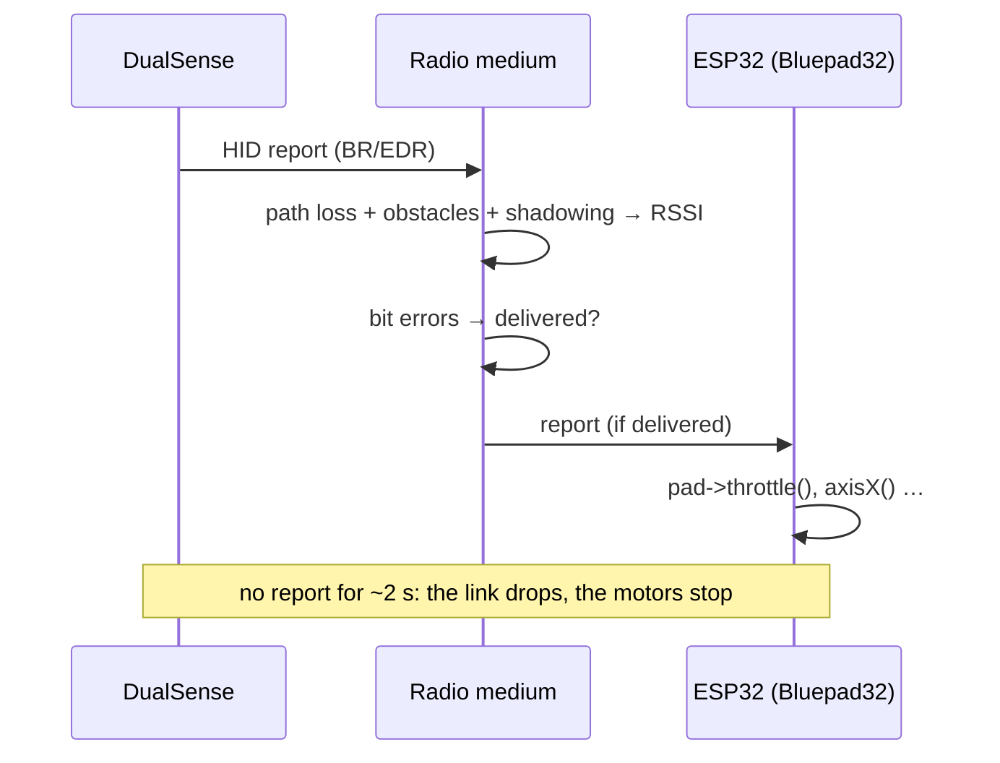

# Radio

ESP32s (Wi-Fi, BLE, Bluetooth), game controllers (DualSense, DualShock 4, Xbox), the Wi-Fi router and BLE tags share one 2.4 GHz medium. Every packet either arrives or is lost, depending on the signal strength computed from the two devices' positions at that moment.

## Path loss

Free space up to a reference distance $`d_0`$, log-distance beyond:

```math
L(d) = 20\log_{10}\!\left(\frac{4\pi d_0 f}{c}\right) + 10\,n\,\log_{10}\!\left(\frac{d}{d_0}\right) + \sum L_\text{obstacle} + X_\sigma(t)
```

| Environment | Path-loss exponent $`n`$ |
| --- | --- |
| Open space | 2.0 |
| Home | 2.7 |
| Office | 3.0 |
| Cluttered | 3.5 |

| Obstacle (crossed by the direct ray) | Extra loss |
| --- | --- |
| Wood, MDF | 4 dB |
| Plastic body | 2 dB |
| Carbon | 12 dB |
| Metal (steel, aluminium) | 20 dB |
| Arena walls, world obstacles | 5 dB |

$`X_\sigma(t)`$ is slow log-normal shadowing with standard deviation $`\sigma`$. It is a fixed function of the link's two ends, the seed and time: the same run gives the same RSSI trace.

## Received power and errors

```math
P_r = P_t - L(d), \qquad \frac{E_b}{N_0} = P_r - N_\text{floor}, \qquad \text{BER}_\text{FSK} = \tfrac{1}{2}\,e^{-\frac{E_b/N_0}{2}}
```

A packet arrives with the probability that none of its bits is wrong. Below the detection threshold the receiver does not see the packet at all.



## IR

38 kHz infrared remotes work only in line of sight: nothing between transmitter and receiver, and no more than ±30° off axis. The NEC code is generated bit by bit and fed to the receiver's output pin.
