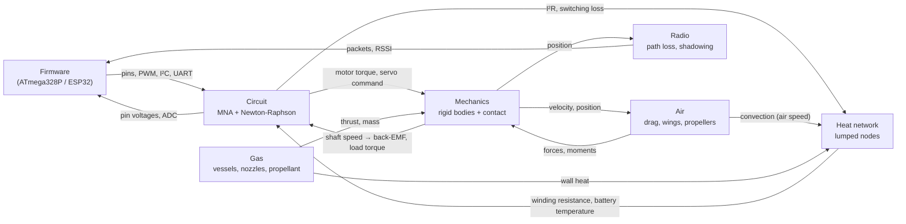
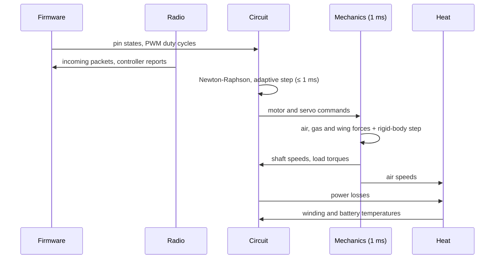

# Physics and maths

In RobotWin Studio no feature is a separate "effect": everything is part of one physics. Circuit, mechanics, heat, air, gas and radio are solved coupled in the same time step: the current a motor draws pulls the battery voltage down and heats the winding; as the winding warms its resistance rises, its torque falls, the car slows and the air resists it less… This section gives every solver's equations, assumptions and validation.

## Coupled solvers

## One time step

The world page advances the simulation in small slices every frame. Within a slice:

## Solvers

| Domain | Method | Step | Page |
| --- | --- | --- | --- |
| Circuit | Modified nodal analysis (MNA), Newton-Raphson, trapezoidal / backward Euler, adaptive step from the local truncation error | 1 µs – 1 ms | [Circuit solver](01-circuit.md) |
| Mechanics | Semi-implicit (symplectic) Euler, implicit gyroscopic term, soft sequential impulses for contacts and joints | 1 ms, sub-stepped | [Rigid bodies and contact](02-mechanics.md) |
| Heat | Lumped thermal network: one or more nodes per part, conduction + convection + radiation | 50 ms | [Heat](03-heat.md) |
| Air | Direction-dependent drag (leading face, base, friction; joined parts shield each other), strip theory + lifting line, propeller C_T/C_P | 1 ms | [Aerodynamics](04-aerodynamics.md) |
| Gas | Ideal gas, isentropic nozzle flow, Bernoulli water jet, pressure-dependent solid propellant burning | 1 ms, internally sub-stepped | [Gas and rockets](05-gas-and-rockets.md) |
| Radio | Free-space + log-distance path loss, obstacle loss, log-normal shadowing, FSK bit errors | per packet | [Radio](06-radio.md) |

## Determinism

The same world and the same inputs give bit-identical results: everything that looks random (shadowing, tolerance draws) is a fixed function of the world and a seed. A recording can therefore be replayed, tests give definite answers, and the render window can recompute a live run exactly.

## Validation

Every model is compared in its own test with a textbook solution or a published measurement. Examples:

| Model | Compared with | Result |
| --- | --- | --- |
| Air tank blowdown | Adiabatic and isothermal closed-form solutions | Between the two; within 1 % of adiabatic over the first 0.5 s |
| KNSB motor | Steady burn pressure $`p = (K_n \rho a c^*)^{1/(1-n)}`$ | 2.36 MPa (theory 2.26 MPa), Isp 130 s |
| Water rocket (2 L, 0.6 L, 4 bar) | Published flights and simulators (30–50 m) | 39.6 m |
| Sphere drag | $`C_D = 0.47`$ (subcritical Re) | 0.470 in every direction |
| Rolling cylinder | A true cylinder vs the model-shaped body | The model body rolls 63 % as far as a true cylinder, a box 5 % |
| Gamepad car | Straight driving, one axle | 4 mm off line over 1.86 m, 0.93 m/s |
