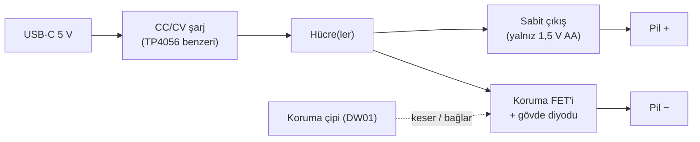

# Devre çözücü

Bir dünyadaki bütün kartlar, parçalar ve kablolar tek bir analog devre olarak çözülür. Kablolar gerçek bakır dirençleriyle devrededir; iki kart arasında GND kablosu yoksa ortak toprakları da yoktur.

## Modifiye düğüm analizi (MNA)

Her düğümün gerilimi ve gerilim kaynaklarının (pil, regülatör çıkışı, endüktans) akımı bilinmeyendir. Kirchhoff akım yasası her düğüm için bir denklem, her kaynak için bir kısıt denklemi verir:

```math
\begin{bmatrix} G & B \\ C & D \end{bmatrix}
\begin{bmatrix} \mathbf{v} \\ \mathbf{i} \end{bmatrix}
=
\begin{bmatrix} \mathbf{i}_s \\ \mathbf{e} \end{bmatrix}
```

$`G`$ iletkenlik matrisi, $`B, C`$ kaynakların bağlandığı düğümler, $`\mathbf{i}_s`$ akım kaynakları, $`\mathbf{e}`$ kaynak gerilimleridir. Her eleman bu matrise kendi katkısını "damgalar" (stamp): bir direnç $`R`$ iki düğümü arasına $`1/R`$ ekler.

## Doğrusal olmayan elemanlar: Newton-Raphson

Diyot, transistör, MOSFET, motor sürücü gibi elemanların akımı gerilime doğrusal bağlı değildir. Her adımda sistem $`\mathbf{F}(\mathbf{x}) = 0`$ Newton-Raphson ile çözülür:

```math
J(\mathbf{x}_k)\,\Delta\mathbf{x} = -\mathbf{F}(\mathbf{x}_k), \qquad \mathbf{x}_{k+1} = \mathbf{x}_k + \Delta\mathbf{x}
```

Her eleman, o anki çalışma noktasındaki eğimini (Jacobian katkısı) ve eşdeğer akımını damgalar. Örneğin diyot (Shockley):

```math
I = I_s\left(e^{V/(n V_T)} - 1\right), \qquad V_T = \frac{kT}{q} \approx 25{,}9\ \text{mV}\ (27\,^\circ\text{C})
```

Üstel terim taşmasın diye gerilim adımı sınırlanır (SPICE'taki gibi "pnjlim").

## Zamanda ilerleme

Kondansatör ve endüktans, her adımda eşdeğer bir iletkenlik ve akım kaynağıyla (companion model) yer değiştirir. Trapez kuralı:

```math
i_{n+1} = \frac{2C}{h}\left(v_{n+1} - v_n\right) - i_n
```

Ani değişimlerden sonra (anahtar, PWM kenarı, eleman arızası) salınım yapmasın diye birkaç adım geri Euler kullanılır: $`i_{n+1} = \tfrac{C}{h}(v_{n+1} - v_n)`$.

Adım boyu yerel kesme hatasına göre ayarlanır. Trapez kuralında hata, gerilimin üçüncü türevinden kestirilir:

```math
\text{LTE} \approx \frac{h^3}{12}\,\dddot{v}, \qquad h_{\text{yeni}} = h\left(\frac{\varepsilon}{\text{LTE}}\right)^{1/3}
```

| Durum | Yöntem | Adım |
| --- | --- | --- |
| Sakin devre | Trapez | 1 ms'ye kadar |
| Hızlı değişim, PWM kenarı | Trapez, küçülen adım | µs mertebesi |
| Anahtar / arıza sonrası | Geri Euler (birkaç adım) | en küçük adım |

## Eleman modelleri (seçme)

### DC motor

Elektrik ve mekanik denklemler birlikte çözülür:

```math
V = R(T)\,I + L\frac{dI}{dt} + K_e\,\omega, \qquad
J\frac{d\omega}{dt} = K_t I - b\,\omega - T_c\tanh\!\left(\frac{\omega}{\omega_0}\right) - \frac{T_\text{yük}}{N}
```

Sargı direnci bakırın sıcaklık katsayısıyla ısınır: $`R(T) = R_{25}\,[1 + 0{,}00393\,(T - 25)]`$. Sargı sıcaklığı [ısı ağından](03-isi.md) gelir; yük torku $`T_\text{yük}`$ milin bağlı olduğu [katı cisimden](02-mekanik.md) gelir.

### Pil

```math
V = n\,\text{OCV}(\text{SoC}) - V_p - I\,R(\text{SoC}), \qquad
\frac{dV_p}{dt} = \frac{I R_p - V_p}{\tau}, \qquad
\frac{d\,\text{SoC}}{dt} = -\frac{I}{3600\,Q}
```

| Kimya | OCV (0 / 20 / 50 / 100 % doluluk) | Hücre direnci | Polarizasyon (hücre başına $`R_p`$, $`\tau`$) |
| --- | --- | --- | --- |
| Alkalin | 0,90 / 1,20 / 1,30 / 1,60 V | 0,15 Ω | 0,25 Ω, 15 s |
| NiMH | 1,00 / 1,20 / 1,25 / 1,40 V | 0,03 Ω | 0,02 Ω, 30 s |
| Li-ion | 3,00 / 3,70 / 3,82 / 4,20 V | 0,05 Ω | 0,02 Ω, 30 s |
| LiFePO4 | 2,50 / 3,25 / 3,30 / 3,45 V | 0,03 Ω | 0,015 Ω, 30 s |

Direnç boşalmanın sonuna doğru artar: $`R = R_0\,[1 + 3(1-\text{SoC})^4]`$. Son %0,2'lik dilimde gerilim dizden sıfıra doğrusal iner (bir anda düşmez).

### USB-C şarjlı lityum pil

Pilin içindeki devre gerçek elemanlardan kurulur:



| Koruma | Eşik | Geri bağlama |
| --- | --- | --- |
| Aşırı deşarj | hücre < 2,4 V | yalnız şarj cihazı takılınca (akım gövde diyodundan geçer) |
| Aşırı şarj | hücre > 4,28 V | hücre < 4,1 V |
| Aşırı akım | > 3 A (tek hücre) / > 6 A (2S paket), 10 ms | 1 s sonra yeniden dener |

Şarj, akımı $`I_\text{şarj}`$ ile sınırlı bir 4,2 V/hücre regülatörüdür: hücre 4,2 V'a ulaşana kadar sabit akım, sonra sabit gerilimde azalan akım.

## Kayıplar ve arızalar

Her eleman anlık güç kaybını raporlar; [ısı ağı](03-isi.md) bunu sıcaklığa çevirir. Sınırlarının dışında sürülen elemanlar gerçekteki gibi bozulur: direnç yanar (açık devre), MOSFET'in kapı oksidi delinir, lityum pil termal kaçağa girer, kablo erir. Bozulan eleman devrede yeni durumuyla (açık / kısa) kalır.
