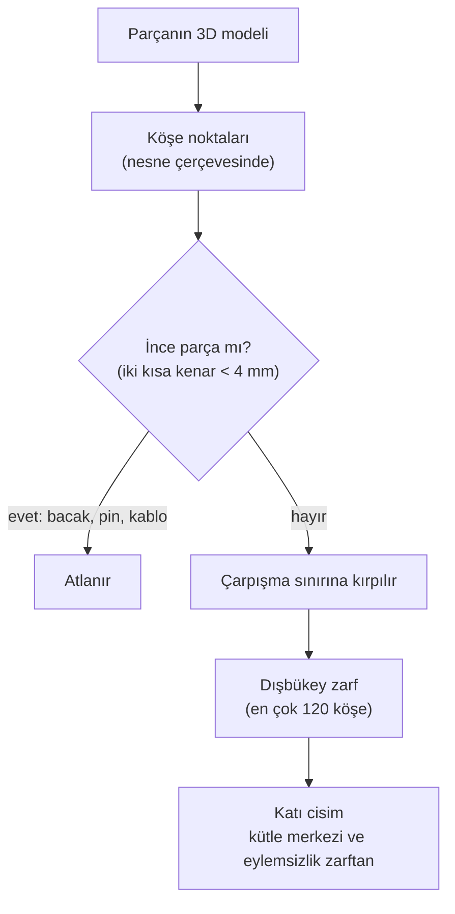

# Katı cisim ve temas

Dünyadaki her nesne bir katı cisimdir: kütle merkezinde konumu, yönelimi (birim kuaterniyon), doğrusal ve açısal hızı, kütlesi ve asal eylemsizlik momentleri vardır. Servo kolları ve motor milleri, gövdeye menteşeyle bağlı ayrı küçük rotorlardır.

## Hareket denklemleri

```math
m\,\dot{\mathbf{v}} = \mathbf{F}, \qquad
I\,\dot{\boldsymbol{\omega}} + \boldsymbol{\omega} \times (I\boldsymbol{\omega}) = \boldsymbol{\tau}
```

Kuvvetler: yerçekimi, temaslar, eklemler, [hava](04-aerodinamik.md) (sürükleme, kanatlar, pervaneler), [gaz itkisi](05-gaz-ve-roket.md), kablolar (ip olarak), ortam kuvvet alanları (rüzgâr, fan, mıknatıs).

## Tümleştirme

Her fizik adımı (1 ms) sabit alt adımlara bölünür. Her alt adımda yarı örtük (simplektik) Euler uygulanır; jiroskopik terim örtük çözülür, böylece hızlı dönen bir pervane ya da tekerlek enerji kazanıp sapıtmaz:

```math
\mathbf{v}_{n+1} = \mathbf{v}_n + h\,\frac{\mathbf{F}}{m}, \qquad
\mathbf{x}_{n+1} = \mathbf{x}_n + h\,\mathbf{v}_{n+1}, \qquad
q_{n+1} = \operatorname{normalize}\!\left(q_n + \tfrac{h}{2}\,\boldsymbol{\omega}_{n+1} \otimes q_n\right)
```

İnce ve hızlı cisimler (pervane kanadı, mermi gibi düşen parça) için alt adım sayısı artırılır (sürekli çarpışma denetimi), böylece bir adımda öbür tarafa geçmezler.

## Temas ve eklemler: yumuşak ardışık itme

Temaslar ve eklemler hız düzeyinde kısıt olarak çözülür (Catto'nun "soft step" yöntemi). Her kısıt için itme:

```math
\lambda = -\,m_\text{eff}\,\big(J\mathbf{v} + \beta\,C/h\big)\,\gamma, \qquad m_\text{eff} = \left(J M^{-1} J^\top\right)^{-1}
```

$`C`$ kısıtın ihlali (iç içe geçme derinliği, eklem kayması), $`\beta`$ yumuşak konum düzeltmesi, $`\gamma`$ yumuşatma katsayısıdır. Kısıtlar Gauss-Seidel sırasıyla 4 kez geçilir, ardından 2 gevşetme geçişi yapılır; önceki adımın itmeleriyle başlanır (sıcak başlatma).

| Kısıt | Ne sağlar |
| --- | --- |
| Temas (normal) | İç içe geçmeyi önler, sekme katsayısı malzeme çiftinden |
| Sürtünme | Coulomb konisi: $`\lvert \lambda_t \rvert \le \mu\,\lambda_n`$, statik ve kinetik $`\mu`$ ayrı |
| Yuvarlanma direnci | Lastik, bilye: $`\tau \le c_{rr}\,r\,\lambda_n`$ |
| Sabit eklem | İki gövde tek parça (vida, yapıştırıcı) |
| Menteşe | Tek eksende dönme; sınır, sürücü (konum: PD, hız: motor) |
| Kızak | Tek eksende kayma |
| Küresel | Uç noktalar çakışık, dönme serbest |

Bir eklem, tasarım kuvvetini aşınca kopar; olay **Olaylar** sekmesine yazılır.

### Kaynaklı parçalar: tek rijit gövde

Yumuşak kısıtın sertliği gövdenin kütlesiyle orantılıdır. Ağır bir gövdeyle hafif bir parça arasındaki zincir, örneğin 400 g'lık bir uçak gövdesi → 6 g'lık tel bacak → 10 g'lık tekerlek, bu yüzden gerçek çelikten çok daha esnek davranır: tekerlek yükte birkaç derece rot açısı yapar. Bu nedenle **kırılmaz sabit bağlantılar** (kırılma kuvveti ya da bağlantı türü verilmemiş sabit eklemler, kabuk duvarları, vidalı kapaklar) ayrı kısıt olarak çözülmez. Bunlarla birleşen parçalar her adımda tek bir rijit gövdede toplanır:

```math
M = \sum m_i, \qquad \mathbf{x}_G = \frac{\sum m_i \mathbf{x}_i}{M}, \qquad I_G = \sum \Big( R_i I_i R_i^\top + m_i \big(\lVert\mathbf{d}_i\rVert^2 E - \mathbf{d}_i\mathbf{d}_i^\top\big) \Big), \quad \mathbf{d}_i = \mathbf{x}_i - \mathbf{x}_G
```

- **Grubun hızı:** Parçaların momentumundan ve açısal momentumundan bulunur. Böylece adımlar arasında bir parçaya ne yapıldıysa (fırlatma, itme) kaybolmaz.
- **Kuvvetler:** Her parçaya etkiyen kuvvet ve tork (yerçekimi, sürükleme, kanat, pervane, motor) gruba toplanır. Grup tek gövde olarak, tam eylemsizlik tensörüyle ve örtük dönme terimiyle tümleştirilir.
- **Temas ve eklemler:** Her parça kendi şekliyle çarpışır. Temas ve başka gövdelere giden eklemler gruba, kütle merkezinden ölçülen kollarla uygulanır.
- **İç yükler:** Grup içindeki kaynakların taşıdığı kuvvet ve tork ters dinamikle bulunur. Kaynağın bir yanındaki parçaların adım boyunca momentum değişiminden dış itmeler (uygulanan, temas, diğer eklemler) çıkarılır. Kayıtlar, gerilme ölçümleri ve render'daki FEM yükleri bu değerleri kullanır.

Doğrulama: bir bloğun üstüne kaynaklı 0,5 kg'lık parçada kaynak 4,905 N taşır (0,5 × 9,81). 0,2 kg'lık, ağırlık merkezi 0,1 m dışarıda olan bir konsolda kaynağın momenti 0,196 N·m çıkar (beklenen 0,1962). Hafif ucu 2 N ile itilen bir zincirde parçalar birbirine göre 10⁻⁶ dereceden fazla dönmez. Vida ve yapıştırıcı gibi kırılabilir bağlantılar ayrı eklem olarak kalır, çünkü kopmaları eklemin kendi kuvvetiyle sınanır.

### Kablolar: etki ve tepki

Kablolar kütleli birer iptir. Bir gövdeye dayanan kablo o gövdeyi iter; kablonun gördüğü düzeltme $`m\,\Delta x/h^2`$ eşit ve zıt yönde gövdeye uygulanır. Önceki sürümde temas tek yönlüydü: kablo pinlerini çekiyordu ama dayandığı gövde hiçbir tepki almıyordu. Bu, yerde duran bir dörtlüyü motorlar çalışmadan havaya kaldırıyordu. İki ucu aynı rijit gövdede olan bir kablo o gövdeye yine dayanır (şekli için), ama aralarındaki kuvvetler içtir: pinlere çekişi ve gövdeye itişi birbirini götürür, bu yüzden ikisi de uygulanmaz. Uygulansaydı gecikmeli fiş gerilimi ile anlık temas itmesi arasındaki fark gövdeye bir tekme verirdi. Pervane diskleri kablolar için katı sayılmaz, çünkü disk yalnızca palların süpürdüğü hacimdir. Pervane diskinden geçen bir kablonun gerçekte kesilmesi henüz modellenmiyor.

### Kablo yolu, delikler ve sürekli çarpışma

Bir kablo yalnızca gerçek bir telin gidebileceği yerden gider:

- **Yol bulma:** Fişlerin çevresindeki boşluk hücrelere bölünür. Bir katının (ya da zeminin) merkezine telin yarıçapı artı hücrenin üçte biri kadar yaklaştığı hücre doludur; 2 mm'lik bir duvar bile 4 mm'lik hücrelerden bir katmanı kapatır. Boş hücrelerin en kısa zinciri (A*) bulunur, sonra gerilir: düz çizginin hiçbir katıya değmediği yerde düz gider. Kaba ızgara dar bir açıklıktan (10 mm'lik bir kablo deliği, iki servo arası) geçemezse daha ince ızgarayla yeniden aranır; bulunan yol kesin ışın testiyle doğrulanır. Otomatik kablo boyu bu yolun %10 fazlası artı 15 mm'dir.
- **Fiş çıkışı:** Tel pinden parçanın yukarı ekseninde çıkar; orada başka bir parça varsa (bir plakanın altındaki motorun uçları) parçanın ekseninden ilk açık yönü seçer.
- **Gerçek delikler:** Kabukta `holes` ile işaretli bir duvar, deliğin çevresindeki dört parçalı çerçevedir (`hole`, `hole.z`, `hole.u`; tek bir yüz için `hole.+x.size` gibi). Tel ve itme çubuğu yalnızca açıklıktan geçer. Editördeki model de aynı tanımdan çizilir.
- **İçi boş borular:** `tube.wall` (m) verilen bir silindir iki ucu açık bir borudur: 16 duvar parçasıyla çarpışır, boru eylemsizliğine sahiptir. Bir roketin motoru gövde borusunun deliğinde merkezleme halkalarıyla durur.
- **Sürekli çarpışma:** Bir tel parçacığının bir alt adımdaki hareketi, gövdenin kendi çerçevesinde (gövde de hareket etmiş olabilir) bir katıya girerse eriştiği yüzde durdurulur. 1 cm'lik bir hareket 2 mm'lik bir duvarı tek adımda geçer; yalnızca dışarı itme teli öbür taraftan çıkarırdı. İki parçacık arasındaki parça telin yarıçapında bir kapsül olarak ele alınır: ayırıcı eksenlerle onu en kısa yoldan dışarı çıkaran itme bulunur. Deliğin üst kenarına çekilen bir tel duvarın içinden değil, deliğe geri kayar. Bu temaslar uzunluk düzeltmesinden sonra bir kez daha uygulanır, böylece köşeden dönen gergin bir telin kirişi köşeyi kesmez.
- **Adım sırası:** Kablolar gövdelerden sonra adımlanır ve temasları parçaların o anki yerine göre çözülür. Önceden kablolar önce adımlanıyordu: 12 m/s'deki bir uçağın içindeki tel gövdenin 12 mm gerisinde kalıyordu. Fişlere çekiş bir sonraki adımda uygulanır.
- **Sönüm ve hava:** Telin kendi (malzeme) sönümü uçlarına göre bağıl hareketine etki eder, dünyaya göre değil; dünyaya göre sönüm 12 m/s'deki bir uçağın içindeki teli yaklaşık 4 g ile geriye iterdi. Hava sürüklemesi ayrıdır ve gerçektir: akışa dik bir silindir (Cd ≈ 1,2), açıktaki tel için rüzgâra göre, iki fişi de kapalı bir gövdede olan tel için o gövdeyle taşınan havaya göre.
- **Gövdeyle taşınan teller:** İki fişi aynı rijit gövdede olan ve çevresinde o gövdeden başka bir şey (5 mm içinde) bulunmayan bir tel, gövdeye göre 0,2 s durduktan sonra gövdeyle birlikte taşınır. Bu, gövdenin hissettiği etkin yerçekimi (g − a) gövde çerçevesinde g'nin %15'i içinde kaldıkça sürer. Bunun dışında tel yeniden adımlanır (kalkış, dönüş, iniş). Düz uçuşta bir uçağın kablolaması, tezgâhta duran bir kablo gibi hesap tutmaz.

### Tutarlılık denetimi

Birbirine bağlı parçalar birbirleriyle çarpışmaz, çünkü bağlantı yüzeylerinde değerler. Bu yüzden bağlandığı güvenlik duvarına yarısı gömülü bir motor fizikte hiç fark edilmezdi. Denetim çarpışma süzgecinin gizlediğini raporlar:

- **gömülü:** Bağlı iki parça 1 mm'den fazla iç içe (yataklı parçalar hariç: mil yatağın içinden geçer). Kart ve modüllerin altındaki pin ve bacaklar 2,9 mm iner; bir kart yüzeye bu pinlerin üstünde konur.
- **kablo:** Bir tel bir katının içinden geçiyor, ya da bir fiş başka bir parçanın içinde kalıyor.
- **yol yok:** İki uç arasında bir katının içinden geçmeyen yol yok (deliksiz kapalı bir kutu).

Denetim simülasyon başlarken **Olaylar** sekmesine, anlık görüntü günlüğüne ve tüm şablonların çakışma raporuna (`--overlap-report`) yazılır. Bilinen sınır: dolu bir kart dışbükey zarfıyla çarpışır. Bileşenlerinin arasından geçen bir tel zarfın içinde sayılabilir.

## Çarpışma şekilleri



| Nesne | Çarpışma şekli |
| --- | --- |
| Kutu, plaka | Kutu (tam) |
| Silindir, tekerlek | Silindir (tam, analitik) |
| Küre, bilye | Küre (tam) |
| Katalog parçası, kart, kanat | Kendi 3D modelinin dışbükey zarfı |
| Modelleyiciden ya da içe aktarılan model (STL/OBJ) | Ağın kendisi: dışbükeyse zarfı, içi boşsa (tepsi, kap, boru, U braket) dışbükey parçaların birleşimi |
| Sabit engel, arazi | Kutu / üçgen ağ (BVH ile) |

Görmek için: **Görünüm → Çarpışma şekilleri (dünya)**.

### İçi boş parçalar: dışbükey parçalara ayırma

Tek bir dışbükey zarf, tepsinin ya da borunun içini doldurur; içine hiçbir şey konamaz. Bu yüzden kapalı bir model ağı, zarfı gövdeyi belirgin biçimde aşıyorsa dışbükey parçalara ayrılır ve çarpışma bu parçaların birleşimiyle hesaplanır. Kütle, kütle merkezi ve eylemsizlik ise her zaman ağın kendisinden gelir.

Bir parçanın "boşluk payı", zarfının gövdeden ne kadar büyük olduğudur:

```math
E = V_{\text{zarf}} - V
```

Ayırma açgözlüdür: $`E`$ değeri en büyük olan parça bir düzlemle iki kapalı parçaya kesilir (kesit yüzeyleri kapatılır, kesitteki delikler açık kalır), her taraf kendi ayrı katılarına bölünür. Düzlem iki türden seçilir:

| Parçanın içi | Aday düzlemler | Seçim |
| --- | --- | --- |
| Az sayıda düz iç yüz (tepsi, braket, cep) | İçbükey kenarlara (iç köşelere) komşu yüzlerin düzlemleri | Kalan zarf hacmi en küçük olan; hacim hemen azalmasa da kesilir, çünkü her kesim bir iç köşeyi yok eder |
| Eğri iç yüz (delik, büküm) | Köşe koordinatlarındaki eksen düzlemleri ve en derin girintiden geçen düzlemler | $`\sum V_{\text{zarf}}`$ en çok azalan |

Her parçada $`E \le 0{,}03\,V_{\text{toplam}}`$ olunca ya da 24 parçaya ulaşınca durulur. Örnek: 2,5 mm duvarlı 90 × 60 × 30 mm tepsi tam olarak zemin ve dört duvar olmak üzere 5 parçaya, Ø40/Ø30 mm boru 14 dilime ayrılır.

İki gövde çarpışırken her parça çifti ayrı ayrı denenir; ışın (ultrasonik, LiDAR, kamera) ve kablo teması da parçalara göre hesaplanır, yani yukarıdan atılan bir ışın tepsinin iç zeminine çarpar.

Birbirine en çok iki eklemle bağlı parçalar (ör. motor – rotor – tekerlek) birbirleriyle çarpışmaz; montajın kendi iç teması gerçekte vida ve yuvalarla sağlanır.

## Malzemeler

Sürtünme ve sekme, iki yüzeyin malzeme çiftinden gelir (kauçuk–zemin, çelik–çelik, PLA–ahşap…). Zemin bölgeleri (halı, fayans, kum) kendi sürtünmesini taşır. Kütle, hacim × malzeme yoğunluğu × dolulukla hesaplanır, isterseniz elle girilir.
