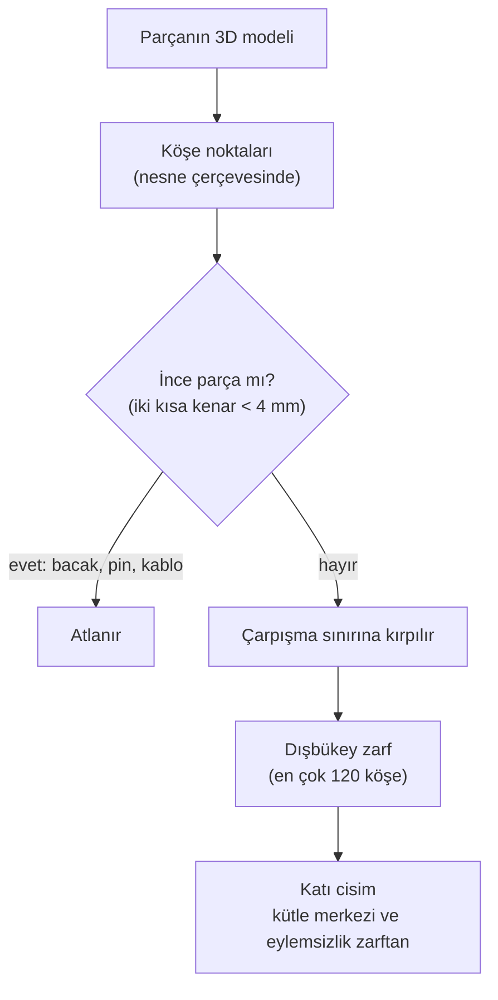

# Katı cisim ve temas

Dünyadaki her nesne bir katı cisimdir: kütle merkezinde konumu, yönelimi (birim kuaterniyon), doğrusal ve açısal hızı, kütlesi ve asal eylemsizlik momentleri vardır. Servo kolları ve motor milleri, gövdeye menteşeyle bağlı ayrı küçük rotorlardır.

## Hareket denklemleri

```math
m\,\dot{\mathbf{v}} = \mathbf{F}, \qquad
I\,\dot{\boldsymbol{\omega}} + \boldsymbol{\omega} \times (I\boldsymbol{\omega}) = \boldsymbol{\tau}
```

Kuvvetler: yerçekimi, temaslar, eklemler, [hava](04-aerodinamik.md) (sürükleme, kanatlar, pervaneler), [gaz itkisi](05-gaz-ve-roket.md), kablolar (ip olarak), ortam kuvvet alanları (rüzgâr, fan, mıknatıs).

## Tümleştirme

Her fizik adımı (1 ms) sabit alt adımlara bölünür. Her alt adımda yarı örtük (simplektik) Euler uygulanır; jiroskopik terim örtük çözülür, böylece hızlı dönen bir pervane ya da tekerlek enerji kazanıp sapıtmaz:

```math
\mathbf{v}_{n+1} = \mathbf{v}_n + h\,\frac{\mathbf{F}}{m}, \qquad
\mathbf{x}_{n+1} = \mathbf{x}_n + h\,\mathbf{v}_{n+1}, \qquad
q_{n+1} = \operatorname{normalize}\!\left(q_n + \tfrac{h}{2}\,\boldsymbol{\omega}_{n+1} \otimes q_n\right)
```

İnce ve hızlı cisimler (pervane kanadı, mermi gibi düşen parça) için alt adım sayısı artırılır (sürekli çarpışma denetimi), böylece bir adımda öbür tarafa geçmezler.

## Temas ve eklemler: yumuşak ardışık itme

Temaslar ve eklemler hız düzeyinde kısıt olarak çözülür (Catto'nun "soft step" yöntemi). Her kısıt için itme:

```math
\lambda = -\,m_\text{eff}\,\big(J\mathbf{v} + \beta\,C/h\big)\,\gamma, \qquad m_\text{eff} = \left(J M^{-1} J^\top\right)^{-1}
```

$`C`$ kısıtın ihlali (iç içe geçme derinliği, eklem kayması), $`\beta`$ yumuşak konum düzeltmesi, $`\gamma`$ yumuşatma katsayısıdır. Kısıtlar Gauss-Seidel sırasıyla 4 kez geçilir, ardından 2 gevşetme geçişi yapılır; önceki adımın itmeleriyle başlanır (sıcak başlatma).

| Kısıt | Ne sağlar |
| --- | --- |
| Temas (normal) | İç içe geçmeyi önler, sekme katsayısı malzeme çiftinden |
| Sürtünme | Coulomb konisi: $`\lvert \lambda_t \rvert \le \mu\,\lambda_n`$, statik ve kinetik $`\mu`$ ayrı |
| Yuvarlanma direnci | Lastik, bilye: $`\tau \le c_{rr}\,r\,\lambda_n`$ |
| Sabit eklem | İki gövde tek parça (vida, yapıştırıcı) |
| Menteşe | Tek eksende dönme; sınır, sürücü (konum: PD, hız: motor) |
| Kızak | Tek eksende kayma |
| Küresel | Uç noktalar çakışık, dönme serbest |

Bir eklem, tasarım kuvvetini aşınca kopar; olay **Olaylar** sekmesine yazılır.

## Çarpışma şekilleri



| Nesne | Çarpışma şekli |
| --- | --- |
| Kutu, plaka | Kutu (tam) |
| Silindir, tekerlek | Silindir (tam, analitik) |
| Küre, bilye | Küre (tam) |
| Katalog parçası, kart, kanat | Kendi 3D modelinin dışbükey zarfı |
| Modelleyiciden ya da içe aktarılan model (STL/OBJ) | Ağın kendisi: dışbükeyse zarfı, içi boşsa (tepsi, kap, boru, U braket) dışbükey parçaların birleşimi |
| Sabit engel, arazi | Kutu / üçgen ağ (BVH ile) |

Görmek için: **Görünüm → Çarpışma şekilleri (dünya)**.

### İçi boş parçalar: dışbükey parçalara ayırma

Tek bir dışbükey zarf, tepsinin ya da borunun içini doldurur; içine hiçbir şey konamaz. Bu yüzden kapalı bir model ağı, zarfı gövdeyi belirgin biçimde aşıyorsa dışbükey parçalara ayrılır ve çarpışma bu parçaların birleşimiyle hesaplanır. Kütle, kütle merkezi ve eylemsizlik ise her zaman ağın kendisinden gelir.

Bir parçanın "boşluk payı", zarfının gövdeden ne kadar büyük olduğudur:

```math
E = V_{\text{zarf}} - V
```

Ayırma açgözlüdür: $`E`$ değeri en büyük olan parça bir düzlemle iki kapalı parçaya kesilir (kesit yüzeyleri kapatılır, kesitteki delikler açık kalır), her taraf kendi ayrı katılarına bölünür. Düzlem iki türden seçilir:

| Parçanın içi | Aday düzlemler | Seçim |
| --- | --- | --- |
| Az sayıda düz iç yüz (tepsi, braket, cep) | İçbükey kenarlara (iç köşelere) komşu yüzlerin düzlemleri | Kalan zarf hacmi en küçük olan; hacim hemen azalmasa da kesilir, çünkü her kesim bir iç köşeyi yok eder |
| Eğri iç yüz (delik, büküm) | Köşe koordinatlarındaki eksen düzlemleri ve en derin girintiden geçen düzlemler | $`\sum V_{\text{zarf}}`$ en çok azalan |

Her parçada $`E \le 0{,}03\,V_{\text{toplam}}`$ olunca ya da 24 parçaya ulaşınca durulur. Örnek: 2,5 mm duvarlı 90 × 60 × 30 mm tepsi tam olarak zemin ve dört duvar olmak üzere 5 parçaya, Ø40/Ø30 mm boru 14 dilime ayrılır.

İki gövde çarpışırken her parça çifti ayrı ayrı denenir; ışın (ultrasonik, LiDAR, kamera) ve kablo teması da parçalara göre hesaplanır, yani yukarıdan atılan bir ışın tepsinin iç zeminine çarpar.

Birbirine en çok iki eklemle bağlı parçalar (ör. motor – rotor – tekerlek) birbirleriyle çarpışmaz; montajın kendi iç teması gerçekte vida ve yuvalarla sağlanır.

## Malzemeler

Sürtünme ve sekme, iki yüzeyin malzeme çiftinden gelir (kauçuk–zemin, çelik–çelik, PLA–ahşap…). Zemin bölgeleri (halı, fayans, kum) kendi sürtünmesini taşır. Kütle, hacim × malzeme yoğunluğu × dolulukla hesaplanır, isterseniz elle girilir.
