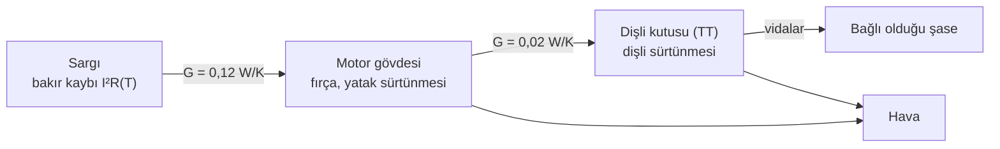

# Isı

Her parça bir ya da birkaç ısıl düğümdür. Elektriksel kayıplar, sürtünme ve sıcak gaz düğümleri ısıtır; ısı, vidalarla bağlı parçalara iletimle, havaya taşınım ve ışınımla gider. Sıcaklık geri dönüp devreyi ve mekaniği değiştirir.

## Düğüm denklemi

```math
C_i\,\frac{dT_i}{dt} = P_i \;-\; \sum_j G_{ij}\,(T_i - T_j) \;-\; h_c A_i\,(T_i - T_\infty) \;-\; \varepsilon\,\sigma A_i\,\left(T_i^4 - T_\infty^4\right)
```

| Sembol | Anlamı |
| --- | --- |
| $`C_i = m_i\,c_p`$ | Isıl kapasite (J/K): kütle × malzemenin özgül ısısı |
| $`P_i`$ | Düğümü ısıtan güç (W): $`I^2R`$, anahtarlama, sürtünme, gaz |
| $`G_{ij}`$ | Bağlı parçalar arası iletkenlik (W/K) |
| $`h_c`$ | Taşınım katsayısı (W/m²K) |
| $`\varepsilon`$ | Malzemenin yayınırlığı (PLA 0,92, alüminyum 0,1…) |

Ağ 50 ms adımla ilerler. Işınım doğrusallaştırılır: $`h_r = \varepsilon\sigma\,(T^2 + T_\infty^2)(T + T_\infty)`$.

## Taşınım: gerçek hava hızıyla

```math
h_c = \max\left(6,\; 10{,}45 - v + 10\sqrt{v}\right)\ \text{W/m²K}
```

Buradaki $`v`$ parçanın üstünden geçen gerçek hava hızıdır: gövdenin havaya göre hızı (rüzgâr dahil), üstündeki pervanenin itme akışı ve kendi dönen yüzeyi (dış rotorlu motorun çanı). Pervane akışı, disk teorisinden indüklenen hız $`v_i`$ ile, diskten $`d`$ uzaklıkta:

```math
v_\text{akış} = v_i\left(1 + \frac{d}{\sqrt{d^2 + r^2}}\right)
```

## Motor: ısının gerçek yolu

Bir motor tek düğüm değildir; ısı gerçekte geçtiği parçalardan geçer:



Sargının sıcaklığı bakırın direncini değiştirir (°C başına +%0,393); ısınan motor aynı gerilimde daha az akım çeker ve daha az tork verir. Sarı TT motorun vidaları plastik dişli kutusuna girdiği için ısı şaseye çok az ulaşır; bu yüzden şase değil sargı ısınır.

## Pil

Pilin ısısı iç direnç ve polarizasyon kaybıdır: $`P = I^2R + \lvert I\,V_p \rvert`$. Lityum hücreler 130 °C'yi aşınca termal kaçağa girer (devrede açık devre olur, olay yazılır).

## Malzemenin tepkisi

| Durum | Ölçüt | Etkisi |
| --- | --- | --- |
| Yumuşama | camsı geçiş sıcaklığını aşınca (PLA 60 °C, ABS 105 °C) | Elastiklik modülü düşer, bağlantılar gevşer |
| Erime | erime sıcaklığına ulaşınca | Bağlantı bırakılır, olay yazılır |
| Isıl gerilme | $`\sigma = -E\,\alpha\,\Delta T`$ (FEM analizinde) | Gerilme haritasına eklenir |

Görmek için: **Görünüm → Isı kamerası (dünya)**. Fare bir parçanın üstündeyken o noktanın sıcaklığı ve parçanın düğümleri gösterilir.
