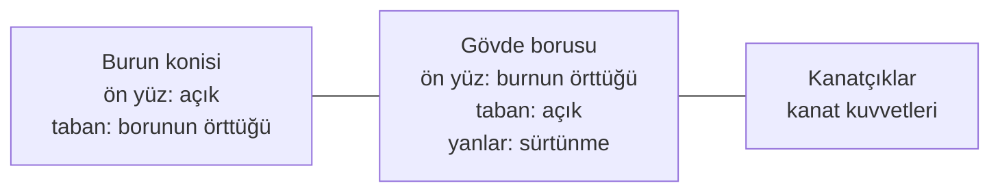

# Aerodinamik

## Atmosfer

Hava yoğunluğu, basıncı ve sıcaklığı Uluslararası Standart Atmosfer'den (ISA) yüksekliğe göre alınır. Troposferde:

```math
T = T_0 - L\,h, \qquad p = p_0\left(\frac{T}{T_0}\right)^{g/(R L)}, \qquad \rho = \frac{p}{R\,T}
```

$`T_0 = 288{,}15`$ K, $`L = 0{,}0065`$ K/m, $`p_0 = 101\,325`$ Pa, $`R = 287{,}05`$ J/kg·K.

## Sürükleme: yüzey yüzey

Bir cismin havaya karşı direnci üç kısımdan oluşur ve her biri gerçekte olduğu yerde hesaplanır:

| Kısım | Nerede | Katsayı |
| --- | --- | --- |
| Durma basıncı | Akışa bakan (öndeki) yüz | ayrık cismin basınç sürüklemesinin %70'i |
| Taban emmesi | Arkadaki yüz | %30'u |
| Yüzey sürtünmesi | Akış boyunca uzanan yan yüzler | $`C_f = 0{,}004`$ (türbülanslı levha, $`Re \approx 10^5\text{–}10^6`$) |

```math
\mathbf{F} = -\tfrac{1}{2}\,\rho\,(C_D A)(\hat{\mathbf{u}})\,\lvert\mathbf{u}\rvert\,\mathbf{u}, \qquad \mathbf{u} = \mathbf{v}_\text{cisim} - \mathbf{v}_\text{rüzgâr}
```

Tek başına bir cisim ölçülmüş $`C_D`$ değerini aynen korur (sürtünme bunun içindedir):

| Şekil | $`C_D`$ | Kaynak |
| --- | --- | --- |
| Küre | 0,47 | alt kritik $`Re`$ (10³–2·10⁵) |
| Kutu yüzü | 1,05 | düz yüzlü blok |
| Silindir, yandan | 1,0 | çapraz akış |
| Silindir, eksen boyunca | 0,9 | kısa silindir |
| Model gövdesi (zarf) | yüzlerinden | aşağıya bakın |

Modelleyiciden ya da dosyadan gelen bir gövdenin direnci, onu saran kutudan değil kendi yüzlerinden hesaplanır. Akışa $`\theta`$ açısıyla bakan bir yüz, izdüşüm alanı üzerinde $`C_p \approx 0{,}8\,\sin^2\theta`$ taşır (Hoerner'in ses altı ön gövde kestirimi): düz yüz 0,8, 20°'lik koni ≈ 0,09, ince bir ogive burun neredeyse sıfır. Arkada kalan yüzler $`0{,}15\,\sin^2\theta`$ taban emmesi görür; daralan kuyruk bu emmeyi geri kazanır, küt taban kazanmaz.

### Birleşik parçalar birbirini örter

Bir parçanın yüzünü ona bağlı başka bir parça kapatıyorsa, o yüz ne durma basıncı ne taban emmesi görür. Örtülme, her gövdenin her eksen yüzünde, gerçek çarpışma şekillerinden geçen çizgilerle ölçülür (12 × 12 örnek):



Böylece bir roketin direnci "ayrı ayrı uçan parçaların toplamı" değil, burnun ön yüzü + kuyruğun tabanı + boyunca sürtünmedir. Örtülme, her gövdenin kendi boyutları üzerinde örneklenir; ince uzun bir boru da (Ø41 × 500 mm) doğru ölçülür. Doğrulama: burun + boru eksenel $`C_D`$ ayrı parçalarda 1,37 idi, birleşikte 0,64 (gerçek küt tabanlı roketlerde 0,5–0,7); ogive burunlu, üç köşeli kanatçıklı katı yakıtlı roket 0,62 (OpenRocket sınıfı kestirimler 0,5–0,7) ve uçuş boyunca böyle kalır; su roketinin tepe noktası 26 m'den 39,6 m'ye çıktı (yayımlanmış uçuşlar 30–50 m).

### Eğik akış

Her eksen, hızın kendi bileşeninin dinamik basıncını görür (Allen ve Perkins'in çapraz akış ilkesi). Kuvvet akışa tam ters olmak zorunda değildir; eğik duran düz bir yüz yana da iter:

```math
F_i = -\tfrac{1}{2}\,\rho\,(C_D A)_i\,\lvert u_i\rvert\,u_i \quad (\text{kutu, her eksen ayrı}), \qquad
\mathbf{F}_\perp = -\tfrac{1}{2}\,\rho\,(C_D A)_\text{yan}\,\lvert\mathbf{u}_\perp\rvert\,\mathbf{u}_\perp \quad (\text{silindirin yuvarlak kesiti})
```

Bu yüzden ince uzun bir gövdenin küçük hücum açısında ($`\alpha`$) yan akıştan gelen ek direnci $`\sin^2\alpha`$ ile büyür, $`\sin\alpha`$ ile değil: 2°'lik yalpa bir roketin direncini neredeyse değiştirmez. Küre her yönde aynı alanı gösterir ve tüm hızı görür. Model gövdelerinde kesitin yuvarlak mı düz mü olduğu, 45°'deki gölge alanı ölçülerek anlaşılır.

## Kanatlar: şerit teorisi + kaldırma çizgisi

Kanat açıklık boyunca şeritlere bölünür. Her şerit kendi yerel hava hızını görür ($`\mathbf{V} + \boldsymbol{\omega}\times\mathbf{r}`$), böylece yuvarlanma sönümü ve asimetrik tutunma kaybı geometriden çıkar.

```math
\alpha_e = \alpha - \alpha_i, \qquad \alpha_i = \frac{C_L}{\pi\,e\,AR}, \qquad C_{D,i} = \frac{C_L^2}{\pi\,e\,AR}
```

Bu, sonlu kanadın kaldırma eğimini verir: $`a = a_0 / (1 + a_0/(\pi e AR))`$. Kesit katsayıları profilin (Clark Y, NACA 0012, NACA 2412, düz levha) ±180° kutup eğrisinden gelir; tutunma kaybı ve sonrası dahildir. Kumanda yüzeyleri açıyı $`\tau\,\eta(\delta)\,\delta`$ kadar kaydırır ve menteşe momentini servoya geri verir. Kuyruk, öndeki kanadın aşağı akışını görür: $`\varepsilon = 2C_{L,w}/(\pi AR_w)`$.

## Pervaneler

İlerleme oranı $`J = V/(nD)`$ ile (UIUC veritabanı eğilimlerine uyum, Brandt & Selig 2011):

```math
T = C_T\,\rho\,n^2 D^4, \qquad Q = \frac{C_P}{2\pi}\,\rho\,n^2 D^5, \qquad
C_T = C_{T0}\left(1 - \frac{J}{J_0}\right), \qquad C_P = C_{P0}\left(1 - \left(\frac{J}{1{,}2\,J_0}\right)^2\right)
```

$`J_0 \approx 1{,}05\,P/D`$ (adım/çap). Pervane torku motora yük olarak geri döner; itki gövdeye uygulanır.

Dünyadaki her pervane bu eğriyi kullanır: itki, pervaneye eksenden giren hava hızıyla azalır, uçak pervanenin adım hızına yaklaşınca sıfıra iner, ötesinde pervane frenler (rüzgârla döner). Örnek: 8×4,5" pervane 8 200 dev/dk'da yerde ≈ 4,2 N iter; 12 m/s ileri hızda (J ≈ 0,4) ≈ 1,3 N. Önceki sürümlerde dünya pervaneleri yalnızca statik $`k_T\,\omega^2`$ kullanıyordu; bu sayfa ile kod uyuşmuyordu, düzeltildi.

**Pervanenin gövde olarak direnci.** Dönen pervanenin bütün kuvvetleri yukarıdaki modeldedir. Durdukça eksenel akış yalnız palların kendi alanına çarpar: katılık $`\sigma \approx 0{,}1`$ ile disk alanının onda biri ($`C_D \approx 1{,}1`$), ve bu pay pallar hızlandıkça $`V^2/(V^2 + (0{,}75\,\omega R)^2)`$ ile söner. Yandan akış pal kalınlığını çap boyunca görür. Pervane dolu bir disk gibi direnç görmez (8" pervanede bu, 8 m/s'de 1,1 N'luk hayalî bir fren olurdu).

## Sınırlar ve doğrulama

- **Gerçek zamanlı uçuş** her fizik adımında yukarıdaki şerit + kaldırma çizgisi modeliyle hesaplanır. Modellenmeyenler: pervane rüzgârının (slipstream) kanada ve kuyruğa etkisi, gövde–kanat girişimi, esnek kanat. Kuyruk yalnızca kanadın aşağı akışını görür.
- **3B akış (lattice-Boltzmann)** yalnızca render'da, kaydın birkaç anında (her yarım saniyeye bir an, en çok altı) çözülür ve uçuşa geri beslenmez. Izgara kabadır; gerçek ölçekteki Reynolds sayısı (1 m'lik bir model uçakta ≈ 10⁵) bu ızgarada çözülemediği için sayısal viskozite büyütülür. Sonuç akışın biçimini ve kuvvetlerin büyüklük sırasını gösterir; endüstriyel bir CFD çözücüsünün yerine geçmez.
- **Doğrulama testleri** her sürümde çalışır: Poiseuille kanal akışı (parabolden sapma %1'in altında), Re = 100 silindir izinde girdap kopması (Strouhal 0,15–0,23; literatürde ≈ 0,165), Re = 20 kürede sürükleme (Schiller–Naumann'ın 0,7–1,45 katı, kaba voksel küre), FEM'de ısıl genleşme ve serbest ivmelenen çubukta atalet dengesi (%1–2). Bunların hepsi düşük Reynolds sayılarındadır. Model uçak ölçeğindeki akış için bağımsız bir doğrulama (rüzgâr tüneli ya da uçuş verisi) henüz yapılmadı.
- **Parçaların kapalı gövde içindeki direnci:** içi boş bir gövdenin (kabuk) içindeki parçalar havayı görmez; direnç kabuğun dış yüzlerindedir.

## Rüzgâr ve türbülans

Ortalama rüzgâra Dryden modeliyle birinci derece süzülmüş rastgele sağanaklar eklenir. Rüzgâr hem sürüklemeyi hem kanatların gördüğü açıyı hem de [taşınımla soğumayı](03-isi.md) değiştirir.
