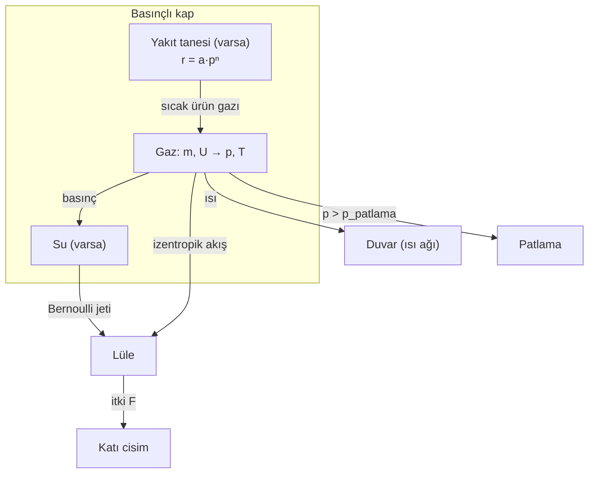

# Gaz ve roketler

Basınçlı kap, su roketi, hava tankı ve katı yakıtlı motor ayrı "özellikler" değil, aynı gaz fiziğidir. Kabın içinde gaz (ve isteğe bağlı su ya da yakıt tanesi) vardır; lüleden ne çıkıyorsa itkiyi o belirler.



## Gazın durumu

Kap, gaz kütlesi $`m`$ ve iç enerji $`U`$ ile izlenir; basınç ve sıcaklık bunlardan çıkar. Soğuk gaz ideal gazdır; sıcak yanma ürünlerinde molekül hacmi de sayılır (Noble–Abel, iç balistiğin durum denklemi, eş hacim $`b \approx 1`$ L/kg):

```math
T = \frac{U}{m\,c_v}, \qquad p = \frac{m\,R\,T}{V_\text{gaz} - b\,m_\text{ürün}}, \qquad V_\text{gaz} = V - V_\text{su} - V_\text{yakıt}
```

Hava, yakıt ürünleri ve ateşleyici ürünleri üç ayrı bileşen olarak izlenir; $`R`$ ve $`c_p`$ kütle oranıyla karışır.

| Gaz | $`R`$ (J/kg·K) | $`\gamma`$ |
| --- | --- | --- |
| Hava | 287,05 | 1,40 |
| CO₂ | 188,9 | 1,29 |
| Azot | 296,8 | 1,40 |
| Helyum | 2077,1 | 1,66 |

## Lüleden gaz akışı

Basınç oranı kritik değerin altındaysa boğazda akış ses hızına ulaşır (kısılma):

```math
\frac{p_a}{p} \le \left(\frac{2}{\gamma+1}\right)^{\frac{\gamma}{\gamma-1}}
\quad\Rightarrow\quad
\dot{m} = C_d\,A_t\,p\,\sqrt{\frac{\gamma}{R\,T}}\left(\frac{2}{\gamma+1}\right)^{\frac{\gamma+1}{2(\gamma-1)}}
```

Kısılma yoksa (ses altı):

```math
\dot{m} = C_d\,A_t\,p\,\sqrt{\frac{2\gamma}{(\gamma-1)\,R\,T}\left[\left(\frac{p_a}{p}\right)^{2/\gamma} - \left(\frac{p_a}{p}\right)^{(\gamma+1)/\gamma}\right]}
```

Genişleyen (de Laval) lülede çıkış Mach sayısı alan oranından çözülür (süpersonik dal):

```math
\frac{A_e}{A_t} = \frac{1}{M_e}\left[\frac{2}{\gamma+1}\left(1 + \frac{\gamma-1}{2}M_e^2\right)\right]^{\frac{\gamma+1}{2(\gamma-1)}}
```

Aşırı genişleyen lülede sınır tabaka, duvar basıncının Schmucker sınırına düştüğü yerde ayrılır; jet duvarı orada bırakır ve çıkış o noktaya çekilir:

```math
\frac{p_\text{ayrılma}}{p_a} = \left(1{,}88\,M - 1\right)^{-0{,}64}
```

İtki, momentum ve basınç itkisinin toplamıdır; gövdeye lülenin olduğu yerden, jete ters yönde uygulanır:

```math
F = \dot{m}\,v_e + (p_e - p_a)\,A_e
```

$`C_d = 0{,}95`$. Ortam basıncı $`p_a`$ lülenin yüksekliğindeki atmosferdir.

## Su: önce su çıkar

Su, roketin hissettiği ivme lüleye doğru bastırdığı sürece ($`\mathbf{f} = \mathbf{a} - \mathbf{g}`$) lüleyi kapatır ve gazdan önce çıkar:

```math
v_e = \sqrt{\frac{2(p - p_a)/\rho_w + 2\,f\,h}{1 - (A_e/A_k)^2}}, \qquad \dot{m}_w = \rho_w\,C_d\,A_e\,v_e, \qquad F = \dot{m}_w\,v_e
```

$`h`$ su sütununun yüksekliği, $`A_k`$ kabın kesitidir. Su çıktıkça gaz genişler ve iş yapar ($`dU = -p\,dV`$); bu yüzden gaz soğur (fırlatmada −10 °C, uçuşta −23 °C görülür).

## Ateşleme: e-kibrit, ateşleyici, alevin yayılması

Yakıt, e-kibrit ateşlenince hemen yanmaz. Zincir şöyledir:

1. Devreden geçen akım e-kibritin köprü telini ısıtır; tel ateşleme sıcaklığına çıkınca e-kibrit ateşlenir ve açık devre olur (≈ 1,6 Ω, sürekli ateşleme akımı ≈ 0,35 A, ısıl zaman sabiti 3 ms).
2. E-kibrit başı (≈ 0,03 g) ve üzerine sarılan ateşleyici barutu ("Ateşleyici barutu", varsayılan 0,5 g) 20 ms içinde yanar; ürünleri ≈ 2000 K'de odanın baş tarafından girer.
3. Sıcak gaz kanal boyunca akarken yakıt yüzeyini ısıtır. Yüzeye giden ısı taşınım (Dittus–Boelter) ve ışınımdır:

```math
q = h\,(T_\text{gaz} - T_s) + \varepsilon\,\sigma\,(T_\text{gaz}^4 - T_s^4), \qquad h = 0{,}023\,\frac{k}{D}\,Re^{0{,}8}\,Pr^{0{,}4}, \qquad Re = \frac{G\,D}{\mu}
```

4. Isı yakıtın içine iletilir (tek boyutlu geçici iletim, örtük çözüm, 8 µm ağ). Yüzeyi tutuşma sıcaklığına ($`T_\text{tut}`$) çıkan bölge yanmaya başlar. Gaz, yüzeye ısı verdikçe soğuyarak lüleye doğru akar; bu yüzden alev baş taraftan lüleye doğru yayılır.

Tane, baştan lüleye eksenel bölgelere ayrılır; her bölgenin kendi sıcaklık dağılımı, kendi tutuşma anı ve kendi yanma derinliği vardır. Ateşleyici zayıfsa yüzey tutuşma sıcaklığına çıkmaz ve motor ateşlenmez: yalnız e-kibrit başı, şekerli yakıtı genellikle tutuşturamaz.

| Yakıt | $`T_\text{tut}`$ | Yanan yüzey sıcaklığı | Katı $`k`$, $`c`$ | Gaz yayıcılığı |
| --- | --- | --- | --- | --- |
| KNSB | 590 K | 800 K | 0,4 W/m·K, 1300 J/kg·K | 0,3 |
| KNDX | 580 K | 800 K | 0,4 W/m·K, 1300 J/kg·K | 0,3 |
| APCP | 690 K | 950 K | 0,4 W/m·K, 1250 J/kg·K | 0,4 |

## Katı yakıt: basınca bağlı yanma

Yanma hızı Saint-Robert/Vieille yasasıyla basınca bağlıdır (Nakka'nın ölçümleri, basınç aralığına göre parça parça):

```math
r = a\,p^n, \qquad \dot{m}_\text{üretim} = \rho_p\,A_b\,r
```

BATES taneleri hem iç delikten hem iki uçtan yanar; yanan yüzey zamanla değişir:

```math
A_b = N\left[\pi\,(d + 2w)(L - 2w) + 2\cdot\frac{\pi}{4}\left(D^2 - (d + 2w)^2\right)\right]
```

Dar kanallı tanelerde kanaldan akan gaz yanmayı hızlandırır (aşındırıcı yanma, Lenoir–Robillard). Kütle akısı $`G`$ lüleye doğru arttığı için lüle ucu daha hızlı yanar ve kalkışta basınç sıçrar:

```math
r = a\,p^n + \alpha\,\frac{G^{0{,}8}}{D^{0{,}2}}\,e^{-\beta\,r\,\rho_p / G}, \qquad \beta = 53, \qquad \alpha = \frac{0{,}0288\,c_p\,\mu^{0{,}2}\,Pr^{-2/3}}{\rho_p\,c_s}\cdot\frac{T_f - T_s}{T_s - T_i}
```

Kanal, tane dış çapına ilk lüle tarafında ulaşır; gövde orada erken açığa çıkar ve itki yavaşça söner.

Yanma odası basıncı, üretilen gazla lüleden çıkan gazın dengesinden kendiliğinden çıkar; itki eğrisi hazır okunmaz. Kararlı durumda:

```math
\rho_p\,A_b\,a\,p^n = \frac{p\,A_t}{c^*} \quad\Rightarrow\quad p = \left(K_n\,\rho_p\,a\,c^*\right)^{\frac{1}{1-n}}, \qquad K_n = \frac{A_b}{A_t}, \qquad c^* = \frac{\sqrt{R\,T_c}}{\sqrt{\gamma}\left(\frac{2}{\gamma+1}\right)^{\frac{\gamma+1}{2(\gamma-1)}}}
```

| Yakıt | Yoğunluk | Alev sıcaklığı | Ürün $`M`$, $`\gamma`$ | Yanma hızı |
| --- | --- | --- | --- | --- |
| KNSB (KNO₃ + sorbitol) | 1800 kg/m³ | 1600 K | 39,9 g/mol, 1,137 | 7,9 mm/s (1,5–3,8 MPa) |
| KNDX (KNO₃ + dekstroz) | 1785 kg/m³ | 1500 K | 42,4 g/mol, 1,131 | 8,9·p^0,62 mm/s |
| APCP (kompozit) | 1700 kg/m³ | 2800 K | 25 g/mol, 1,20 | 3,5·p^0,35 mm/s |

Oda ile lüle arasındaki zaman sabiti milisaniyenin altında olabildiği için gaz, her fizik adımında kendi küçük alt adımlarıyla ilerler.

## Duvar ısısı ve patlama

Sıcak gaz yalnız tanenin örtmediği gövde duvarını ısıtır: kapaklar, taneler arası ve kanalın gövdeye ulaştığı yerler. Bu yüzeylere ısı, kanal akışıyla taşınım (Dittus–Boelter) ve ışınım olarak gider. Lüle boğazı ise Bartz bağıntısıyla ısınır; motorun en sıcak yeri burasıdır:

```math
h_\text{boğaz} = \frac{0{,}026}{D_t^{0{,}2}}\,\frac{\mu^{0{,}2}\,c_p}{Pr^{0{,}6}}\left(\frac{p_c}{c^*}\right)^{0{,}8}
```

Bu ısı, ısı ağında motorun düğümüne gider; Görünüm → Isı kamerası motorun arka ucunun ısındığını gösterir. Duvar, ince cidar çevresel gerilmesi malzemenin dayanımına ulaşınca patlar:

```math
\sigma = \frac{p\,r}{t} \quad (\text{silindir}), \qquad \sigma = \frac{p\,r}{2t} \quad (\text{küre}), \qquad p_\text{patlama} = \frac{\sigma_\text{dayanım}\,t}{r}
```

| Kap | Malzeme, cidar | Patlama basıncı |
| --- | --- | --- |
| 2 L PET şişe (r = 52 mm) | çift yönlü gerilmiş PET 160 MPa, 0,3 mm | ≈ 9 bar |
| KNSB motor gövdesi (r = 14,5 mm) | 6061-T6 alüminyum 276 MPa, 1,5 mm | ≈ 28 MPa |

## Doğrulama

| Deney | Beklenen | Simülasyon |
| --- | --- | --- |
| 1 L tank, 6 bar, 2 mm delik: boşalma | adyabatik ile izotermal kapalı çözümler arasında | 0,5 s'de adyabatiğe %1 yakın, sonra duvarın ısısıyla izotermale doğru |
| KNSB, Kn 169 | $`p`$ = 2,26 MPa (aşındırıcı yanma olmadan) | 0,25 s'de 2,58 MPa (dar kanalın aşındırıcı yanması), tepe 3,3 MPa, yanma 1,10 s, 127 N·s, Isp 136 s |
| Su roketi 2 L / 0,6 L / 4 bar / 21,5 mm | su ~0,1 s'de biter, 30–50 m | 70 ms, en çok 300 N, 43 m/s, tepe 39,6 m |
| Lüle 1,5 mm'ye daraltılır | gövde patlar | patlar |
| Şişe 12 bar'a şişirilir | ~9 bar'da patlar | patlar |
| Yakıt yüzeyinin ısınması (h = 2000 W/m²K, 2000 K gaz) | yarı sonsuz katı: $`T_s = T_0 + (T_g - T_0)[1 - e^{\beta^2}\mathrm{erfc}\,\beta]`$ | 2, 5 ve 20 ms'de farkı %1'in altında |
| 0,5 g ateşleyici, KNSB | birkaç ms'de tutuşma, alev baştan yayılır | baş tarafı 5,3 ms'de tutuşur, alev 0,6 ms'de tüm yüzeye yayılır |
| Yalnız e-kibrit başı (0,03 g), KNSB | çoğu zaman tutuşmaz | yüzey en çok 122 °C, ateşlenemedi |
| Ø8 mm kanal, 4 MPa | lüle ucu aşındırıcı yanar | baş 8,2, lüle ucu 10,4 mm/s; Ø18 mm kanalda fark %3 |

## Duman, kalkış ve alevin çarptığı yüzey

- **Duman:** Yanma ürünlerinin bir kısmı gaz değil, yoğuşmuş taneciktir: KNSB'de %44 K₂CO₃, KNDX'te %43, alüminyumlu APCP'de %32 Al₂O₃, barutta %56. Lüleden çıkan duman akışı bu orandan hesaplanır ($`\dot m_\text{duman} = \chi\,\dot m`$, KNSB motorda ≈ 44 g/s). Sahnedeki dumanın yoğunluğu bu akışa göre çizilir.
- **Dumanın hareketi:** Gaz, lüleden aracın kendi hızına eklenmiş çıkış hızıyla çıkar. Hava onu birkaç alev boyu içinde durdurur; bu yüzden yükselen roket dumanını havada bırakır.
- **Alev:** Görünür alev çıkış çapının ≈ 15 katıdır. Duman ve alev 3B sahnenin içinde çizilir; önlerindeki cisim onları kapatır.
- **Kalkış:** İtki, motora bağlı her şeyin ağırlığını yenip motor 1 cm yükselince olay günlüğüne itki, ağırlık ve itki/ağırlık oranı yazılır. Örnekteki roket 2,019 s'de 133,7 N itki ile 4,4 N'luk ağırlığını yener (oran 30).
- **Alevin çarptığı yüzey:** Sıcak jet, yolundaki ilk yüzeyi ısıtır (rampa, test standı plakası, duvar; aracın kendi parçaları sayılmaz). Isı, çarpan yuvarlak jet bağıntısıyla hesaplanır ve o parçanın ısı ağındaki düğümüne gider. Örnekte alev rampaya 109 J verir. Motorun ısısı, ona bağlı parçalara (karton gövde, kanatçıklar) bağlantı yüzeyinden iletilir.

```math
h = \tfrac{1}{2}\,\frac{k}{D_e}\,Re^{1/2}\,Pr^{0{,}4}\cdot\min\!\left(1,\ \frac{6\,D_e}{H}\right), \qquad Re = \frac{4\,\dot m}{\pi\,D_e\,\mu}, \qquad A = \pi\left(\frac{D_e}{2} + 0{,}2\,H\right)^2
```

Render (Kayıt) aynı fiziği baştan hesaplar. Oda basıncı, gaz sıcaklığı, itki, kütle akışı, çıkış hızı, yanan yüzey, yakıt yüzeyi sıcaklığı, kalan yakıt, duman akışı ve paraşüt açıklığı kanal olarak kaydedilir ve grafiklerde görünür. Oynatmada alev, duman ve paraşüt kayıttan çizilir.

## Paraşüt

Herhangi bir gövdeye kurtarma paraşütü verilebilir ("Kanopi çapı"). Altimetre tırmanmanın bittiğini görünce (ya da belirlenen anda) paraşüt atılır. İpler gerilince kanopi Knacke'nin dolma modeliyle açılır: dolma süresi $`t_f = n\,D_0 / v`$ ($`n \approx 8`$), sürükleme alanı $`(C_D S)(t) = (C_D S)_0\,(t/t_f)^2`$ ile büyür, $`C_D \approx 0{,}75`$. Kuvvet gövdenin üstüne bağlanır; açılma şoku ve sallanma katı cisim fiziğinden çıkar.

## Model roket: fırlatma şablonu

"Katı yakıtlı roket" şablonu her şeyi birlikte kullanır: 41 mm karton gövde, ogive burun, üç kontrplak kanatçık, iki BATES tanesiyle KNSB motor (G sınıfı), rampada 9 V pil, 2 s geri sayımla kapanan anahtar ve e-kibrit, tepe noktasında 45 cm paraşüt.

| Ölçüm | Simülasyon |
| --- | --- |
| Anahtar kapanır → e-kibrit ateşlenir | 2,001 s → 2,003 s (2,68 A) |
| Yakıt tutuşur, alev yayılır | 2,007 s, 2,008 s |
| Toplam itki, yanma süresi | 128 N·s, 1,05 s |
| Sürükleme katsayısı (Ø41 mm'ye göre) | 0,62 (OpenRocket sınıfı kestirimler 0,5–0,7) |
| En yüksek hız, tepe | 270 m/s, 1033 m |
| İtki altında eğim | 0,4° |
| Paraşütle iniş hızı | 7,0 m/s |
