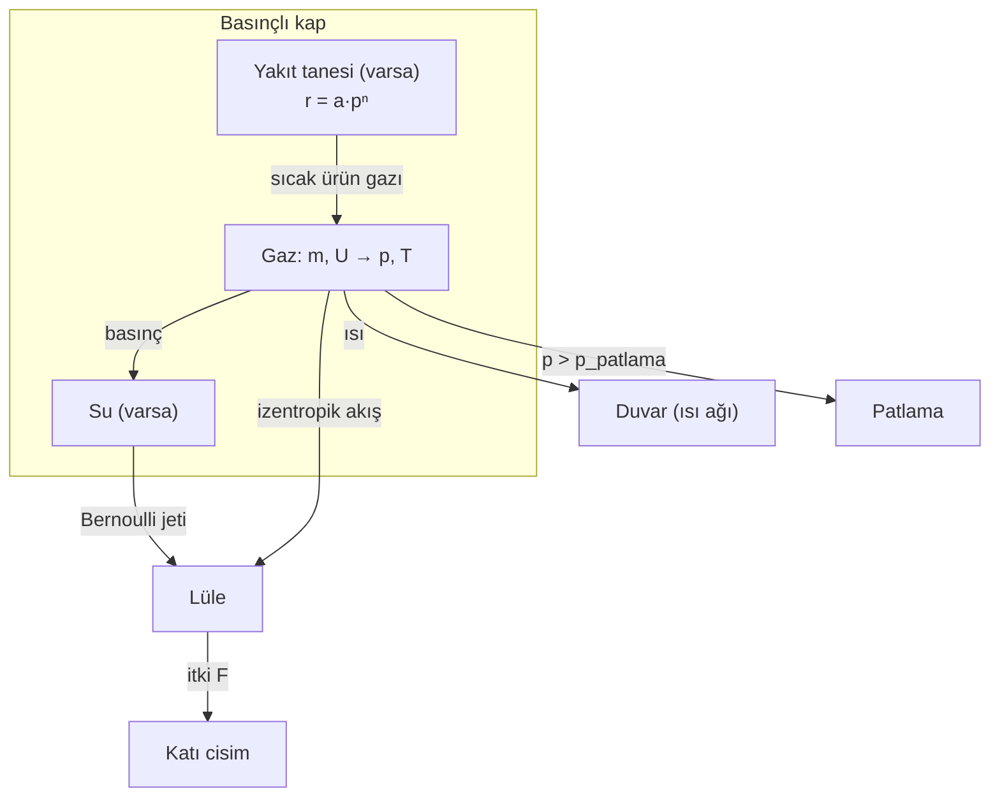

# Gaz ve roketler

Basınçlı kap, su roketi, hava tankı ve katı yakıtlı motor ayrı "özellikler" değil, aynı gaz fiziğidir. Kabın içinde gaz (ve isteğe bağlı su ya da yakıt tanesi) vardır; lüleden ne çıkıyorsa itkiyi o belirler.



## Gazın durumu

Kap, gaz kütlesi $`m`$ ve iç enerji $`U`$ ile izlenir; basınç ve sıcaklık bunlardan çıkar (ideal gaz):

```math
T = \frac{U}{m\,c_v}, \qquad p = \frac{m\,R\,T}{V_\text{gaz}}, \qquad V_\text{gaz} = V - V_\text{su} - V_\text{yakıt}
```

Yanma ürünleri havaya karıştıkça $`R`$ ve $`c_p`$ kütle oranıyla karışır.

| Gaz | $`R`$ (J/kg·K) | $`\gamma`$ |
| --- | --- | --- |
| Hava | 287,05 | 1,40 |
| CO₂ | 188,9 | 1,29 |
| Azot | 296,8 | 1,40 |
| Helyum | 2077,1 | 1,66 |

## Lüleden gaz akışı

Basınç oranı kritik değerin altındaysa boğazda akış ses hızına ulaşır (kısılma):

```math
\frac{p_a}{p} \le \left(\frac{2}{\gamma+1}\right)^{\frac{\gamma}{\gamma-1}}
\quad\Rightarrow\quad
\dot{m} = C_d\,A_t\,p\,\sqrt{\frac{\gamma}{R\,T}}\left(\frac{2}{\gamma+1}\right)^{\frac{\gamma+1}{2(\gamma-1)}}
```

Kısılma yoksa (ses altı):

```math
\dot{m} = C_d\,A_t\,p\,\sqrt{\frac{2\gamma}{(\gamma-1)\,R\,T}\left[\left(\frac{p_a}{p}\right)^{2/\gamma} - \left(\frac{p_a}{p}\right)^{(\gamma+1)/\gamma}\right]}
```

Genişleyen (de Laval) lülede çıkış Mach sayısı alan oranından çözülür (süpersonik dal):

```math
\frac{A_e}{A_t} = \frac{1}{M_e}\left[\frac{2}{\gamma+1}\left(1 + \frac{\gamma-1}{2}M_e^2\right)\right]^{\frac{\gamma+1}{2(\gamma-1)}}
```

Çıkış basıncı ortamın %40'ının altına düşerse akış lüle duvarından ayrılır; çıkış o noktaya çekilir. İtki, momentum ve basınç itkisinin toplamıdır; gövdeye lülenin olduğu yerden, jete ters yönde uygulanır:

```math
F = \dot{m}\,v_e + (p_e - p_a)\,A_e
```

$`C_d = 0{,}95`$. Ortam basıncı $`p_a`$ lülenin yüksekliğindeki atmosferdir.

## Su: önce su çıkar

Su, roketin hissettiği ivme lüleye doğru bastırdığı sürece ($`\mathbf{f} = \mathbf{a} - \mathbf{g}`$) lüleyi kapatır ve gazdan önce çıkar:

```math
v_e = \sqrt{\frac{2(p - p_a)/\rho_w + 2\,f\,h}{1 - (A_e/A_k)^2}}, \qquad \dot{m}_w = \rho_w\,C_d\,A_e\,v_e, \qquad F = \dot{m}_w\,v_e
```

$`h`$ su sütununun yüksekliği, $`A_k`$ kabın kesitidir. Su çıktıkça gaz genişler ve iş yapar ($`dU = -p\,dV`$); bu yüzden gaz soğur (fırlatmada −10 °C, uçuşta −23 °C görülür).

## Katı yakıt: basınca bağlı yanma

Yanma hızı Saint-Robert/Vieille yasasıyla basınca bağlıdır (Nakka'nın ölçümleri, basınç aralığına göre parça parça):

```math
r = a\,p^n, \qquad \dot{m}_\text{üretim} = \rho_p\,A_b\,r
```

BATES taneleri hem iç delikten hem iki uçtan yanar; yanan yüzey zamanla değişir:

```math
A_b = N\left[\pi\,(d + 2w)(L - 2w) + 2\cdot\frac{\pi}{4}\left(D^2 - (d + 2w)^2\right)\right]
```

Yanma odası basıncı, üretilen gazla lüleden çıkan gazın dengesinden kendiliğinden çıkar; itki eğrisi hazır okunmaz. Kararlı durumda:

```math
\rho_p\,A_b\,a\,p^n = \frac{p\,A_t}{c^*} \quad\Rightarrow\quad p = \left(K_n\,\rho_p\,a\,c^*\right)^{\frac{1}{1-n}}, \qquad K_n = \frac{A_b}{A_t}, \qquad c^* = \frac{\sqrt{R\,T_c}}{\sqrt{\gamma}\left(\frac{2}{\gamma+1}\right)^{\frac{\gamma+1}{2(\gamma-1)}}}
```

| Yakıt | Yoğunluk | Alev sıcaklığı | Ürün $`M`$, $`\gamma`$ | Yanma hızı |
| --- | --- | --- | --- | --- |
| KNSB (KNO₃ + sorbitol) | 1800 kg/m³ | 1600 K | 39,9 g/mol, 1,137 | 7,9 mm/s (1,5–3,8 MPa) |
| KNDX (KNO₃ + dekstroz) | 1785 kg/m³ | 1500 K | 42,4 g/mol, 1,131 | 8,9·p^0,62 mm/s |
| APCP (kompozit) | 1700 kg/m³ | 2800 K | 25 g/mol, 1,20 | 3,5·p^0,35 mm/s |

Oda ile lüle arasındaki zaman sabiti milisaniyenin altında olabildiği için gaz, her fizik adımında kendi küçük alt adımlarıyla ilerler.

## Duvar ısısı ve patlama

Sıcak gaz duvarı ısıtır: yanma sırasında $`h \approx 1500`$ W/m²K, durgun gazda 20 W/m²K. Duvar, ince cidar çevresel gerilmesi malzemenin dayanımına ulaşınca patlar:

```math
\sigma = \frac{p\,r}{t} \quad (\text{silindir}), \qquad \sigma = \frac{p\,r}{2t} \quad (\text{küre}), \qquad p_\text{patlama} = \frac{\sigma_\text{dayanım}\,t}{r}
```

| Kap | Malzeme, cidar | Patlama basıncı |
| --- | --- | --- |
| 2 L PET şişe (r = 52 mm) | çift yönlü gerilmiş PET 160 MPa, 0,3 mm | ≈ 9 bar |
| KNSB motor gövdesi (r = 14,5 mm) | 6061-T6 alüminyum 276 MPa, 1,5 mm | ≈ 28 MPa |

## Doğrulama

| Deney | Beklenen | Simülasyon |
| --- | --- | --- |
| 1 L tank, 6 bar, 2 mm delik: boşalma | adyabatik ile izotermal kapalı çözümler arasında | 0,5 s'de adyabatiğe %1 yakın, sonra duvarın ısısıyla izotermale doğru |
| KNSB, Kn 169 | $`p`$ = 2,26 MPa | 2,36 MPa, yanma 1,10 s, 121 N·s, Isp 130 s |
| Su roketi 2 L / 0,6 L / 4 bar / 21,5 mm | su ~0,1 s'de biter, 30–50 m | 70 ms, en çok 300 N, 43 m/s, tepe 39,6 m |
| Lüle 1,5 mm'ye daraltılır | gövde patlar | patlar |
| Şişe 12 bar'a şişirilir | ~9 bar'da patlar | patlar |
