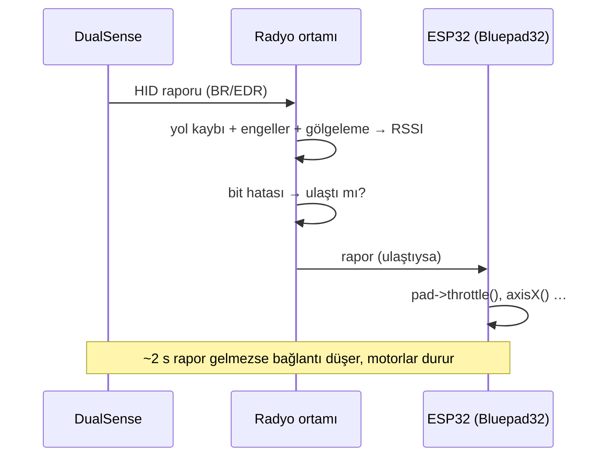

# Radyo

ESP32'ler (Wi-Fi, BLE, Bluetooth), kumandalar (DualSense, DualShock 4, Xbox), Wi-Fi modem ve BLE etiketleri aynı 2,4 GHz ortamını paylaşır. Her paket, iki cihazın o anki konumlarına göre hesaplanan sinyal gücüyle ya ulaşır ya kaybolur.

## Yol kaybı

Referans uzaklığa $`d_0`$ kadar serbest uzay, ötesinde log-mesafe:

```math
L(d) = 20\log_{10}\!\left(\frac{4\pi d_0 f}{c}\right) + 10\,n\,\log_{10}\!\left(\frac{d}{d_0}\right) + \sum L_\text{engel} + X_\sigma(t)
```

| Ortam | Yol kaybı üssü $`n`$ |
| --- | --- |
| Açık alan | 2,0 |
| Ev | 2,7 |
| Ofis | 3,0 |
| Kalabalık ortam | 3,5 |

| Engel (doğrudan ışının içinden geçtiği) | Ek kayıp |
| --- | --- |
| Ahşap, MDF | 4 dB |
| Plastik gövde | 2 dB |
| Karbon | 12 dB |
| Metal (çelik, alüminyum) | 20 dB |
| Arena duvarları, dünya engelleri | 5 dB |

$`X_\sigma(t)`$, standart sapması $`\sigma`$ olan, zamanla yavaşça değişen log-normal gölgelemedir. Bağlantının iki ucuna, tohum değerine ve zamana bağlı sabit bir fonksiyondur: aynı çalıştırma aynı RSSI izini verir.

## Alınan güç ve hata

```math
P_r = P_t - L(d), \qquad \frac{E_b}{N_0} = P_r - N_\text{taban}, \qquad \text{BER}_\text{FSK} = \tfrac{1}{2}\,e^{-\frac{E_b/N_0}{2}}
```

Bir paketin ulaşma olasılığı, paket uzunluğu boyunca bit hatası olmaması olasılığıdır. Alınan güç algılama eşiğinin altındaysa alıcı paketi hiç görmez.



## IR

38 kHz kızılötesi kumandalar yalnız görüş hattında çalışır: verici ile alıcı arasında ışığı geçirmeyen bir engel olmamalı. Işık eksenden uzaklaştıkça yumuşakça azalır ($`\cos^m\theta`$; vericinin yarım şiddet açısı 25°, alıcınınki 45°) ve uzaklığın karesiyle zayıflar; ikisinin çarpımı eşiği geçerse alıcı görür. NEC kodlaması bit bit üretilip alıcının çıkış pinine verilir.

## Geçerlilik aralığı

Modelin doğruluğu aşağıdaki aralıkta ölçülmüştür; sayıların testi `RadioTests`'tedir.

| Konu | Model | Ölçülen | Model dışında kalan |
| --- | --- | --- | --- |
| Yol kaybı | 1 m'ye kadar serbest uzay, ötesinde log-mesafe ($`n`$ ortamdan), doğrudan ışının geçtiği engellerin kaybı | 2,44 GHz'de 1 m'de 40,2 dB (serbest uzay formülü), her on katta $`10\,n`$ dB; ışının yanından geçen engel kayıp eklemez | Yansıma ve kırınım, dalga boyu ölçeğindeki hızlı çok yollu sönümlenme |
| Gölgeleme | Log-normal, zamanla yavaş değişen, iki uca ve tohuma bağlı (tekrarlanabilir) | σ = 4 dB'de ölçülen yayılım 3,4–4,6 dB, ortalama ±0,4 dB; iki yönde aynı | Ortamda hareket eden insanların ve cisimlerin etkisi |
| Paket | FSK bit hata oranı, paket boyunca | Duyarlılık eşiğinde kayıp %5–80, eşiğin altında %100 | Başka ağların girişimi ve kanal çakışması; anten deseni (kazanç yönsüz, sabit dBi) |
| IR | Görüş hattı, $`\cos^m\theta`$ yayılım (verici 25°, alıcı 45° yarım şiddet), uzaklığın karesi, 38 kHz taşıyıcı, NEC zamanlaması | NEC çerçevesi bit bit doğru çözülür, taşıyıcısız ışık alıcıyı tetiklemez | Güneş ve lamba ışığının gürültüsü, yansıyan IR |
