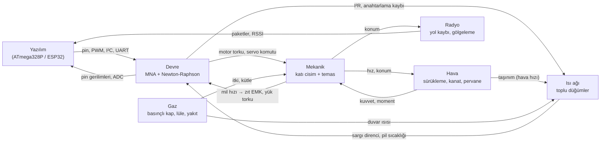
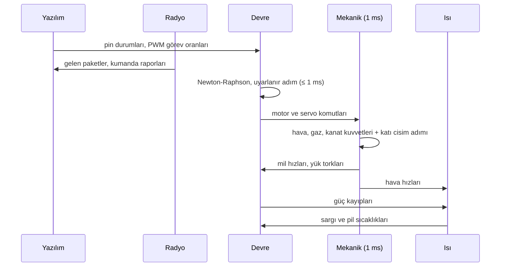

# Fizik ve matematik

RobotWin Studio'da her özellik ayrı bir "efekt" değil, aynı fiziğin parçasıdır. Devre, mekanik, ısı, hava, gaz ve radyo tek bir zaman adımında birbirine bağlı çözülür: bir motorun çektiği akım pilin gerilimini düşürür, motorun sargısını ısıtır, sargı ısındıkça direnci artar, torku azalır, araba yavaşlar, havanın direnci azalır… Bu bölüm her çözücünün denklemlerini, varsayımlarını ve doğrulamasını anlatır.

## Birbirine bağlı çözücüler

## Bir zaman adımı

Dünya sayfası her karede simülasyonu küçük dilimlerle ilerletir. Bir dilimin içinde sıra şöyledir:

## Çözücüler

| Alan | Yöntem | Adım | Sayfa |
| --- | --- | --- | --- |
| Devre | Modifiye düğüm analizi (MNA), Newton-Raphson, trapez / geri Euler, yerel kesme hatasıyla uyarlanır adım | 1 µs – 1 ms | [Devre çözücü](01-devre.md) |
| Mekanik | Yarı örtük (simplektik) Euler, örtük jiroskopik terim, yumuşak ardışık itme (sequential impulse) ile temas ve eklemler | 1 ms, alt adımlı | [Katı cisim ve temas](02-mekanik.md) |
| Isı | Toplu ısıl ağ: her parça bir ya da birkaç düğüm, iletim + taşınım + ışınım | 50 ms | [Isı](03-isi.md) |
| Hava | Yön bağımlı sürükleme (ön yüz, taban, sürtünme; birleşik parçalar birbirini örter), şerit teorisi + kaldırma çizgisi, pervane C_T/C_P | 1 ms | [Aerodinamik](04-aerodinamik.md) |
| Gaz | İdeal gaz, izentropik lüle akışı, Bernoulli su jeti, basınca bağlı katı yakıt yanması | 1 ms, iç alt adımlı | [Gaz ve roketler](05-gaz-ve-roket.md) |
| Radyo | Serbest uzay + log-mesafe yol kaybı, engel kaybı, log-normal gölgeleme, FSK bit hatası | paket başına | [Radyo](06-radyo.md) |
| Sıvılar | Konum tabanlı akışkan (PBF), yoğunluk haritalı duvarlar, gerçek viskozite ve yüzey gerilimi, iki yönlü etkileşim | alt adım (CFL), canlıda en çok 3 ms | [Sıvılar](07-sivilar.md) |

## Belirlenimcilik

Aynı dünya ve aynı girişler bit düzeyinde aynı sonucu verir: rastgele görünen her şey (gölgeleme, tolerans çekilişleri) dünyaya ve tohum değerine bağlı sabit bir fonksiyondur. Bu sayede bir kayıt yeniden oynatılabilir, testler kesin sonuç verir ve render penceresi canlı simülasyonu aynen yeniden hesaplayabilir.

## Doğrulama

Her model, kendi testinde ders kitabı çözümüyle ya da yayımlanmış ölçümle karşılaştırılır. Örnekler:

| Model | Karşılaştırma | Sonuç |
| --- | --- | --- |
| Hava tankı boşalması | Adyabatik ve izotermal kapalı çözümler | Simülasyon ikisinin arasında, ilk 0,5 s'de adyabatiğe %1 yakın |
| KNSB motor | Kararlı yanma basıncı $`p = (K_n \rho a c^*)^{1/(1-n)}`$ | 2,36 MPa (teori 2,26 MPa), Isp 130 s |
| Su roketi (2 L, 0,6 L, 4 bar) | Yayımlanmış uçuşlar ve simülatörler (30–50 m) | 38,8 m |
| Küre sürüklemesi | $`C_D = 0{,}47`$ (alt kritik Re) | Her yönde 0,486 (sürtünme dahil) |
| Silindir yuvarlanması | Gerçek silindir ile model gövdesi | Model gövdesi gerçek silindirin %63'ü kadar yuvarlanır, kutu %5 |
| Kumandalı araba | Düz sürüş, tek aks | 1,86 m'de 4 mm sapma, 0,93 m/s |
