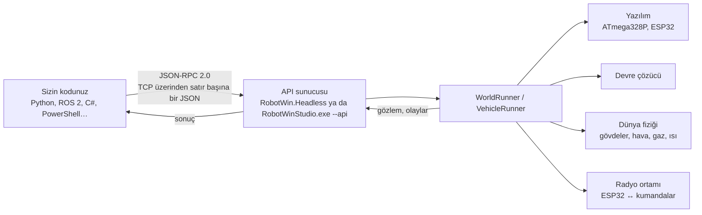

# Otomasyon API'si

RobotWin Studio, arayüz olmadan çalışan **belirlenimci bir simülasyon çalıştırıcısı** ve yerel bir **JSON-RPC API sunucusu** içerir. Böylece akademik robotik, ROS 2, otonom araç ve İHA çalışmaları ve robot öğrenmesi için betiklenebilir:

- devre, kartların gerçek yazılımı (ATmega328P öykünmesi, ESP32 HAL modeli) ve mekanik, uygulamanın birebir dilimlemesiyle aynı adımda ilerler; aynı tohum + aynı komutlar ⇒ bit düzeyinde aynı koşu;
- koşular işlemcinin izin verdiği hızda (çoğu sahnede gerçek zamandan çok hızlı) ilerler, sıfırlanabilir; çok sayıda örnek ayrı süreçler olarak paralel çalışır;
- sensörler adlarıyla okunur (ultrasonik parçalar, enkoderler, aracın çizgi/engel sensörleri; ayrıca herhangi bir nesneye takılabilen sanal IMU, GPS, odometri, 2B/3B LiDAR, RGB/derinlik kamerası, mesafe ve çizgi sensörleri);
- eyleyiciler üç düzeyde sürülebilir: **pinler** (istemci yazılımın yerini alır), **sürücüler** (motor sürücü kanallarının / ESC'lerin PWM görev oranı) ve **eklemler** (ideal DC motor gerilimi, hız, tork, servo açısı);
- araçlar: diferansiyel sürüş yardımcısı, quadcopter kurma / gaz / tutum / irtifa tutma hedefleri;
- devrenin içi: düğüm gerilimleri, parça başına akımlar, sıcaklıklar ve arızalar, çözücünün ham sinyalleri;
- kart başına seri giriş/çıkış, yazılım değiştirme, olaylar (parça arızaları, çarpmalar, darbeler, uyarılar).

## Hızlı başlangıç (Python)

```python
from robotwin import launch

with launch(example="car", seed=1) as server:            # kendi sürecinde başsız sunucu
    sim = server.client()
    sim.add_sensor("lidar", name="scan", object="O1", offset=[0, 0, 0.05])
    sim.add_sensor("odometry", name="odom", object="O1")
    sim.drive(0.2, 0.0)                                   # 0,2 m/s ileri
    r = sim.step(dt=0.01, steps=100, observe=["scan", "odom"])
    print(r["time"], r["rtf"], r["observation"]["odom"]["position"])
    sim.reset(seed=1)                                     # aynı tohum → aynı koşu
```

Çalışan bir sunucuya bağlanmak: `RobotWinClient("127.0.0.1", 5555)`. Pekiştirmeli öğrenme (`RobotWinEnv`, Gymnasium uyumlu), paralel ortamlar ve taklit öğrenme [`python/README.md`](https://github.com/Kinin-Code-Offical/robotwin-studio/blob/main/python/README.md) içinde anlatılır.

## Python istemcisi olmadan

Protokol TCP üzerinden düz JSON satırlarıdır; her dil kullanılabilir. PowerShell:

```powershell
$c = [System.Net.Sockets.TcpClient]::new("127.0.0.1", 5555)
$s = $c.GetStream(); $w = [System.IO.StreamWriter]::new($s); $r = [System.IO.StreamReader]::new($s)
$w.WriteLine('{"jsonrpc":"2.0","id":1,"method":"world.load","params":{"example":"car"}}'); $w.Flush(); $r.ReadLine()
$w.WriteLine('{"jsonrpc":"2.0","id":2,"method":"sim.step","params":{"dt":0.01,"steps":100,"observe":["pose:O1"]}}'); $w.Flush(); $r.ReadLine()
```

## Parçalar nasıl birleşir



## Sunucuyu başlatmak

| Komut | Ne yapar |
| --- | --- |
| `RobotWin.Headless --api 5555` | Platformlar arası başsız sunucu (.NET 9, Windows/Linux/macOS). |
| `RobotWin.Headless --api 0 --example car --parent-pid 1234` | Boş bir port seçer, örneği yükler; `ROBOTWIN_API_READY port=<n>` satırını yazar; üst süreçle birlikte kapanır. |
| `RobotWin.Headless --run 5 --world robot.rwworld [--dt 0.01] [--seed 3]` | Toplu koşu: JSON raporu standart çıktıya yazar (çözücü durduysa çıkış kodu 4). |
| `RobotWinStudio.exe --api 5555 [--world f.rwworld]` | Uygulamanın kendisi, pencere açmadan: dünya gövdeleri uygulamanın 3B modellerinden gelir (arayüzle birebir aynı fizik), ESP32 çizimleri uygulamanın MSVC ayarlarıyla derlenir. |
| `RobotWinStudio.exe --bake-geometry f.rwworld [--out g.json]` | Uygulamanın gövde geometrisini dünyanın yanına yazar (`f.rwworld.geometry.json`); başsız araç onu kendiliğinden kullanır. |

Ortak seçenekler: `--seed N`, `--no-firmware`, `--firmware-dir KLASÖR` (`builtin:` hex dosyaları için), `--host ADRES --allow-remote` (geri döngü dışı), `--token T`. Aracı derlemek: `dotnet build tools/RobotWin.Headless -c Release` (çıktı `builds/RobotWin.Headless/Release/net9.0/`).

Sunucu varsayılan olarak yalnızca `127.0.0.1` üzerinde dinler. Başka bir makineden erişim için `--host 0.0.0.0 --allow-remote --token GIZLI` kullanın; istemci ilk çağrıda `hello {"token": "GIZLI"}` göndermelidir.

## Kablo protokolü

TCP üzerinden JSON-RPC 2.0, **satır başına bir JSON değeri** (UTF-8, `\n`). İstekler toplu gönderilebilir (bir JSON dizisi). `id` taşımayan bildirimlere yanıt verilmez. Sonlu olmayan sayılar `null` olarak gönderilir (ör. dönüşü olmayan bir LiDAR ışını). Bütün bağlantılardan gelen istekler geliş sırasıyla birer birer yürütülür.

```text
→ {"jsonrpc":"2.0","id":1,"method":"world.load","params":{"example":"car","seed":7}}
← {"jsonrpc":"2.0","id":1,"result":{"kind":"world","title":"Araba","objects":[...],...}}
→ {"jsonrpc":"2.0","id":2,"method":"sim.step","params":{"dt":0.01,"steps":50,"actions":[{"drive":{"v":0.2,"w":0}}],"observe":["O2.encoder","pose:O1"]}}
← {"jsonrpc":"2.0","id":2,"result":{"time":0.5,"steps":50,"rtf":1.8,"observation":{...},"failed":[],"halted":false}}
```

Hata kodları: `-32700` ayrıştırma hatası, `-32600` geçersiz istek, `-32601` bilinmeyen yöntem, `-32602` hatalı parametre, `-32603` iç hata, `-32001` yüklü bir şey yok, `-32002` bulunamadı, `-32003` bu kipte desteklenmiyor, `-32004` yetkisiz.

Birimler: SI (m, s, rad, V, A, °C); adında belirtilen yerlerde (`rpy_deg`, `angle`) derece. Çerçeveler: dünya Z yukarı; gövde ve sensörlerde x ileri / y sol / z yukarı (ROS REP-103). Kuaterniyonlar `[x, y, z, w]`.

## Zaman modeli

`sim.step {dt, steps}` `steps × dt` saniye ilerletir. Her `dt` içeride uygulamanın aynı adım dilimlerine bölünür (1 ms; ATmega328P varsa 50 µs; ESP32 varsa 100 µs): yazılım → devre çözücü (uyarlanır, `max_step` varsayılanı uygulamadaki gibi 2e-4 s) → mekanik (1 ms sabit adım). Yanıt o çağrının duvar saati süresini ve gerçek zaman çarpanını verir; `sim.status` ortalamaları tutar. `pace: 1.0` çağrıyı duvar saatine kilitler (0,5 = yarı hız). Masaüstü işlemcide tipik gerçek zaman çarpanı: mikro quadcopter ≈ 15–30×, analog çizgi izleyen ≈ 14×, iki tekerlekli dünya arabası ≈ 1,7× (dünya fiziği, 16 çözücü yinelemesi), yazılımlı Arduino robotu ≈ 0,8× (çevrim doğruluklu AVR öykünmesi). Daha çok iş için daha çok süreç kullanın.

## Kipler

- **Dünya** (`.rwworld` ya da `example: "car"`): Dünya sayfasının kum havuzu dünyaları. Nesnelerin kimlikleri `O1`, `O2` …; hareketli çıkışı olan bileşenler (motor mili, servo kolu) eyleyicidir; kartlar programlanabilir.
- **Araç** (Montaj sayfası düzeneği olan `.rwproj` ya da `example: "line-follower" | "obstacle-avoider" | "quadcopter"`): şema simülasyonunun robot arabası / quadcopter'ı ve arenası. Gövde `vehicle` nesnesidir; hazır sensörler `odom`, `imu`, `gps` ve takılı her sensör için bir tane (refdes adıyla).

## Yöntem başvurusu

### Oturum

| Yöntem | Parametreler | Sonuç |
| --- | --- | --- |
| `hello` | `token?` | ad, `api_version` ("1.0"), arka uç (`headless`/`studio`), sensör türleri, örnekler |
| `ping` | – | `"pong"` |
| `methods` | – | `{yöntem: yardım}` |
| `shutdown` | – | `true`; süreç kapanır |

### Dünya

| Yöntem | Parametreler | Sonuç |
| --- | --- | --- |
| `world.load` | şunlardan biri: `path` (.rwworld / .rwproj), `example`, `world_json`; `seed`=0, `firmware`=true, `max_step`=2e-4, `rel_tol`=1e-3, `damage`=true, `geometry` (pişmiş JSON yolu), `environment` (dünya kipi: `{track: "oval"\|"eight"\|"none", track_scale, friction, gravity, ambient_c, obstacles: [{x, y, size_x, size_y, height}], clear_obstacles}`), `arena` (araç kipi: `oval`, `eight`, `obstacles`, `empty` …), `sensors` (`sensor.add` parametrelerinin listesi) | `world.describe` ile aynı |
| `world.reset` | `seed?`, `randomize?: {position: σ m, yaw_deg: σ}`, `observe?: [adlar]` | `{time: 0, seed, observation?}`: devreyi, yazılımı ve fiziği baştan kurar; eklenen sensörler kalır; eyleyici komutları silinir |
| `world.describe` | – | `kind`, `title`, `environment` (pistin `start` [x, y, yaw] dahil), `objects` (id, ad, tür, parça, poz, geometri: şekil/min/max/kütle/çıkış/sensör), `joints`, `cables`, `boards`, `actuators`, `sensors` (araç kipi: tür, kütle, boyutlarla `vehicle` bloğu) |
| `world.save` | `path` | yüklü dünyayı (`environment` değişiklikleriyle) `.rwworld` olarak kaydeder; uygulamanın Dünya sayfasında açılır |
| `world.export_geometry` | `path?` | gövde geometrisi + kablo uzunlukları (`.geometry.json` biçimi) |

### Adımlama ve olaylar

| Yöntem | Parametreler | Sonuç |
| --- | --- | --- |
| `sim.step` | `dt`=0,01 (≤10), `steps`=1 (ya da `duration`), `actions?` (önce uygulanır, aşağıya bakın), `observe?` (adlar), `pace?`, `stop_on_failure?`, `events?` | `time`, `steps`, `sim_time`, `wall_time`, `rtf`, `halted`, `failed` (nesne kimlikleri), `events_pending`, `observation?`, `events?` |
| `sim.status` | – | zaman, tohum, rtf, rtf_average, wall_time, halted, failed, boards |
| `events.poll` | `max?` | `[{time, source, kind: info\|warning\|failure\|impact, message, value}]` (boşaltılır) |

`actions` öğeleri: `{actuator, mode, value, ...}` (`actuator.set` gibi), `{pin, board?, mode, duty?, frequency?, angle?}` (`pin.write` gibi), `{drive: {v, w, ...}}`, `{flight: {...}}` (`flight.set` gibi) ya da `{method, params}` (herhangi bir yöntem).

`observe` adları: herhangi bir sensör adı, `pose:<nesne>`, `pin:<kart>.<pin>` (ya da `pin:<pin>`), `part:<ref>`, `status`, `flight`.

### Nesneler

| Yöntem | Parametreler | Sonuç |
| --- | --- | --- |
| `object.list` | – | `[{id, name, kind, static}]` |
| `object.get_pose` | `id` (kimlik ya da ad) | `position`, `orientation` [x,y,z,w], `rpy` (rad), `linear_velocity`, `angular_velocity` (dünya çerçevesi) |
| `object.set_pose` | `id`, `position?`, `orientation?` ya da `rpy_deg?`, `keep_velocity?` | yeni poz; eklemli bütün düzenek katı olarak taşınır, hızlar sıfırlanır |

### Sensörler

| Yöntem | Parametreler | Sonuç |
| --- | --- | --- |
| `sensor.list` | – | açıklamalar (`name`, `type`, `object`, sınırlar, çözünürlük) |
| `sensor.types` | – | `sensor.add` ile eklenebilen türler |
| `sensor.read` | `name` ya da `names[]` (yoksa kameralar dışında hepsi) | okuma(lar); her okumada `time` vardır |
| `sensor.add` | `type`, `name?`, `object?`, `offset?` [x,y,z] (nesne çerçevesi), `rpy_deg?`, türün parametreleri | açıklama |
| `sensor.remove` | `name` | bool |

Hazır sensörler; dünya: `<nesne>.range` (HC-SR04 parçası: `range`, `in_range`, ışının `from`/`to`'su, `echo_pulse`), `<nesne>.encoder` (motor/servo çıkışı: `angle`, `velocity`, 1440 cpr'de `ticks`). Araç: `odom`, `imu`, `gps` ve takılı her sensör refdes adıyla (`value`, `triggered`, `range`).

Sanal sensör türleri (`sensor.add`), varsayılanlarıyla:

| Tür | Parametreler | Okuma |
| --- | --- | --- |
| `imu` | `accel_noise`=0, `gyro_noise`=0 (σ), `filter_tau`=0,004 s | `orientation`, `rpy`, `angular_velocity` (sensör çerçevesi), `linear_acceleration` (özgül kuvvet, dururken z'de ≈ +9,81) |
| `gps` | `origin_lat`=41,0082, `origin_lon`=28,9784, `origin_alt`=40, `noise`=0 m, `noise_vertical` | `latitude`, `longitude`, `altitude`, `position_enu`, `velocity_enu`, `covariance_diagonal` (x = doğu, y = kuzey) |
| `odometry` / `pose` | `noise`=0 | `position`, `orientation`, `rpy`, `linear_velocity` / `angular_velocity` (gövde çerçevesi, ROS odometrisi), `linear_velocity_world` |
| `lidar` | `samples`=360, `angle_min`=−π, `angle_max`=π, `range_min`=0,05, `range_max`=8, `layers`=1, `vfov_deg`, `noise`=0, `ignore_own`=true | LaserScan alanları: `angle_min/max/increment`, `range_min/max`, `ranges` (null = dönüş yok; 3B'de `layers × samples` değer) |
| `range` | `range_max`=4, `noise` | `range` (null = hiçbir şey), `hit_object` |
| `camera` | `width`=64, `height`=48 (≤640×480), `fov_deg`=60, `range_max`=20 | `encoding` "rgb8", `width`, `height`, `step`, `fx`, `fy`, `cx`, `cy`, `data` (base64, sol üstten satır sırasıyla) |
| `depth` | kamera gibi | `encoding` "32FC1" (little-endian float32 metre, +inf = hiçbir şey) |
| `line` | `threshold`=0,4, `noise` | `value` (zemin yansıtma: siyah çizgi ≈ 0,06, beyaz ≈ 0,85), `on_line` |

Genişletmek (C#): başka modüller parça sensörlerini `SensorRegistry.RegisterProvider(runner => IEnumerable<ISimSensor>)`, yeni sanal türleri `SensorRegistry.RegisterType("ad", (runner, spec) => ISimSensor)` ile kaydeder; API değişmeden `sensor.list`, `sensor.read`, `sim.step observe` ve ROS köprülerinde görünürler.

### Eyleyiciler

| Yöntem | Parametreler | Sonuç |
| --- | --- | --- |
| `actuator.list` | – | dünya: her hareketli çıkış için bir tane (`type` motor / servo / joint, `modes`, motor sabitleri) ve her PWM sürücü eleman için; araç: tekerlek/pervane motorları (sürücüleriyle) ve sürücüler |
| `actuator.set` | `name`, `mode`, `value`, `max_torque?`, `supply?`=6 V | aşağıya bakın |
| `actuator.release` | `name?` (yoksa hepsi) | `true`; denetim devreye/yazılıma geri döner |
| `pin.write` | `board?` (nesne kimliği/adı/refdes; tek kart varsa gerekmez), `pin` ("D5", "A0", "IO21"), `mode`: `high` `low` `input` `pullup` `pwm` (`duty` 0–1, `frequency`=490) `servo` (`angle` 0–180°, 50 Hz) `release` | pin durumu |
| `pin.read` | `board?`, `pin` | `voltage`, `level`, `mode`, `current`, `pwm_frequency`, `pwm_duty`, `overridden` |
| `drive.differential` | `v` m/s, `w` rad/s (+ = sola), `left?`/`right?` motor kimlikleri, `base?`, `wheel_radius?`, `track?`, `mode`: `speed` (varsayılan) / `voltage`, `max_torque?`, `supply?`; araç: `max_speed`=0,6 | kullanılan tekerlekler (motor, taraf, tekerlek hızı / görev oranı) |
| `drive.stop` | – | her şeyi bırakır |

Sürme düzeyleri:

1. **Pinler**: yazılımın gördüğü düzey; bir kart pinini her dilimde bir seviyede / PWM'de / servo darbesinde tutar. `firmware: false` (ya da `firmware.enable {enabled:false}`) ile en iyisidir: denetleyici istemcinin kendisidir ve sinyal yine gerçek devreden (sürücüler, H köprüleri, servolar) geçer.
2. **Sürücüler**: bir PWM anahtarında (motor sürücü kanalı, uçuş kartı MOSFET'i) `mode: duty`; komut verilirken lojik girişi yok sayılır. Araçlarda tekerlek/pervane motorları refdes ile adlandırılır ve sürücülerine çözülür.
3. **Eklemler** (dünya kipi): hareketli bir çıkışın devreyi atlayan ideal komutu: `voltage` (parçanın motor sabiti, direnci ve dişli oranından DC motorun tork–hız doğrusu), `duty` (= değer × `supply`), `speed` (çıkış milinde rad/s, `max_torque` ile sınırlı), `torque` (N·m), `angle` (servo kolu, derece, 90 = orta, servonun kendi tork/hız modeliyle sürülür).

`drive.differential` (dünya) tekerlek motorlarını (yan aks) bulur, taraflarını şase çerçevesinden (taban nesnesinin +x'i ileri; varsayılan: motorların sabitlendiği nesne), tekerlek yarıçapını ve iz genişliğini takılı tekerleklerden alır, sonra çıkış mili hızlarını sürer. Açık çevrimdir: doğruluk için `odom` ile çevrimi kapatın (sarhoş teker sürtünmesi ve kayma gerçek dönüş hızını düşürür). Araç kipinde sürücülerin görev oranını ayarlar (`taraf hızı / max_speed`; tek yönlü sürücüler geri gidemez).

### Uçuş (İHA, araç kipi, quadcopter)

| Yöntem | Parametreler | Sonuç |
| --- | --- | --- |
| `flight.status` | – | `armed`, `powered`, `mode`, `throttle`, çubuk girdileri, `target_altitude`, `altitude`, `roll`/`pitch`/`yaw` kestirimi, `motor_commands`, `props_broken`, `speed`, `distance`, `mass` |
| `flight.arm` | `armed`=true | durum |
| `flight.set` | `throttle` 0–1, `roll` / `pitch` / `yaw` −1…1 (çubuklar: en çok 25° eğim, 3 rad/s sapma), `mode`: `angle` (elle gaz) / `altitude` (gaz = tırmanma hızı çubuğu, 0,5 tutar), `target_altitude` m, `armed` | durum |
| `flight.motors` | `duty`: [4] (null birini bırakır) | ham motor PWM görev oranları (uçuş denetleyicisinin yerine geçer) |

İrtifa kipinde kurmak gazı ortalar (0,5) ve `target_altitude` verilmediyse o anki yüksekliği (≥ 0,6 m) tutar. Pozitif pitch burnu aşağı eğer (+x yönünde hızlanır), pozitif roll sağa yatırır (−y yönünde hızlanır), pozitif yaw sola döndürür.

### Seri, yazılım, devre

| Yöntem | Parametreler | Sonuç |
| --- | --- | --- |
| `serial.read` | `board?`, `clear`=true | son okumadan beri `{refdes: metin}` |
| `serial.write` | `text`, `board?` | `true` (kartın RX'ine) |
| `firmware.set` | `board`, `hex` ya da `path` (Intel HEX; ikisi de yoksa silinir) | kart; bir sonraki `world.reset`'te uygulanır |
| `firmware.enable` | `enabled` | durum; koşu sıfırlanır |
| `circuit.voltage` | `node`: hat adı, ya da dünyada `nesne:pin` | volt (bilinmiyorsa null) |
| `circuit.part` | `ref`: bileşen nesne kimliği, `nesne/R2` (karttaki parça) ya da bir refdes | `devices` (id, tür, arıza, `signals`: I, V, P, T …), `temperature`, `failed` |
| `circuit.signals` | `prefix`, `max`=500 | çözücünün ham sinyalleri |

## Python, ROS 2, rosbridge

- Python istemcisi, Gymnasium ortamı, paralel ortamlar, taklit öğrenme: [`python/README.md`](https://github.com/Kinin-Code-Offical/robotwin-studio/blob/main/python/README.md).
- ROS 2 düğümü, başlatma dosyası, URDF dışa aktarımı: [`ros2/robotwin_bridge/README.md`](https://github.com/Kinin-Code-Offical/robotwin-studio/blob/main/ros2/robotwin_bridge/README.md). Düğüm `/clock`, `/tf`, `/odom`, `/scan`, `/imu`, `/fix`, `/camera/image_raw` yayımlar, `/cmd_vel` dinler.
- ROS'suz WebSocket (rosbridge v2 alt kümesi, roslibjs / web panoları için): `python -m robotwin.rosbridge --example car --port 9090`.

## Uygulamayla tam olarak aynı olmayanlar

- ESP32 kartları ile kumandalar arasındaki Wi-Fi, BLE ve Bluetooth bağlantıları başsız koşuda da çalışır (`WorldRunner.Radio`: kumandanın `Input`'unu ayarlayarak sürün). IR kumandalar, sesler ve seri monitörün USB kablosuna bağlı oluşu başsız koşuda yoktur.
- `RobotWin.Headless`, pişmiş geometri yoksa gövde boyutlarını veri sayfası ölçülerinden yaklaşık hesaplar (TT motor, 4×AA pil, ESP32, Nano ve Uno uygulamayla aynı; diğer parçalar kutu). Uygulamanın birebir gövdeleri için `RobotWinStudio.exe --api` ya da `--bake-geometry` kullanın.
- ESP32 kartları yalnızca çizim derleyebilen bir sunucuda çalışır (MSVC'li uygulama ya da MSVC kurulu makine); başsız araç onları boşta bırakır.
- Eklem düzeyindeki eyleyici komutları ve sanal sensörler idealleştirilmiş eklemelerdir (yukarıda anlatıldı); pin ve sürücü komutları gerçek devreden geçer.
- Işın izlemeli kamera düz renkli ve düşük çözünürlüklüdür: öğrenme hatları içindir, fotogerçekçi değildir.
