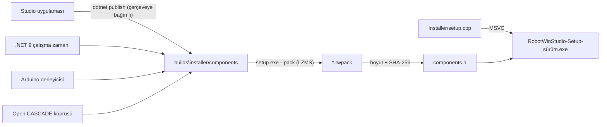

# Kurulum programını derlemek ve sürüm yayımlamak

RobotWin Studio **tek bir kurulum programıyla** dağıtılır: `RobotWinStudio-Setup-<sürüm>.exe`, yanında da kurduğu bileşenler. Kurulum programı küçüktür (yarım megabayt kadar): sürümünün bileşen listesini boyutları ve SHA-256 özetleriyle taşır, seçilenleri GitHub sürümünden, kendi klasöründen (internetsiz) ya da başka bir kaynaktan alır. Hepsini `tools/build-installer.ps1`, WPF uygulamasından ve `Installer/` içindeki yerel kurulum programından üretir.



| Bileşen | Dosya | Kurulduğu yer |
| --- | --- | --- |
| RobotWin Studio (her zaman) | `RobotWinStudio-<sürüm>-app.rwpack` | uygulama, çerçeveye bağımlı |
| .NET 9 çalışma zamanı | `RobotWinStudio-<sürüm>-dotnet.rwpack` | uygulamanın yanındaki `dotnet\`: Microsoft.NETCore.App ve Microsoft.WindowsDesktop.App çalışma zamanları ve konakları |
| Arduino derleyicisi | `RobotWinStudio-<sürüm>-arduino.rwpack` | `tools\arduino`: arduino-cli, AVR çekirdeği ve kütüphane listesi |
| STEP / IGES desteği | `RobotWinStudio-<sürüm>-occt.rwpack` | `occt\`: Open CASCADE köprüsü ve lisansı |

Uygulamanın tek derlemesi her kurulum türüne yeter: exe'si .NET'i önce kendi `dotnet\` klasöründe, sonra `DOTNET_ROOT`'ta, sonra bilgisayarda kurulu .NET'te arar (`RobotWin.Studio.csproj` içinde `AppHostDotNetSearch` / `AppHostRelativeDotNet`).

## Kurulum programını yerelde derlemek

Gerekenler: .NET 9 SDK (Windows SDK'sının içindeki .NET 9 Masaüstü Çalışma Zamanı'yla) ve C++ iş yüklü Visual Studio 2022 / Build Tools (betik onu `vswhere` ile bulur).

```powershell
powershell -ExecutionPolicy Bypass -File tools\build-installer.ps1 -Version 1.7.0
# daha hızlı, Arduino derleyicisi olmadan (ilk derlemede arduino.cc'den indirilir):
powershell -ExecutionPolicy Bypass -File tools\build-installer.ps1 -Version 1.7.0 -NoArduino
```

Çıktı `builds\installer\release\` içindedir: kurulum programı ve `.rwpack` dosyaları. Betiğin yaptıkları:

1. Uygulamayı `win-x64` için çerçeveye bağımlı, ReadyToRun olarak `dotnet publish` eder (`-p:Version=<sürüm>`).
2. Her bileşenin klasörünü `builds\installer\components\<id>` içinde dizer: `occt\` olmadan uygulama; LGPL lisansıyla Open CASCADE köprüsü; bu makinenin .NET 9 çalışma zamanı (host\fxr ve aynı sürümden iki paylaşılan çatı, Microsoft'un lisans notlarıyla); bir kez `builds\installer\arduino-ready` içine indirilip bir blink çizimi derlenerek denenen Arduino derleyicisi.
3. `Installer\setup.cpp`'yi MSVC ile derler (`cl /std:c++20 /O2 /MT`) ve her bileşeni onunla paketler (`setup.exe --pack <klasör> <dosya.rwpack>`: her dosya Windows Sıkıştırma API'sinin LZMS'iyle sıkıştırılır, işe yaramazsa olduğu gibi kalır). Bileşenlerin boyutlarını ve SHA-256 özetlerini `components.h`'ye yazar ve kurulum programını onlarla yeniden derler: bir kurulum programı yalnız kendi sürümünün dosyalarını kurar.
4. Sonucu kanıtlar: kurulum programı her bileşeni sürüm klasöründen taşınabilir bir klasöre kurar (`/S /PORTABLE /TYPE=full /SOURCE=<sürüm klasörü>`) ve her dosya boyutuyla gelmelidir. `-NoCheck` bunu atlar.

`-Repo sahip/ad`, kurulum programının indirdiği GitHub deposunu belirler (sürüm iş akışı kendi deposunu verir).

## Kurulum programı ne yapar

`Installer/setup.cpp`, çalışma zamanı bağımlılığı olmayan yerel bir Win32 programıdır. Sihirbazın üç sorusu vardır:

1. **Dil ve kurulum türü.** Dil hem sihirbazın hem uygulamanın dilidir (bu kullanıcının uygulama dilinden başlar). **Tam** her bileşeni kurar (her şey hemen internetsiz çalışır), **Hafif** yalnız uygulamayı bilgisayardaki .NET 9 Masaüstü Çalışma Zamanı'yla kurar (kendi .NET kopyasını yalnız bilgisayarda yoksa ekler), **Özel** sonraki sayfada işaretlenen bileşenleri.
2. **Bileşenler** (yalnız Özel'de), her biri indirme boyutuyla.
3. **Nereye ve nasıl:** bu kullanıcı için, tüm kullanıcılar için (kurulum programı kendini yönetici olarak yeniden başlatır ve kendi ilerlemesini gösterir) ya da **taşınabilir** (yalnız bir klasör: kısayol, kayıt defteri girdisi ve dosya türü yok); klasör; masaüstü kısayolu, dosya türleri, sonra başlat. Kaynak satırı dosyaların nereden geleceğini söyler.

Sonra gerekeni indirir (WinHTTP: sistemin vekil sunucusu, yönlendirmeler, kopan indirme kaldığı yerden sürer, altı deneme), kurulumda bir şey değişmeden önce her dosyanın SHA-256'sını denetler, açar, önceki kurulumda olup bunda olmayanı (onun `install.log`'u) kaldırır ve şunları yazar:

| Dosya | Amaç |
| --- | --- |
| `Uninstall.exe` | kurulum programının kendisi: kurulumu kaldırır ya da `/MODIFY` ile sihirbazı onun üzerinde açar (bileşen ekle ya da kaldır; kalanlar yeniden indirilmez) |
| `install.json` | sürüm, tür, bileşenler, dil ve nereye kurulduğu; uygulama onu okur (dil, uygulamayı ilk kez açan kullanıcıların varsayılanıdır) |
| `install.log` | kurulan her dosya, bileşeninin altında |

Windows *Uygulamalar* listesine kaydedilmiş bir kurulum yeniden bulunur: yeni bir kurulum programı onu aynı tür ve bileşenlerle yerinde günceller (tam kurulum yeni sürümün bütün bileşenlerini alır), *Uygulamalar → Değiştir* de `Uninstall.exe /MODIFY`'ı açar. Uygulamadaki **Ayarlar → Güncellemeler → Bileşenleri değiştir…** de öyle. İndirilenler kurulum başarıyla bitene kadar `%TEMP%\RobotWinStudio-Setup-<sürüm>` içinde tutulur; son çalışmanın günlüğü `%TEMP%\RobotWinStudio-Setup.log`'dur.

| Komut satırı | |
| --- | --- |
| `RobotWinStudio-Setup-1.7.0.exe` | sihirbaz |
| `... /S` | sessiz; `/PASSIVE`: soru yok, yalnız ilerleme penceresi (uygulama içi güncelleyici bunu kullanır) |
| `/TYPE=full`, `/TYPE=lite`, `/COMPONENTS=app,arduino,occt` | tür ya da tam olarak bu bileşenler (`app` her zaman, bilgisayarda .NET 9 yoksa `dotnet` de kurulur) |
| `/LANG=en`, `/LANG=tr` | uygulamanın dili |
| `/D=<klasör>`, `/ALLUSERS`, `/PORTABLE` | nereye |
| `/NODESKTOP`, `/NOTYPES`, `/LAUNCH` | masaüstü kısayolu yok, dosya türü yok, sonra uygulamayı başlat |
| `/SOURCE=<klasör ya da adres>` | bileşenleri GitHub yerine bir klasörden (internetsiz, ağ paylaşımı) ya da bir yansıdan al |
| `/KEEP` | indirilen bileşenleri sakla |

İnternetsiz kurulum: `.rwpack` dosyalarını kurulum programının yanına koyun (ya da herhangi bir yere, `/SOURCE=` ile); doğru boyutta bulunan her biri denetlenip kullanılır, kalanlar indirilir. Varsayılan klasörler: `%LOCALAPPDATA%\Programs\RobotWin Studio` (bu kullanıcı), `%ProgramFiles%\RobotWin Studio` (tüm kullanıcılar), kurulum programının yanında `RobotWin Studio` (taşınabilir). Dosya ilişkilendirmeleri `RobotWinStudio.exe --register-file-types` ile kaydedilir (`--unregister-file-types` ile kaldırılır).

## Sürüm iş akışı

`.github/workflows/release.yml`, `v*` ile eşleşen her gönderilen etikette (ve var olan bir etiketle elle, *workflow_dispatch*) çalışır:

1. **windows** (`windows-latest`): `tools/build-installer.ps1 -Version <v'siz etiket> -Repo <bu depo>`'yu çalıştırır (kurulum denetimiyle biter); bütün bileşenleri kurulum programının kendisiyle taşınabilir bir kopyaya kurup `RobotWinStudio-<sürüm>-win-x64-portable.zip` olarak sıkıştırır; o kopyayı `--selftest` ile başlatır ve .NET konağının izinden kendi `dotnet\` klasörüyle çalıştığını denetler; `tools/RobotWin.Headless`'ı `win-x64` için yayınlar, araba örneğiyle 1 s'lik toplu koşu yapıp `RobotWin-Headless-<sürüm>-win-x64.zip` olarak paketler.
2. **linux** (`ubuntu-latest`): ekransız simülatörü `linux-x64` için (.NET içinde) yayınlar, aynı toplu koşuyu Linux'ta çalıştırır ve `RobotWin-Headless-<sürüm>-linux-x64.tar.gz` yapar; etiketteki kaynağı `RobotWinStudio-<sürüm>-source.zip` ve `.tar.gz` olarak yazar (`git archive`).
3. **publish**: iki işin dosyalarını toplar, `SHA256SUMS.txt` yazar (`sha256sum`) ve hepsini o etiketin GitHub sürümüne ekler (`softprops/action-gh-release`).

| Dosya | İçerik |
| --- | --- |
| `RobotWinStudio-Setup-<sürüm>.exe` | Windows x64 kurulum programı: tam, hafif ya da özel; bu kullanıcı, tüm kullanıcılar ya da taşınabilir |
| `RobotWinStudio-<sürüm>-app.rwpack`, `-dotnet.rwpack`, `-arduino.rwpack`, `-occt.rwpack` | Kurulum programının indirdiği (ya da klasöründen aldığı) bileşenler |
| `RobotWinStudio-<sürüm>-win-x64-portable.zip` | Kurulumsuz tam uygulama klasörü: açın ve çalıştırın |
| `RobotWin-Headless-<sürüm>-win-x64.zip` | Ekransız simülatör ve otomasyon sunucusu, Windows |
| `RobotWin-Headless-<sürüm>-linux-x64.tar.gz` | Ekransız simülatör ve otomasyon sunucusu, Linux (ESP32 kartları orada yazılımsız çalışır: çizimler Windows DLL'ine derlenir) |
| `RobotWinStudio-<sürüm>-source.zip`, `.tar.gz` | Etiketteki kaynak kodu |
| `SHA256SUMS.txt` | Her dosyanın SHA-256 özeti |

Uygulama içi güncelleyici kurulum programını indirip kurulu kopyanın üzerinde çalıştırır (`/S /PASSIVE`, aynı klasör, tür ve seçimler); kurulum programı da o kopyanın sahip olduğu bileşenleri indirir. Bileşenli bir sürümde güncellemenin boyutu olarak kurulum programıyla o bileşenlerin toplamı gösterilir. 1.6'ya kadarki sürümlerde iki kurulum programı vardı (tam olan, yalın adla ya da `-tam.exe`, ve `-lite.exe`); güncelleyici onları da tanır.

## Sürüm denetim listesi

1. `main` CI'da yeşil (`.github/workflows/ci.yml`: derleme, `dotnet test`, `--selftest`).
2. [CHANGELOG.md](https://github.com/Kinin-Code-Offical/robotwin-studio/blob/main/CHANGELOG.md)'ye `## [x.y.z] - YYYY-AA-GG` bölümü ekleyin.
3. İsterseniz kurulum programını yerelde derleyip deneyin (kur, bir örnek aç, bir dünya çalıştır, bileşenleri değiştir, kaldır).
4. Etiketleyip gönderin:

   ```powershell
   git tag v1.7.0
   git push origin v1.7.0
   ```

5. İş akışı bitince GitHub'daki sürüm notlarını düzenleyin (değişiklik günlüğü bölümünü kopyalayın): indirilecek tek dosya `RobotWinStudio-Setup-<sürüm>.exe`'dir; `.rwpack` dosyaları onun indirdikleridir ve yanına konunca kurulum internetsiz yapılır.
