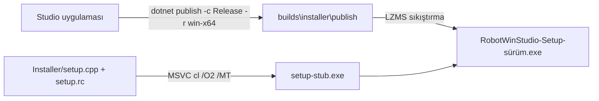

# Kurulum paketini derlemek ve sürüm yayımlamak

RobotWin Studio iki kurulum programıyla dağıtılır: `RobotWinStudio-Setup-<sürüm>.exe` (.NET içinde) ve `RobotWinStudio-Setup-<sürüm>-lite.exe` (daha küçük). İkisini de `tools/build-installer.ps1`, WPF uygulamasından ve `Installer/` içindeki yerel kurulum koçanından üretir.



## Kurulum paketini yerelde derlemek

Gerekenler: .NET 9 SDK ve C++ iş yüklü Visual Studio 2022 / Build Tools (betik onu `vswhere` ile bulur).

```powershell
powershell -ExecutionPolicy Bypass -File tools\build-installer.ps1 -Version 1.1.0
# .NET'i içinde taşıyan tam paket (hedef bilgisayarda çalışma zamanı gerekmez):
powershell -ExecutionPolicy Bypass -File tools\build-installer.ps1 -Version 1.1.0 -SelfContained
```

`builds\installer\` içindeki çıktı:

| Dosya | İçindekiler |
| --- | --- |
| `RobotWinStudio-Setup-1.1.0.exe` | Tam paket: .NET'i içinde taşıyan uygulama (`-SelfContained`). |
| `RobotWinStudio-Setup-1.1.0-lite.exe` | Lite paket: çerçeveye bağımlı uygulama; .NET 9 Masaüstü Çalışma Zamanı yoksa sihirbaz kurmayı önerir. |

1.0.0 sürümünde tam paketin adı `-tam.exe`, küçüğünün adı yalındı; uygulama içi güncelleyici ve indirme sayfası iki adlandırmayı da tanır.

Betiğin yaptıkları:

1. `dotnet publish Studio\RobotWin.Studio\RobotWin.Studio.csproj -c Release -r win-x64`, `-p:Version=<sürüm>` ile `builds\installer\publish` içine.
2. `version.h`'yi yazar ve `Installer\setup.cpp` + `setup.rc`'yi MSVC ile (`cl /std:c++20 /O2 /MT`) bir koçana derler.
3. `setup-stub.exe --pack <publish> <setup.exe>` çalıştırır: yayımlanan dosyalar Windows Sıkıştırma API'siyle (LZMS) sıkıştırılıp koçanın bir kopyasının sonuna eklenir.

## Kurulum programı ne yapar

`Installer/setup.cpp`, çalışma zamanı bağımlılığı olmayan yerel bir Win32 kurulum programıdır.

| Kip | Komut |
| --- | --- |
| Sihirbaz (varsayılan olarak kullanıcıya, yetki yükseltmeyle bütün kullanıcılara) | `RobotWinStudio-Setup-1.1.0.exe` |
| Sessiz, kullanıcıya | `... /S` |
| Sessiz, bütün kullanıcılara | `... /S /ALLUSERS` |
| Özel klasör | `... /S /D=<klasör>` |
| Taşınabilir (yalnız aç; kısayol ve kayıt defteri yok) | `... /S /PORTABLE /D=<klasör>` |
| Seçenekler | `/NODESKTOP` (masaüstü kısayolu yok), `/NOTYPES` (dosya ilişkilendirmesi yok), `/LAUNCH` (sonra uygulamayı başlat) |
| Kaldırma | Windows *Uygulamalar* listesi ya da kurulum klasöründeki `Uninstall.exe` (`/S` sessiz) |

Varsayılan klasörler: `%LOCALAPPDATA%\Programs\RobotWin Studio` (kullanıcıya) ya da `%ProgramFiles%\RobotWin Studio` (bütün kullanıcılara). .NET 9 Masaüstü Çalışma Zamanı yoksa sihirbaz onu Microsoft'tan indirip kurmayı önerir (`aka.ms/dotnet/9.0/windowsdesktop-runtime-win-x64.exe`). Dosya ilişkilendirmeleri `RobotWinStudio.exe --register-file-types` ile kaydedilir (`--unregister-file-types` ile kaldırılır).

## Sürüm iş akışı

`.github/workflows/release.yml`, `v*` ile eşleşen her gönderilen etikette (ve var olan bir etiketle elle, *workflow_dispatch*) çalışır:

1. Etiketi `windows-latest` üzerinde çeker, .NET 9 kurar.
2. `tools/build-installer.ps1 -Version <v'siz etiket>`'i iki kez çalıştırır: normal ve `-SelfContained`.
3. `RobotWinStudio-Setup-<sürüm>.exe` (tam) ve `RobotWinStudio-Setup-<sürüm>-lite.exe`'yi o etiketin GitHub sürümüne yükler (`softprops/action-gh-release`).

## Sürüm denetim listesi

1. `main` CI'da yeşil (`.github/workflows/ci.yml`: derleme, `dotnet test`, `--selftest`).
2. [CHANGELOG.md](https://github.com/Kinin-Code-Offical/robotwin-studio/blob/main/CHANGELOG.md)'ye `## [x.y.z] - YYYY-AA-GG` bölümü ekleyin.
3. İsterseniz kurulum paketini yerelde derleyip deneyin (kur, bir örnek aç, bir dünya çalıştır, kaldır).
4. Etiketleyip gönderin:

   ```powershell
   git tag v1.1.0
   git push origin v1.1.0
   ```

5. İş akışı bitince GitHub'daki sürüm notlarını düzenleyin (değişiklik günlüğü bölümünü kopyalayın) ve lite paketin .NET 9 Masaüstü Çalışma Zamanı istediğini, tam paketin onu içinde taşıdığını belirtin.
