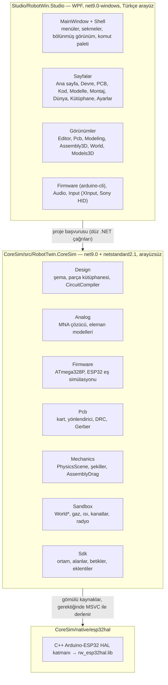
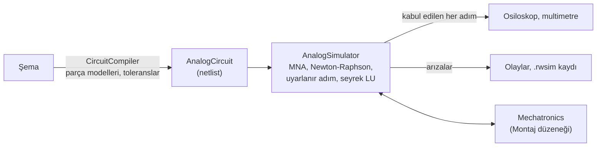
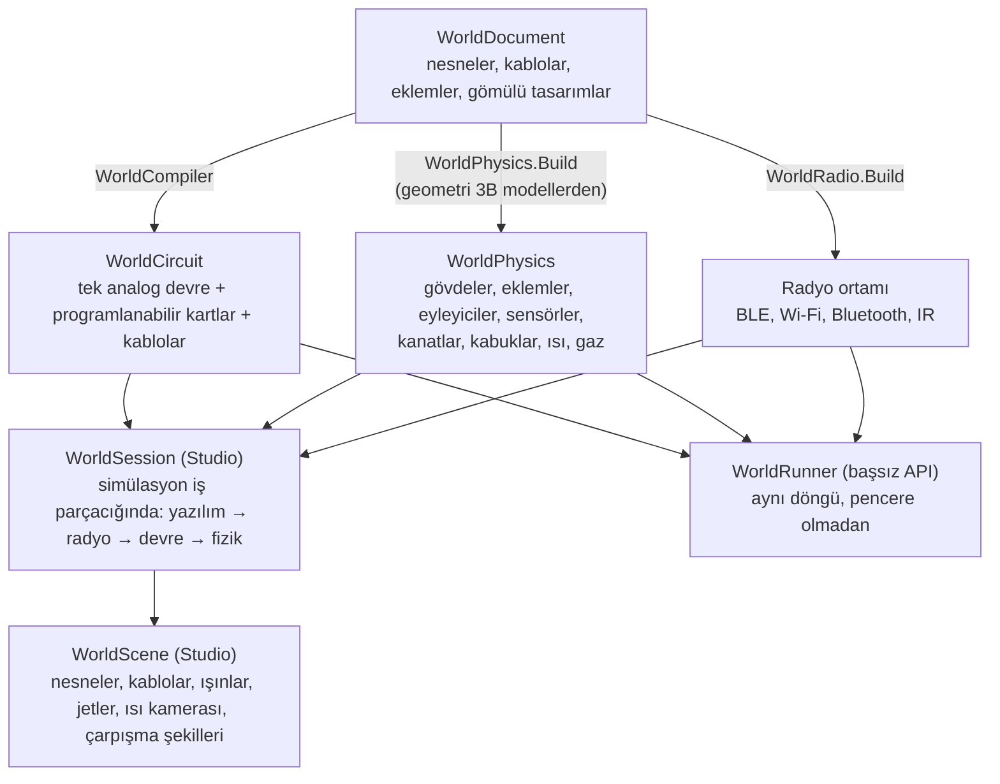
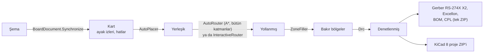

# Mimari

RobotWin Studio tek bir Windows masaüstü sürecidir: C# simülasyon çekirdeğinin (`CoreSim/src/RobotTwin.CoreSim`) üstünde bir C# .NET 9 WPF uygulaması (`Studio/RobotWin.Studio`). Ayrı bir motor süreci, süreçler arası iletişim ya da oyun motoru yoktur. Uygulamanın içinde çalışan tek yerel kod, kullanıcının MSVC ile DLL'e derlenen kendi ESP32 çizimidir (aşağıdaki Yazılım eş simülasyonu bölümüne bakın).

> 1.x tasarımı (Unity ön yüzü + adlandırılmış borular üzerinden C++ `NativeEngine`/`FirmwareEngine`) [archive/](https://github.com/Kinin-Code-Offical/robotwin-studio/tree/main/docs/archive) içinde anlatılır. O motorlar depoda durur ama uygulama onları kullanmaz.

## Katmanlar

| CoreSim klasörü | İçindekiler |
| --- | --- |
| `Design/` | Şema modeli, parça kütüphanesi (`StandardParts`, `Esp32Parts`, `WirelessParts`), `CircuitCompiler`, ERC, BOM, SPICE, toleranslar, Monte Carlo, tanılama |
| `Analog/` | MNA + Newton-Raphson çözücü, seyrek LU, eleman modelleri (piller, şarj devreleri, koruma kartları dahil) |
| `Instruments/` | Osiloskop, multimetre |
| `Firmware/` | ATmega328P öykünücüsü, Intel HEX, I²C veri yolu + cihaz modelleri, `FirmwareCoSimulation`; `Esp32/` çizim derleyicisi + eş simülasyon |
| `Pcb/` | Kart modeli, katmanlar, bölgeler, yönlendirici, otomatik yerleşim, DRC, Gerber/Excellon, KiCad dışa aktarımı |
| `Mechanics/` | Katı cisim `PhysicsScene`, çarpışma şekilleri ve dışbükey zarflar, ağlar, malzemeler, düzenek sürüklemesi, araçlar/dronlar, kütle özellikleri |
| `Modeling/` | PolyMesh, temel şekiller, CSG, ağ düzenleme, robot parçaları, `.rwmodel` |
| `Sandbox/` | `WorldDocument`, `WorldCompiler`, `WorldPhysics` (+ kanatlar, kabuklar, ısı, gaz), `Radio/` |
| `Sdk/` | Ortam (hava, rüzgâr), kuvvet alanları, davranışlar, betikler, eklentiler |
| `Formats/` | `.rwproj` / `.rwpart` / `.rwlib` / `.rwsim` kapları, KiCad kütüphane içe aktarımı |

Temel kurallar:

- **CoreSim'in arayüz bağımlılığı yoktur.** Arayüzsüz sınanabilen her şey (çözücü, yazılım, PCB, fizik, dünya derleyicisi, dosya biçimleri) oradadır ve `CoreSim/tests` ile sınanır.
- **Çizim ve etkileşim Studio'nundur.** WPF 3B (`Viewport3D`) kartı, montajı, dünyayı ve modelleyiciyi çizer; bileşenlerin 3B modelleri dosyadan yüklenmez, kodla üretilir (`Models3D/`). Bir parçanın çarpışma gövdesi bu modelin dışbükey zarfıdır (`World/ModelHulls.cs`).
- Eski CoreSim klasörleri (`Host/`, `IPC/`, `Runtime/`, `Specs/`, `Contracts/`, `Engine/`, `Infrastructure/`, `Serialization/`) 1.x tasarımından kalmadır; Studio uygulaması onları kullanmaz.

## Belgeler ve çalışma alanı

`Shell/Workspace.cs` açık belgeleri (sekmeleri) tutar. Bir belge ya bir **devre/kart projesidir** (`ProjectPackage`: şema, PCB kartı, mekanik düzenek, yazılım kaynakları) ya da bir **dünyadır** (`WorldDocument`). Dünyanın içindeki bir kart gömülü belge olarak ("Dünyadaki kart") açılır ve aynı Devre/PCB/Kod sayfalarıyla düzenlenir.

Sol gezinme (`Shell/FlowRail.cs`, "Tasarımdan gerçeğe hattı") sayfaları değiştirir: Devre → PCB → Kod → Modelle → Montaj → Dünya, ayrıca Ana sayfa, Kütüphane ve Ayarlar. `MainWindow` ikinci bir sayfayı yan yana gösterebilir (bölünmüş görünüm), bir sayfayı kendi penceresine taşıyabilir, şeridi gizleyebilir (odak kipi) ve tam ekrana geçebilir.

## Devre simülasyonu döngüsü

1. `Design/CircuitCompiler`, `PartLibrary`'deki her parçanın simülasyon modeliyle bir `Schematic`'i analog bir netliste (`AnalogCircuit`) çevirir. Toleranslar (`Design/Tolerances.cs`) değerleri sabit bir tohumla saçabilir.
2. `Analog/AnalogSimulator` onu çözer: modifiye düğüm analizi, doğrusal olmayan elemanlar için Newton-Raphson, trapez / geri Euler tümleştirme, uyarlanır alt adımlar, yoğun yedekli seyrek LU (`SparseLu`), ısıl model ve parça hasarı (yanma, sigorta atması, delinme). Belirlenimcidir. Matematiği: [Devre çözücü](../fizik/01-devre.md).
3. `Studio/Simulation/SimulationSession`, simülatörü WPF çizim döngüsünden seçili hızda sürer, osiloskop ve multimetre için probları kabul edilen her çözücü adımında örnekler, arıza olaylarını yayar ve `.rwsim` dosyaları kaydeder.
4. Projede mekanik bir düzenek varsa `Mechanics/Mechatronics` motorları ve pervaneleri bir katı cisim araca ya da drona iki yönlü bağlar: devre motorları sürer, yük torku geri döner.

## Yazılım eş simülasyonu

Yazılım devreyle **aynı adımda** çalışır: yazılım bir dilim çalışır, sonra devre aynı süre kadar ilerletilir.

| | AVR (Arduino Uno / Nano) | ESP32 |
| --- | --- | --- |
| Model | `Firmware/Atmega328P*`: çevrim sayan ATmega328P (bütün AVRe+ komut kümesi, kesmeler, INT0/1 ve pin değişimli GPIO, PWM kipli Timer0/1/2, USART0, ADC, EEPROM, watchdog, TWI ana birim, temel SPI) | `Firmware/Esp32/`: çizim yerel olarak derlenir ve Arduino API düzeyinde çalışır |
| Derleme | `Studio/Firmware/ArduinoCompiler`, `arduino-cli` ile → Intel HEX; örnekler hazır `.hex` olarak gelir | `Esp32SketchCompiler`: `.ino`'yu ön işler, MSVC `cl.exe` ile (Ayarlar'dan, `vswhere` ile ya da standart Visual Studio klasörlerinden bulunur) `rw_esp32hal.lib`'e bağlı bir x64 DLL'e derler (kütüphane CoreSim'e gömülü HAL kaynaklarından bir kez derlenir ve `%LOCALAPPDATA%\RobotWin\esp32hal-cache` altında saklanır) |
| Dilim | 50 µs | 100 µs (dünya) |
| Pinler | lojik seviyeler ve ADC gerilimleri girer; LOW / HIGH / pull-up / zamanlayıcı PWM çıkar; düşük gerilimde işlemci resette tutulur | ESP32 giriş eşikleri, 45 kΩ pull-up'lar, LEDC PWM, DAC |
| Ek | Veri yolundaki I²C modelleri: SSD1306, PCF8574 + HD44780, MPU-6050 | FreeRTOS görevleri, zamanlayıcılar, Wire, Servo, simüle Wi-Fi, BLE alt kümesi ve Bluepad32; `Esp32Radio` çizimi dünyanın radyo ortamına bağlar |

## Dünya hattı

Açık dünya (Dünya sayfası) yukarıdakilerin hepsini aynı anda birçok kart ve parçada kullanır:

- **`Sandbox/WorldDocument`** kaydedilen modeldir: başlık ve ortam (`WorldSpec`: zemin boyutu ve sürtünmesi, duvarlar, yerçekimi, sıcaklık, engeller), nesneler (`Board`, `Component`, `Body`, `Model`; her birinin pozu, malzemesi, doluluğu, kütlesi ve sabitliği), kablolar (iki pin ucu, AWG, uzunluk, renk), eklemler (`Fixed`, `Hinge`, `Slider`; isteğe bağlı olarak bir servo koluna ya da motor miline, sınırlar ve kopma kuvvetiyle), gömülü kart tasarımları ve özel parçalar. Düzenleme yardımcıları ve geri alma için derin kopyalar sağlar.
- **`Sandbox/WorldCompiler`** dünyayı tek bir devreye açar: her kartın şeması ve her serbest bileşen için tek parçalı bir şema, nesne kimliğiyle öneklenen adlarla birleştirilir (`O3/U1`); her kablo kesit ve uzunluğundan boyutlanan, güç sınırı ve 160 °C erime sınırı olan bir dirence dönüşür; elektriksel olarak ayrı gruplar kendi 0 V referansını alır; bir PC + USB kablosu bir kartı besleyebilir ya da bir USB-C pili şarj edebilir.
- **`Sandbox/WorldPhysics`** bir `Mechanics/PhysicsScene` kurar: yerçekimi, zemin ve engeller, nesne başına bir katı cisim (kutu, küre, silindir ya da parçanın 3B modelinin dışbükey zarfı), her servo kolu ve motor mili için menteşeli bir rotor ve kullanıcının eklemleri. En çok iki eklemle bağlı parçalar çarpışmaz. Her 1 ms adımda eyleyicileri devreden sürer, kanat, gaz ve sürükleme kuvvetlerini ekler, fiziği ilerletir, kol açısını/akımını ve mil yükünü devreye geri verir, ısı ağını ilerletir. Matematiği: [Fizik ve matematik](../fizik/README.md).
- **`Sandbox/Radio`** 2,4 GHz ortamını simüle eder (BLE reklamları/GATT bildirimleri, UDP ve akış soketli Wi-Fi, eşleşmeli Bluetooth Classic HID kumandaları), uzaklık, engel ve gövdelerle yol kaybı ve isteğe bağlı log-normal sönümleme, görüş hattı IR kanalı (NEC) ve USB (`WorldUsb`).
- **`Studio/World/WorldSession`** çalışan bir dünyanın sahibidir: derler, çözücüyü kurar, AVR (50 µs) ve ESP32 (100 µs) eş simülasyonlarını başlatır, kablolarla ulaşılan I²C cihazlarını bağlar, `WorldPhysics`'i kurar ve her şeyi aynı adımda ilerletir. Arızalar ve darbeler günlük kayıtlarına ve seslere (`Audio/SimSounds`) dönüşür.
- **`Formats/Urdf`, `Formats/Xacro`, `Formats/UrdfImport`** ROS robot tanımını okur (önce xacro genişletilir: özellikler, ifadeler, makrolar, include, koşullar) ve dünyaya koyar: gövdesi olan bağlantılar sıfır duruşunda parça, eklemler sınırlarıyla menteşe ve kızak olur, her birinin bir sürücüsü vardır (`WorldJoint.Drive`: sahne ekleminin hız sürücüsünde konum ya da hız döngüsü, URDF'nin effort ve velocity değerleri kadar güçlü ve hızlı; çalışırken `WorldPhysics.SetJointTarget` ile sürülür).
- **`Ros/RosBridgeClient`, `Ros/RosWorldLink`** çalışan dünyayı rosbridge üzerinden ROS 2'ye bağlar (WebSocket üzerinde v2 JSON protokolü, yalnız `System.Net.WebSockets`): `/clock` ve `/joint_states` gider, `/joint_command` motor hedefi olarak gelir; yerde serbest duran robot için (`RosWorldLink.Mobile.cs`) `WorldPhysics.MotionOf`'tan `/odom` ve `/tf` gider, `/cmd_vel` sürüş tekerleklerinin hızı olarak gelir (iz ve yarıçap `WorldPhysics.RollingRadius`'tan); URDF'nin Gazebo için bildirdiği algılayıcılar (`Formats/UrdfSensors.cs` → `WorldObject.RobotSensors`) `RosWorldLink.Sensors.cs`'de çalışır (ışınlar `PhysicsScene.Raycast`, IMU `ImuModel` ile) ve `/scan`, `/imu` olarak yayımlanır. Gönderme ve alma kendi görevlerinde koşar; bağlantının `Step`'i simülasyonla çalışır ve yalnız kuyruğa yazar (Studio: `WorldSession.Ros`).
- **`Industrial/ModbusTcpServer`, `ModbusHost`** uzak G/Ç modüllerini (`CellParts.ModbusIoId`) Modbus TCP ile sunar (fonksiyon kodları 1–6, 15, 16, 23; `ModbusTcpServer.Answer` ağsız protokoldür). Modülün veri tablosu (`WorldPhysics.ModbusDevices`, `Sandbox/WorldPhysics.Modbus.cs`) her makine adımında devre pinlerini izler: bobinler DO pinlerini sürer, DI pinleri ayrık girişleri belirler (Studio: `WorldSession.Modbus`, dünya çalışırken açık).
- **`Industrial/StProgram`** kendi IEC 61131-3 Yapısal Metin derleyicimiz ve yorumlayıcımızdır (ağaç, türlü, PLC tamsayı taşması, standart bloklar, çalışma hataları); `Sandbox/WorldPhysics.Plc.cs` onu her çevrim süresinde PLC parçasının pinleriyle tarar. `WorldPhysics.Pneumatics.cs` pnömatik silindirleri (kütle ve enerjisiyle iki hava haznesi, ISO 6358 valf akışı), `WorldPhysics.Switches.cs` fotoselleri ve sınır anahtarlarını çözer.
- **`Studio/Simulation/SimThread`** canlı simülasyonları (dünya, devre) kendi iş parçacığında yürütür: ağır bir simülasyon arayüzün karelerini değil, kendi çekirdeğini kullanır. İki iş parçacığını tek bir kilit, *kapı*, ayırır. Simülasyon iş parçacığı ilerlerken kapıyı tutar (en çok 2 ms'lik parçalarla). Arayüz iş parçacığı bir şey işlerken (yönlendirilen giriş, zamanlayıcılar, gönderilen işler, bağlamalar) kapıyı dağıtıcının kancalarıyla tutar; sayfalar ve paneller çalışan simülasyonu her zamanki gibi okur ve değiştirir. Simülasyonla yan yana yalnız çizim koşar: WPF'nin yerleşim ve çizim geçişi. Simülasyonu gösteren kare işleyicileri ve denetimler okudukları yerin çevresinde `SimThread.Hold()` alır. Yalnız arayüzün yapabileceği işleri (olay günlüğü, kesme noktasında ya da arızada duraklatma, sayfalara giden seri metin) simülasyon iş parçacığı arayüzün bir sonraki karesine bırakır. Simülasyon gerçek zamana yetişemezken onu okuyan kareler zamanın en çok dörtte birini alır; arada GPU son sahneyi yeniden çizer. Ayarlar → Simülasyon'dan kapatılabilir (eski yol: karelerin içinde); `--sim-thread off` bunu tek bir koşu için yapar.

## PCB hattı

## Dosya biçimleri

Bütün biçimler, `manifest.json` (biçim, sürüm, uygulama, başlık, yazar, tarihler, özet) taşıyan sürümlü ZIP kaplarıdır; geçici bir dosya üzerinden yazılır, böylece bir çökme yarım dosya bırakamaz. Kod: `Formats/RobotWinFiles.cs`, `Sandbox/WorldDocument.cs`, `Modeling/ModelDocument.cs`.

| Uzantı | İçindekiler (ZIP'in içinde) |
| --- | --- |
| `.rwproj` (v2) | `schematic.json`, `pcb/board.json`, `mechanics/assembly.json`, `firmware/index.json`, `firmware/<RefDes>/sketch.ino` + `.hex`, `library/parts.json`, `settings.json`, `preview.png`. v1 projeler (tek JSON dosyası) hâlâ açılır. |
| `.rwworld` | `world.json`, `designs/index.json`, `designs/<id>.rwproj` (gömülü kartlar), `preview.png` |
| `.rwpart` | `part.json`: temel simülasyon modeli, parametreler, isteğe bağlı ayak izi, modül alt devresi ve 3B model |
| `.rwlib` | `parts/<id>.json` |
| `.rwsim` | `channels/*.csv`, `events.json`, `trajectory.json`, `serial.txt`, `project.rwproj` |
| `.rwmodel` | `model.json`, `preview.png` |
| `.rwfp` | `footprint.json` |

## Kullanıcı verilerinin yeri

| Ne | Nerede |
| --- | --- |
| Ayarlar | `%APPDATA%\RobotWinStudio\settings.json` |
| Kullanıcı parça kütüphanesi, ayak izleri | `%APPDATA%\RobotWinStudio\Library` (`Footprints\`) |
| Eklentiler | `%APPDATA%\RobotWinStudio\Plugins` |
| Son dosyalar, çökme günlüğü | `%APPDATA%\RobotWinStudio\recent.txt`, `crash.log` |
| Otomatik yedekler | `Belgeler\RobotWin\Yedekler` |
| arduino-cli derlemeleri | `%LOCALAPPDATA%\RobotWinStudio\Build` |
| C# betik derlemeleri | `%LOCALAPPDATA%\RobotWinStudio\Scripts` |
| ESP32 HAL / çizim önbelleği | `%LOCALAPPDATA%\RobotWin\esp32hal-cache` |
| Dosya türü simgeleri | `%LOCALAPPDATA%\RobotWinStudio\Icons` |
