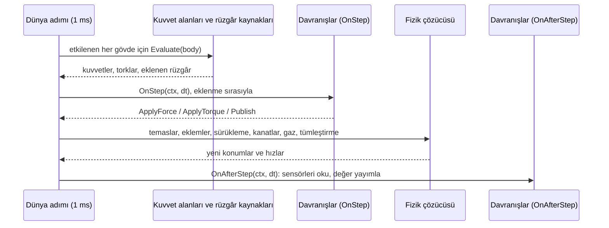

# Fizik betikleri (SDK): ortam, kuvvet alanları, betikler ve eklentiler

Bir dünyanın fiziğine kendi kodunuzu üç düzeyde ekleyebilirsiniz. Hepsi aynı sabit 1 ms fizik adımının içinde, belirli bir sırayla ve tohumlu rastgelelikle çalışır; bu yüzden bir dünya her seferinde aynı sonucu verir.

| Düzey | Nerede | Gerekenler | Ne için |
| --- | --- | --- | --- |
| **İfade** | Nesne → *Ortam ve davranışlar* → *Davranış ekle → İfade*, ya da Ortam → *İfade alanı* | Hiçbir şey | Hızlı kuvvet yasaları: `F.x = -k*(x - x0) - c*vx`, `wind.x = 3*sin(t)` |
| **C# betiği** | Dünya → *Betikler* sekmesi → *Yeni C# betiği* | .NET 9 SDK (uygulama hiçbir şey indirmez) | Durumlu davranışlar, sensörler, denetleyiciler; dünya dosyasının içinde saklanır |
| **Eklenti DLL'i** | `%APPDATA%\RobotWinStudio\Plugins\<ad>\` ya da dünya dosyasının yanındaki `Plugins\` | Herhangi bir derleyici (şablon: `sdk/templates/RobotWinPlugin`) | Kütüphaneler, özel devre elemanları, paylaşılan modeller |

## Kodunuz ne zaman çalışır



Uyguladığınız kuvvetler yalnızca o adım için geçerlidir; her adımda yeniden uygulayın.

## 1. İfadeler: araç gerekmez

### Nasıl eklenir

1. Dünya sayfasında bir nesne seçin.
2. Sağ panelde **Ortam ve davranışlar** → **Davranış ekle → İfade**.
3. Programı yazın; ayarlamak istediğiniz değerleri **Sabitler** kutusuna yazın, ör. `k=20, c=0.5`.
4. Dünyayı çalıştırın. Hatalar satır ve sütunla gösterilir: `Satır 2, sütun 7: Bilinmeyen değişken 'sped'. Bunu mu demek istediniz: speed?`

### Örnek: nesneyi başladığı yere geri çeken yay ve sönüm

```text
# yay + sönüm (x0 = başlangıç konumu)
k = 20; c = 0.5
F.x = -k*(x - x0) - c*vx
F.z = m*g*0.5 * (t > 1)          # karşılaştırmalar 0/1 verir
TL.z = -0.01*wz                  # gövde ekseninde tork
```

### Dil

| | |
| --- | --- |
| Deyimler | `;` ya da yeni satırla ayrılır; açıklama `#` ya da `//` |
| İşleçler (düşükten yükseğe) | `?:`, `\|\|`, `&&`, `< > <= >= == !=`, `+ -`, `* / %`, tekli `- + !`, `^` (üs, sağdan; `-2^2 = -4`, `2^3^2 = 512`; `**` da olur). `%` taban (floor) kalanıdır: `-7 % 3 = 2` |
| Fonksiyonlar | `sin cos tan asin acos atan atan2 sinh cosh tanh sqrt cbrt abs exp ln log log10 log2 pow min max clamp sign floor ceil round frac hypot lerp step smoothstep deg rad if noise hash square saw pulse` |
| Sabitler | `pi tau e g0 true false` |
| Girdiler (nesne davranışı) | `t dt x y z vx vy vz wx wy wz speed m g x0 y0 z0 roll pitch yaw rho tempC air.x air.y air.z wind.x wind.y wind.z airspeed h` ve Sabitler kutusundaki adlar |
| Çıktılar | `F.x F.y F.z` (N, dünya), `FL.x…` (N, gövde ekseni), `T.x…` (N·m, dünya), `TL.x…` (gövde); `Fx`, `F.x`'in kısaltmasıdır. Atanmayan çıktılar 0'dır |
| İfade alanı | ayrıca `wind.x wind.y wind.z` yazabilir (o noktaya eklenen hava hızı, m/s); temel rüzgâr `air.*` ile okunur; orada hız girdileri 0'dır |

Yerel değişkenler (`k = 20`) her adımda yeniden hesaplanır ve *Ad.değişken* olarak yayımlanır (Betikler sekmesinde ve sağ panelde görünür). Döngü ve kullanıcı fonksiyonu yoktur, bu yüzden her program biter (en çok 8000 karakter, 4000 düğüm, 64 iç içe düzey). NaN/∞ kuvvet üreten ifade hata sayılır (bkz. §6).

## 2. Dünyanın içindeki C# betikleri

### Nasıl yazılır ve yüklenir

1. **.NET 9 SDK**'yı kurun (uygulama indirmez). Yoksa Betikler sekmesi nedenini yazar; ifadeler ve eklentiler yine çalışır.
2. Dünya sayfası → **Betikler** sekmesi → **Yeni C# betiği**. Düzenleyicide bir şablon açılır.
3. `WorldBehavior`'dan türeyen bir sınıf yazın (aşağıda). Kaydedin: betik dünya dosyasının içinde saklanır.
4. Betik dünya başlarken (ya da *Derle* ile) derlenir. Hatalar dosya, satır ve sütunla görünür.
5. Bir nesne seçin → **Davranış ekle** → davranışınız (`[Behavior]` adıyla). `[Parameter]` özellikleri denetçide görünür.
6. Çalıştırın. `Publish` ettiğiniz değerler sağ panelde görünür; başka kod ve *Programlanabilir sensör (SDK)* parçası bunları okuyabilir.

### Örnek: nesneyi bir hedef noktaya çekmek

```csharp
using RobotTwin.CoreSim.Mechanics;
using RobotTwin.CoreSim.Sdk;

[Behavior("Yay ile merkeze çek", Description = "Nesneyi bir yay ve sönümle bir noktaya çeker.")]
public sealed class SpringToPoint : WorldBehavior
{
    [Parameter("Yay sabiti", Unit = "N/m")] public double K { get; set; } = 20;    // denetçide düzenlenir
    [Parameter("Sönüm", Unit = "N·s/m")] public double C { get; set; } = 0.5;
    [Parameter("Hedef", Unit = "m")] public Vec3 Target { get; set; }

    public override void OnStep(IBehaviorContext ctx, double dt)                 // her 1 ms, çözücüden önce
    {
        var b = ctx.Self!;                                                         // bağlı olduğu nesne
        b.ApplyForce((Target - b.Position) * K - b.Velocity * C);
        ctx.Publish("uzaklık", (Target - b.Position).Length);                      // denetçi, başka kod, SDK sensör parçası
    }
}
```

### Örnek: bir kartın PWM pinini izleyen itici

Betik devreyi okuyabilir: burada bir "soğuk gaz iticisi", Arduino'nun D9 pinine verdiği gerilimle orantılı olarak gövdenin +z ekseni boyunca iter.

```csharp
using RobotTwin.CoreSim.Mechanics;
using RobotTwin.CoreSim.Sdk;

[Behavior("PWM itici")]
public sealed class PwmThruster : WorldBehavior
{
    [Parameter("Kart nesnesi")] public string Board { get; set; } = "O1";
    [Parameter("En büyük itki", Unit = "N")] public double MaxThrust { get; set; } = 2.0;

    public override void OnStep(IBehaviorContext ctx, double dt)
    {
        double v = ctx.Circuit?.Voltage(Board, "D9") ?? 0;          // ortalama PWM seviyesi, 0–5 V
        double thrust = MaxThrust * System.Math.Clamp(v / 5.0, 0, 1);
        ctx.Self!.ApplyLocalForce(new Vec3(0, 0, thrust), Vec3.Zero);   // gövde çerçevesi, kütle merkezinde
        ctx.Publish("itki", thrust);
    }
}
```

### Betik kuralları

- Betikler geçici bir projede (`%LOCALAPPDATA%\RobotWinStudio\Scripts\<özet>`) `dotnet build` ile derlenir; `global.json` ile 9.x SDK'ya sabitlenir, NuGet boş bir yerel klasöre yönlendirilir: **paket yok, indirme yok**. Sonuç içerik özetine göre önbelleğe alınır.
- Bir betik türünün anahtarı `script:<Ad.Alanı.Tür>`'dür.
- `System.Random`, saat ya da iş parçacığı kullanmayın; `ctx.Random` (tohumlu) kullanın. Yoksa koşular tekrarlanamaz.

## 3. Eklenti DLL'leri

### Klasör düzeni

```text
%APPDATA%\RobotWinStudio\Plugins\
  AcmeWind\
    plugin.json
    Acme.Wind.dll        (+ .pdb, + kendi bağımlılıkları)
<dünya klasörü>\Plugins\...   (Ayarlar'dan kapatılabilir)
```

```json
{ "id": "acme.wind", "name": "ACME rüzgâr", "version": "1.2.0", "author": "ACME",
  "description": "…", "assembly": "Acme.Wind.dll", "entryTypes": [], "sdkVersion": 1 }
```

- `id` benzersiz olmalı, `:` `/` `\` içeremez; `builtin` ve `script` ayrılmıştır. `entryTypes` boşsa derlemedeki bütün uygun public türler alınır. plugin.json olmayan tek DLL'li klasör dosya adıyla yüklenir.
- Her eklenti, DLL'in bellekteki kopyasından **kendi toplanabilir `AssemblyLoadContext`'ine** yüklenir: diskteki dosya kilitlenmez; yeniden derleyip *Eklentileri yeniden yükle* deyin. `RobotTwin.CoreSim` her zaman uygulamanınkiyle paylaşılır (eklenti klasörüne kopyalamayın).
- **Dünya başına**: bir eklentinin davranışları ve alanları, dünyanın Betikler sekmesinde **"Bu dünyada etkin"** ise çalışır (türlerinden birini eklediğinizde kendiliğinden açılır). Ayarlar → *Eklentiler ve betikler* bir eklentiyi her yerde kapatır.
- Kaldırma, eklentinin nesnelerini tutan bir şey kalmayınca tamamlanır; Betikler sekmesindeki yeniden yükleme önce simülasyonu durdurur.

### Şablondan nasıl derlenir

```powershell
cd sdk/templates/RobotWinPlugin
dotnet build -c Release -p:Deploy=true
```

DLL ve plugin.json `%APPDATA%\RobotWinStudio\Plugins\RobotWinPlugin.Samples\` klasörüne kopyalanır. Depo dışında `-p:RobotWinDir="<RobotTwin.CoreSim.dll klasörü>\"` verin. Şablondaki örnekler: rüzgâr türbini ($`C_P(\lambda)`$, Betz sınırı, jeneratör yükü), dipol mıknatıs ($`3\mu_0 m_1 m_2 / 2\pi r^4`$), Reynolds sayısına bağlı küre sürüklemesi, termal yükselme (`IWindSource`), yumuşak sınır (`ForceField`) ve anemometre (özel `AnalogDevice` + `IPartProvider` + sensör davranışı).

### Örnek: kuvvet alanı

```csharp
using System.Collections.Generic;
using System.Globalization;
using RobotTwin.CoreSim.Mechanics;
using RobotTwin.CoreSim.Sdk;

/// <summary>Çelik parçaları çeken bir mıknatıs: F ∝ 1/r⁴ (aynı doğrultudaki iki dipol).</summary>
public sealed class DipoleMagnet : ForceField
{
    private Vec3 _centre;
    private double _strength = 2e-6;   // N·m⁴

    // Alanın yeri (Ortam → kuvvet alanları) ve parametreleri buraya bir kez gelir.
    public override void Configure(IReadOnlyDictionary<string, string> parameters, ForceFieldSpec spec)
    {
        _centre = new Vec3(spec.X, spec.Y, spec.Z);
        if (parameters.TryGetValue("strength", out var s)) _strength = double.Parse(s, CultureInfo.InvariantCulture);
    }

    public override bool Affects(ISimBody body) => !body.IsStatic && body.Material == "steel";

    public override (Vec3 Force, Vec3 Torque) Evaluate(ISimBody body, IBehaviorContext ctx)
    {
        var r = _centre - body.Position;
        double d = System.Math.Max(0.005, r.Length);
        return (r / d * (_strength / (d * d * d * d)), Vec3.Zero);
    }
}
```

### Örnek: özel devre parçası

Bir parça, `Build`'i devreye `AnalogDevice` alt sınıfları ekleyen bir `PartDefinition`'dır. Eleman her adımda kendini [MNA matrisine](../fizik/01-devre.md) damgalar:

```csharp
using System.Collections.Generic;
using RobotTwin.CoreSim.Analog;
using RobotTwin.CoreSim.Design;
using RobotTwin.CoreSim.Sdk;

/// <summary>Direnci başka bir davranışın yayımladığı ışık değerini izleyen bir LDR.</summary>
public sealed class LdrDevice : AnalogDevice
{
    public LdrDevice(string id, int a, int b) : base(id) { A = a; B = b; }
    public int A { get; }
    public int B { get; }
    public double Lux { get; set; } = 100;

    public override void Stamp(StampContext ctx)
    {
        double r = 10_000 * System.Math.Pow(Lux / 10.0, -0.7);   // GL5528 benzeri R(lüks) eğrisi
        ctx.AddConductance(A, B, 1.0 / r);
    }
}

public sealed class LdrParts : IPartProvider
{
    public IEnumerable<PartDefinition> Parts()
    {
        var part = new PartDefinition { Id = "acme-ldr", Name = "ACME LDR", Category = "Sensör", RefPrefix = "R" };
        part.Pins.Add(new PinDefinition("A", "1", -2, 0));
        part.Pins.Add(new PinDefinition("B", "2", 2, 0));
        part.Build = c => c.Add(new LdrDevice(c.RefDes, c.Pin("A"), c.Pin("B")));
        yield return part;
    }

    public IEnumerable<PartPreset> Presets() => System.Array.Empty<PartPreset>();
}
```

Bu sayfadaki dört C# örneği kütüphanenin kendisine karşı derlenerek denetlenmiştir.

## 4. C# API başvurusu (`RobotTwin.CoreSim.Sdk`)

| Tür | Amaç |
| --- | --- |
| `IWorldBehavior` / `WorldBehavior` | Her adımda çalışan kod (`OnStart`, `OnStep`, `OnAfterStep`, `OnStop`). `[Behavior(AttachTo = "world")]` dünya genelinde tek örnek |
| `IBehaviorContext` | `Time, Dt, StepIndex, Self, Bodies, Body("ad ya da O3"), Joints, Joint(id), Air (Density, TemperatureC, Pressure, WindAt), Gravity, Circuit, Parameters, Param(), Random (tohumlu), Publish/Read, Raycast, Log/Warn` |
| `ISimBody` | `Id, Name, Object, Mass, Inertia, Position, Orientation, Velocity, AngularVelocity, Volume, Material, DragArea (yazılabilir), LocalToWorld/WorldToLocal, PointVelocity, ApplyForce, ApplyForceAtPoint, ApplyLocalForce, ApplyTorque, Teleport, SetVelocity, LastSdkForce`. Kuvvetler bir adım için geçerlidir |
| `ISimJoint` | `Angle, Speed, Axis, Anchor, MotorTorque (kalıcı), Drive, TargetAngle, TargetSpeed, Stiffness, Damping, MaxTorque, ReactionForce/Torque, Parent, Child` |
| `IForceField` / `ForceField` | `Affects(body)`, `Evaluate(body, ctx) → (Force, Torque)`; `Configure(parameters, spec)` alanın yerini ve parametrelerini alır |
| `IWindSource` | `WindAt(point, time)` → eklenen hava hızı (sürükleme ve pervaneler üzerinden etkiler) |
| `ICircuitAccess` | `Voltage(nesne, pin)`, `Signal(anahtar)`, `Devices(nesne[, iç RefDes])` → eleman modellerine doğrudan erişim (özel sensörler) |
| `IPartProvider` | Özel devre parçaları: `Build`'i `AnalogDevice` alt sınıfları (`Stamp`, `Accept`) ekleyen `PartDefinition` |
| `SensorDevice` | Hazır Thevenin çıkışı (OUT–GND). Kütüphanedeki **"Programlanabilir sensör (SDK)"** parçası `signal` parametresinde adı geçen yayımlanmış değeri gerilime çevirir (`V = değer·ölçek + kayma`, sınırlı); Arduino `analogRead` ile okunur |
| `SdkRandom` | SplitMix64 + Box–Muller; `ctx.Random` her ek için ayrı, tohumlu bir akış |

Birimler SI'dır; dünya çerçevesinde Z yukarıdır. Koddan `DragArea` atamak, o gövdenin otomatik yüz yüz sürüklemesinin ([aerodinamik](../fizik/04-aerodinamik.md)) yerine sizin simetrik Cd·A değerinizi koyar.

## 5. Ortam modeli

*Ortam* palet sekmesi.

### Hava

Yoğunluk ortam sıcaklığı *T*, deniz seviyesi basıncı *p₀*, rakım *h* ve bağıl nemden hesaplanır:

```math
p = p_0\,(1 - 2{,}25577\cdot10^{-5}\,h)^{5{,}25588}, \qquad \rho = \frac{p_d}{R_d T} + \frac{p_v}{R_v T}
```

Tetens doymuş buhar basıncıyla; 15 °C ve 1013,25 hPa'da 1,225 kg/m³. İsterseniz sabit bir yoğunluk girin (Mars ≈ 0,02). Sürükleme için bütün dünyaya tek yoğunluk uygulanır; [gaz kapları](../fizik/05-gaz-ve-roket.md) ortam basıncını kendi yüksekliklerinde ISA'dan alır.

### Rüzgâr

- **Ortalama rüzgâr**: hız, *estiği* yön (0° = +X'e doğru, 90° = +Y'ye doğru), dikey bileşen.
- **Yükseklik profili**: düzgün; üstel yasa $`u(z) = u_\text{ref}(z/z_\text{ref})^\alpha`$; logaritmik $`u(z) = u_\text{ref}\ln(z/z_0)/\ln(z_\text{ref}/z_0)`$.
- **Türbülans** (Dryden benzeri): her eksende birinci dereceden Gauss–Markov süreci, $`u_{k+1} = a\,u_k + \sigma\sqrt{1-a^2}\,n`$, $`a = e^{-V\Delta t/L}`$; σ yatay şiddet, dikey σ = oran·σ, ilinti süresi $`L/V`$. Boyuna bileşen Dryden spektrumunun tam karşılığıdır; yanal ve dikey Dryden spektrumları ikinci derecedir ve aynı birinci derece süzgeçle yaklaşıklanır. Türbülans uzayda düzgündür; L'den çok küçük nesneler için uygundur.
- **Ani esintiler**: rüzgâr yönünde $`\tfrac{1}{2}A\,(1 - \cos 2\pi t/T)`$ biçiminde, genliği A·[0,5, 1], aralar üstel dağılımlı.
- **Tohum**: bütün rastgele süreçler `SdkRandom` (SplitMix64) kullanır; her .NET sürümünde aynı dizi.

### Aerodinamik

- **Sürükleme** her hareketli nesnede, yüz yüz: öndeki yüzde durma basıncı, tabanda emme, yanlarda yüzey sürtünmesi; bağlı parçaların örttüğü yüzler çıkarılır ([ayrıntı](../fizik/04-aerodinamik.md)). Nesne başına Cd, referans alan ya da sürüklemeyi kapatma: sağ panel → *Ortam ve davranışlar*.
- **Kaldırma kuvveti** $`\rho V g`$ (isteğe bağlı; hacim çarpışma şeklinden ya da elle).
- **Dönme sönümü** $`-c\,\rho\,r^5\,\lvert\omega\rvert\,\omega`$ (r = sınır küresinin yarıçapı; kaba bir model).
- **Pervaneler**: rüzgâr modeli pervanelerin giriş havasına da girer (rotor sürüklemesi); yoğunluk itkiyi ölçekler.

### Kuvvet alanları (Ortam → *Kuvvet alanları ve hava akımları*)

| Tür | Davranış | Parametreler |
| --- | --- | --- |
| `uniform` (düzgün) | sabit kuvvet (N) ya da ivme (m/s²) | yön, büyüklük |
| `radial` (çekici/itici) | merkeze doğru `S·f(r)`; `f`: 1/r² (R'de 1), doğrusal, Gauss, sabit | R, azalma |
| `vortex` (girdap) | Rankine girdabı: çekirdekte `S·r/R`, dışında `S·R/r`; içe akış, yukarı akış. Varsayılan olarak **rüzgâr** (sürükleme ve pervanelerle etkiler), isterseniz doğrudan kuvvet | eksen, R |
| `fan` | kutu bölgede hava akımı (rüzgâra eklenir), ~6 çaptan sonra serbest jet gibi azalır, kenarlarda yumuşar | yön, çıkış hızı |
| `conveyor` (konveyör) | bölgedeki nesnelerin yatay hızını τ = 50 ms ile bant hızına çeker, zemin sürtünmesini dengeler; en çok (tutuş + μ_zemin)·m·g | bant yönü/hızı, tutuş |
| `expression` (ifade) | her nesneye `F.*`/`T.*` ya da her noktada `wind.*` | program |
| `plugin` (eklenti) | `IForceField` / `IWindSource` uygulayan eklenti türü | eklentinin parametreleri |

Alanlar döndürülmüş bir kutuyla sınırlanabilir ve seçili nesnelere hedeflenebilir. 3B görünümde: zeminde rüzgâr okları, köşede rüzgâr çorabı, alanların çerçeveleri (fan mavi, konveyör sarı, girdap yeşil, diğerleri mor).

## 6. Güvenlik ve yalıtım

- Her kullanıcı çağrısı (`OnStart/OnStep/OnAfterStep/OnStop`, alan değerlendirmesi, rüzgâr kaynağı) ayrı bir `try/catch` içindedir. Hatalar Olaylar günlüğüne yazılır (tür, mesaj, ilk yığın satırı, zaman); **3 hatadan sonra** o davranış ya da alan bu çalıştırma için kapatılır, gerisi çalışmaya devam eder. İfadelerin ve alanların ürettiği NaN/∞ kuvvetler uygulanmaz ve hata sayılır; `ISimBody.ApplyForce` NaN/∞ değerleri sessizce yok sayar.
- **Adım bütçesi**: her davranışın ve alanın adım başına ortalama süresi ölçülür; dünyanın bütçesini (varsayılan 0,25 ms) aşan için bir kez uyarı verilir. Betikler panelinde canlı süreler görünür.
- **Sınırlar (dürüstçe)**: .NET kodu zorla durdurulamaz; sonsuz döngüye giren bir eklenti uygulamayı dondurur, `StackOverflowException` yakalanamaz. Eklenti ve betik kodu uygulamanın bütün yetkileriyle (dosya, ağ) çalışır: **korumalı alan (sandbox) değildir**. Yalnızca güvendiğiniz eklentileri kurun; başkalarından gelen dünyalarda dünya klasörü eklentilerini Ayarlar'dan kapatın. İfade dili tamamen güvenlidir (döngü yok, G/Ç yok).

## 7. Belirlenimcilik

Rüzgâr, alanlar ve davranışlar `WorldPhysics.Advance`'in sabit adımında (`Step`, varsayılan 1 ms), belirli bir sırayla (önce alanlar, sonra davranışlar, eklenme sırasıyla) çalışır. Rastgele sayılar dünyanın tohumundan türetilir. Aynı dünya + aynı tohum ⇒ aynı yörünge (testle doğrulanmıştır). Kare hızı ve gerçek zaman çarpanı sonucu değiştirmez.

## 8. Doğrulama (testler: `CoreSim/tests/RobotTwin.CoreSim.Tests/SdkTests.cs`)

| Test | Karşılaştırma | Tolerans |
| --- | --- | --- |
| Düşen pinpon topu | $`v(t) = v_t\tanh(g t / v_t)`$, $`v_t = \sqrt{2mg/(\rho C_D A)}`$ | %1 / %0,5 |
| Hafif kutuya rüzgâr | ilk kuvvet $`\tfrac{1}{2}\rho C_D A v^2`$; nesne başına Cd ve sürüklemeyi kapatma | %2 |
| Dryden türbülansı | ortalama ≈ 0, σ ve dikey σ, $`\rho(\tau = L/V) \approx e^{-1}`$; aynı tohum aynı dizi | %4 |
| Esintiler, profil yasaları, ISA yoğunluk/basınç/viskozite | kapalı çözümler | — |
| İfade dili | öncelik, fonksiyonlar, hata konumları ve öneriler | birebir |
| Eklentiler | testte üretilen gerçek bir DLL (`PersistedAssemblyBuilder`) yüklenir, çalışır, diskte değiştirilip yeniden yüklenir, kaldırılır ve yükleme bağlamının toplandığı doğrulanır; hata yalıtımı ve bütçe uyarısı; .NET SDK varsa betik derleme | — |
