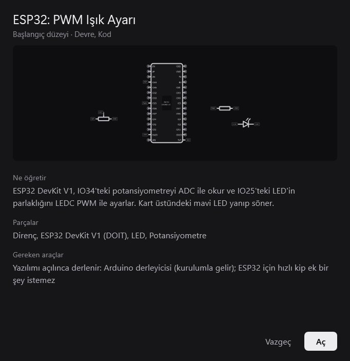
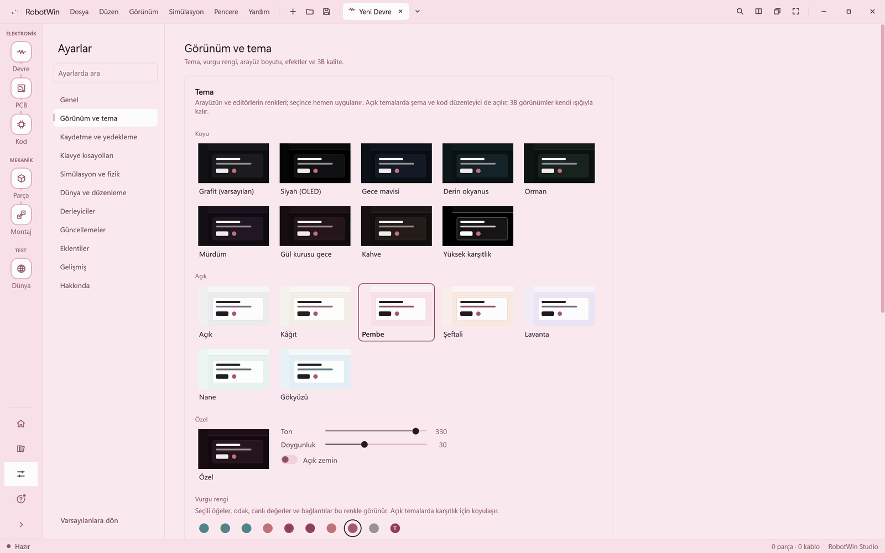

# 1. Başlarken

Bu bölümde RobotWin Studio'yu kurar, ekranın bölümlerini tanır ve ilk projenizi açarsınız.

## Kurulum

1. [GitHub Sürümler sayfasından](https://github.com/Kinin-Code-Offical/robotwin-studio/releases/latest) kurulum dosyasını, `RobotWinStudio-Setup-<sürüm>.exe`'yi indirin. Küçüktür: seçtiğiniz parçaları aynı sürümden kendisi indirir ve her birini doğrular.
2. Çalıştırın. İlk sayfada **dili** (kurulumun ve uygulamanın dili) ve **kurulum türünü** seçin:
   - **Tam** (önerilen): uygulama, kendi .NET 10'u, Arduino derleyicisi ve STEP / IGES desteği. Kurulur kurulmaz her şey internetsiz çalışır.
   - **Hafif**: yalnız uygulama; bilgisayarınızdaki .NET 10 Masaüstü Çalışma Zamanı'nı kullanır (yoksa kendi kopyasını getirir). Derleyici ve STEP / IGES sonradan eklenebilir.
   - **Özel**: bileşenleri kendiniz işaretleyin.
3. **Kurulum biçimini** seçin: bu kullanıcı için (varsayılan, yönetici izni istemez), tüm kullanıcılar için (yönetici ister) ya da **taşınabilir** (yalnız bir klasör, örneğin USB bellekte: kısayol, kayıt defteri girdisi ve dosya türü yok).
4. Kurulum bitince Başlat menüsünden **RobotWin Studio**'yu açın.

Bileşenleri sonradan eklemek ya da kaldırmak için **Ayarlar → Güncellemeler → Bileşenleri değiştir…**'i (ya da Windows **Ayarlar → Uygulamalar → RobotWin Studio → Değiştir**'i) kullanın. Kaldırmak için Windows **Ayarlar → Uygulamalar** listesini kullanın. Bir güncelleme yeni sürümü kurduktan sonra onu bir kez dener; yeni sürüm açılmazsa önceki sürümü olduğu gibi geri yükler. İnternetsiz kurmak için sürümün `.rwpack` dosyalarını kurulum dosyasının yanına koyun.

### Kendi kodunuzu derlemek için

| Kart | Gerekli araç | Kurulum |
| --- | --- | --- |
| Arduino Uno / Nano | Arduino derleyicisi: `arduino-cli`, AVR çekirdeği ve kütüphane listesi | **Kurulumun bir bileşenidir** (tam kurulumda vardır); hafif kurulumda **Ayarlar → Güncellemeler → Bileşenleri değiştir…** ile ekleyin |
| ESP32 | Visual Studio C++ araçları (MSVC) | Visual Studio 2022 veya Build Tools ile **"C++ ile masaüstü geliştirme"** iş yükü |

Kendi `arduino-cli`'nizi kullanmak isterseniz yolunu **Ayarlar → Derleyiciler** bölümüne yazın. Uygulama MSVC'yi kendisi bulur; bulamazsa yolunu aynı bölüme girin.

## İlk açılış

Uygulama açılırken bir açılış ekranı görünür: ürünün adı ve sürümü, alt şeritte o an neyin yüklendiği ve ne kadarının bittiği, en altta ince bir ilerleme çubuğu. Arka plandaki fotoğraf RobotWin'in kendi görseli hazır olana kadar duran lisansı serbest bir stok fotoğraftır; sahibi alt satırda yazar. Ardından **Başlangıç** sayfası gelir.

Başlangıç sayfasında şunlar vardır:

- **Yeni dünya**, **Yeni devre / kart** ve **Aç…** düğmeleri.
- **Devre ve robot örnekleri:** Başlangıç, Orta ve Robot düzeyinde hazır devreler (LED ve buton, Arduino Blink, LCD + OLED, ESP32 PWM, MOSFET ile motor, op-amp, 7805, RC filtre, röle, NAND, çizgi izleyen robot, engelden kaçan robot, mikro quadcopter). Her örnek bir karttır: resmi örneğin kendi devresinden çizilir, altında düzeyi ve kullandığı alanlar (Devre, PCB, Kod, Montaj, Dünya) yazar. Karta tıklayınca önce kısa bir bilgi ekranı açılır: ne öğrettiği, parçaları ve gereken araçlar (örneğin yazılımı hazır derlenmiş mi, Arduino derleyicisi mi gerekiyor); **Aç** örneği açar.
- **Dünyalar:** hazır dünya şablonları (boş atölye, servo kol, iki tekerlekli araba, ultrasonik sensör, kumandalı araba…).
- Sağda **Son açılanlar**, **Otomatik yedekler** ve sık kullanılan **Kısayollar**.

> İpucu: Bir örneğe tıklamak onu yeni bir sekmede açar. Örnekleri bozmaktan korkmayın; kaydetmediğiniz sürece orijinal hali değişmez.

## İlk robotun: etkileşimli rehber

Uygulamayı ilk açtığınızda 5–10 dakikalık bir rehber önerilir. Daha sonra **Başlangıç** sayfasındaki **İlk robotun** düğmesiyle ya da **Yardım → İlk robotun** ile yeniden açabilirsiniz.

Rehber sağ altta küçük bir kart olarak durur. Her adımda neye basacağınızı yazar ve o düğmenin çevresini turuncu bir çerçeveyle gösterir. Adımı yaptığınızda kendiliğinden fark eder ve sonrakine geçer. Karttaki düğme (örneğin **Servo kolu aç**, **Yükle ve çalıştır**) adımı sizin yerinize yapar; **Bu adımı atla** sonrakine geçer.

1. **Hazır servo kolunu açın:** Arduino Uno iki SG90 servoyu sürer.
2. **Çalıştırın ve izleyin:** kol tarar.
3. **Kodu açın:** kolun Arduino kodu Kod sayfasında açılır.
4. **Kodu değiştirin:** 23. satırdaki `step = 2` içinde 2 seçili gelir; 6 yazın. Kol üç kat hızlı tarar.
5. **Karta yükleyin:** kod derlenir, Uno'ya yüklenir, dünya baştan çalışır.
6. **Akımı ölçün:** **Kablolar ve ölçümler** sekmesinde servoların kablolarındaki akım canlı görünür.
7. **Kaydedin:** dünya, değiştirdiğiniz kodla birlikte saklanır.

## Ekranın bölümleri

| Bölüm | Yeri | Ne işe yarar |
| --- | --- | --- |
| Menü çubuğu | En üst | **Dosya**, **Düzen**, **Görünüm**, **Simülasyon**, **Pencere**, **Yardım** menüleri. **F10** ile klavyeden açılır. |
| Belge sekmeleri | Menünün yanında | Açık devreler ve dünyalar; kayıtlı bir dosya kendi adıyla görünür. Kaydedilmemiş değişiklik, kapatma düğmesinin yerinde bir nokta olarak görünür. Sekmeler sığmazsa şerit fare tekerleğiyle ya da oklarla kayar; **▾** bütün açık sekmeleri listeler. Sağ tıklayıp **Sabitle** derseniz sekme en solda kalır, toplu kapatmalarda kapanmaz ve dosya bir dahaki açılışta da sabit gelir. Sekmeleri sürükleyerek sıralayabilirsiniz. **Ctrl+Tab** sonraki sekme, **Ctrl+W** sekmeyi kapatır, **Ctrl+Shift+T** kapatılan dosyayı yeniden açar. |
| Tasarımdan gerçeğe hattı | Sol kenar | Sayfalar üç grupta: **ELEKTRONİK** (Devre → PCB → Kod), **MEKANİK** (Parça → Montaj), **TEST** (Dünya). Altta Başlangıç, Kütüphane, Ayarlar ve Yardım. Başlangıç'a sol üstteki logodan da dönülür. **Ctrl+B** hattı genişletir; her sayfanın ne işe yaradığı ve durumu yazar. |
| Sayfa | Orta | Seçili aşamanın editörü. |
| Durum çubuğu | En alt | Sorun sayaçları (hata ⊗, uyarı ⚠), son mesaj, simülasyon durumu, parça ve kablo sayısı. |

### Pencere özellikleri

- **Çalışma alanları:** başlık çubuğundaki **Çalışma alanı** seçicisi (ya da **Pencere → Çalışma alanı**) göreve hazır yerleşimleri açar: Devre tasarımı, Ölçüm (şema ve altta osiloskop), Kod, PCB, Mekanik, Dünya, Dünya simülasyonu (altta kablolar ve ölçümler). Hazır çalışma alanları kenardaki araç şeritlerini de göreve göre ayarlar: tasarımda araçlar açık, Ölçüm ve Dünya simülasyonunda katlı (yalnız tutamakları kalır), Dünya simülasyonunda ızgara şeridi kapalı. Panelleri ve şeritleri istediğiniz gibi düzenleyip **Ekrandaki düzeni çalışma alanı olarak kaydet…** ile kendi çalışma alanınızı yapabilir (panellerle birlikte şeritlerin yeri ve durumu da saklanır), **Varsayılan düzene dön** ile panelleri ilk yerlerine alabilirsiniz. **Ekrandaki düzeni projeye kaydet** düzeni projenin içine yazar: proje kaydedilince onunla saklanır, proje her açıldığında kendiliğinden geri gelir ve seçicide **Projenin düzeni** olarak durur; **Projenin düzenini kaldır** onu projeden çıkarır.
- **Komut paleti (Ctrl+K):** her komutu, sayfayı ve parçayı adını yazarak bulun. Ne istediğinizi cümle gibi de yazabilirsiniz, kelimelerin sırası ve ekleri önemli değil: "MOSFET ekle", "servo motorun akımını izle", "DRC çalıştır", "seçili parçayı PCB'de göster", "montaj ilişkilerini denetle". Açık sayfanın komutları önce gelir; yalnızca o anda yapılabilecek komutlar (bir parça seçiliyken "PCB'de göster" gibi) listelenir.
- **Bölünmüş görünüm (Ctrl+\\):** iki sayfayı yan yana gösterir; örneğin devre ile PCB'yi birlikte görürsünüz.
- **Ayrı pencereye al:** **Pencere → Bu sayfayı ayrı pencereye al** ile bir sayfayı ikinci bir pencereye (örneğin ikinci monitöre) taşıyın.
- **Odak modu:** **Görünüm → Odak modu** gezinme çubuğunu gizler.
- **Panelleri taşımak, küçültmek, ayırmak:** Dünya, Devre ve PCB sayfalarındaki yan paneller (palet, parça kütüphanesi, özellikler, denetçi) ve alt sekmeler başlıklarından sürüklenerek ayrı pencereye alınır; pencereyi kenara bırakınca sola, sağa ya da alt bölmeye yerleşir. Başlıktaki **Küçült** düğmesi o tarafı kenarda adların yazdığı ince bir şeride indirir (Visual Studio'daki gibi), şeride tıklayınca geri açılır. **Ctrl+Space** tam görünüm: bütün paneller çekilir, çizim alanı bütün pencereyi alır; yeniden basınca paneller olduğu gibi döner. Düzen saklanır. Bkz. [Dünya → Panelleri yerleştirme](07-dunya.md#panelleri-yerleştirme).
- **Katlanır bölümler** (Blender'daki gibi): Devre, PCB ve Parça'nın özellik panellerinde her bölüm başlığının önünde bir ok var; başlığa tıklamak bölümü katlar ya da açar. Dünya denetçisinin bileşen kartları da öyle. Hangi bölümlerin katlı olduğu oturumlar arasında saklanır.
- **Araç şeritleri** (Unity'deki gibi): Devre, PCB, Parça ve Dünya'da araçlar çizim alanının sol kenarında simgeli bir sütun olarak durur. Başındaki **≡** tutamağından sürüklenir: başka bir kenara ya da köşeye bırakılınca oraya yerleşir, başka yerde yüzer. Tutamağa çift tıklamak ya da sağ tık ▸ **Ayrı pencereye al** şeridi küçük bir pencereye çıkarır (SolidWorks'teki gibi; ikinci ekrana da taşınır), yine çift tık ya da **Yerine koy** geri yerleştirir. Bir grubun araçları (çizim) kendi şeridinde açılır, ana şeridin yanında durur. Yerleri sayfa sayfa saklanır. Üst çubuklar da yalnız simgelerden oluşur; adı ve kısayolu simgenin ipucundadır.
- **Sorunlar:** durum çubuğunun solundaki sayaçlar bütün projenin hatalarını ve uyarılarını sayar: devrenin ERC'si, PCB'nin son DRC'si, son derlemenin hataları, **Montaj** (projesinin gerisinde kalan montaj), **Proje** denetiminin bulduğu eksikler (derleyici, kütüphane, parça; şemanın gerisinde kalan PCB) **Montaj denetimi** (açık dünyada ya da Montajda **Denetle** ile: iç içe geçen parçalar, ekseni kayık delikler, kısa ya da gergin kablolar, kutusu tanımlı kartın (PCB → DRC → **Kutu**) duvarlara, tabana ya da kapağa taşan kartı ve parçaları; birbirine ya da aynı gövdeye sabitlenmiş parçalar sayılmaz, satır parçayı ya da kabloyu seçer) ve bilgi olarak **Model sınırları** (devredeki parçaların simülasyon modelinin neyi içermediği: ısıl gürültü, çekirdek kaybı, radyonun bir model olması …; satır parçayı gösterir) (VS Code'daki Sorunlar paneli gibi). Bir alanın denetimi son değişiklikten eskiyse yanında bir bilgi işareti çıkar. Sayaçlara tıklamak (ya da komut paletinde "Sorunlar") listeyi açar: en üstte her alanın durumu ("Devre: tamam", "PCB: 2 uyarı", "Proje: denetlenmedi"; tıklayınca o alana gider), altında alan alan hatalar ve uyarılar; yalnız bilgi düzeyindekiler "▸ N bilgi" satırının altında katlıdır. Bir satır o yere gider (parça seçilir, DRC işareti ya da kod satırı gösterilir; Proje ve Montaj satırları düzeltmeleriyle denetim penceresini açar), eski kalmış alan **Denetle** ile yeniden denetlenir. Düzeltmesi olan satırın sağında bir anahtar düğmesi durur (VS Code'un hızlı düzeltmesi gibi; ne yapacağı ipucunda yazar): numarasız ya da yinelenen tanımlayıcıda **Numaralandır**, bağlanmamış pinde pine NC işareti, boştaki NC işaretini silme, bağlı pindeki NC işaretini kaldırma, boştaki kablo parçasını silme, hiçbir şeye değmeyen etiketi silme, tek pinli etiketli hatta tamamlama (aynı ad başka türlü yazılmışsa — "MOTOR_EN" / "Motor-EN" — etiket o hattın adını alır; o adda tek bir boştaki pin varsa, "SDA" ya da "A4/SDA" gibi, pinin ucuna o etiket konur), PCB'de bağlanmamış bağlantıda, bir şeye fazla yakın yolda ya da boşta kalan yol ucunda **Hattı yeniden çiz** (o hattın yolları kaldırılır, otomatik rota yalnız onu öbür hatların arasından yeniden çizer, DRC yeniden çalışır), diğer ERC ve DRC işaretlerinde **İstisna olarak işaretle**; Proje ve Montaj satırlarında PCB sayfası, montajı güncelleme, araç zincirini kurma ya da kütüphane sayfası. Devredeki düzeltmeler tek adımda geri alınır; düzeltmeden sonra liste yeniden denetlenir, açtığınız "bilgi" katı açık kalır.
- **Sol şerit:** başlık çubuğunun en solundaki şerit düğmesi, **Ctrl+Shift+B**, **Görünüm → Sol şerit** ya da şeridin altındaki **Gizle** onu kapatır ve açar; seçim saklanır. Sayfalara şerit kapalıyken de **Ctrl+1…7** ve komut paletiyle gidilir.
- **Alt bölmeyi katlamak:** alt bölmenin sağındaki ⌄ onu yalnız sekmelerinin kaldığı ince bir şeride indirir; bir sekmeye tıklamak ya da ⌃ geri açar. Dünya sayfası ilk açılışta alt bölmesi katlı başlar; seri çıktı gibi bir şey gelince kendi açılır.
- **Kaydırıcılar:** her kaydırıcının yanındaki değer kutusuna değer yazılabilir (Enter uygular, ↑/↓ adım atar, Shift büyük adım).
- **Tam ekran (F11):** **Esc** veya **F11** ile çıkılır.
- **Arayüz ölçeği:** **Görünüm → Arayüz ölçeği**. Varsayılan **Otomatik (ekrana oranlı)**: arayüz pencereyle orantılı ölçeklenir; 1920 × 1080'de %100'dür, daha küçük ekranda ya da Windows'un büyük ekran ölçeğinde (%150, %200) simgeler, yazılar ve paneller aynı oranda küçülür, büyük ekranda büyür (%60–%150). Böylece hiçbir şey kaymaz, taşmaz, ikinci sütuna geçmez; oranlar her ekranda aynı kalır. Sunum ya da başka bir tercih için sabit bir ölçek (%75–%150) seçilebilir.

## Dosyalar

| Uzantı | Ne saklar |
| --- | --- |
| `.rwproj` | Bir devre / kart projesi: şema, PCB, montaj, kartların kodu |
| `.rwworld` | Bir dünya: nesneler, kablolar, bağlantılar ve içindeki kartlar |
| `.rwmodel` | Parça sayfasında yaptığınız 3D parçalar |
| `.rwsim` | Simülasyon kaydı (ölçümler, olaylar, seri çıktı) |
| `.rwpart`, `.rwlib` | Kendi parçanız / parça kütüphanesi |

- **Kaydet:** Ctrl+S. **Farklı kaydet:** Ctrl+Shift+S. **Aç:** Ctrl+O.
- Uygulama kaydedilmemiş işinizi belirli aralıklarla `Belgeler\RobotWin\Yedekler` klasörüne yedekler. Yedekleri Başlangıç sayfasındaki **Otomatik yedekler** listesinden açabilirsiniz.
- Kurulum bu dosya türlerini Windows'a kaydeder; dosyaya çift tıklayınca RobotWin Studio açılır.

## Kütüphane

**Kütüphane** (Ctrl+7) sayfası tüm parçaları şema sembolü, PCB ayak izi ve 3D önizlemesiyle gösterir.

- **Bundan yeni parça:** var olan bir parçanın simülasyon modelini kullanıp kendi değerlerinizle yeni bir parça (`.rwpart`) oluşturur.
- **3B modeli değiştir…:** bir parçanın 3D görünümünü kendi STL / OBJ / PLY / WRL ya da STEP / IGES dosyanızla değiştirir. **Üretilen modele dön** eskisini geri getirir.
- **İçe aktar…:** `.rwpart` / `.rwlib` dosyaları ve KiCad sembol (`.kicad_sym`) ile ayak izi (`.kicad_mod`, `.pretty` klasörü) dosyaları.
- **Kütüphanemi dışa aktar:** kendi parçalarınızı tek bir `.rwlib` dosyasında paylaşın.

## Ayarlar

**Ayarlar** (Ctrl+,) sayfası kategorilere ayrılır. Soldaki listeden bir kategori seçin ya da üstteki **Ayarlarda ara** kutusuna bir sözcük yazın; arama bütün kategorilere bakar.

| Kategori | Neler var |
| --- | --- |
| Genel | Dil, açılışta başlangıç sayfası, ilk robot rehberi, proje klasörü, son dosyalar, uzunluk birimi (mm, cm, inç, mil: uzunluk kutuları bu birimde gösterir; "1 in", "25.4 mm", "2 cm" gibi birimli yazılan değeri her birimde okur) |
| Görünüm ve tema | Tema galerisi (9 koyu, 7 açık tema ve özel tema), vurgu rengi, arayüz ölçeği, performans göstergesi, efektler ve ses, 3B kalite, 3B çizici (kendi GPU çizicimiz ya da WPF) |
| Kaydetme ve yedekleme | Otomatik yedek sıklığı, kaydederken önceki sürümü saklama, çökme sonrası kurtarma, yedek klasörü, belge başına kopya sayısı, klasörün boyut sınırı |
| Klavye kısayolları | Pencerenin ve bütün sayfaların kısayollarını değiştirme, çakışma uyarısı, tek tek ya da toplu sıfırlama |
| Simülasyon ve fizik | Parça hasarı, arıza olunca duraklat, ortam sıcaklığı, zaman adımı, başlangıç hızı, simülasyonu ayrı iş parçacığında çalıştırma |
| Dünya ve düzenleme | Yeni dünyaların yerçekimi, dünya editörü ızgarası |
| Derleyiciler | `arduino-cli` yolu, `vcvars64.bat` yolu |
| Güncellemeler, Eklentiler | Sürüm denetimi; eklenti klasörleri ve betikler |
| Gelişmiş | Ayarları dosyaya aktarma ve dosyadan alma, hata günlüğü, dosya türleri |

**Dil:**

- Uygulama ilk açılışta İngilizcedir. **General → Language** (Genel → Dil) kartından English ya da Türkçe seçin. Seçtiğiniz dil, uygulama yeniden açılınca her yerde geçerli olur; kartta **Şimdi yeniden başlat** düğmesi var.
- Dille birlikte değişenler:
  - pencerelerin, tuvallerin ve ölçü aletlerinin bütün metinleri;
  - sayı ve tarih biçimi (İngilizcede 1.5 mm, Türkçede 1,5 mm);
  - Yardım sayfasındaki kılavuz ve Haberler;
  - parça kataloğunun adları ve açıklamaları;
  - örneklerin adları ve örnek kodların yorumları.
- Aramalar (parça, ayar, komut paleti) iki dilde de çalışır: "resistor" da "direnç" de bulur.
- **Kendi dil paketinizi yapmak için:**
  1. `Lang/en.json` dosyasını kopyalayıp `de.json` gibi adlandırın. Anahtarlar arayüzün kaynak metinleridir (Türkçe), değerler İngilizceleri: değerleri kendi dilinize çevirin. `{…}` olan kalıplarda sayılar ve adlar `{0}`, `{1}` sırasıyla yerleşir.
  2. Dosyanın başındaki `"language"` alanına dilin adını, `"culture"` alanına sayı ve tarih biçimini (örneğin `"de-DE"`) yazın.
  3. Yeni dosyayı **Dil paketleri klasörü** düğmesinin açtığı klasöre koyun (`%APPDATA%\RobotWin\lang`). Dosyanın adı dilin kimliği olur.
  4. Paket listede "(kendi paketiniz)" olarak görünür. Çevirmediğiniz metinler İngilizce görünür, Türkçe değil; paketi parça parça büyütebilirsiniz.

**Temalar:** **Görünüm ve tema** kategorisindeki galeri her temayı pencerenin küçük bir resmi olarak gösterir. Tıkladığınız tema hemen uygulanır.

- **Koyu:** Grafit (varsayılan), Siyah (OLED ekranlar için), Gece mavisi, Derin okyanus, Orman, Mürdüm, Gül kurusu gece, Kahve, Yüksek karşıtlık.
- **Açık:** Açık, Kâğıt, Pembe, Şeftali, Lavanta, Nane, Gökyüzü. Açık temalarda şema bir kâğıda basılmış gibi koyu mürekkeple çizilir, PCB soluk bir kart üstünde koyu baskıyla görünür (bakır renkleri aynı kalır), kod düzenleyici de açılır ve sözdizimi renkleri açık zemine uygun tonlara geçer.
- **Özel:**
  - **Ton:** 0 kırmızı, 120 yeşil, 200 mavi, 330 pembe.
  - **Doygunluk:** zeminlerin ne kadar renkli olacağı.
  - **Açık zemin** anahtarı.
  - Kaydırırken pencere renk değiştirir; bırakınca kaydedilir.
- **Vurgu rengi:**
  - Seçili öğeler, odak ve bağlantılar için on renk; **T** işaretli olan temanın kendi rengidir.
  - Açık temalarda vurgu, karşıtlık için koyulaşır.
  - 3B görünümler ve ölçü aletlerinin ekranları kendi ışığıyla kalır.

**Yedekler nasıl çalışır?**

- Kaydedilmemiş sekmeler seçtiğiniz aralıkla yedek klasörüne kopyalanır; asıl dosyanız değiştirilmez.
- Bir dosyanın üstüne kaydettiğinizde eski hâli `ad-önceki-tarih` adıyla saklanır.
- Her belgenin en yeni kopyaları tutulur ve klasör boyut sınırını aşmaz; en eskiler silinir.
- Uygulama beklenmedik biçimde kapanırsa bir sonraki açılışta başlangıç sayfası o çalışmanın yedeklerini gösterir.

**Kısayol değiştirmek:** **Klavye kısayolları** kategorisinde düğmeye tıklayıp yeni tuşlara basın. Devre, PCB, Dünya, Kod ve Parça sayfalarının tuşları da buradadır; onlar tek harf olabilir. **Esc** vazgeçer, **Backspace** tuşu kaldırır. Başka bir komutla çakışan tuş turuncu bir notla işaretlenir. Tek bir harf pencere kısayolu olamaz, çünkü yazarken çalışırdı; **Ctrl**, **Alt** ya da **Shift** ile birlikte basın. **F1–F12** tek başına olur.

---

[İçindekiler](README.md) · [Sonraki: 2. Devre →](02-devre.md)
