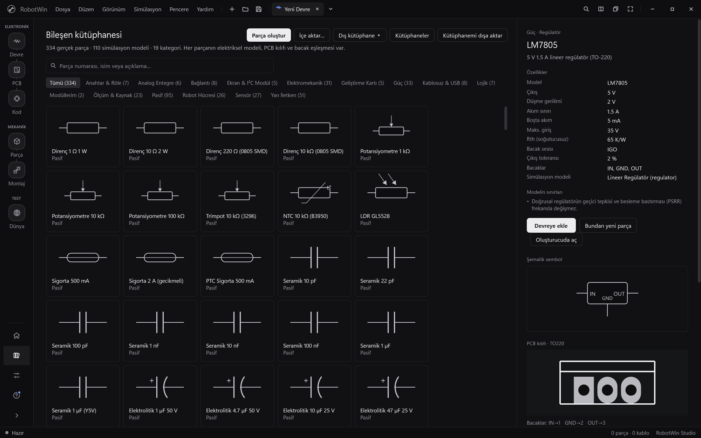
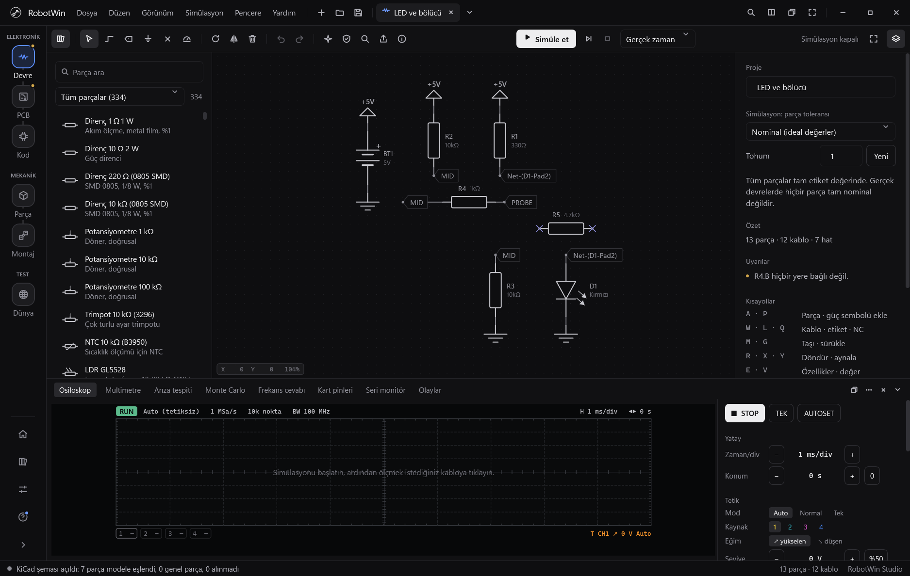
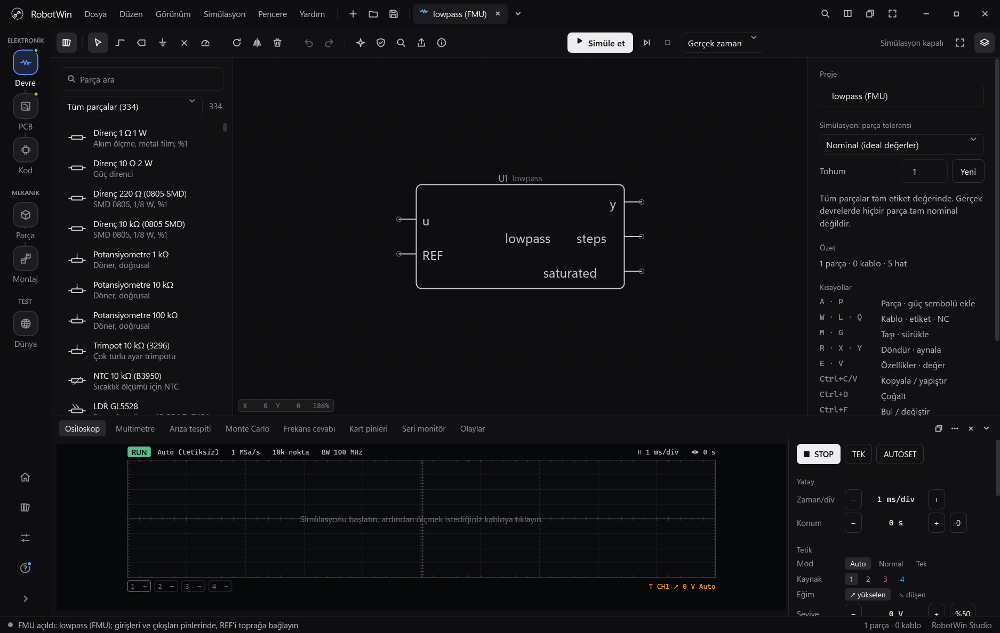

# 2. Devre

**Devre** sayfası (Ctrl+1) şema çizdiğiniz ve devreyi canlı simüle ettiğiniz yerdir. Simülasyon gerçek bir analog devre çözücüsüyle çalışır: gerilimler, akımlar, ısınma ve parça hasarı hesaplanır.

Sayfanın bölümleri:

- **Solda** aranabilir parça listesi.
- **Ortada** şema tuvali ve üstte araç çubuğu (**Simüle et** düğmesi, hız seçimi).
- **Sağda** özellikler paneli: seçili parça, proje bilgisi, parça toleransı, kısayollar.
- **Altta** ölçü ve bilgi sekmeleri: **Osiloskop**, **Multimetre**, **Arıza tespiti**, **Monte Carlo**, **Kart pinleri**, **Seri monitör**, **Olaylar**, **Hatlar**.

## Yeni bir devre

1. **Dosya → Yeni devre / kart** (Ctrl+N).
2. Boş tuvalde şu yazar: "Soldan bir parça seçip tuvale tıklayın. Bir pinden başlayıp başka bir pine tıklayarak kablo çekin."

## Parça ekleme

1. Soldaki arama kutusuna parçanın adını yazın (örneğin `direnç 10k`, `LED`, `LM358`, `arduino`).
2. Listeden parçayı seçin ve tuvale tıklayarak yerleştirin.
3. Klavyeden **A** tuşu da aranabilir parça listesini açar.
4. **P** tuşu güç sembolü ekler (GND, +5V…).

Kütüphanede pasifler, diyot ve LED'ler, transistörler ve MOSFET'ler, op-amp'ler, 74HC lojik entegreler, regülatörler, piller ve güç kaynakları, anahtar ve röleler, DC motorlar ve servolar, sensörler, ekranlar ve I²C modüller, motor sürücüler, Arduino Uno / Nano, ESP32 kartları ve kablosuz cihazlar bulunur.

Arama kutusunun üstündeki kategori listesi iki seviyelidir. Ana kategorilerin (ör. **Pasif**, **Güç**, **Ölçüm & Kaynak**) altında alt kategoriler gelir (ör. **Direnç**, **Kondansatör**, **Güç kaynağı**, **Sinyal jeneratörü**). Her satır içindeki parça sayısını gösterir. Bir alt kategori seçince yalnızca o tür parçalar listelenir. Aynı düzen **Kütüphane** sayfasında da vardır: ana kategori düğmelerinin altında, seçilen kategorinin alt kategorileri ikinci bir satırda çıkar. Bir parçayı seçince sağda önce **model durumu** rozetleri görünür: **Elektriksel model** (simülasyonda çalışır mı), **PCB kılıfı**, **3B model**, **Mekanik model** (dünyada kendi ölçüsü ve kütlesiyle bir katı cisim mi, servo kolu ya da motor mili gibi hareketli bir çıkışı var mı; sarı: kütlesi tanımlı değil, genel bir değer varsayılır), programlanabilir kartlarda **Firmware** ve **Model sınırları**; yeşil var, sarı kısmi, gri yok demektir, üstüne gelince ne anlama geldiği yazar. Rozetlerin altında **Üretici**, **Parça numarası**, **Kaynak** ve **Lisans** yazar (yerleşik parçalar RobotWin'in MIT lisanslı genel modelleridir; kendi ve içe aktarılan parçalarınızda Parça oluşturucuda düzenlenir, KiCad, Fritzing ve SPICE içe aktarımı doldurur). Üreticisinin veri sayfasıyla karşılaştırılan parçalarda (LM7805; IRFZ44N, IRF540N, 2N7000; 1N4148, 1N4007, 1N5819, 1N5822; BC547B, 2N2222A, TIP120) **Veri sayfası** rozeti ve bir **Veri sayfasıyla karşılaştırma** tablosu da vardır: her satırda ölçülen büyüklük ve koşulları, modelin parça kütüphanedeki hâliyle simüle edilerek bulunan değeri, veri sayfasının tipik değeri ve aralığı, aralıkta mı; altında kaynak. Aynı karşılaştırma bir testtir, uygulamanın gösterdiğiyle test edilen aynıdır. Altında bir **Özellikler** tablosu görünür. Tabloda simülasyon modelinin bütün değerleri (bu parçanın varsayılandan farklı olanları kalın), bacakları ve modelin adı yazar.

**Anahtarlamalı regülatör modülleri:** **Güç → Regülatör** altında düşürücüler (LM2596 3 A, MP1584 mini 3 A, XL4015 5 A) ve yükselticiler (MT3608, XL6009) vardır. Pilden ya da adaptörden 5 V ya da 12 V almak için kullanılır. Modülün IN+ / IN− uçları girişe, OUT+ / OUT− uçları yüke bağlanır; çıkış gerilimi kartın trimpotudur (**Çıkış gerilimi**). Model, çipin anahtarlama periyodu üzerinden ortalanmış hâlidir. Bobin akımı, akım sınırı, çıkış ve giriş kondansatörleri gerçektekiyle aynı biçimde çalışır:
- **Verim:** giriş, çıkış gücünü ve anahtar, bobin, diyot ve anahtarlama kayıplarını çeker. Örneğin LM2596 12 V'tan 5 V'a 1 A'de yaklaşık %85 verir.
- **Düşüm:** düşürücünün çıkışı girişin altında kalır. LM2596'nın anahtarı yaklaşık 1,1 V düşürür, bu yüzden 5,5 V'tan 5 V alınamaz.
- **Akım sınırı:** sınırı aşan yükte akım sınırda kalır, çıkış düşer.
- **Açılış:** giriş UVLO geriliminin altındayken modül kapalıdır. Açılınca çıkış yumuşak başlama süresinde yükselir; kondansatörlerin şarj akımı da görünür.
- **Isınma:** kayıplar modülü ısıtır ve ısıl kapanmaya kadar götürebilir.

**Lineer regülatörler** (LM7805, AMS1117 …) yükle çıkışlarını biraz düşürür (yük regülasyonu; LM7805'te 5 mA'den 1,5 A'e yaklaşık 12 mV). Denetim döngüsü sonsuz hızlı değildir: hızlı bir yük basamağında çıkış bir an çöker ve küçük bir çıkış kondansatörüyle birkaç kez salınarak toparlanır (LM7805'te 0,1 µF üzerinde 0,5 A'lik basamak ≈ 0,24 V). Parçanın **Çıkış direnci**, **Çıkış endüktansı** ve **Açık çevrim direnci** değerleri bunu belirler; LM7805'in değerleri veri sayfasının çıkış empedansı eğrisinden alınmıştır.

**Modelin sınırları:** her modelin bir sınırı vardır. Kütüphanedeki parça sayfasında ve devredeki parçanın denetçisinde **Modelin sınırları** başlığı, o modelin neyi dışarıda bıraktığını ya da sadeleştirdiğini yazar. Örneğin regülatör modülünde anahtarlama dalgalanması yoktur, düğmede kontak sıçraması yoktur, MOSFET seviye 1 modeldir. Bir sonucu okurken buna bakın.

## Kablolama

1. Bir pine tıklayın; kablo başlar.
2. İstediğiniz yerlerde tıklayarak köşe koyun.
3. Hedef pine tıklayın; kablo biter. Çift tık veya **Esc** de bitirir.

Yardımcı tuşlar:

| Tuş | İşlev |
| --- | --- |
| W | Kablo aracı |
| / | Köşe yönü (önce yatay / önce dikey) |
| Shift+Boşluk | Kablo modu: 90° → 45° → serbest |
| Backspace | Son köşeyi geri al |
| L / Ctrl+L | Hat etiketi / global etiket |
| Q | Bağlantı yok (NC) işareti |
| J | Bağlantı noktası: imlecin altında kesişen teller birleşir; elle konmuş noktada yeniden basınca ayrılır |
| Silici (araç çubuğu) | Her tıklama altındaki öğeyi siler (tel, parça, etiket, not, NC işareti); araç seçili kalır, Esc seçime döner |
| Boş yere sağ tık ▸ Birim | Sol alttaki koordinatlar ızgara adımı, mm, mil ya da inç olarak; seçim saklanır |
| T | Metin: sayfaya not, başlık ya da açıklama (çerçeveli olunca metin kutusu); çift tıkla düzenlenir |

Aynı adı taşıyan etiketler birbirine bağlıdır; `GND` adı toprak demektir. birbirinin üstünden geçen iki kablo bağlı sayılmaz; bir kablonun ucu ya da köşesi öbürünün üstüne düşerse (T) bağlanır ve orada nokta çizilir. Kesişen iki kabloyu birleştirmek için araç çubuğundaki bağlantı noktası aracıyla (J) kesişime tıklayın; nokta çizilir ve iki kablo aynı hat olur. Elle konmuş noktaya yeniden tıklamak onu kaldırır. Kabloya sağ tıklayınca **Böl**, **segment sil** ve **etiket** seçenekleri çıkar.

## Düzenleme

**Çizim**: sol araç şeridindeki **Çizim** düğmesi yanında kendi şeridini açar (yine basınca kapanır); oradan **Çizgi** (köşelere tıklayın; çift tık, Enter ya da Esc bitirir), **Dikdörtgen** (iki köşe), **Daire** (merkez, sonra çemberin bir noktası) **Yay** (başlangıç, yayın bir noktası, bitiş), **Bezier eğrisi** (başlangıç, bitiş, sonra iki denetim noktası; çizerken denetim noktalarının kolları görünür), **Tablo** (sol üst köşeye tıklanır, 3 × 3 gelir ve düzenleyicisi açılır: hücreler, satır / sütun ekle-çıkar, sütun genişliği ve satır yüksekliği mm olarak, yazı boyu ve çizgi; çift tık ya da sağ tık ▸ Tabloyu düzenle… yeniden açar; döndürülünce dik kalır) ve **Resim…** (PNG, JPG, BMP ya da GIF dosyası; imleçle gelir, tıklanan yere konur, 300 ppi boyutunda) seçilir. Resim döndürülüp aynalanınca dik kalır, yalnız yeri değişir; projeye PNG olarak gömülür (büyük fotoğraflar en uzun kenarı 2048 piksele küçültülür). Çizimler bir bloğun çerçevesi, bir bölme ya da mekanik bir taslak içindir; hatları yoktur, devreyi değiştirmez. Diğer öğeler gibi seçilir, taşınır, döndürülür, aynalanır, kopyalanır ve silinir; PNG/SVG görüntüsüne ve KiCad şemasına (polyline, rectangle, circle, arc, bezier, table, image olarak) gider, KiCad şeması açılınca onlar da alınır.

**Net sınıfı yönergesi** (yönerge etiketi): bir tele sağ tıklayıp **Net sınıfı yönergesi ekle** seçilir; telin üstüne bir sap, ucunda bir baklava ve süslü parantez içinde sınıfın adı gelir (önce `{Power}`). Etiket hattı adlandırmaz; değdiği hat PCB güncellenince o net sınıfını alır. Sınıfın adı çift tıkla, V ile ya da Özellikler'den değişir; kartta o adda sınıf yoksa Default'un kopyası olarak açılır, kuralları kartın net sınıflarından ayarlanır. Taşınır, kopyalanır, gruplanır; ERC yalnız hiçbir tele ya da pine değmiyorsa uyarır. KiCad'e kartın net sınıfı ataması olarak gider.

**Kural alanı**: **Çizim** şeridinden **Kural alanı** seçilip iki köşeye tıklanır; kesik çizgili bir çerçeve ve sol üstünde süslü parantez içinde sınıf (önce `{Power}`) gelir. İçinde bir teli, pini ya da etiketi olan her hat PCB güncellenince o net sınıfını alır; alandaki bir net sınıfı yönergesi alandan önce gelir. Sınıf çift tıkla, sağ tık ▸ **Net sınıfını düzenle…** ya da Özellikler'den değişir; alan seçilir, taşınır, kopyalanır, silinir.

**Hiyerarşik sayfalar**: büyük bir devre bloklara bölünür. Araç çubuğundaki **Hiyerarşi** düğmesinden ya da **S** ile **Hiyerarşik sayfa** seçilip iki köşeye tıklanır; çerçevenin üstünde adı (yerinde yazılır), altında içindeki parça sayısı görünür. Sayfaya çift tıklamak onu açar. Alt sayfada parçalar, teller ve etiketler her zamanki gibi çizilir. Bir hat alt sayfadan **hiyerarşik etiketle** (**H**, kesik çerçeveli) çıkar ve sayfa sembolünün kenarındaki aynı adlı **sayfa pinine** bağlanır. Pin, **Sayfa pini** aracıyla kenara tıklanarak ya da sağ tık ▸ **Sayfa pinlerini eşitle** ile içerideki etiketlerden eklenir. Pinin ve etiketin yönü (giriş, çıkış, çift yönlü, üç durumlu, pasif) sağ tıkla seçilir. Sayfa pininden tel çekilir; böylece üst sayfadaki bir hat alt sayfaya iner.

Bağlantı kuralları:

- Alt sayfadaki yerel etiketler yalnız o sayfanındır ve netlistte `/Motor/IN1` gibi sayfa yoluyla adlanır; aynı adlı başka bir sayfadaki etiket ayrı bir hattır.
- Global etiketler ve güç sembolleri (GND, +5V) her sayfada aynı hattır.
- Araç şeridindeki etiket düğmesi bir gruptur: basılı tutunca ya da sağ tıklayınca **Hat etiketi** (L), **Global etiket** (Ctrl+L) ve **Hiyerarşik etiket** (H) listelenir, seçilen düğmenin yüzü olur.
- Farklı sayfalarda aynı yerde duran parçalar birbirine değmez.

Sayfa açıkken sol üstte bir yol çubuğu belirir: **◀ Geri**, **▲ Üst sayfa**, **▶ İleri** ve kökten bu sayfaya kadar her basamak tıklanabilir, **▾** alt sayfaları listeler. Kısayollar: Alt+↑ ya da Alt+Backspace üst sayfaya çıkar, Alt+← geri, Alt+→ ileri gider. Bul, ERC ve PCB'de göster başka sayfadaki bir parçaya o sayfayı açarak gider. ERC, sayfa sembolünde pini olmayan hiyerarşik etiketi ve içinde etiketi olmayan sayfa pinini uyarır. Bütün sayfalar tek tasarımdır: PCB, simülasyon, malzeme listesi ve netlist hepsini birlikte görür. KiCad'e aktarımda her alt sayfa kendi `.kicad_sch` dosyası olur ve kök sayfada KiCad'in sayfa sembolüyle durur.

**Bus**: birçok hattı tek kalın mavi çizgiyle taşır. **Hiyerarşi** menüsünden ya da **B** ile kablo gibi çizilir. Üstüne `D[0..7]` (vektör: D0…D7) ya da `{SDA SCL}` (grup) adlı bir etiket konur. **Bus girişi** (**Z**) bus'a tıklanan yerden 45° aşağı-sağa (Shift ile sola) kısa bir ayak çizer; ayağa bağlanan tele üyenin adıyla (`D3`) bir etiket konur. Bus'ın kendisi dokunduğu hiçbir teli birleştirmez; üyeler etiketlerinin adıyla birleşir. Bir sayfa pini ve içerideki hiyerarşik etiket bus adı taşırsa (`D[0..7]`), her üye alt sayfadaki aynı adlı üyeye bağlanır. ERC bus'ın boşta kalan ucunu ve bus etiketini uyarı saymaz.

| Tuş | İşlev |
| --- | --- |
| M / G | Taşı / sürükle (G'de kablolar uzar) |
| R / Shift+R | Döndür |
| X / Y | Yatay / dikey aynala |
| Ctrl+D | Çoğalt |
| Ctrl+C / Ctrl+X / Ctrl+V | Kopyala / kes / yapıştır (sekmeler arasında da çalışır) |
| Del | Sil |
| E | Özellikler (birden çok parça seçiliyken de) |
| V, F2 veya çift tık | Değeri yerinde düzenle (örneğin `4k7`) |
| D | Parçanın datasheet'i |
| Ctrl+F / Ctrl+H | Bul / bul ve değiştir (`*` ve `?` joker karakterleri) |
| F1 veya ? | Tüm kısayollar |

- **Numaralandır:** parça adlarını (R1, R2, C1…) satıra veya sütuna göre sırayla verir; PCB ve montajdaki adlar da güncellenir.
- **Alan tablosu** (boş yere sağ tık): şemadaki bütün parçalar referans, tür, değer, kılıf ve açıklamayla tek tabloda. Aynı tür ve değerdekiler bir satırda toplanır (istenirse parça parça). Bir satırın değeri yazılınca ya da listeden seçilince o satırdaki bütün parçalar değişir ve tek adımda geri alınır. Birimli değerler (4k7, 100nF) okunamazsa kabul edilmez. Referansa tıklamak o parçaları şemada seçer.
- **Grupla** (Ctrl+G): seçili parçalar, kablolar, etiketler, yazılar ve şekiller bir grup olur. Gruptaki herhangi bir öğeye tıklamak bütün grubu seçer; böylece bir alt devre tek parça gibi taşınır, döndürülür, kopyalanır, silinir. Seçili grup kesik çizgili bir çerçeve ve adıyla görünür. **Grubu çöz** (Ctrl+Shift+G) grubu dağıtır. Grup dosyaya kaydedilir; kopyalanıp yapıştırılan grup yeni bir grup olur. İkisi de sağ tık menüsünde ve çoklu seçimin özelliklerinde de var.
- **Elektriksel kural denetimi (ERC):** bağlanmamış pinleri, tek pinli hatları, çıkış çakışmalarını ve beslemesiz güç girişlerini bulur. Bir satıra sağ tıklayınca işaret notuyla **İstisna olarak işaretle…** (parça ve hatla birlikte tutulur, parça taşınsa da geçerli) ya da kuralın önemi (hata, uyarı, bilgi, **Denetleme**) seçilir; ikisi de şemayla kaydedilir ve geri alınır. **İstisnalar** kutusu kabul edilenleri de listeler.
- **PCB kılıfı:** parçanın PCB'de kullanacağı ayak izini seçin.

## Simülasyon

1. Araç çubuğunda **Simüle et**'e basın veya **F5**'e basın.
2. Simülasyon çalışırken:
   - Butonlara ve anahtarlara tıklayın.
   - Potansiyometreleri fare tekerleğiyle çevirin.
   - Bir kabloya tıklayın: osiloskop o noktayı ölçmeye başlar.
   - Üst çubuktaki **Simülasyon katmanları** düğmesi (katman simgesi) şemanın üstündekileri tek tek açıp kapatır: **Gerilim** (teller hattın gerilimine göre renklenir), **Akım akışı** (iki bacaklı parçalarda akan noktalar), **Zorlanma (güç, sıcaklık)** (bir sınırının %60'ından fazlasını kullanan parçanın çevresi sarıdan kırmızıya parlar, yanında hangi sınır ve yüzdesi yazar), **Dijital (mantık seviyesi)** (MCU pinlerinin ve mantık kapılarının hatlarında 1, 0 ya da ?: beslemenin %70'i ve üstü 1, %30'u ve altı 0, arası belirsiz: boşta kalan giriş, zayıf çekme ya da çakışan çıkışlar) ve **Arıza noktaları** (hasar gören parça kırmızı halka ve nedeniyle işaretlenir, uzaklaşınca da bulunur). Seçimler saklanır.
   - Bir parçayı seçin: Özellikler panelinin en üstünde **Canlı değerler** çıkar: pinlerinin gerilimi, içinden geçen akım (MOSFET'te VGS, ID ve güç kaybı; servoda hedef ve gerçek açı, akım ve akımdan tork) ve her sınırı (gerilim, akım, güç, sıcaklık) değeri ve sınırıyla; altındaki çubuk sınıra ne kadar yakın olduğunu gösterir (yeşil rahat, sarı yakın, kırmızı aşılmış). Saniyede birkaç kez yenilenir.
3. **F5** tekrar basılınca duraklatır, **Shift+F5** durdurur. **1 ms ilerlet** düğmesi tek adım ilerletir.
4. Hız seçimi: **0.01×**, **0.1×**, **Gerçek zaman**, **5×**, **20×**.

Durum çubuğunda simülasyon zamanı görünür. Bilgisayar gerçek zamana yetişemezse "gerçek zamanın %…'i" yazar.

### Parça hasarı

Gerçek hayatta yanacak bir devre burada da yanar: dirençsiz LED, aşırı akım çeken bir motor, ters takılmış bir elektrolitik kondansatör… Yanan parça işaretlenir ve **Olaylar** sekmesine yazılır.

- **Arıza tespiti** sekmesinde **Neden?** düğmesi parçanın neden yandığını açıklar.
- Simülasyon sürerken arıza tespitindeki bir soruna tıklamak parçanın **akım yolunu** gösterir: onunla seri parçalar (akımı onunkinin onda biri ile on katı arasında olanlar) ve besleme işaretlenir, aralarındaki teller turuncu parlar; yol beslemeden geçip toprağa kapanır. Yan dallar ve boştaki parçalar yolda görünmez.
- Devreyi düzelttikten sonra **Hasarlı parçaları onar** ile parçaları yenileyin.
- Hasarı tamamen kapatmak için **Simülasyon → Parça hasarı (yanma, sigorta)** seçeneğini kapatın.

### Hatlar (ağ gezgini)

Araç çubuğundaki göz biçimli **Hattı vurgula** aracıyla bir pine, tele ya da etikete tıklamak o hattı şemada ve kartta öne çıkarır; aynı hatta ya da boşa tıklamak kaldırır (1 tuşunun solundaki tuş imleçtekini vurgular).

**Hatlar** sekmesi şemadaki bütün hatları pin sayılarıyla listeler: önce toprak, sonra adlandırılmış hatlar, en sonda adı bir pinden türetilenler (soluk). Arama kutusu hat adıyla ya da pinle süzer (`GND`, `R1`, `R1.2`). Bir hat seçilince şemada vurgulanır, görünüm oraya gider ve PCB'de de vurgulanır; sağda pinleri parça türleriyle listelenir, bir pin seçilince parçası seçilir.

### Kart pinleri

Kodu olmayan bir Arduino veya ESP32'nin pinlerini **Kart pinleri** sekmesinden elle sürebilirsiniz: giriş, pull-up, LOW, HIGH veya PWM.

## Tasarım alternatifleri

Aynı devrenin sürümlerini bir arada tutabilirsiniz: bazı parçaların takılmadığı, bazı değerlerin ya da parçaların başka olduğu alternatifler. Örneğin flyback diyotu olmayan "ucuz" bir sürüm, ya da 330 Ω yerine 1 kΩ ile pil ömrü uzun bir sürüm.

1. **Simülasyon → Tasarım alternatifi → Alternatifler…** penceresinde **Yeni alternatif** ile bir tane ekleyin, adını ve ne için olduğunu yazın.
2. Alternatif seçiliyken bir parçayı seçin. Denetçisinin **Alternatif** bölümünde **Bu alternatifte takılmaz** ya da **Bu alternatifte değer** ile o alternatifteki halini verin. Yukarıdaki parametreler bütün alternatiflerindir.
3. Takılmayan parça şemada soluk ve çarpı işaretli görünür, değeri değişen parçanın değeri vurgulu yazılır.

Seçili alternatif **Simüle et**'in yanındaki listeden değiştirilir. Simüle edilen, malzeme listesine (BOM), üretim dosyalarına (Gerber paketindeki BOM ve dizgi dosyası) ve montaja giren odur. Takılmayan parçanın pedleri kartta kalır; kart bütün alternatifler için birdir.

**Karşılaştır** her alternatifi ve çizildiği hali aynı 1 saniye simüle eder ve yan yana koyar: beslemenin ortalama ve tepe gücü, çekilen yük (mAh), en sıcak parça ve bozulan parçalar. **Kartların kodunu da çalıştır** seçiliyse (öntanımlı) her alternatifte Uno / Nano'ların derlenmiş kodu ve ESP32'lerin çizimi de çalışır. ESP32 çizimleri önce derlenir. Her kartın son yazdığı satır **Kart çıktısı** sütununda görünür; böylece bir alternatifin kodun davranışını nasıl değiştirdiği de karşılaştırılır. Seçili değilse yalnız devre çalışır.

Alternatifler parçaları adlarıyla değil kimlikleriyle izler: bir parçanın adını değiştirmek onun alternatiflerdeki halini korur.

## KiCad şemasını açma

**Dosya → Aç…** (Ctrl+O) bir KiCad şemasını (`.kicad_sch`, KiCad 6–10) yeni bir devre olarak açar; alt sayfalar aynı klasörden okunur.

- Bağlantılar KiCad'in kurallarıyla çözülür: tel uçları ve telin üstündeki etiketler bağlanır, bağlantı noktası olmayan kesişme bağlanmaz; aynı adlı etiketler sayfası içinde, global etiketler ve güç sembolleri bütün tasarımda, gizli güç pinleri adlarıyla birleşir; sayfa pini alt sayfadaki aynı adlı hiyerarşik etiketle birleşir (sayfa birden çok kez kullanılmışsa her kopyasında ayrı).
- Veri yolları (bus) da: vektörler (`D[0..7]`, üyeler sıralarıyla eşleşir), gruplar (`I2C{SDA SCL}`, üyeler adlarıyla), takma adlar (`{USB}`; şemada ya da projede tanımlı); bir veri yolu sayfa pinleri üzerinden alt sayfalara geçer.
- Netler KiCad'in kendi netlistesiyle aynıdır: KiCad'le gelen bütün örnek tasarımlarda (73 sayfalık olanlar dahil) `kicad-cli`'nin çıkardığı netlisteyle karşılaştırılarak denenir.
- Her sembol, kütüphane içe aktarmadaki kurallarla bir simülasyon modeline eşlenir; değeri (10k, 100nF, 5V…) ve kılıfı kendi alanlarından gelir. Pil sembolünün gerilimi gerçek bir kimyanın hücre sayısına çevrilir (9 V = 6 alkalin hücre); hiçbiri tutmazsa düzenleyicili bir Li-ion paket olur (5 V: iki hücre ve düzenleyici).
- Birimleri ayrı çizilmiş semboller (çift op-amp'ın iki yarısı) her birim için ayrı parça olur: U1A, U1B.
- Parçalar KiCad'deki yerlerinde ve yönlerinde durur; sembollerimiz daha büyük olduğu için çizim oranında açılır, sığmayan parça sağa ya da aşağı kayar. Her alt sayfa kendi sayfası olur: üst sayfasında KiCad'deki yerinde bir sayfa sembolüyle durur, çift tıkla açılır; alt sayfaların etiketleri global olduğu için hatlar sayfalar arasında adlarıyla birleşir. Pinler netlerine kısa bir tel ve net etiketiyle bağlanır; GND'ye toprak, diğer güç netlerine besleme sembolü konur. Bağlantısız bırakılmış pinler işaretleriyle gelir.
- Modeli olmayan ve bacak sayısına uyan genel parçası da olmayan semboller alınmaz; KiCad'de "takılmaz" (DNP) işaretli olanlar benzetime girmez. Açılışta hangilerinin alınmadığı söylenir.

## FMU modelleri (FMI 2.0)

Modelica, Simulink, 20-sim, OpenModelica gibi araçlardan dışa aktarılan bir **FMU** (`.fmu`, FMI 2.0 ortak benzetim ya da model değişimi) devrede bir blok olarak çalışır.

- **Dosya → Aç…** bir `.fmu`'yu bloğu yerleşmiş yeni bir devre olarak açar; **Kütüphane** sayfasının üst çubuğundaki dış kütüphane simgesinin menüsünden **FMU (FMI 2.0, .fmu)…** onu kütüphanenize parça olarak ekler. FMU dosyası parçanın içindedir: projeyle birlikte taşınır.
- Bloğun her **girişi** solda, her **çıkışı** sağda bir pindir; **REF** gerilimlerin ölçüldüğü ve sürüldüğü referanstır (çoğunlukla GND'ye bağlanır). Giriş, pinin REF'e göre gerilimini okur; çıkış, değerini 1 Ω'luk iç dirençle pine sürer.
- FMU'nun parametreleri parçanın parametreleridir (başlangıç değerleriyle); **İletişim adımı**, devre ile FMU'nun buluştuğu aralıktır (öntanımlı FMU'nun kendi adımı, yoksa 1 ms). Her adımda girişler verilir, FMU kendi çözücüsüyle ilerler, çıkışlar bir sonraki adıma kadar tutulur.
- 64 bit Windows ikilisi (`binaries/win64`) olan FMU'lar çalışır. Ortak benzetim (Co-Simulation) FMU'su kendi çözücüsüyle ilerler. Yalnız model değişimi (Model Exchange) olan FMU'nun durumlarını RobotWin'in kendi tümleyicisi çözer. Bu tümleyici uyarlamalı Dormand–Prince 5(4) yöntemidir; zaman olayları ve durum olayları (bir olay göstergesinin işaret değiştirdiği an, ikiye bölmeyle bulunur) FMI 2.0'ın istediği gibi işlenir.
- Devre ile FMU yalnız iletişim noktalarında buluşur: girişler o anki gerilimlerdir, çıkışlar bir sonraki noktaya kadar sabit tutulur (sıfırıncı derece tutma).

## Dışa aktarma

Devre sayfasından şunları dışa aktarabilirsiniz:

- Malzeme listesi (BOM): aşağıda
- KiCad netlist (`.net`)
- SPICE netlist (`.cir`)
- Resim (PNG / SVG)
- Yazdır / PDF (Ctrl+P)

### Malzeme listesi ve tedarik

**BOM** komutu malzeme listesini bir pencerede açar. Aynı parçalar tek satırdır; ölçü aletleri, jeneratörler ve laboratuvar kaynakları simülasyonun araçlarıdır, karta alınmadıkları için listede yer almaz.

- Her satıra **üretici**, **üretici parça numarası** (MPN), **tedarikçi**, **tedarikçi parça numarası**, **birim fiyat** ve tedarikçinin **en az** satış adedi yazılır. Bunlar projeyle saklanır; modeli olan parçalarda (IRLZ44N, LM7805, 1N5819…) MPN kendiliğinden gelir.
- **Kart sayısı** verilince her satırın siparişi hesaplanır: kartların istediği adet, tedarikçinin en azından azsa en az kadar sipariş edilir (turuncu). Alt satırda toplam tutar, kart başına tutar ve fiyatı girilmemiş satır sayısı görünür.
- **CSV kaydet** bütün listeyi kaydeder.
- **JLCPCB / LCSC**, **Digi-Key** ve **Mouser** o tedarikçinin satırlarını kendi yükleme biçiminde verir: JLCPCB'nin dizgi BOM'u (Comment, Designator, Footprint, LCSC Part #), Digi-Key ve Mouser'ın toplu sepet dosyası.

## Sonraki adım

Devreniz hazırsa **PCB** sayfasına geçin (Ctrl+2) veya kartın kodunu yazın (Ctrl+3). Ölçü aletlerinin ayrıntıları [8. Ölçü aletleri](08-olcu-aletleri.md) bölümündedir.

---

[← Önceki: 1. Başlarken](01-baslarken.md) · [İçindekiler](README.md) · [Sonraki: 3. PCB →](03-pcb.md)
