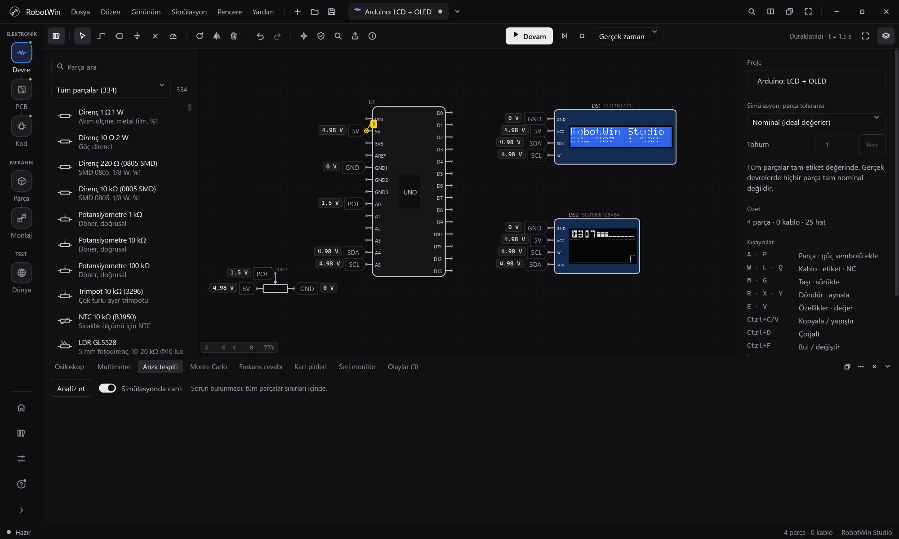
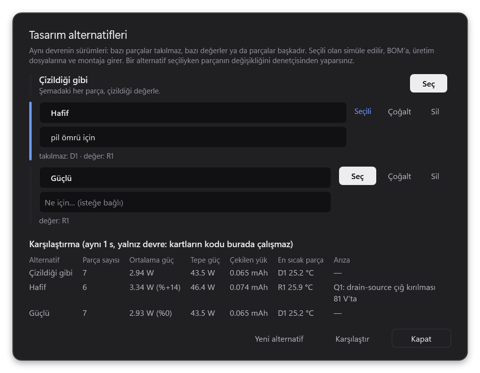

# 2. Devre

**Devre** sayfası (Ctrl+1) şema çizdiğiniz ve devreyi canlı simüle ettiğiniz yerdir. Simülasyon gerçek bir analog devre çözücüsüyle çalışır: gerilimler, akımlar, ısınma ve parça hasarı hesaplanır.

Sayfanın bölümleri:

- **Solda** aranabilir parça listesi.
- **Ortada** şema tuvali ve üstte araç çubuğu (**Simüle et** düğmesi, hız seçimi).
- **Sağda** özellikler paneli: seçili parça, proje bilgisi, parça toleransı, kısayollar.
- **Altta** ölçü ve bilgi sekmeleri: **Osiloskop**, **Multimetre**, **Arıza tespiti**, **Monte Carlo**, **Kart pinleri**, **Seri monitör**, **Olaylar**.

## Yeni bir devre

1. **Dosya → Yeni devre / kart** (Ctrl+N).
2. Boş tuvalde şu yazar: "Soldan bir parça seçip tuvale tıklayın. Bir pinden başlayıp başka bir pine tıklayarak kablo çekin."

## Parça ekleme

1. Soldaki arama kutusuna parçanın adını yazın (örneğin `direnç 10k`, `LED`, `LM358`, `arduino`).
2. Listeden parçayı seçin ve tuvale tıklayarak yerleştirin.
3. Klavyeden **A** tuşu da aranabilir parça listesini açar.
4. **P** tuşu güç sembolü ekler (GND, +5V…).

Kütüphanede pasifler, diyot ve LED'ler, transistörler ve MOSFET'ler, op-amp'ler, 74HC lojik entegreler, regülatörler, piller ve güç kaynakları, anahtar ve röleler, DC motorlar ve servolar, sensörler, ekranlar ve I²C modüller, motor sürücüler, Arduino Uno / Nano, ESP32 kartları ve kablosuz cihazlar bulunur.

Arama kutusunun üstündeki kategori listesi iki seviyelidir. Ana kategorilerin (ör. **Pasif**, **Güç**, **Ölçüm & Kaynak**) altında alt kategoriler gelir (ör. **Direnç**, **Kondansatör**, **Güç kaynağı**, **Sinyal jeneratörü**). Her satır içindeki parça sayısını gösterir. Bir alt kategori seçince yalnızca o tür parçalar listelenir. Aynı düzen **Kütüphane** sayfasında da vardır: ana kategori düğmelerinin altında, seçilen kategorinin alt kategorileri ikinci bir satırda çıkar. Bir parçayı seçince sağda bir **Özellikler** tablosu görünür. Tabloda simülasyon modelinin bütün değerleri (bu parçanın varsayılandan farklı olanları kalın), bacakları ve modelin adı yazar.

## Kablolama

1. Bir pine tıklayın; kablo başlar.
2. İstediğiniz yerlerde tıklayarak köşe koyun.
3. Hedef pine tıklayın; kablo biter. Çift tık veya **Esc** de bitirir.

Yardımcı tuşlar:

| Tuş | İşlev |
| --- | --- |
| W | Kablo aracı |
| / | Köşe yönü (önce yatay / önce dikey) |
| Shift+Boşluk | Kablo modu: 90° → 45° → serbest |
| Backspace | Son köşeyi geri al |
| L / Ctrl+L | Hat etiketi / global etiket |
| Q | Bağlantı yok (NC) işareti |

Aynı adı taşıyan etiketler birbirine bağlıdır; `GND` adı toprak demektir. Kabloya sağ tıklayınca **Böl**, **segment sil** ve **etiket** seçenekleri çıkar.

## Düzenleme

| Tuş | İşlev |
| --- | --- |
| M / G | Taşı / sürükle (G'de kablolar uzar) |
| R / Shift+R | Döndür |
| X / Y | Yatay / dikey aynala |
| Ctrl+D | Çoğalt |
| Ctrl+C / Ctrl+X / Ctrl+V | Kopyala / kes / yapıştır (sekmeler arasında da çalışır) |
| Del | Sil |
| E | Özellikler (birden çok parça seçiliyken de) |
| V, F2 veya çift tık | Değeri yerinde düzenle (örneğin `4k7`) |
| D | Parçanın datasheet'i |
| Ctrl+F / Ctrl+H | Bul / bul ve değiştir (`*` ve `?` joker karakterleri) |
| F1 veya ? | Tüm kısayollar |

- **Numaralandır:** parça adlarını (R1, R2, C1…) satıra veya sütuna göre sırayla verir; PCB ve montajdaki adlar da güncellenir.
- **Elektriksel kural denetimi (ERC):** bağlanmamış pinleri, tek pinli hatları, çıkış çakışmalarını ve beslemesiz güç girişlerini bulur.
- **PCB kılıfı:** parçanın PCB'de kullanacağı ayak izini seçin.

## Simülasyon

1. Araç çubuğunda **Simüle et**'e basın veya **F5**'e basın.
2. Simülasyon çalışırken:
   - Butonlara ve anahtarlara tıklayın.
   - Potansiyometreleri fare tekerleğiyle çevirin.
   - Bir kabloya tıklayın: osiloskop o noktayı ölçmeye başlar.
3. **F5** tekrar basılınca duraklatır, **Shift+F5** durdurur. **1 ms ilerlet** düğmesi tek adım ilerletir.
4. Hız seçimi: **0.01×**, **0.1×**, **Gerçek zaman**, **5×**, **20×**.

Durum çubuğunda simülasyon zamanı görünür. Bilgisayar gerçek zamana yetişemezse "gerçek zamanın %…'i" yazar.

### Parça hasarı

Gerçek hayatta yanacak bir devre burada da yanar: dirençsiz LED, aşırı akım çeken bir motor, ters takılmış bir elektrolitik kondansatör… Yanan parça işaretlenir ve **Olaylar** sekmesine yazılır.

- **Arıza tespiti** sekmesinde **Neden?** düğmesi parçanın neden yandığını açıklar.
- Devreyi düzelttikten sonra **Hasarlı parçaları onar** ile parçaları yenileyin.
- Hasarı tamamen kapatmak için **Simülasyon → Parça hasarı (yanma, sigorta)** seçeneğini kapatın.

### Kart pinleri

Kodu olmayan bir Arduino veya ESP32'nin pinlerini **Kart pinleri** sekmesinden elle sürebilirsiniz: giriş, pull-up, LOW, HIGH veya PWM.

## Tasarım alternatifleri

Aynı devrenin sürümlerini bir arada tutabilirsiniz: bazı parçaların takılmadığı, bazı değerlerin ya da parçaların başka olduğu alternatifler. Örneğin flyback diyotu olmayan "ucuz" bir sürüm, ya da 330 Ω yerine 1 kΩ ile pil ömrü uzun bir sürüm.

1. **Simülasyon → Tasarım alternatifi → Alternatifler…** penceresinde **Yeni alternatif** ile bir tane ekleyin, adını ve ne için olduğunu yazın.
2. Alternatif seçiliyken bir parçayı seçin. Denetçisinin **Alternatif** bölümünde **Bu alternatifte takılmaz** ya da **Bu alternatifte değer** ile o alternatifteki halini verin. Yukarıdaki parametreler bütün alternatiflerindir.
3. Takılmayan parça şemada soluk ve çarpı işaretli görünür, değeri değişen parçanın değeri vurgulu yazılır.

Seçili alternatif **Simüle et**'in yanındaki listeden değiştirilir. Simüle edilen, malzeme listesine (BOM), üretim dosyalarına (Gerber paketindeki BOM ve dizgi dosyası) ve montaja giren odur. Takılmayan parçanın pedleri kartta kalır; kart bütün alternatifler için birdir.

**Karşılaştır** her alternatifi ve çizildiği hali aynı 1 saniye simüle eder ve yan yana koyar: beslemenin ortalama ve tepe gücü, çekilen yük (mAh), en sıcak parça ve bozulan parçalar. Burada yalnız devre çalışır, kartların kodu çalışmaz.

Alternatifler parçaları adlarıyla değil kimlikleriyle izler: bir parçanın adını değiştirmek onun alternatiflerdeki halini korur.

## Dışa aktarma

Devre sayfasından şunları dışa aktarabilirsiniz:

- Malzeme listesi (BOM, `.csv`)
- KiCad netlist (`.net`)
- SPICE netlist (`.cir`)
- Resim (PNG / SVG)
- Yazdır / PDF (Ctrl+P)

## Sonraki adım

Devreniz hazırsa **PCB** sayfasına geçin (Ctrl+2) veya kartın kodunu yazın (Ctrl+3). Ölçü aletlerinin ayrıntıları [8. Ölçü aletleri](08-olcu-aletleri.md) bölümündedir.

---

[← Önceki: 1. Başlarken](01-baslarken.md) · [İçindekiler](README.md) · [Sonraki: 3. PCB →](03-pcb.md)
