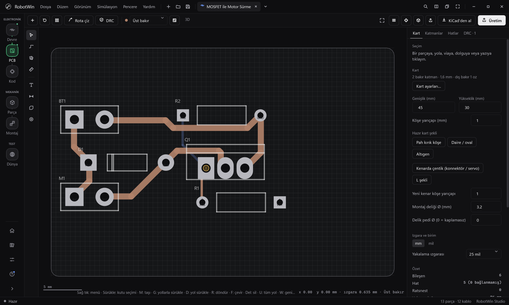

# 3. PCB

**PCB** sayfası (Ctrl+2) devrenizi baskılı devre kartına dönüştürür: parçaları yerleştirir, bakır yolları çizer, kuralları denetler ve üretime gönderilecek dosyaları çıkarırsınız.

## Şemadan karta

1. Devreyi **Devre** sayfasında çizin.
2. **PCB** sayfasına geçin. Şemadaki parçalar karta gelir; bağlanması gereken pinler ince çizgilerle (bağlantı çizgileri) gösterilir.
3. Şemayı sonradan değiştirirseniz PCB sayfasına döndüğünüzde kart kendiliğinden güncellenir, yerleşiminiz korunur. Değişiklik yerleşimden bir şey götürecekse (karttan kalkan ya da ayak izi değişen parça, artık olmayan hatlardaki iz ve via'lar) kart olduğu gibi kalır ve sayfanın üstünde ne olacağı söylenir: **Kartı güncelle** ile uygulanır. O zamana kadar **Güncelle** düğmesi vurgulu durur, üzerine gelince her değişikliği listeler. Karttan kalkan parçanın yeri hatırlanır; şemaya geri dönerse oraya konur. Kart parçaları adlarıyla değil kimlikleriyle izler: bir parçanın adını değiştirmek (R1 → R7) onu yerinde bırakır. Bir hattın adı değişince (etiketi yeniden adlandırmak, ya da adsız bir hattın adını aldığı parçanın adı değişince) izleri, via'ları ve dolguları yeni adıyla kalır; eskiden artık olmayan hattın bakırı diye silinirdi.
4. **Parça ekle** ile kütüphaneden doğrudan karta parça koyabilirsiniz; parça şemaya da eklenir.

## Kart ayarları

**Kart ayarları** düğmesi şunları açar:

- Bakır katman sayısı: **2**'den **32**'ye kadar çift sayılar (Üst bakır, İç 1 … İç 30, Alt bakır), KiCad'deki gibi. Seçilen yığın kart kalınlığına sığmıyorsa pencere en az gereken kalınlığı yazar; kalınlığı artırın ya da prepreg'i inceltin.
- Kart kalınlığı, bakır ağırlıkları, dielektrik.
- Kör / gömülü via'lar.
- Hat sınıfları (yol genişliği ve boşluk) ve üretim kuralları.

Kart kenarını sol araç çubuğundaki **kart kenarı** aracıyla çokgen olarak çizebilir, **montaj deliği** ekleyebilirsiniz.

## Yerleştirme

- Parçaları fareyle sürükleyin. **R** döndürür, **F** parçayı alt / üst yüze çevirir, **L** kilitler.
- **Yerleştir** düğmesi bağlantılara göre otomatik yerleşim yapar; kilitli parçalar yerinde kalır.

## Yol çizimi

### Elle (etkileşimli)

1. **X** tuşuna basın (yol aracı).
2. Bir pede tıklayın ve fareyi hedefe doğru götürün. Yol, engellerin etrafından dolaşır ve boşluk kurallarına uyar.
3. Tıklayarak ara noktaları sabitleyin; hedef pede tıklayınca biter.

| Tuş | İşlev |
| --- | --- |
| V | Via koy ve katman değiştir |
| PgUp / PgDn | Via ile üst / alt katmana geç |
| / | Açı yönü (önce çapraz / önce düz) |
| Boşluk | 45° / 90° mod |
| W / Shift+W | Yol genişliği: sonraki / önceki |
| Backspace | Son parçayı geri al |
| Enter veya çift tık | Bitir |
| Esc | İptal |

Çizilmiş bir yolu **G** ile sürükleyebilirsiniz; bağlı uçlar da gelir.

### Otomatik

**Rota çiz** düğmesi tüm bağlantıları otomatik çizer: bütün katmanlarda arar, hat sınıfı genişlik ve boşluklarına uyar, gerekirse iç düzlemlere via atar.

## Bakır alanlar (dolgu)

1. **Z** ile dolgu alanı çizin veya hazır **+ GND (üst)** seçeneğini kullanın. 4 ve daha çok katmanlı kartlarda **+ GND düzlemi (İç 1)** de vardır.
2. **Doldur** ile alanları doldurun. **B** doldurur, **Ctrl+B** dolguyu boşaltır.

Dolgu, boşluk, ısıl bağlantı (thermal relief), öncelik ve ada temizleme kurallarına göre yapılır.

## Tasarım kural denetimi (DRC)

**DRC** düğmesi kartı denetler:

- Hat sınıfı boşlukları, yol genişliği, delik ve halka boyutu
- Kart kenarına uzaklık
- Parça avlusu (courtyard) çakışması, ped üstünde serigrafi
- Bağlanmamış hatlar, boşta kalan yol ve via'lar
- Güncel olmayan dolgular
- Yol akım kapasitesi

Hatalar listede görünür; birine tıklayınca kartta o yer gösterilir.

### Üretim ve test (DFM/DFT)

**Üretim ve test (DFM/DFT)** anahtarı açıkken DRC, üreticinin ve dizgi hattının bakacağı şeyleri de uyarı olarak ekler:

- **Asit tuzağı:** 90°'den dar açıyla birleşen yollar (pedde ya da viada değil; aşındırma sıvısı köşede kalır).
- **Maske köprüsü:** iki ped arasında 0,1 mm'den dar lehim maskesi seti (açıklıklar birleşir, lehim köprü kurabilir).
- **Pedde via:** SMD pedin içindeki açık via (lehimi emer; dolgulu ve kapatılmış via gerekir).
- **Kenara yakın SMD:** kart kenarına 2 mm'den yakın SMD ped (dizgi hattı kenardan tutar; panel kenar payı gerekir).
- **Fidüsyel yok:** 0,65 mm ve daha ince adımlı bir parça varken ikiden az fidüsyel.
- **Mezar taşı riski:** iki pedli SMD parçanın bir pedi çok daha geniş bakıra bağlıysa (fırında iki uç aynı anda erimez).
- **Okunmaz serigrafi:** 0,8 mm'den alçak ya da 0,15 mm'den ince yazı.
- **Delik çeşidi:** sekizden çok farklı delik çapı (her biri bir takım değişimi).
- **Test erişimi yok / prob aralığı:** iki ya da daha çok pedi olan her hat için test probunun değebileceği bir yer (delikli ped, test noktası parçası ya da alt yüzde en az 0,8 mm ped) aranır; olmayanlar listelenir, iki prob 1,27 mm'den yakınsa uyarı çıkar. Özet satırı **test kapsamını** verir.

Bunlar hata değil uyarıdır: kurala uymayan kart üretilebilir, ama daha pahalıya ya da daha düşük verimle.

### Fark çiftleri ve uzunluk eşleme

**Hatlar** sekmesinde **Fark çiftleri** bölümü birlikte gitmesi gereken iki hattı tutar (USB D+/D−, CAN H/L). **Adlarından bul**, adı `+`/`-`, `_P`/`_N` ya da `H`/`L` ile biten hatları çift yapar. Her çiftin yanında yollanmış iki uzunluk, farkları ve yolun ne kadarının çiftin aralığında yan yana gittiği görünür; **Aralık** ve **En çok fark** (USB 2.0 tam hızda ~2,5 mm, yüksek hızda ~1,25 mm) ayarlanır. **Uzunluk grupları** aynı anda varması gereken hatları (paralel veri yolu, saat ve verisi) bir toleransla tutar. Bir hattın uzunluğu yollarıyla geçtiği viaların gövdesidir (kartın kalınlığının iki katman arasındaki payı). DRC, farkı sınırı aşan çifti, yolunun %60'ından azı yan yana giden çifti ve yayılımı toleransı aşan grubu uyarır. **Yol uzunlukları** her hattın uzunluğunu listeler.

## 3D görünüm

**3D** düğmesi kartı parçalarıyla birlikte 3 boyutlu gösterir. Simülasyon çalışırken LED'ler yanar, ısınan parçalar kızarır.

## Üretim dosyaları

| Düğme | Ne üretir |
| --- | --- |
| **Üretim** | `<ad>-gerber.zip`: tüm bakır katmanların Gerber dosyaları, lehim maskesi, pasta, serigrafi, kart kenarı, PTH / NPTH / kör delik (Excellon) dosyaları, BOM ve dizgi dosyası (CPL) |
| **KiCad'e aktar** | `<ad>-kicad.zip`: KiCad 8 projesi (`.kicad_pro`, `.kicad_sch`, `.kicad_pcb`), netlist, sembol ve ayak izi kütüphaneleri, SPICE ve Gerber |

Gerber ZIP'ini doğrudan kart üreticisine yükleyebilirsiniz.

ZIP kaydedilir kaydedilmez diskten geri okunup denetlenir. Okuyucu, dosyaları yazan koddan bağımsız olarak Gerber ve Excellon belirtimlerine göre yazılmıştır:

- her katman 20 µm'lik (büyük kartlarda biraz daha iri) piksellerle çizilir;
- aynı katman kartın kendi geometrisinden ayrıca çizilir: yollar, pedler biçimleriyle, vialar, bakır dökümler, maske açıklıkları, pasta, serigrafi ve kart kenarı;
- ikisi üst üste konur; bir pikselden kalın her fark nerede olduğu ve alanıyla bildirilir ("eksik (4.00, 4.00) mm, 27.9 mm²");
- delik dosyaları delik delik eşlenir: kaplamalı / kaplamasız ayrımı, çap ve kör/gömülü via katmanları dahil.

Yanlış birim, ters çevrilmiş eksen, yanlış açıklık boyu, ters dönen yay ya da kaybolan bir nesne dosyalar üreticiye gitmeden görünür. Durum çubuğu sonucu yazar ("9 Gerber ve 2 delik dosyası kartla aynı"); bir fark varsa yerleriyle bir pencere açılır.

## Ayak izi ve modül

- **Footprint:** ayak izi düzenleyicisi. SMD ve THT pedler, serigrafi, avlu ve üretim katmanı çizip kullanıcı kütüphanenize kaydedersiniz.
- **Modül yap:** bu kartı kütüphaneye tek bir parça olarak kaydeder. Başka devrelere tek parça gibi eklenir, içi yine tam simüle edilir.

## Görünüm

| Tuş | İşlev |
| --- | --- |
| Home veya F | Sığdır |
| + / − / tekerlek | Yakınlaştır / uzaklaştır |
| Orta tuş veya sağ tuşla sürükle | Kaydır |
| PgUp / PgDn | Etkin katman |
| H | Yalnızca etkin katmanı göster / hepsini göster |
| 1 tuşunun solundaki tuş | İmleçteki hattı vurgula |
| Ctrl+Shift+M | Ölç |
| Ctrl+Shift+H | Ölçü çizgisi |
| T | Serigrafi yazısı |
| F1 veya ? | Tüm PCB kısayolları |

---

[← Önceki: 2. Devre](02-devre.md) · [İçindekiler](README.md) · [Sonraki: 4. Kod →](04-kod.md)
