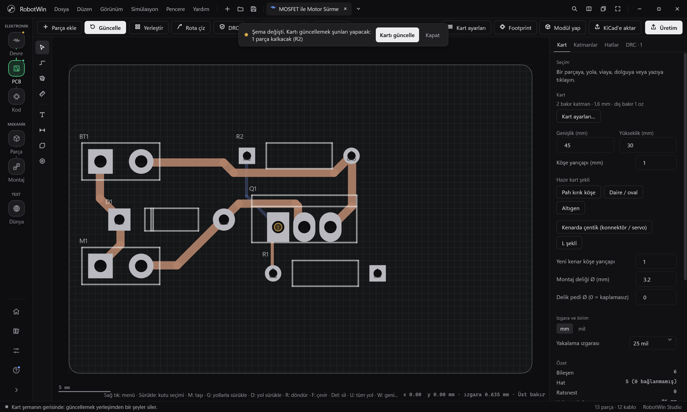
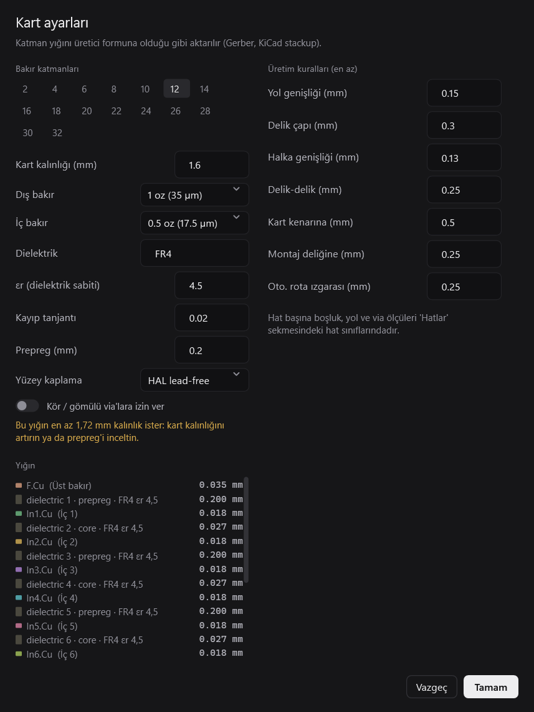

# 3. PCB

**PCB** sayfası (Ctrl+2) devrenizi baskılı devre kartına dönüştürür: parçaları yerleştirir, bakır yolları çizer, kuralları denetler ve üretime gönderilecek dosyaları çıkarırsınız.

## Şemadan karta

1. Devreyi **Devre** sayfasında çizin.
2. **PCB** sayfasına geçin. Şemadaki parçalar karta gelir; bağlanması gereken pinler ince çizgilerle (bağlantı çizgileri) gösterilir.
3. Şemayı sonradan değiştirirseniz PCB sayfasına döndüğünüzde kart kendiliğinden güncellenir, yerleşiminiz korunur. Değişiklik yerleşimden bir şey götürecekse (karttan kalkan ya da ayak izi değişen parça, artık olmayan hatlardaki iz ve via'lar) kart olduğu gibi kalır ve sayfanın üstünde ne olacağı söylenir: **Kartı güncelle** ile uygulanır. O zamana kadar **Güncelle** düğmesi vurgulu durur, üzerine gelince her değişikliği listeler. Karttan kalkan parçanın yeri hatırlanır; şemaya geri dönerse oraya konur. Kart parçaları adlarıyla değil kimlikleriyle izler: bir parçanın adını değiştirmek (R1 → R7) onu yerinde bırakır. Bir hattın adı değişince (etiketi yeniden adlandırmak, ya da adsız bir hattın adını aldığı parçanın adı değişince) izleri, via'ları ve dolguları yeni adıyla kalır; eskiden artık olmayan hattın bakırı diye silinirdi.
4. **Parça ekle** ile kütüphaneden doğrudan karta parça koyabilirsiniz; parça şemaya da eklenir.

## Kart ayarları

**Kart ayarları** düğmesi şunları açar:

- Bakır katman sayısı: **2**'den **32**'ye kadar çift sayılar (Üst bakır, İç 1 … İç 30, Alt bakır), KiCad'deki gibi. Seçilen yığın kart kalınlığına sığmıyorsa pencere en az gereken kalınlığı yazar; kalınlığı artırın ya da prepreg'i inceltin.
- Kart kalınlığı, bakır ağırlıkları, dielektrik.
- Kör / gömülü via'lar.
- Hat sınıfları (yol genişliği ve boşluk) ve üretim kuralları.

Kart kenarını sol araç çubuğundaki **kart kenarı** aracıyla çokgen olarak çizebilir, **montaj deliği** ekleyebilirsiniz.

## Yerleştirme

- Parçaları fareyle sürükleyin. **R** döndürür, **F** parçayı alt / üst yüze çevirir, **L** kilitler.
- **Yerleştir** düğmesi bağlantılara göre otomatik yerleşim yapar; kilitli parçalar yerinde kalır.

## Yol çizimi

### Elle (etkileşimli)

1. **X** tuşuna basın (yol aracı).
2. Bir pede tıklayın ve fareyi hedefe doğru götürün. Yol, engellerin etrafından dolaşır ve boşluk kurallarına uyar.
3. Tıklayarak ara noktaları sabitleyin; hedef pede tıklayınca biter.

| Tuş | İşlev |
| --- | --- |
| V | Via koy ve katman çiftinin öbür katmanına geç (çift Katmanlar sekmesinde; varsayılan üst ↔ alt, 4 ve 6 katmanda iç katmanlar da seçilebilir) |
| PgUp / PgDn | Via ile üst / alt katmana geç |
| / | Açı yönü (önce çapraz / önce düz) |
| Boşluk | 45° / 90° mod |
| W / Shift+W | Yol genişliği: sonraki / önceki |
| Backspace | Son parçayı geri al |
| Enter veya çift tık | Bitir |
| Esc | İptal |

Çizilmiş bir yolu **G** ile sürükleyebilirsiniz; bağlı uçlar da gelir.

### Otomatik

**Rota çiz** düğmesi tüm bağlantıları otomatik çizer: bütün katmanlarda arar, hat sınıfı genişlik ve boşluklarına uyar, gerekirse iç düzlemlere via atar.

## Bakır alanlar (dolgu)

1. **Z** ile dolgu alanı çizin veya hazır **+ GND (üst)** seçeneğini kullanın. 4 ve daha çok katmanlı kartlarda **+ GND düzlemi (İç 1)** de vardır.
2. **Doldur** ile alanları doldurun. **B** doldurur, **Ctrl+B** dolguyu boşaltır.

Dolgu, boşluk, ısıl bağlantı (thermal relief), öncelik ve ada temizleme kurallarına göre yapılır.

## Damla (teardrop)

Araç çubuğundaki **Damla** düğmesi KiCad ve Altium'daki damlaları açar: ince bir hattın ped ya da via'ya girdiği yerde bakır pedden hatta doğru genişler, böylece delik kayarsa, aşındırma yerse ya da kart esnerse bağlantı kopmaz. Paneldeki ayarlar: pedlerde ve via'larda ayrı ayrı, eğri (KiCad'in varsayılanı) ya da düz kenar, uzunluk ve genişlik pedin boyutunun yüzdesi olarak (varsayılan %50 ve %100) ve en fazla uzunluk / genişlik (mm). Damla hattın kendi çizgisi boyunca durur; hat pedin ortasından girmese de onunla hizalıdır ve pedin kenarından taşmaz. Başka bir ağa kural aralığından yakın düşecek damla önce daraltılır, olmuyorsa hiç konmaz; bu yüzden DRC'yi bozmaz. Damlalar saklanmaz, hatlardan her an yeniden çıkar: çizimde, Gerber bakır katmanlarında (bölge olarak) ve başka ağların dökümlerinde (çevrelerinde aralık bırakılır) hep güncel haliyle bulunur. Ayar değişince dökümler yeniden doldurulur. KiCad'e verilen dosyaya damlalar yazılmaz; KiCad'de kendi damla ayarıyla yeniden üretilir.

## Çizim araçları ve via

Sol araç şeridinde köşesinde küçük üçgen olan düğmeler araç gruplarıdır: basılı tutunca ya da sağ tıklayınca gruptaki araçlar adlarıyla açılır, seçilen araç düğmenin yüzü olur.

- **Çizim** grubu: **Çizgi** (her bitiş yeni çizginin başı olur, Esc bitirir), **Dikdörtgen** (iki karşı köşe), **Daire** (merkez, çevreden bir nokta), **Yay** (merkez, başlangıç, bitiş) ve **Çokgen** (köşeler; çift tık, ilk köşe ya da Enter kapatır). Backspace son noktayı geri alır. Tuvalin sol üstündeki seçenek çubuğundan katman (üst / alt serigrafi, üst / alt montaj, çizimler), çizgi kalınlığı ve **Dolgulu** seçilir. Serigrafideki şekiller Gerber'e yazılır (dolgulu olanlar taranarak), KiCad'e `gr_line`, `gr_rect`, `gr_circle`, `gr_arc`, `gr_poly` olarak gider; bir pedin üstüne düşen serigrafi çizimini DRC bildirir. Şekiller seçilir, taşınır (M), silinir; seçim süzgecinde **Çizimler** olarak geçer.
- **Mıknatıs** (KiCad'in mıknatıslı öğeleri; **Kart** sekmesinde **Izgara ve birim** altında): imleç ızgaradan önce yakınındakine gider: **Pedlere yakala** pedin, via'nın ve deliğin merkezine, **Yollara yakala** yolun ucuna ya da orta çizgisine (her biri **Hiç**, **Çizerken** ya da **Her zaman**), **Çizimlere ve kart kenarına yakala** çizimlerin, ölçülerin ve kenarın köşelerine ve merkezlerine. Yakalanan yerde küçük bir elmas görünür. Çizim araçları, dolgu ve kenar köşeleri, cetvel ve ölçüler kullanır; seçimler saklanır.
- **Ölçü** aracı (Ctrl+Shift+H), KiCad'in ölçü türleriyle; seçenek çubuğundaki **Tür**: **Hizalı** (iki nokta, sonra çizginin yanı), **Dik (yatay / dikey)** (iki nokta, sonra üstüne ya da altına çekince yatay, yanına çekince dikey uzaklık), **Yarıçap** (merkez, çemberden bir nokta, sonra dışarı; "R 3.00 mm" yazar), **Kılavuz** (okun ucu, sonra yazının yeri; not sorulur) ve **Merkez işareti** (merkez, sonra artının ucu). Seçili ölçünün **Yazı** kutusu ölçülen değerin yerine yazılacak metni (kılavuzda notu) alır, boşsa değer yazılır. Ölçüler çizimde, Çizdir'de, Gerber'de ve KiCad'de aynı çizgilerle çıkar.
- **Yol** grubu: **Yol** (X) ve **Uzunluk ayarı**. Yol çizerken seçenek çubuğunda yol genişliği (hat sınıfından ya da bir adım), via boyutu ve etkin katman seçilir.
- **Görünüm çubuğu** (kartın sağ üstü): kartı sığdır, seçime sığdır, yakınlaştır, uzaklaştır; seçimi döndür, öbür yüze çevir, kilitle; **Bul** (Ctrl+F) parçayı tanımlayıcısından ya da değerinden, hattı ve yazıyı bulur, seçince oraya gider (hatta vurgular).
- **Alanlar** grubu: **Bakır dolgu alanı** (Z) ve **Yasak bölge** (KiCad'in kural alanı). Yasak bölge köşelere tıklanarak çizilir; seçenek çubuğundan neyin yasak olduğu (yol, via, dolgu, parça) ve katmanı (etkin katman ya da bütün katmanlar) seçilir. Dolgu bu alanı boş bırakır, iki yönlendirici de kenarlarını aşmaz, DRC içindeki yolu, viayı, dolguyu ve (isteniyorsa) parçayı **Yasak bölge** hatası olarak bildirir. KiCad'e keepout bölgesi olarak gider. Kırmızı taralı çizilir; kenarından seçilir, taşınır, silinir.
- **Delikler** grubu: **Montaj deliği** ve **Via**. Via aracı tıklanan yere bir via koyar; altındaki yolun, pedin ya da dolgunun hattını alır (dikiş viaları için).

## Tasarım kural denetimi (DRC)

**DRC** düğmesi kartı denetler:

- Hat sınıfı boşlukları, yol genişliği, delik ve halka boyutu
- Kart kenarına uzaklık
- Parça avlusu (courtyard) çakışması, ped üstünde serigrafi
- Bağlanmamış hatlar, boşta kalan yol ve via'lar
- Güncel olmayan dolgular
- Yol akım kapasitesi

Hatalar listede görünür; birine tıklayınca kartta o yer gösterilir. **F8** sonraki, **Shift+F8** önceki işarete gider (listenin üstündeki oklar da).

Listenin üstündeki **Hatalar**, **Uyarılar** ve **İstisnalar** düğmeleri sayılarıyla birlikte o türü gösterir ya da gizler. Bir satıra sağ tıklayınca:

- **İstisna olarak işaretle…**: bilerek kabul edilen bir işaret (örneğin kart kenarındaki bir test noktası) bir notla sayımdan çıkar. İstisna kartla kaydedilir; aynı kural aynı yerde aynı şeyi bulduğu sürece geçerlidir (sayılar biraz değişse de). İşaretin konusu 1 mm'den fazla kayarsa ya da başka parçalar arasında çıkarsa yeniden sayılır. **İstisnalar** düğmesi açıkken istisnalar gri olarak listelenir ve sağ tıkla geri alınır.
- **Bu kuralın önemi**: kural **Hata**, **Uyarı** ya da **Denetleme** (hiç bildirilmez) olur.

**Kural önemleri** bütün kuralları gruplarıyla (Elektriksel, Üretim, Mekanik, Sinyal bütünlüğü, Düzen ve bakım, Üretim ve test) ve son çalıştırmadaki işaret sayılarıyla listeler; her biri için önem seçilir, **Hepsini varsayılana döndür** ayarları siler. Önemler ve istisnalar kartla kaydedilir ve geri alınabilir. **Raporu kaydet…** son çalıştırmayı metin dosyası olarak yazar: tarih, kart, sayılar, hatalar, uyarılar, istisnalar (notlarıyla) ve denetlenmeyen kurallar.

### Aralık çözümlemesi

KiCad'deki İncele menüsünün aralık çözümlemesi: Ctrl+tık ile iki öğe seçin (hat, via, parça ya da dolgu) ve komut paletinden (Ctrl+K) **Aralık çözümlemesi**ni açın. Pencere iki öğenin ağını ve ağ sınıfını, aralarında geçerli olan aralığı ve bunun hangi sınıftan geldiğini (iki sınıftan büyüğü; dolgunun kendi aralığı daha büyükse o) ve paylaştıkları her bakır katmanında bakırlarının gerçek uzaklığını yazar; kuralın altındaki katman **KURAL DIŞI** diye kırmızı görünür. Bir parça seçildiğinde öteki öğeye en yakın, başka ağdaki pedi hesaba katılır.

### Üretim ve test (DFM/DFT)

**Üretim ve test (DFM/DFT)** anahtarı açıkken DRC, üreticinin ve dizgi hattının bakacağı şeyleri de uyarı olarak ekler:

- **Asit tuzağı:** 90°'den dar açıyla birleşen yollar (pedde ya da viada değil; aşındırma sıvısı köşede kalır).
- **Maske köprüsü:** iki ped arasında 0,1 mm'den dar lehim maskesi seti (açıklıklar birleşir, lehim köprü kurabilir).
- **Pedde via:** SMD pedin içindeki açık via (lehimi emer; dolgulu ve kapatılmış via gerekir).
- **Kenara yakın SMD:** kart kenarına 2 mm'den yakın SMD ped (dizgi hattı kenardan tutar; panel kenar payı gerekir).
- **Fidüsyel yok:** 0,65 mm ve daha ince adımlı bir parça varken ikiden az fidüsyel.
- **Mezar taşı riski:** iki pedli SMD parçanın bir pedi çok daha geniş bakıra bağlıysa (fırında iki uç aynı anda erimez).
- **Okunmaz serigrafi:** 0,8 mm'den alçak ya da 0,15 mm'den ince yazı.
- **Delik çeşidi:** sekizden çok farklı delik çapı (her biri bir takım değişimi).
- **Test erişimi yok / prob aralığı:** iki ya da daha çok pedi olan her hat için test probunun değebileceği bir yer (delikli ped, test noktası parçası ya da alt yüzde en az 0,8 mm ped) aranır; olmayanlar listelenir, iki prob 1,27 mm'den yakınsa uyarı çıkar. Özet satırı **test kapsamını** verir.

Bunlar hata değil uyarıdır: kurala uymayan kart üretilebilir, ama daha pahalıya ya da daha düşük verimle.

### Kutu

**DRC** sekmesindeki **Kutu** anahtarı kartın gireceği kutuyu tanımlar. Açılınca kartın ve parçalarının birkaç milimetre payla sığdığı bir kutu önerilir; ölçüler iç ölçülerdir:

- uzunluk kartın X'i, genişlik Y'si boyunca, yükseklik tabandan kapağa;
- kartın sol üst köşesinin iç sol ve üst duvarlara uzaklığı;
- ayak yüksekliği (tabandan kartın altına) ve delikli parçaların kesilmiş uçlarının boyu;
- pay: bir duvara bundan yakın kalan gövde uyarılır.

DRC her parçanın gövdesini (avlusunun alanı, ayak izinin yüksekliği kadar; alt yüzdeki parçalarda kartın altına doğru) duvarlara, tabana ve kapağa göre denetler:

- giren her şey hatadır ("Q1 kapağa 0,6 mm giriyor (gövdesi 15 mm, kartın üstünde 14,4 mm var)");
- payın içinde kalan uyarıdır;
- delikli parçaların uçları tabana değiyorsa ya da kart kutuya sığmıyorsa yine hatadır.

Bir konnektör duvardan dışarı çıkacaksa (USB soketi, DC jakı) **Duvardaki açıklıklar** altında o duvara bir açıklık ekleyin: konumu kartın koordinatıyla, alt kenarı tabandan. Gövdesi açıklığın içinde kalan parça duvara girmiş sayılmaz. Kutu kartla birlikte kaydedilir; ayarlar kapalıyken tek satırlık özet görünür.

### Fark çiftleri ve uzunluk eşleme

**Hatlar** sekmesinde **Fark çiftleri** bölümü birlikte gitmesi gereken iki hattı tutar (USB D+/D−, CAN H/L). **Adlarından bul**, adı `+`/`-`, `_P`/`_N` ya da `H`/`L` ile biten hatları çift yapar. Her çiftin yanında yollanmış iki uzunluk, farkları ve yolun ne kadarının çiftin aralığında yan yana gittiği görünür; **Aralık** ve **En çok fark** (USB 2.0 tam hızda ~2,5 mm, yüksek hızda ~1,25 mm) ayarlanır. **Uzunluk grupları** aynı anda varması gereken hatları (paralel veri yolu, saat ve verisi) bir toleransla tutar. Bir hattın uzunluğu yollarıyla geçtiği viaların gövdesidir (kartın kalınlığının iki katman arasındaki payı). DRC, farkı sınırı aşan çifti, yolunun %60'ından azı yan yana giden çifti ve yayılımı toleransı aşan grubu uyarır. **Yol uzunlukları** her hattın uzunluğunu listeler. Her çiftin yanında uzunluk farkı zaman olarak da yazar (ps): dış katmanda yol, katman yığınındaki dielektrik ve yol genişliğinden hesaplanan etkin εr ile (Hammerstad–Jensen mikroşerit), iç katmanda εr ile ilerler.

**Uzunluk ayarı (menderes):** yol aracının grubundadır (yol düğmesini basılı tutun). Kısa kalan hattın uzun, düz bir parçasına tıklayın; parça 45° köşeli kıvrımlarla, çiftinin öteki yarısının ya da uzunluk grubunun en uzun hattının uzunluğuna getirilir. Kıvrımlar hat sınıfının aralığını başka bakıra ve kart kenarına karşı korur; sığmazsa nedenini söyler (hangi yola ya da pede yakın). Seçenek çubuğundan hedef (çift / grup ya da elle mm), genlik, en çok genlik, bacak aralığı ve köşe tipi seçilir. Geri alınabilir. Bir fark çiftinin yarısında KiCad'in eğiklik ayarı gibi çalışır: kıvrımlar küçük genlikle (yol genişliğinin 1,5 katından) ve eşinden uzak yana atılır, böylece iki yol yan yana kalır; sonuçta kalan eğiklik çiftin izin verdiğiyle birlikte yazılır.

**Fark çifti yolu:** yol aracının grubundadır (yol düğmesini basılı tutun). Bir çiftin (D+/D−, `_P`/`_N`, CAN H/L) pedine tıklayın: iki pedi birden alır. Her tıklama çiftin orta hattına bir bacak ekler (önce düz, sonra 45°); iki yol bu hattın iki yanından çiftin **Aralık**'ıyla, köşelerde gönyeli olarak birlikte gider, pedlerinden 45° ile çıkıp çifte katılır. İmlecin yanında iki uzunluk ve farkları görünür. Karşı uçtaki çift pedlerine tıklayınca yollar yerine konur; **Enter** ya da çift tık olduğu yerde bitirir, **Geri** son bacağı alır, **Esc** bırakır. Başka bir ağın bakırına fazla yaklaşan ya da uçları ters sırada olan (yollar kesişir) çift kırmızı çizilir ve konmaz. Adından bulunan çift, yol konunca kartın çiftlerine eklenir; DRC onu aralığına ve farkına göre denetler. Köşelerde iç yol kısa kalır: fark sınırı aşarsa uzunluk ayarı eşitler. Seçenek çubuğundan genişlik ve katman seçilir.

## 3D görünüm

**3D** düğmesi kartı parçalarıyla birlikte 3 boyutlu gösterir. Simülasyon çalışırken LED'ler yanar, ısınan parçalar kızarır.

## Üretim dosyaları

| Düğme | Ne üretir |
| --- | --- |
| **Üretim** | `<ad>-gerber.zip`: tüm bakır katmanların Gerber dosyaları, lehim maskesi, pasta, serigrafi, kart kenarı, PTH / NPTH / kör delik (Excellon) dosyaları, BOM ve dizgi dosyası (CPL) |
| **KiCad'e aktar** | `<ad>-kicad.zip`: KiCad 8 projesi (`.kicad_pro`, `.kicad_sch`, `.kicad_pcb`), netlist, sembol ve ayak izi kütüphaneleri, SPICE ve Gerber |

Gerber ZIP'ini doğrudan kart üreticisine yükleyebilirsiniz.

### Çizdir (SVG / PDF)

**Dosya → Kartı çizdir (SVG / PDF)…** (ya da komut paletinde **Çizdir (SVG / PDF)**) KiCad'in Çizdir penceresidir. Her katman Gerber'e yazılan çiziminin aynısıyla, 1:1 ölçekte çizilir: dolgular, damlalar, yollar, pedler, via'lar, maske açıklıkları, pasta, serigrafi ve kenar. Biçim: **PDF: her katman bir sayfa**, **SVG: her katman ayrı dosya** (adın sonuna katmanınki eklenir, örneğin `kart-F_Cu.svg`) ya da **SVG: hepsi tek dosyada** (katmanlar kartta durdukları sırayla, her biri kendi grubunda). Katmanlar tek tek ya da **Hepsi**, **Bakır**, **Üst taraf**, **Alt taraf** düğmeleriyle seçilir. Seçenekler: renkli ya da hepsi siyah (toner transferi, film), aynalı, delikler gerçek çapında açık, kart kenarı her katmanda ve altta kartın ve katmanın adı. Seçimler hatırlanır.

ZIP kaydedilir kaydedilmez diskten geri okunup denetlenir. Okuyucu, dosyaları yazan koddan bağımsız olarak Gerber ve Excellon belirtimlerine göre yazılmıştır:

- her katman 20 µm'lik (büyük kartlarda biraz daha iri) piksellerle çizilir;
- aynı katman kartın kendi geometrisinden ayrıca çizilir: yollar, pedler biçimleriyle, vialar, bakır dökümler, maske açıklıkları, pasta, serigrafi ve kart kenarı;
- ikisi üst üste konur; bir pikselden kalın her fark nerede olduğu ve alanıyla bildirilir ("eksik (4.00, 4.00) mm, 27.9 mm²");
- delik dosyaları delik delik eşlenir: kaplamalı / kaplamasız ayrımı, çap ve kör/gömülü via katmanları dahil.

Yanlış birim, ters çevrilmiş eksen, yanlış açıklık boyu, ters dönen yay ya da kaybolan bir nesne dosyalar üreticiye gitmeden görünür. Durum çubuğu sonucu yazar ("9 Gerber ve 2 delik dosyası kartla aynı"); bir fark varsa yerleriyle bir pencere açılır.

### KiCad'den geri alma

Kartı **KiCad'e aktar** ile KiCad'e götürüp orada yerleştirdiyseniz ya da yolladıysanız **KiCad'den al** ile `.kicad_pcb` dosyasını seçin:

- önce neyin değiştiği listelenir: taşınan, döndürülen ya da öbür yüze alınan parçalar (referanslarıyla), hat hat yol sayısı, uzunluğu ve via sayısı, bakır dolgular, montaj delikleri, kart ölçüsü;
- **değişiklikleri al** onları bu karta taşır (tek bir geri alınabilir adım); dolgular yeniden doldurulur;
- ayak izleri ve şema bu projenindir: KiCad'de başka ayak iziyle duran bir parça ya da yalnız KiCad'de olan bir parça listede görünür ama alınmaz;
- yollar yaylarıyla gelir (yaylar 10°'lik kirişlerle); çeyrek tur olmayan bir açı (45°) en yakın çeyrek tura yuvarlanır ve listede yazar;
- KiCad'de başka bir yere çizilmiş bir kart, dış hattının köşesi bu kartın başlangıcına gelecek şekilde kaydırılır.

## Ayak izi ve modül

- **Footprint:** ayak izi düzenleyicisi. SMD ve THT pedler, serigrafi, avlu ve üretim katmanı çizip kullanıcı kütüphanenize kaydedersiniz.
- **Ayak izi atama** (komut paleti, Ctrl+K; KiCad'deki gibi): karttaki her parçanın değeri, türü ve ayak izi tek tabloda; parçanın her pininin ayak izinde pedi yoksa satır kırmızı olur ve hangi pinlerin pedsiz kaldığını yazar. **Değiştir…** başka bir ayak izi seçtirir.
- **Modül yap:** bu kartı kütüphaneye tek bir parça olarak kaydeder. Başka devrelere tek parça gibi eklenir, içi yine tam simüle edilir.

## Görünüm

**Ağ renkleri** (KiCad'deki gibi): **Hatlar** sekmesinin **Hat atamaları** listesinde her ağın yanındaki kutucuğa tıklayıp bir renk seçin; o ağın bakırı (hatlar, damlalar, dökümler, via halkası) her katmanda bu renkte görünür, böylece bir besleme ya da bir yol kart boyunca izlenir. **Renk yok** katmanın rengine döndürür; **Bütün ağ renklerini kaldır** hepsini siler. Renkler kartla kaydedilir ve yalnız görünüştür: Gerber, delik ve KiCad dosyaları değişmez.

Tuvalin sağ üstündeki araç kutusundaki ızgara düğmesi ızgarayı gösterir ya da gizler (yakalama değişmez; seçim saklanır).

**Katmanlar** sekmesindeki **Saydamlık** kaydırıcıları (KiCad'in Nesneler sekmesi gibi) yolları (damlalarıyla), via'ları, pedleri ve dolguları ayrı ayrı soluklaştırır; değer yazılabilir ve saklanır. **Dolguları yalnız kenarıyla göster** dökümleri KiCad'deki gibi yalnız sınır çizgileriyle çizer, altlarındaki yollar görünür. Yalnız görünüş değişir.

| Tuş | İşlev |
| --- | --- |
| Home veya F | Sığdır |
| + / − / tekerlek | Yakınlaştır / uzaklaştır |
| Orta tuş veya sağ tuşla sürükle | Kaydır |
| PgUp / PgDn | Etkin katman |
| H | Yalnızca etkin katmanı göster / hepsini göster |
| 1 tuşunun solundaki tuş | İmleçteki hattı vurgula (sol şeritteki göz biçimli **Hattı vurgula** aracı tıklananı vurgular; aynı hatta ya da boşa tıklamak kaldırır) |
| Ctrl+Shift+M | Ölç |
| Ctrl+Shift+H | Ölçü |
| T | Serigrafi yazısı |
| F1 veya ? | Tüm PCB kısayolları |
| F8 / Shift+F8 | Sonraki / önceki DRC işareti |

**Katmanlar** sekmesinin altındaki **Seçim süzgeci** tıklamanın, kutu seçiminin ve Ctrl+A'nın hangi türleri alacağını belirler: parçalar (ve aralarında kilitli olanlar), yollar, vialar, yazılar, montaj delikleri, dolgu alanları, ölçüler, kart kenarı. Kapalı bir tür çizilmeye ve denetlenmeye devam eder, yalnızca seçilemez; örneğin vialar kapalıyken bir via'nın altındaki yol doğrudan seçilir. **Hepsi** bütün türleri açar ya da kapatır.

**Kart** sekmesindeki **İstatistikler…** kartın neyden yapıldığını gösterir: boyut ve alan, üst / alt yüzdeki, delikli ve SMD parçalar, ped türleri, vialar, hat ve yol sayısı, katman katman yol uzunluğu, dolgu alanları ve delik listesi (her çap, kaplamalı ya da değil, ped / via / montaj deliği ve sayısı). **Panoya kopyala** üretici teklifi için metin olarak verir. Komut paletinden de açılır ("kart istatistikleri").

---

[← Önceki: 2. Devre](02-devre.md) · [İçindekiler](README.md) · [Sonraki: 4. Kod →](04-kod.md)
